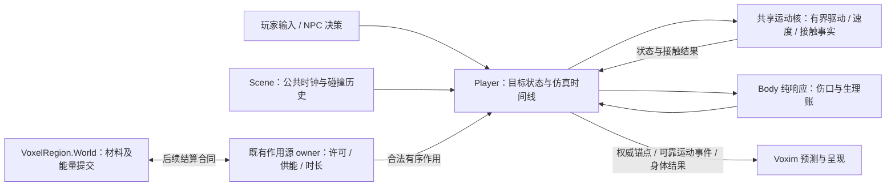
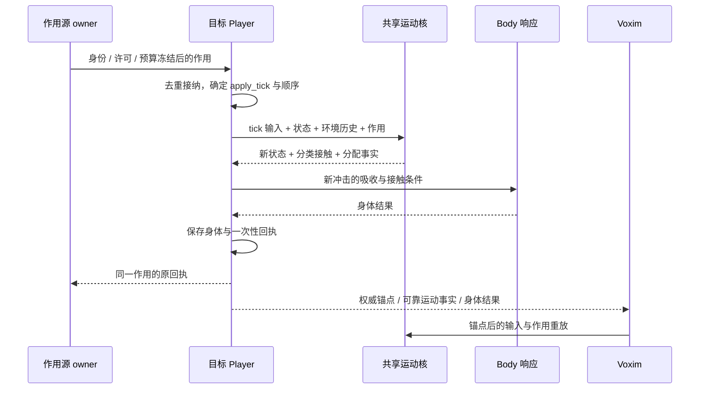
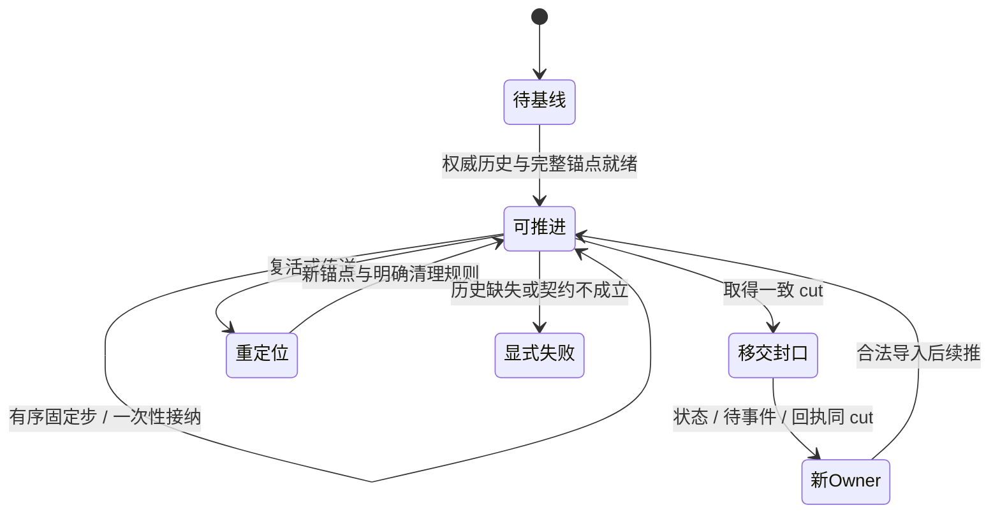

# 动量、接触与角色操作设计

> 状态：**方向已确认；设计文档；尚未实现；参数／协议及本文列明决策未冻结**。日期：2026-11-04。
> 用户确认的方向是「物理因果 + 可控操作」：有质量、单一真实速度、有界驱动、统一接触事实与 Body 后果。
> 方向确认不等于批准本文全部细节、伤害数值、协议布局或后续实现任务；本文供评审与实施规划使用。
> 研究证据见[研究稿](2026-11-04-momentum-contact-research.md)；测试正文只维护于 [Voxim Testing](../../../../Voxim/Docs/Testing.md)。

## 1. 目标、路线与非目标

角色受到重力、推拉、反冲和碰撞后，运动与身体后果应有同一条因果链；玩家仍能通过有限能力走、跳、转向和刹车。
质量影响相同冲量造成的速度变化；伤病影响主动能力，不瞬间抹除外界造成的速度。
运动、接触、身体响应与能量来源分别有唯一 owner，客户端只预测运动与呈现，确认态由服务端给出。

- **纯运动学角色**：直接设置位移／目标速度，复用现有预测最容易；原生不提供完整质量／冲量响应，需要应用补齐外力与接触合同，才能形成一致的权威后果。
- **纯动态刚体角色**：质量、接触约束和双向交换较自然；站立、步阶、姿态、多人共同求解与回放的成本更高。
- **有限驱动力的受控角色（本设计方向）**：输入给期望速度，有限驱动改变真实速度；保留角色操作帮助，同时明确其几何与做功边界。

选择第三条，是对用户目标与既有共享固定步核的取舍，不是宣称当前 KCC 已成为动态刚体求解器。
首个闭环限定 Player 本地跌落与静态接触，先证明运动到身体的因果；可独立验收，不以全套世界物理为前置。
非目标包括完整刚体、角动量、布娃娃、绳索、载具、流体 PDE、全局封闭守恒，以及新增通用技能／效果框架。
水、散体、软垫、冰面和移动平台的力学效果均需自己的模型与历史，不能因已有材料或热系统就宣称具备。

## 2. 当前代码真值与必须改变的合同

证据以当前工作区为准；下列是现状，不是已完成的迁移：

- [共享 movement.rs](../../../../Voxim/Plugins/VoximMovement/Native/src/movement.rs) 的 `Profile` 无惯性质量，`State` 仅有位置、速度和 grounded；固定步只返回 State。
- 同文件 `World.step` 有输入时对全部水平速度硬限速；贴地／撞顶清竖直速度，`move_shape` 回调为空；最终水平速度由位移除以 dt 回推。
- 这些行为必须改合同：不能保留硬裁剪再追加「外力速度」，不能清 vy 后才猜着地冲击，也不能继续丢弃接触事实。
- [online.rs](../../../../Voxim/Plugins/VoximMovement/Native/src/online.rs) 的 `query_bounds` 基于旧状态和旧 Profile 预算；新冲量必须进入同一步查询预算。
- 该文件 `constrain_travel` 在出域时保留旧位置并清速度，是运行域限制；没有物理耗散依据，不得产生撞伤。
- [Player](../../../apps/scene_server/lib/scene_server/movement/player.ex) 在 `advance` 选择输入、碰撞历史与能力倍率；当前能力倍率修改 speed，不是有界驱动力合同。
- Player 已有 `simulation_tick`、Scene 移交 cut、Body 与 `effect_receipts`；[目录说明](../../../apps/scene_server/lib/scene_server/movement/README.md) 记录公共时钟与状态所有权。
- [MmoPrediction](../../../../Voxim/Source/Voxim/Movement/MmoPrediction.cpp) 按权威 simulation_tick 锚点回放；扩展后必须补完整回放闭包，不能仅添加一个冲量消息。
- [Body](../../../apps/scene_server/lib/scene_server/body.ex) 的 `trauma/3` 接受伤口参数，尚无接触到伤口的统一响应；已有工具伤口表不能冒充该曲线。
- [Semblance](../../../apps/voxel_region/lib/voxel_region/magic/semblance.ex) 保存发射初动能，重力改轨迹而未更新该动能账；落地将剩余 kinetic_j 全转热。

## 3. 职责与边界

沿既有公共 API、路由与唯一生产组合根接入；下图是职责关系，不要求新增同名进程或框架。

- Player 在线性化的单目标 tick 上接纳输入／效果、调用运动与 Body、保存结果和回执；不让 Gate 或客户端改运动真值。
- 共享运动核拥有驱动、积分、静态接触与接触分类；同一版本供服务端 NIF 与客户端预测使用。
- Scene 维护可查询的时间线；World 拥有 canonical 材料与材料／热提交，不由运动核直接写世界。
- Body 唯一解释组织吸收后的伤口与生理后果；作用源只交物理量与接触条件，不各自决定伤口。
- 作用源 owner 维护自己的预算、持续时间、取消和失效；Player 不替来源猜测供能或续租。

## 4. 最小合法状态与数据语义

以下是语义集合，**不是 opcode、结构体 ABI、字段顺序或 wire 格式冻结**；实现前列出各语言边界与迁移方式。

1. **运动参数**：明确正惯性质量 m、形状、驱动／制动能力、期望步行速度、重力与操作帮助策略，以及参数版本身份。
2. **运动状态**：完整 XYZ 位置、唯一真实速度 v、仿真 tick、支撑事实；仅在模型确实依赖时保留支撑身份／模式等记忆。
3. **时间线输入**：该步规范化操作、已接纳瞬时作用及确定顺序；持续作用以该步可重放的来源参数与有效区间表达。
4. **环境事实**：该 tick 的碰撞／domain 历史；引入材料响应后，还需对应材质和响应目录身份。
5. **接触结果**：tick、接触身份／点／法线、碰前后速度、相对接近速度、法向／切向作用及其计算来源、接触分类。
6. **目标提交事实**：目标身份与生命代次、作用身份、应用 tick、接纳结果、Body 回执；沿用已有收据 owner。

恒质量平动下 `p = m v`、`J = Δp`、`K = ½m|v|²`。动量和动能从 m、v 派生，不另存可写动量或击退速度真值。
惯性质量的来源待定；不能把 Body 热容量／生理质量自动解释为惯性质量。装备、携物与质量变化暂不纳入恒质量步。
边界接纳时一次校验有限值、正质量、合法身份、时间与预算，构造合法状态；内部核直接消费，不层层复核同一事实。
客户端／NPC 动作入口只交意图；m、J 与供能预算由合法 authority 来源构造，不能接受客户端自行授权的物理量。运维／测试作者入口仍按既有 Access 分类接纳。
输入目标速度只约束驱动意图；真实速度可以暂时高于步行速度。若需安全运动范围，应以显式运行合同处理，不能伪装成摩擦或撞击。

## 5. 固定步顺序与控制

沿用现有 60 Hz 公共时间基准；是否采用子步、具体积分／接触算法及稳定性范围，在实现前用同一核的小例决定。
每步按下列语义推进，服务端与客户端保持同版本、同顺序；不得由 mailbox 到达顺序隐式决定物理顺序。

1. 在目标 tick 选择输入、能力参数、环境历史与已接纳作用；保存接触前可解释的速度，不提前清零。
2. 输入形成支撑面相对期望速度；控制器计算有界驱动／主动制动，不裁剪总速度。
3. 对同一步重力及已建模持续力积分；按确定顺序施加瞬时冲量到同一 v。驱动使用步初状态还是冲量后状态须随算法冻结。
4. 用该步可能达到的速度／位移及操作帮助范围形成完整 XYZ 查询包络，确认历史可用后执行扫掠／接触推进。
5. 求得运动结果，分离物理接触响应与 snap、跨阶、去穿透等几何修正，输出分类接触事实与能量分配依据。
6. Player 接纳该步状态；对合格的新冲击调用 Body 响应并记账一次，然后发布权威运动与身体结果。

`|Δv_drive| ≤ F_max Δt / m` 表达有界驱动；`Δv_external = J / m` 表达瞬时外力。
具体追踪算法、方向分解和支撑切换待定；不能把公式直接当作已冻结的手感控制器。
跳跃是有限冲量／驱动并有供能边界；空中控制受能力约束。伤病与疲劳修改驱动、期望步速或跳跃能力，不乘小全部惯性。

- **主动刹车**：角色决策发力，有方向、能力和预算；松键自动制动是否开启及强度属于操作参数。
- **接触摩擦**：表面切向约束，依赖支撑与法向作用；不能继续把现有转向 friction 参数直接当物理摩擦系数。
- **介质阻力**：相对流速产生的力，由介质模型拥有；水的热交换、液体数量或散体占用均不自动提供阻力／浮力。

三者可同时存在，但必须分别解释其速度变化与耗散，避免一段减速被重复计账。

## 6. 查询域与高速运动

`query_bounds` 必须消费与固定步相同的合法输入／作用预算，覆盖冲量后速度、重力与驱动产生的可能路径，以及胶囊和辅助位移。
不能先按旧速度放行查询，再在核内突然加 J；也不能在 Scene／UE 各复制一份包络公式。
沿用共享核作为包络 owner，并在查询前构造本步不可变的推进输入；具体函数签名与 ABI 待定。
包络、已授权 domain 与实际扫掠都使用完整 XYZ，包括高速竖直坠落和跨 tile 的 Y 方向；不退回 XZ column 或固定 Y 带。
高速会增加覆盖与历史需求，先确定真实预算，再确定合法范围／显式失败语义；不无界扩大查询、并发或临时连接。
缺失历史、越域和 query 不可用均输出可诊断原因；域限制与暂停／拒绝不生成接触伤或虚构耗散。

## 7. 接触、跌落与伤口响应

法线 n 从表面指向角色时，非转动简化的接近速度为 `u_n = max(0, -(v_a - v_b)·n)`。
首期静态表面 `v_b = 0`；动态平台接触点速度包含平移和旋转，须等其模型存在才可使用。
孤立法向碰撞可用有效质量与恢复系数估计冲击；多点接触、力臂、惯性张量未进入前，不宣称完整刚体求解。
继续用 KCC 时输出必须标记「有效冲击估计」及假设，不能称为真实 solver impulse；净 `mΔv` 也不能全归给一个撞点。

接触至少区分新冲击、持续支撑、滑动与非物理几何修正；碰撞回调是事实输入，不能靠最终位置差重建全部接触。
静止支撑的 `mgΔt` 不是每帧新 hit；跨阶、snap、去穿透、出生、传送和域硬停不得生成假伤。
跌落以接触前相对速度、表面和停止过程判断；高度只说明重力做功的路径，不能直接映射固定扣血。
Body 接收有效吸收能、接触部位／形态及已建模缓冲条件，统一产生伤口；当前 `trauma/3` 只可承接最终表示。
相同 J 不唯一决定伤口；停止时间／距离、接触面积、姿态与组织响应均可能改变后果。
响应曲线应复用[作用分层设计](../../../../Voxim/Docs/Combat-Action-Design.md) §1.1 的唯一身体响应 owner，不新增跌落专用 HP。
所选简化模型、标定样本与阈值需要一手依据和产品决定；本文不发明医学阈值或质量、伤害、摩擦数值。
首闭环可以采用显式固定接触模型；软垫／屈膝／斜擦的差异必须等对应模型成立后分别验收。

## 8. 能量分配与做功边界

一次接触只有一份分配：解释残余源能、目标动能变化、组织／材料变形耗散、热和其他已建模输出。
伤口是吸收能的响应，不再把伤害数值加作另一笔耗能；接触能量不得分别被热、击退和伤口各消费一次。
恒质量总冲量 J 对已有速度 v 的动能变化是 `ΔK = v·J + |J|²/(2m)`；逆向冲量可能降低动能。
多个作用按冻结顺序计算各自账，不能全部用步初 v 独立算再相加，漏掉交叉项。
跨 owner 弹体接入时，必须替换 Semblance 对应的「剩余初动能全转热」分配，不能在其上叠加机械输出。
同时决定重力功与弹体实时机械能的表达；当前简化 kinetic_j 账不得被写成已闭合的真实重力动能账。

- 角色升高的 `mgh` 与重力功对应；首期可把静态地面当模型外部动量库，但不得宣称整个世界封闭守恒。
- 持续悬停的维持损耗、源自身损耗与升高做功分账；零位移不代表供能合同免费。
- 跳跃／跳板输出必须有角色驱动、储能或供能源；不得无源设置速度。
- 台阶辅助抬升明确为操作帮助，并列出做功处理与简化范围；几何排除伤害不等于允许凭空增加物理能量。
- 双向刚体需反作用和共同求解；偏心冲量的 `ΔL = r×J`、转动与约束均属后续边界。

## 9. 联网、回放与目标线性化

可靠到达不等于跨流仿真有序；运动事实需应用 tick、确定序号与目标身份，不能以本机收包时刻生效。
**命令幂等与轨迹回放分开**：同一作用只接纳／扣伤一次；同一冲量可在多个校正回放中再次参与轨迹计算，不能再调用 Body 入账。
若作用允许排队，已接纳待 apply 只是待应用状态，不是已完成的 Body 原收据；同身份只对应一个自然事件，应用后才产生完成结果。轨迹重放不改变接纳记录。
ACK 输入前缀不代表相同 tick 的全部外力已可退休；事件、输入和历史基于共同已确认锚点管理保留窗口。
权威锚点必须形成完整状态闭包：v、质量／驱动参数身份、支撑记忆、作用前缀与待事件，以及重放所需碰撞／响应历史。
若模型引入持续源、接触记忆或辅助状态，也必须进入闭包；不能藏在客户端临时缓存或另一个 owner 的当前状态中。
重放时不能向当前 World 查询材质补历史；旧事件退休与历史退休使用同一可回放范围。
迟到／超窗事件的拒绝、重锚或其他策略及明确错误待协议决定，禁止静默丢弃；本文不擅定 Hello 版本或可靠通道消息布局。
保留 G0 历史冻结样本及其原合同；新版本不得静默改写这些样本。现行 Profile 由 Session 承载，若质量／驱动状态需要扩展 SessionStart／InputStart，同样纳入 Session 与两端 codec、版本协商及 fixture 的显式决策。
保留旧样本不等于禁止新增版本，也不能为维持旧布局隐瞒回放所需状态；Movement／新增效果、NIF ABI 与 UE 适配一并决定，本文不指定版本号。

Player 内可线性化一个目标的运动和身体结果，**不等于**与 World 弹体／热账或源扣能跨 owner 原子提交。
跨 owner 前必须明确预算冻结、幂等接纳、确认丢失／拒绝、目标迁移与最终能量去向；不以「可靠消息」替代结算合同。
现有 World 投射物冻结目标 id／identity／life 与交付焦耳后，路由只寻找同 cid 的当前 owner，并携带原目标身份；不得改绑到当前新会话或新生命。
首个本地跌落闭环不依赖此分布式结算；单目标外力先证明目标语义，弹体统一能量接线随后独立推进。

## 10. 生命周期、移交与恢复

移交复用 Player 已有字段清单 SSOT；受控移交保持同一目标生命，同一 cut 携带完整运动闭包、待应用事件与幂等回执，旧 owner 封口后不能再结算。
待应用事件始终绑定原目标生命；复活终结旧生命尚未应用的事件，不能因先前接纳就带入新生命。终结记录是稳定的未应用结果，不伪造已造成身体损伤的 Body 收据。
旧事件重投返回其稳定终态，不改变新生命速度或身体；复活也拒绝旧生命的新作用。已应用的回执仍返回原结果，不因复活清空而重复入账。
沿现行 `receive_effect` 次序先查回执；已入账重复即使跨复活／移交也返回原收据，只有未接纳的新作用才检查目标身份与生命。
传送不自动等于换生命；速度、支撑、持续源与待事件如何保留／清除，需按传送类型显式决定，并发布对应新锚点。
连接 epoch、目标生命代次与 Scene owner 迁移是不同边界；角色来源死亡不等于目标换生命，不能套用目标复活取消规则来自动取消已释放对象或回滚已授权作用，沿既有释放语义另定持续源终止条件。
出生与重定位本身不生成撞击；重定位后实际发生的新接触仍按正常核处理。
现状只有 Body／收据持久化，运动状态不持久化；本设计不承诺进程崩溃后动量连续，Body 存档不能替代运动恢复协议。
收据退休须与幂等和历史范围共同设计；沿用当前累计表不代表已经解决长期增长，本次不新造泛用日志系统。

## 11. 材料历史与归因边界

[CollisionSource](../../../apps/voxel_region/lib/voxel_region/collision_source.ex) 只把材质投影为 occupancy；
[MmoCollisionHistory](../../../../Voxim/Source/Voxim/Movement/MmoCollisionHistory.h) 保存 occupancy／domain，
[blocking_hash](../../../apps/mmo_contracts/lib/mmo_contracts/voxel_material_catalog.ex) 只摘要 ID／blocks／supports。
同阻挡换料可能使提交 N 改变而 R 不变，当前历史不能恢复该 tick 的摩擦或顺应性。
材料响应接入前，明确 CV／N／R、目录 digest 与 tick 的历史关联；是否扩展 R 含义须专门决策，不能悄改 occupancy 契约或另造无 owner 的版本号。
固定统一模型可先行；材料依赖玩法只在相应历史、目录和回放闭包具备后开放。

物理作用与许可分开，沿用 [Combat-Action-Design §1.1、§5.3](../../../../Voxim/Docs/Combat-Action-Design.md) 的已定归因边界。
环境接触不套角色战斗范围；可归因于角色的直接作用与已有持续源进入唯一许可 owner Harm。
只保留实际需要的直接来源／Action 身份与既有持续源，不为推落另建来源图或默认永久追责。
击杀奖励只认明确直接效果／已有持续源，无法可靠归属的连锁记环境；该奖励策略**不能决定是否受保护**，不能洗掉来源来绕过保护许可。
推人后的延迟接触、同 holder 内作用、拆支撑及跨保护边界仍需明确规则；城区是否屏蔽环境事故也未冻结，不在本文擅改 PvP、犯罪或收益政策。
驾驶者下车后载具作用按既有决定算环境，不能因新动量系统重新追溯驾驶者。

## 12. 系统互动与玩家／NPC 共用

- Body 伤病 → 驱动能力下降 → 跛行与更难刹车；保持惯性，避免「受伤即消除被推速度」。
- 技能／魔法 → 有预算 J → 推拉、反冲及二次撞墙；需要作用 producer、许可和目标回放合同。
- 材料 → 历史一致的接触参数 → 冰面滑行／软垫缓冲；目录与历史缺失前不承诺。
- 风场／悬浮 → 有效区间内持续力 → 移动与维持耗能；源 owner 维护取消、时长和供能，不能一次注册后无人续管。
- 水／散体 → 新增阻力、浮力或顺应性 → 减速与漂浮；不把热接触或 occupancy 当成现成水动力。
- 爆炸 → 有预算、距离和遮挡的径向冲量 → 多目标推离；首版可不做气体 PDE，但多目标总预算另需明确。
- 平台／落石／载具／绳索 → 动态源与共同求解／约束 → 双向交互；属于后阶段，不是单目标公式自动支持。

玩家与 NPC 共用运动核、作用入口和目标 owner 语义；NPC 决策只产生输入／合法作用并消费权威结果，不复制 NPC 专用击退真值。
系统间只传稳定的物理事实和合法结果，批次／队列只决定运输与时序，不增设第二份正确性协议。

## 13. 分阶段交付、观测与验收设计

以下是候选交付切片，尚未开始实施；依赖按能力设定，能独立验收的切片不等待无关系统齐备。

1. **Player 本地跌落／静态接触闭环**：先定接触估计与 Body 响应标定，改共享核的速度／接触合同，接入唯一生产根与正常走跳入口。
   本片引入的质量／驱动参数身份、支撑及接触记忆当片进入权威锚点与预测回放闭包，不能把基础预测一致性后置到外力片。
   证明输入不裁剪高速、质量影响响应、着地因果和静止／几何修正零假伤；不需要先做弹体、材料差异或双向刚体。
2. **单目标外力与回放**：在前项完整状态／预测合同上加入合法作用、apply_tick、幂等接纳及外力事件前缀／待事件，覆盖迟到／重复／ACK／移交。
   首个有真实来源的玩家场景尽早接通，不等待全套后续报告；跨 owner 源预算边界必须明确后才声称闭账。
3. **跨 owner 弹体统一能量**：冻结源／目标结算合同，替换 Semblance 对应分配，验证热、残余能、目标动能和耗散不重叠。
4. **表面响应历史／持续力**：各自依赖材料历史闭包或源生命周期；二者可独立推进，不互设虚假前置。
5. **真正双向刚体**：另定共同求解 owner、反作用、角运动与重放域，再讨论平台、载具、落石和约束。

实现前先补只读观测：目标／生命代次、simulation_tick、apply_tick、作用身份／来源、碰前后 v、m、驱动／重力／J、接触分类与算法来源、历史身份、能量分配、Body 回执与拒绝原因。
观测派生自 owner 的结果；不为验收增加生产扫描或备用真值。原始产物进入独立 `.demo/observe/<run>/`，保留源码、构建、协议及参数身份。
验收遵守共同测试规则，以契约选最小充分层次：

- **算法／协议**：手算 J/m、已有速度的 ΔK、有限驱动、接近速度与零假伤；确定输入和无网络依赖，避免复制算法当期望。
- **真实模块接缝**：正常 Player 入口形成合法状态；验证接触到 Body 一次入账、重复／迟到作用、ACK 回放、移交与复活旧代拒绝。
- **复活待事件反例**：接纳目标生命 L 的事件 → 复活为 L+1 → 到达旧 apply_tick／重复重投；新生命无 Δv／Body 损伤，旧事件保持稳定未应用终态。另证已完成回执跨复活仍返回原结果，以及同生命移交保持 pending 连续。
- **最短真实客户端**：真实用户走跳／跌落入口、自动化触发同一路径、CLI／日志核对同一角色与接触；涉及他人复制时使用真实双客户端。
- **扩展切片**：材料换料 N 变 R 不变的历史反例、持续源取消／耗能、弹体拒绝／确认丢失的结算反例，分别随对应能力加入。

具体命令随实施入口和测试范围确定，不凭空声明现有 runner 已支持新功能；纯文档阶段只做编码、链接与差异检查。
服务端执行仅在 Linux／WSL；后续网络场景先列并发、次数、总时长及清理方式，记录 UDP 基线，只清理本次资源。

## 14. 风险、开放决定与依据

待冻结：惯性质量来源；驱动／刹车／跳跃产品目标；接触估计算法与 Body 曲线标定；辅助抬升做功；完整状态闭包与协议版本；迟到／超窗规则；跨 owner 结算；材料响应历史；传送／崩溃恢复；双向求解域。
主要风险是 KCC 估计精度、操作手感与耗散的取舍、高速包络成本、历史／回执增长，以及网络校正引起的假伤；这些风险分别由对应 owner 与切片证据回答。
不得通过硬限总速度、重复扣伤、查当前材质、吞错或第二条生产路径掩盖风险。当前没有实现、实跑或验收结论。

一手依据与适用取舍（详细检索记录见研究稿）：

- [OpenStax 冲量与碰撞](https://openstax.org/books/university-physics-volume-1/pages/9-2-impulse-and-collisions)：用于量纲、动量变化及停止过程，不能给出组织损伤阈值。
- [Box2D 接触事件](https://box2d.org/documentation/group__events.html) 与 [Catto Sequential Impulses](https://box2d.org/files/ErinCatto_SequentialImpulses_GDC2006.pdf)：借鉴 hit／支撑区分和接触约束；二维接口不直接作为本项目三维实现或完整守恒保证。
- [PhysX Character Controllers](https://nvidia-omniverse.github.io/PhysX/physx/5.3.0/docs/CharacterControllers.html)：说明角色操作与运动学／动态响应边界，支持保留受控角色，但不能把查询结果冒称 solver impulse。
- [Jolt CharacterVirtual](https://raw.githubusercontent.com/jrouwe/JoltPhysics/master/Jolt/Physics/Character/CharacterVirtual.h)：质量、推力与接触可显式组合；其最大推力并非本项目输入驱动算法，不采用默认参数。
- [Epic ChaosWalkingMode](https://dev.epicgames.com/documentation/en-us/unreal-engine/python-api/class/ChaosWalkingMode?application_version=5.6)：借鉴显式支撑／反作用语义，不转移服务端 authority 到 UE，也不引入第二套运动根。
- [Unity Character Controller 限制](https://docs.unity3d.com/Packages/com.unity.charactercontroller@1.3/manual/limitations.html) 与[移动平台](https://docs.unity3d.com/Packages/com.unity.charactercontroller@1.3/manual/moving-platforms.html)：用于动态交互和相对运动边界，不据此宣称现有静态碰撞已支持平台。
