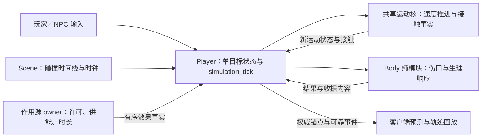

# 动量、接触与角色操作研究证据与候选方案，未实施

> 状态：研究证据保留稿，未实施。记录日期：2026-11-04。
> 用户偏好：以物理因果为基础，保留可控角色操作。
> 方向确认：用户已同意「有限驱动力的受控角色」研究思路，并要求编写正式设计。
> 唯一当前设计入口：[动量、接触与角色操作设计](2026-11-04-momentum-contact-design.md)。当前范围、决策、待定项与验收以该稿为准。
> 本文保留研究时的证据、候选语义和待定边界；正文中「建议」「尚未批准／冻结」等措辞描述研究时状态，不表示当前方向仍待确认，也不代表候选玩法已实施。

## 1. 研究结论与三条路线

建议继续研究「有限驱动力的受控角色」：保留角色控制与台阶处理，让驱动、重力、外力和接触共同改变一份真实速度。
这可以使跌落、受击、撞墙和二次碰撞有一致因果，同时让玩家通过有限驱动改变运动。
这是一项建议，尚未获得实现批准，也不代表现有 KCC 已经具备刚体冲量求解能力。

- **纯运动学角色**：位移／目标速度直接控制，容易保持手感和复用当前预测；但外力若仍被总限速覆盖，物理因果只能是附加特效。
- **纯动态刚体角色**：由力、接触约束和质量推进，双向交换较自然；但步阶、站立、姿态、预测与多角色共同求解的代价大，操作设计也不能省略。
- **有限驱动力的受控角色**：输入追逐目标速度但受力预算限制，外部冲量保留在同一速度；与当前共享内核较接近，但接触输出、耗散和未来双向交互必须明确建模。

选择第三条作当前建议，是对既有固定步、共享预测内核及用户偏好的综合判断；不是从某个引擎 API 直接推导的规格。
借鉴下列实践的语义，不更换引擎，也不引入第二套生产运动根。

## 2. 当前实现证据与缺口

共享内核位于 [movement.rs](../../../../Voxim/Plugins/VoximMovement/Native/src/movement.rs)：

- 第 139–150 行处理水平驱动、制动与转向；有输入时，对**全部水平速度**按输入目标速度做硬限速。
- 第 153 行贴地时设置竖直速度，第 210 行落地／撞顶时清零竖直速度；这些操作没有输出接触冲量。
- 第 176 行 `move_shape` 的碰撞回调为空，接触事实没有被保留下来。
- 第 211 行水平速度由最终位移除以 `dt` 回推；它混合了运动推进与几何修正，不能直接当作完整接触账。

[online.rs](../../../../Voxim/Plugins/VoximMovement/Native/src/online.rs) 第 78 行起的 `constrain_travel` 在越过活动范围时保留旧位置、将速度归零。
这是域边界硬停，当前没有物理耗散含义，不能据此产生撞击伤。

[运动目录说明](../../../apps/scene_server/lib/scene_server/movement/README.md) 与
[Player](../../../apps/scene_server/lib/scene_server/movement/player.ex) 表明：Scene 提供碰撞时间线与公共 60 Hz 时钟，Player 持有角色运动、Body 与效果回执。
[MmoPrediction](../../../../Voxim/Source/Voxim/Movement/MmoPrediction.cpp) 以权威 `simulation_tick` 锚点回放，而非仅按输入 ACK 推断状态。
当前运动 State／Profile 与固定步返回值没有惯性质量、冲量及接触结果契约；已有速度字段不等于已有动量系统。

[Body](../../../apps/scene_server/lib/scene_server/body.ex) 的 `trauma/3` 接受给定部位与伤口参数，尚无「冲量／吸收能量 → 伤口」曲线。
[Harm](../../../apps/scene_server/lib/scene_server/movement/harm.ex) 是当前角色来源作用的战斗范围许可判断，不负责物理计算。

## 3. 运动语义建议：一份速度，有限控制

恒质量平动下，`p = m v`，`J = Δp`，`K = ½ m |v|²`。
建议只把速度 `v` 作为运动真值；动量可由质量与速度推导，不另存一份可写动量。
惯性质量应来自明确的 motion profile／catalog；不能擅自把 Body 的热／生理质量认定为已批准的惯性质量。
质量变化、携物和装备是否改变惯性，应另定规则，不能暗中套用恒质量公式。

输入表达期望的**支撑面相对速度**，控制器以有界驱动力追逐它。
单步驱动速度改变量满足 `|Δv_drive| ≤ F_max Δt / m`；目标速度限制驱动意图，不裁剪全部真实速度。
外部冲量则以 `Δv_external = J / m` 加到同一份速度；已有高速不能因玩家按下方向键而被统一硬限速吞掉。
这是受控运动建议；驱动力参数、空气控制和跳跃供能尚未确定。

三类减速须分别解释并观察：

- 摩擦来自接触切向约束，与支撑、材料和法向作用有关。
- 主动刹车来自角色有意施力，受角色能力与驱动预算约束。
- 介质阻力来自空气、水等相对流动，由介质模型拥有。

伤病／疲劳减速建议影响驱动力、期望步行速度或跳跃能力，不直接乘小全部惯性速度。
不能让腿伤瞬间消除坠落、被推或载具携带产生的动量。
地面静止是支撑约束的结果；台阶辅助和 snap 是操作模型的几何帮助，必须与物理接触响应分开记录。

## 4. 接触事实与冲击估计

建议固定步输出可诊断的接触事实，而不是只返回位置：

- `simulation_tick`、接触点、法线、接触双方／表面身份与来源标识。
- 碰前／碰后速度、接触点相对接近速度、本步法向／切向冲量及其计算来源。
- 接触分类：新撞击、持续支撑、滑动，或非物理几何修正。

法线 `n` 从表面指向角色时，非转动简化的接近速度为 `u_n = max(0, -(v_a - v_b) · n)`。
忽略旋转、偏心接触和多点耦合时，`m_eff = 1 / (1/m_a + 1/m_b)`；静态表面取 `1/m_b = 0`。
在孤立法向碰撞、给定恢复系数 `e` 的简化下，冲量量级可写为 `(1 + e) m_eff u_n`。
这只是简化模型；动态刚体一般还需惯性张量和接触点力臂，不能直接推广为完整求解公式。

如果仍用 KCC 碰前速度与扫掠结果估算，应标为**有效冲击估计**，不能冒称刚体求解器产生的真实 impulse。
单步净 `m Δv` 还可能包含驱动、重力和多个接触，不能全部归到一个撞点。
台阶抬升、snap、去穿透、出生／传送、域边界硬停均不能被位移反推为撞击。
静止支撑每步约有 `mg Δt` 的作用，但它不能被当作每帧新撞击反复造成伤害。
接触响应依赖材质时，必须取与该物理 tick 一致的材质／响应版本，不能用当前 World 状态覆盖回放历史。
[CollisionSource](../../../apps/voxel_region/lib/voxel_region/collision_source.ex) 第 12–18、100–125、133–150 行把材质投影为 occupancy；
[MmoCollisionHistory](../../../../Voxim/Source/Voxim/Movement/MmoCollisionHistory.h) 第 30–37 行的历史只保存 occupancy／domain。
因此同阻挡换料可能令提交序号 N 改变、碰撞修订 R 不变；现有历史不能据此还原当时表面材质。
[目录 blocking_hash](../../../apps/mmo_contracts/lib/mmo_contracts/voxel_material_catalog.ex) 只摘要 ID／blocks／supports，不含摩擦、缓冲等表面响应。
现有 CV／N／R 与属性目录 digest 可以沿用，但还缺 N／tick 对应的历史材质及响应参数。
不能随意另造表面版本或回放时查当前 World；是否扩展 R 语义须另行决策，不能悄悄改变既有 occupancy 契约。
第一轮可研究固定统一接触模型；冰面摩擦、软垫和相变引起的响应变化，须在相应历史与目录契约具备后接入。

## 5. 损伤是接触的响应，不等于冲量

`J` 决定动量变化，不单独决定伤口；相同冲量可以对应不同的停止过程和组织负担。
伤口模型还需要吸收能量、停止时间／距离、接触面积、部位、姿态与主动缓冲等条件。
本研究不发明医学阈值，不给出线性 HP 扣除式；需产品选定简化程度，再查证所采用的响应模型。

建议由运动／接触层给出事实与能量分配，Body 纯模块负责伤口和生理最终账。
Player 作为目标 owner 接纳一次结果并留下收据；客户端回放轨迹不能再次写 Body。
现有 `trauma/3` 可以承接最终伤口表示，但它自身不能证明冲击映射具有物理依据。

跌落应看**着地前相对速度、表面和缓冲条件**；高度只是重力改变速度的路径信息。
软垫、斜擦、抓住边缘和主动屈膝可能改变停止过程；同高度不能直接固定扣 HP。
在相关表面／缓冲模型尚未建立前，不能把这些差异宣称为已有玩法。

## 6. 能量闭账与现有弹体边界

[Semblance](../../../apps/voxel_region/lib/voxel_region/magic/semblance.ex) 当前用 `kinetic_j = ½ m |v₀|²` 记录发射动能。
重力改变轨迹但没有把位能变化加入这笔动能账；落地时全部剩余 `kinetic_j` 转为热。
因此现状是一种明确的简化账，不是完整重力机械能模拟。

新增机械伤害／击退时，必须用**一次统一接触分配**替换对应的原有分配。
不能保持「原先全部动能转热」不变，再凭空增加目标动能和机械吸收能。
机械损伤是耗散的响应代理；若已计入组织吸收，不再把“伤害值”作为另一笔能源累加。
接触预算应分别解释剩余弹体能、目标动能变化、变形／损伤耗散、热及其他已建模输出。

恒质量且施加总冲量 `J` 时，`ΔK = v · J + |J|² / (2m)`，其中 `v` 为施加前速度。
不能只用 `|J|²/(2m)` 给已有速度的目标记击退能，也不能把逆向冲量总当成正能量输入。
抬高角色的 `mgh`、持续悬停／控制的维持代价、场源自身损耗应分账；悬停无位移不等于供能契约免费。

静态地面可视作当前模型外部动量库：角色动量变化可以被地面接收，但不宣称封闭系统全局守恒。
动态平台／刚体必须接收相反作用，并进入共同求解与能量账后，才可声明相应双向守恒。
重力功须与位能变化对应；跳板输出应有储能／供能与支撑反作用来源，不能把速度设置当免费机械能。
台阶辅助抬升也有做功边界：若作为操作帮助，须显式声明其简化与能量处理，不伪装成无源物理上升。
首期只研究线性动量；偏心接触的 `ΔL = r × J`、旋转、铰链、绳索和结构刚体属于后续，不能仅加质量字段就声称具备。

## 7. 时间、所有权与可回放事件

下图是候选职责边界，不是新增模块清单；稳定公共 API 仍由现有路由组织。

建议由 Player 在单目标 `simulation_tick` 上线性化运动效果与对应伤害。
这不等于 Player 与 World 弹体／热账、作用源扣能之间的跨 owner 原子提交；跨 owner 预算冻结、目标幂等接纳、确认丢失与拒绝时的能量去向，仍须另定结算契约。
可优先用 Player 本地环境跌落／静态接触验证运动与损伤因果，跨 owner 弹体接线在相应结算契约明确后再验证。
**命令幂等与轨迹回放必须分开**：一条作用只提交／扣伤一次，但同一运动事件可因校正而重放多次。
可靠事件携 `apply_tick`，在目标时间线上确定顺序；可靠到达本身不保证跨消息流的仿真顺序。
ACK 前后事件的保留／退休应依据同一已确认前缀；不能 ACK 后立即删掉仍为回放锚点所需的外力事实。
迟到事件怎样落到可回放窗口、超窗怎样显式失败，需要随协议决策确定，不能静默丢失。

跨 Scene 移交必须在同一个 cut 携带运动状态、待应用事件与幂等收据，避免旧 owner 重放或新 owner 漏算。
复活／传送时哪些速度、支撑关系和待事件清除，必须明确定义；旧 life generation 的作用应被拒绝。
当前运动状态不持久化，本文不承诺跨进程崩溃的动量连续性；Body 持久化不能替代运动恢复契约。
双方角色／动态刚体守恒接触需要共同求解／重放域，是后阶段架构决策；不能让两个 Player 各算一次便声称守恒。

## 8. 许可、归因与交互边界

本节「来源链追责」仅保留为研究候选；正式设计继承既定归因政策并替代该候选，具体边界以[正式设计](2026-11-04-momentum-contact-design.md)为准。

环境跌落／撞墙不能直接套当前 Harm 的「所有角色来源离散作用」战斗范围门禁，否则无战斗范围就可能无事故。
但可归因于他人推力的坠落也不能洗成环境事故，绕过本来应有的许可。
建议保留直接作用来源、授权结果和后续接触所需的来源链；混合来源、时间窗和非 PvP 间接伤害规则仍是产品问题。
不为这一研究预建泛用事件图；也不把物理守恒与伤害许可混成同一判断。

候选玩法应按所需能力分层，而不是承诺接上一条冲量消息便全部可用：

- **优先研究**：跌落／撞墙、受击推拉、跳板／反冲及连锁二次碰撞，复用同一速度与接触入口。
- **持续作用**：风场、持续推力和悬浮，必须有源 owner 拥有时长、取消、供能与失效语义。
- **介质缓冲**：水和散体需要新增阻力／浮力／接触顺应性；现有热交换不能证明这些力学能力存在。
- **双向与约束**：平台、载具、绳索、落石和坍塌，需要对应运动源、刚体／约束；首期单目标线性运动不覆盖它们。
- **爆炸第一片**：可以先研究有能量预算、距离与遮挡约束的径向冲量源，不必先做气体 PDE；真实压力传播另列后阶段。

具体系统怎样形成玩法，可沿以下短链讨论；「可复用」指已有 owner／入口，新增机制仍未实施：

- **Body → 接触响应形成伤口 → 摔伤／撞伤**：可复用伤口和生理账，需新增有依据的接触到伤口映射。
- **伤病 → 降低主动驱动能力 → 带伤跛行／更难刹车**：可复用能力派生，需改为驱动约束，不能削掉全部惯性。
- **技能／魔法 → 有预算的瞬时冲量 → 推拉／反冲／二次撞墙**：可复用意图与许可入口，需新增运动效果 producer 和统一能量分配。
- **材料 → 历史一致的摩擦／顺应性 → 冰面滑行／软垫缓冲**：现有阻挡目录可复用，表面参数及其历史尚缺。
- **NPC → 同一驱动和外力入口 → 被推后调整站位**：可复用角色 owner／动作入口，需让决策消费真实运动结果。
- **网络／权限 → tick 事件、收据与来源许可 → 双端一致的合法推人**：可复用可靠通道和目标收据，需补运动事件回放契约及间接伤规则。
- **介质 → 相对流速下阻力／浮力 → 入水减速／漂浮**：需新增力学 producer，不能把已有热接触当水动力。
- **动态物体 → 双向接触与共同求解 → 平台携带／落石撞人**：需新增相应运动源与求解域，不是现有静态 occupancy 的自然附赠。
- **机械能转换 → 明确输入输出与损耗 → 弹簧跳板／未来机构储能**：可复用账本思路，需新增转换 producer；每次输出都有能量来源。

玩家与 NPC 应共用作用入口及目标 owner 语义，不复制一套 NPC 专用击退真值。
平台的接触点相对速度包含其平移与旋转；这属于后阶段模型，不能用世界空间角色速度冒充。

## 9. 最小验证矩阵（设计，未运行）

遵守 [共同测试规则](../../../../Voxim/Docs/Testing.md)，按契约选择必要层次，不把矩阵当成本次已执行项。

- **纯运动核**：正常走跳回归；相同 `J` 不同 `m` 得到相应 `Δv`；已有高速不被输入限速抹掉。
- **接触／响应**：软硬着地、斜擦分别验证法向接近速度与缓冲；静止站立、snap、台阶和传送产生零假伤。
- **后阶段平台**：按平台接触点速度验证相对撞击；未引入平台模型前明确排除，不伪装覆盖。
- **真实 Player 接缝**：重复／迟到事件、ACK 校正回放不双重扣伤；移交保持待事件和收据，复活拒绝旧代事件。
- **能量**：弹体接触统一分配，热、击退动能和耗散闭账；原热转化不能与新增机械输出重复入账。
- **玩家链路**：经真实用户入口操作，自动化触发同一路径；涉及他人复制时用真实双端，核对同一作用身份。

建议只读 CLI／结构化日志能看到：来源／目标与 life generation、`apply_tick`、碰前后 `v`、`J`、接触分类／表面、能量分配、Body 收据。
原始证据落独立 `.demo/observe/` 运行目录，记录源码／协议版本；具体运行命令待获批实现选定入口后确定。
本次只做文档链接、编码和差异检查；没有启动服务、运行测试或建立 UDP 连接探针。

## 10. 一手依据与适用取舍

- [OpenStax：Impulse and Collisions](https://openstax.org/books/university-physics-volume-1/pages/9-2-impulse-and-collisions)：支持冲量、动量变化及停止时间的关系；用于量纲与因果，不作为组织损伤阈值来源。
- [Box2D 事件](https://box2d.org/documentation/group__events.html)：区分接触开始、持续接触和具有接近速度的 hit；借鉴事件语义，不能把二维 API 当作本项目三维冲量接口。
- [Catto：Sequential Impulses](https://box2d.org/files/ErinCatto_SequentialImpulses_GDC2006.pdf)：接触约束、摩擦与冲量迭代说明支撑不等于新撞击；本项目尚无共同动态求解域，不照搬其完整守恒结论。
- [PhysX Character Controllers](https://nvidia-omniverse.github.io/PhysX/physx/5.3.0/docs/CharacterControllers.html)：明确运动学／动态控制差异及游戏角色的特殊要求；支持保留操作模型，但 KCC 查询不能冒充刚体响应。
- [Jolt CharacterVirtual 声明](https://raw.githubusercontent.com/jrouwe/JoltPhysics/master/Jolt/Physics/Character/CharacterVirtual.h)／[实现](https://raw.githubusercontent.com/jrouwe/JoltPhysics/master/Jolt/Physics/Character/CharacterVirtual.cpp)：显式质量、最大推力和接触处理展示可控角色与有限物理作用可组合；其最大推力语义不等于已给出本项目的输入驱动算法，也不采用其默认数值。
- [Epic ChaosWalkingMode](https://dev.epicgames.com/documentation/en-us/unreal-engine/python-api/class/ChaosWalkingMode?application_version=5.6)：地面反作用和支撑调节可显式建模；仅作语义参考，不改用 UE 客户端物理作 authority，不推荐已弃用的旧 PhysicsDrivenWalkingMode。
- [Unity Character Controller 限制](https://docs.unity3d.com/Packages/com.unity.charactercontroller@1.3/manual/limitations.html)／[移动平台](https://docs.unity3d.com/Packages/com.unity.charactercontroller@1.3/manual/moving-platforms.html)：控制器的动态交互存在限制，平台需可追踪运动；借鉴边界与相对运动，不直接移植 Unity 组件或承诺现有平台支持。

## 11. 尚待决定

1. 惯性质量的 catalog 来源，以及驱动、刹车、空气控制和跳跃参数的产品目标。
2. 接触缓冲／部位／面积怎样形成伤口响应，哪些简化需要进一步证据，哪些暂不建模。
3. 非 PvP 推人、混合来源及延迟坠落的间接伤许可与归因规则。
4. 双向动态接触的共同物理 owner／重放域，及何时进入下一阶段讨论。

本节保留研究时的待定清单；当前决定及其冻结状态统一见[正式设计](2026-11-04-momentum-contact-design.md)。
研究方向已由用户确认；本文不再承担当前设计入口，也不声明任何运行时能力已实现、实跑或验收。
