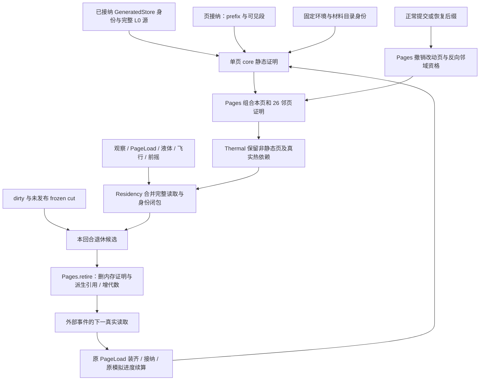

# 静态 L0 页保守退休设计

## 0. 状态、目标与阅读口径

**用户于 2026-10-30 批准，实施中，尚未验收。** 范围仅 L0，具体选择见 §11。本次允许本地实现、测试与受限 Linux 镜像成对回放；禁止 commit、push、部署或触碰生产，禁止桌面模拟键鼠输入。

目标：在当前固定均匀热环境下，回收已证明无天然热／液体活动且无当前读取需求的原生 L0 页内存；玩家返回、外部活动接近时，经原装页与模拟链恢复。**不改变 canonical truth、物理边界、模型时间、生成字节或持久格式。** 不能以“空活动集”“未编辑”“可以重新生成”三者之一单独授权退休。

约束与上位决定：

- [AGENTS.md](../../../../AGENTS.md)、[文档地图](../../../README.md)、[系统正交纲领](../../../30-reference/overview/2026-06-27-架构设计指导思想-系统正交.md)、[共用测试规则](../../../../../Voxim/Docs/Testing.md)。按活跃阶段目录放置，使用日期命名、状态、目标／范围／决策／反例／验收／进度；不把提案写入 current-truth 充当现状。
- [execution-plan.md 页首及 CW1/CW3/P1](execution-plan.md)：S0 已收口，天然初始化转交 Weather；当前 GeneratedStore 阻退保留。本稿若获批，仅以证明成立的 L0 子集替代该全局阻退，其他未知页仍保留。
- [continuous-world-decision.md §5.2–5.5](continuous-world-decision.md)：无玩家也持续演化；装页等待不丢模型时间；天然初态、首 cut、旧背景能量迁移后移。[Weather](../../../../../Voxim/Docs/Weather.md) 的 P2/P3 仍待细化。该文有两个 §5.5，本稿涉及的是“天然雪与权威气候”，同时遵守后一个“实际交互闭包与分区”的限制。
- [M2a](m2a-page-store.md)、[M2b](m2b-on-demand-pages.md) 的持久发布、完整身份、接纳代数合同继续；[P6](p6-simulation-scope.md) 的旧窗口冻结只作历史，不作为此设计依据。

标记约定：**【读码】**指本轮在上述基线核对；**【既有证据】**指复读既有产物，没有重做运行；**【设计】**指拟实施合同；**【推断／待验】**指尚无本轮运行证明。下文代码位置均是仓库根相对 `文件:行号`，行号固定于本稿基线；拟新增函数明确标“拟”，没有伪造行号。

## 1. 已知事实与收益边界

### 1.1 为什么现在退不下去

【读码】`apps/voxel_region/lib/voxel_region/world/residency.ex:18` 的 `required/1` 首先调用 Thermal；`apps/voxel_region/lib/voxel_region/world/thermal.ex:74` 的 `residency_dependencies/1` 在 thermal 非 nil 且 source 为 GeneratedStore 时返回 `natural_activity_unregistered`，因而不能到达 `Residency.maintain_now/1` 的候选集合与退休（`residency.ex:65`）。thermal=nil 的更早分支则返回空依赖；首版新功能只针对正式有热环境的 GeneratedStore，不借此分支规避资格证明。

`Thermal.thermal_node?/3`（`apps/voxel_region/lib/voxel_region/world/thermal.ex:1056`）会排除未记焓且默认相态温度不平衡的天然雪冰，**这不是静态证明**；`Liquids.adopt_liquid_sources/2`（`apps/voxel_region/lib/voxel_region/world/liquids.ex:107`）从首次读到的材料接纳水／岩浆，`liquid_adopted` 也不是全世界初态凭证。这两个限制不在本稿中偷换成已解决。

### 1.2 两轮证据与本轮只读核对

【既有证据】入口为 [notes](../../../../.demo/observe/qinglan-deploy-20261029/fix-20261030/notes.md)、[coverage/report](../../../../.demo/observe/qinglan-deploy-20261029/fix-20261030/coverage/report.md)、[results.json](../../../../.demo/observe/qinglan-deploy-20261029/fix-20261030/coverage/results.json)、[逐页决策 CSV](../../../../.demo/observe/qinglan-deploy-20261029/fix-20261030/coverage/page-decisions.csv)。

- 重建步行新增 L0–L5 为 7,292 页，含 26 邻页口径候选 4,495（61.64%）。**其中仅 L0：3,480 / 3,922（88.73%）**；本稿只以后一组为排期参考。
- L0 按 30–43 KiB/页外推 **101.95–146.13 MiB**；不是 RSS 实测，也不包含粗层的潜在收益。出生庭院 12 页、如园盒 90 页及其一圈邻域 280 页均无该口径候选。
- 日志实际新增计数是 7,101，而重建集合是 7,292，差 191（2.69%）；缺精确新增页键，不能把重建页逐一声称为当时真实装入页，也不能将 9,131 重建总页等同用户提供的 9,336 驻留快照。
- 【本轮只读核对】CSV 共 68,727 行，`walk_new_l0/n26` 恰为 3,922 行、3,480 true。以既有 `segment-summary.jsonl` 中**全部可见页段（含空值）**映射 L0 与 structure/canopy 片段归属，共 109 个 L0 键；它们的 26 邻页没有额外命中这 3,480 个候选。此核对只证明下述“空段也阻退”收紧在该切点没有减少候选，不证明在线邻域证据齐全或运行时门禁已释放。

本轮读取了持久化导出和发布资产副本，未连接数据库或生产。该比对是文本／JSON／CSV 运算，不是新物理试验。

## 2. 采用的一手实践与本项目取舍

以下页面于 2026-10-30 直接打开核对。它们支持机制，**不代替本项目静态判据与数值等价证明**。

1. [Box2D Simulation / Sleep parameters](https://box2d.org/documentation/md_simulation.html)：休眠对象遇接触／关节变化须唤醒。对应本稿“证明静态 + 事件失效 + 读取前恢复”全生命周期；不采用刚体速度阈值判断热或液体，也不忽略作用于休眠页的输入。
2. [LAMMPS Communication](https://docs.lammps.org/Developer_par_comm.html)：短程相互作用必须拥有相应距离内的邻域数据。对应当前导热、辐射与液体实际读取闭包；26 页是保守完整 XYZ 邻域，不能成为物理 cutoff。不引入 ghost 真值副本或分布式数值交换。
3. [Erlang Processes / Signals](https://www.erlang.org/doc/system/ref_man_processes.html)：同发送者信号有顺序保证，不提供多个发送者间的总序。对应 World 接纳回合确定先后、异步结果携带现有请求与页代数；不能仅凭“GenServer 单线程”省掉迟到结果检查或跨 Scene 接纳屏障。
4. 持久与发布沿已批准的 [分页依据](research-paging-evidence.md) 和 M2a/M2b，不重新设计 WAL／checkpoint。本稿只复用实际代码中的 dirty、frozen cut、published 与 generation。

本稿是这些既有机制在当前 owner 上的工程组合，不提出新数值算法。完整页材料判据依赖下面列出的本仓材料与热模型。若实施发现有限 halo 无法覆盖某一实际读取者，应先补该 owner 的真实依赖或缩小资格，不能凭空新增“静态视为墙”算法。

## 3. “静态 L0 页”的正式定义

### 3.1 三种不同的事实

设页键 `p=(0,rx,ry,rz)`，core 为完整 `64³` 宏格；`N(p)` 为本页及 `dx,dy,dz∈{-1,0,1}` 的 26 个同级邻页，共 27 页。材料检查只认各页完整 core，不能用载荷一格 ring 代替整页邻域。负坐标使用现有向负无穷取整（`apps/voxel_region/lib/voxel_region/world/canonical.ex:400`）。

【设计】区分：

1. **原生静态 core**：同一已接纳源身份下，该页完整源材料与默认状态在固定环境中无天然驱动力，且该页没有任何修改证据。
2. **静态 L0 资格**：`N(p)` 的每个 core 都有上述证明，身份关系已闭合，证明依赖未失效。它只证明“无外部扰动时可跳过无变化的区间”，不是永久免模拟资格。
3. **本回合可退休**：具有静态 L0 资格，且不属于观察、准备、真实活动等 required 集，也不属于 dirty／未发布 cut 的持久阻退集。资格为真仍可能不可退休。

任何缺源、缺完整材料证明、未知参数、未完成页接纳、未闭合身份，结果都是**未知／阻退**，不得当作空气或无活动；未知是页级原因，不必让一个未知页阻退整个 World。真正的 owner 契约错误仍按既有错误路径阻退并诊断。

### 3.2 材料与默认状态证明

【设计】由源接纳路径对**实际完整源载荷**生成紧凑材料摘要；均匀页可以用 GeneratedStore 已有完整空间分类的 uniform 证明，不靠抽样。资格函数消费已接纳材料目录、Phase／Combustion／Transform 的规则，不复制第二份物性表。

- **空气 0**：无默认质量／热源／有限数量，允许。空气页同样要证明邻域与读者已释放，不能只凭全空气绕过门禁。
- **雪 4、冰 20**：首版一律拒绝，包括偶然低温下看似稳定的雪冰；冷区资格留给 Weather。这是明确范围收紧。
- **水 21、岩浆 22**：一律拒绝，不以平静表面、空 `liquid_active` 或 `liquid_adopted` 为稳定证明。`Phase.liquid?/1`、有向相变对见 `apps/voxel_region/lib/voxel_region/phase.ex:29`、`:32`。
- **其他可相变固体**：用默认满格数量、默认焓及固定环境验证相态与温度相容：`Phase.energy/4` → `Phase.temperature/4` 不得产生物理温差，`Phase.material/4` 不得立即换材，且不在相变阈值边界。当前玄武岩 13 在 293.15 K、转变点 1268.15 K 下可接受；不得把所有能相变的固体一概排除。函数见 `phase.ex:44`、`:55`、`:66`。浮点往返只允许既有数值精度的舍入误差，**不以生产 1 K 静止容差证明严格无通量**；达不到该证明则拒绝。
- **未点燃可燃物**：天然煤、木、叶、干草可接受，条件是无火、无已初始化／剩余燃料记录、无供热、默认温度严格低于目录点燃阈值。最低叶材 523.15 K 与 293.15 K 的差来自既有 coverage 所查发布目录，实施仍读实际目录，不能硬编码这个值。`Combustion.combustible?/1`、`properties/1` 见 `apps/voxel_region/lib/voxel_region/combustion.ex:13`、`:21`。可燃性不等于燃烧；受外界点火后立即按正常热系统推进。
- **化学转化、热损坏、电功或其他默认驱动**：环境温度不得达到 `transform_kelvin` 等已支持触发条件；无天然功率、储能、定时事件、身体／拟态输入。转化语义见 `apps/voxel_region/lib/voxel_region/transform.ex:3`、`:23`。导电矿石本身不等于有电功；发光石 23 的发光不自行等于热源。未知目录语义／新型生成源在规则接纳时拒绝，不能因不在 4/20/21/22 黑名单就放行。
- **散体与植物**：当前无数量记录的天然散体不是液体前沿，见 `apps/voxel_region/lib/voxel_region/world/liquids.ex:189`；有有限数量记录即按改动页拒绝。不得由此次退休增加或删除支撑、落沙、植物演化规则。

【读码】当前生成器 `apps/voxel_region/native/voxim_worldgen/src/world.rs:327` 的 `classify` 产生材料，占用来自完整 XYZ；树、花草、矿物与岩层在 `:337`、`:354`、`:389`、`:412`，没有这里同时发布天然燃烧／供热账的路径。**【推断／待验】**据此加上当前默认材料语义可构造上述静态子集；需要资格单测与真实 GeneratedStore 对照证明，不能只凭读码宣布已成立。

### 3.3 环境来源与有效期

【读码／既有证据】293.15 K 的来源链是：

1. `VOXIM_THERMAL_ENVIRONMENT_PATH` 经 `config/runtime.exs:146` 进入 World 选项；部署示例路径在 `deploy/.env.example:53`。
2. `World.Catalogs.load_thermal_environment/1`（`apps/voxel_region/lib/voxel_region/world/catalogs.ex:48`）读取发布环境 JSON；本地发布副本 `../Voxim/Saved/Playtest/release-20261029/Server/environment.json:4` 为 293.15 K，ε=0.9、视距 8、容差 1 K。
3. **运行时最终配置才是资格输入**：启动先恢复 globals，再 `World.init/1` 接纳资产参数（`apps/voxel_region/lib/voxel_region/world.ex:779`）。`Catalogs.environment_tolerance/2`（`catalogs.ex:34`）保留存档 ambient／换热账，覆盖资产容差、辐射、气候区等；因此不能只 hash 磁盘 JSON，也不能把“资产有 293.15”当作当前 World 必为 293.15。
4. 既有 `coverage/global-thermal.json` 在 cut 14617 的实际 config 同为 293.15 K、无 climate_zones。运行时位置查询走 `Climate.air_k/2`（`apps/voxel_region/lib/voxel_region/climate.ex:44`）。旧 Climate 注释里的气候分区绝热合同不能用来替代持续世界的平衡证明。

【设计】首版只支持**热环境已接纳、全空间均匀、无时变 provider、无 climate_zones**的固定配置；读取其 K 值判资格，不写死 293.15。辐射实际读取距离必须被一页 halo 覆盖（当前 8 宏格小于 64；接受边界由页尺寸与实际读取足迹推出），超出该前提则不启用本规则。环境、材料目录与物理规则在一个有效期内固定。

时变气候／季节／天气改变权威温度后，旧证明立即失效；**清空证明并继续模拟还不够**，退休页也可能出现新的初始能量与活动。首版不支持这种在线切换：启用本功能的 World 对改变资格依赖的参数发布／热实验，在修改任何状态前显式返回拟定 `static_l0_environment_change_requires_maintenance`。相同环境下新增有限热源仍允许。关闭开关并冷启动到维护流程后，源／环境变化按原发布与迁移合同处理；新的时变物理来源必须由 Weather 完成初态、活动登记与背景账迁移后再开放退休。不能将“重启”当作已经完成能量迁移。

### 3.4 原生／改动判据、祖页与身份

【设计】首版采用更容易跨重启证明的**无持久页段**子集：`N(p)` 任一页在当前可见发布前缀有页段即拒绝，包括空 tombstone、false activity、空液体集合，以及按 L0 页归属的 structure/canopy 片段。它们只表示“发生过页状态记录”，不声称都有物理活动；诊断统一为 `recorded_page`。这比 coverage 的“最新非空页段”更严，§1.2 已记录该切点的差异核对。

依据：`apps/voxel_region/lib/voxel_region/world/pages.ex:680` 规定空值也写段；`apps/data_service/lib/data_service/voxel/page_store.ex:225` 的 `read_pages/4` 返回同一只读快照中的 prefix 与最新可见段，不过滤空 payload。纯 locator 的删除规则与几何页不同，不以 locator 单独猜测整棵树已消失。若未来存储压缩删除全部空段，必须保留等价“曾修改”证据或重新设计资格，本稿不能直接沿用。

当前未发布变更从正常 canonical 写入／成功事务与恢复后缀使该页的 `source_only` 证明失效，不等到 PG 发布；已持久化也不恢复资格。本进程内修改后即使又改回原材料、活动结束或属性归零仍保持拒绝，重启后由页段／epochs 等重建。仅运输、解码、读取、退休不算业务改动。旧 `resident=:all` 全量恢复／迁移态，首版不发静态资格；须先取得正常发布边界与按页接纳证据。

- **26 邻页**：每个 core 都满足 §3.2–3.4；邻页尚未接纳或只有不完整来源证据则保留本页。只需它们的 core 证明，**不递归要求邻页也具备自身 27 页退休资格**，否则会无限扩大。
- **L1–L5 祖页及其邻域**：本稿不退休任何粗层，也不从粗层材料反推 L0 静态。实际读写的 L0 种子仍由 `Pages.with_ancestors/1`（`pages.ex:82`）加入祖页，再按 `Pages.expand/1`（`:136`）扩各级 26 邻页。祖页是归约／提交依赖，不是第二份天然物理状态；祖页有远处不相干内容，不自动令其覆盖的所有 L0 失效。
- **身份闭包**：`Pages.residency_closure/3`（`pages.ex:141`）继续保留 home、根、covers、附件与跨页整树。本方案的静态页本身不带安装身份／refined／macro owner；邻域有身份或片段即按记录页拒绝。不可用“当前页无身份行”绕过从远 home 指向本页的 covers；未闭合／未知根仍显式阻退。

## 4. 资格计算、唯一 owner 与生命周期

### 4.1 推荐实现形状（本节为设计，不含实现代码）

**World 是唯一可变接纳／失效 owner；Pages 拥有页证明生命周期；GeneratedStore 只证明不可变源内容；Thermal 消费证明与维护真实热依赖。** 不给每页开进程、不建全世界活性表、不添加第二套时间或可写 CV。

推荐在 `World.Pages` 下组织一个职责单一的纯资格模块（拟 `World.StaticL0`），只供源接纳与 Pages 使用。它拥有规则版本、完整 core 材料分类和 27 页资格组合；Residency 不扫描材料，Thermal 不再次解析原始载荷。

源证明绑定：`{规则版本, 实际 kernel identity, 完整生成 config, computed identity, pinned CV, 材料目录 digest, 已接纳环境/物理规则身份, level/XYZ, 源 body identity}`。共享世界级项只保存一份，页记录引用该接纳身份，不复制整份配置。GeneratedStore 当前 `open/1` 只在局部变量计算 kernel／identity（`apps/voxel_region/lib/voxel_region/generated_store.ex:30`、`:55`）；拟保留其已校验结果供证明使用。只匹配 pinned CV 不足以识别 kernel／目录变化。

当前规则身份通过 `generated_store.ex:224` 的内容版本函数与 `native/voxim_worldgen/build.rs:5` 的源码 hash 绑定；**不改 worldgen Rust 算法／hash 输入来实现本分类**，首版使用现有完整载荷和 uniform 分类，避免为内存优化触发世界身份迁移。材料目录不参加当前 CV（`generated_store.ex:5`），所以资格必须另外绑定 properties.digest。

### 4.2 计算时机与成本

【设计】沿现有 `PageLoad` 任务接纳单位计算，覆盖冷启动 `load_sync` 与异步 `run/loop` 两条路径：

1. 从真实 backend 返回的页键／prefix／段构造“无记录页”证明。收到任一段即记录拒绝，无须为其生成额外几何证明。准备未结束、共享任务尚未完成时维持 unknown。
2. 对本次**已经需要装入**且无记录的 L0 页，使用已冻结的 GeneratedStore context 读取／验证源并计算 core 摘要。uniform 直接走既有完整空间分类；mixed 使用完整载荷，不采样、不额外生成一套分类噪声算法。
3. 重工作在当前装页任务中按**单页自然单元**完成；逐页结果带原任务归属、page_generation 和接纳身份交 World。仅交材料摘要／结果，不给 World 多留一份 66³ payload。首版在原任务完成前完成该页分类，不增加后台补证队列或第二个 ready 协议；源合法但分类为非静态／未知并不妨碍页的正常使用，只禁止退休。原等待者可能因此多等一次分类，这一成本计入完整装页延迟，不能从 220 ms 指标中剔除。
4. World 接纳完整页与来源结果后，Pages 对这个页和反向 26 邻页中仍驻留的页组合资格，每项至多读取 27 个紧凑摘要。缺邻页证据则保留，不为得到退休资格额外递归 PageLoad 一圈世界。此选择会留下观察／装页边缘的 unknown 页，须实测其对覆盖率的损失。

冷启动的 `load_sync` 发生在最终环境资产合并之前，因此它只能先接纳材料／持久来源事实；必须等 `World.init` 完成恢复、环境合并、目录校验与后缀重放后，才在该最终环境身份下形成资格。不得拿加载前的默认 config 发证。

【读码】当前 `PageLoad.loop`（`apps/voxel_region/lib/voxel_region/world/page_load.ex:475`）主要读持久段，并不为所有无行 L0 提供完整天然材料证明；`Canonical.decoded_source/2`（`apps/voxel_region/lib/voxel_region/world/canonical.ex:361`）以及 `Payloads.source_bytes/3` 所在源读取路径（`apps/voxel_region/lib/voxel_region/world/payloads.ex:138`）才会读源。**新增这条摘要接纳路径是真实工作量，不能写成“已有字段改一行”。** 应复用已经发生的源读取结果；不得为同一个加载任务的同页重复解码。没有可复用结果时，一次额外完整 core 检查是成本，必须记录生成次数、读取／分类耗时和峰值。

只按已有装页请求的有限页序列处理，不建退休预热线程池。首轮实现分类源读取并发 **1**，复用现有任务取消／DOWN／共享读取责任；不按每页异步任务再开一层无界 `Task.async_stream`。若首次完整页生成超出性能包络，调整上游来源摘要的产出方式须另据实测细化，不能调高门槛或截断 core。

### 4.3 记录、失效与释放

【设计】只在 resident／staged 页生命周期内保有紧凑派生记录：core 证明（通过／原因／未知）、27 页资格（通过／原因／未知）、接纳源身份与原页代数。证明可重建、**不进 PG 页格式、不进 wire、不作为 persisted truth**。不持有源大 binary、27 份配置或整棵身份副本；记录数受当前 resident/staged 集约束。

失效点归 Pages 的写入／接纳边界：

- 正常 canonical 写入、成功事务与后缀回放：改动页 core 证明撤销，并按完整 XYZ 撤销其反向 `N` 中仍驻留页的邻域资格。使用现有单元→页归属与身份 home/covers 投影，不重扫全世界、不仅看本次 dirty 集合差集（已经 dirty 的页再次改动也要处理）。
- 同代数内一旦改动，`source_only=false` 不得被迟到摘要改回 true；generation 只在退休时递增，**不能单凭 generation 相等证明加载后未被修改**。迟到结果只提供不可变源材料事实，Pages 必须消费当前已撤销的来源资格；新代数重装仍须从真实持久段／后缀重新判断。
- 数值域内未写回值：既有 Thermal 依赖 pin 先保住全部读写域；到 canonical 提交时撤销相关资格。在此之前不能将原生未写回状态误认为天然状态。
- 新页证明接纳只更新受影响的局部组合；邻页**退休本身不改变真值**，不使已经建立且无后续变更的资格失效。以后该邻页若被改写，必须先装回，并通过上述反向 `N` 撤销仍驻留的资格，不能依赖被退休邻页还保存一份证书。
- 退休后删除该页自己的证明；重装重新接纳并组合，不从历史 `retired_pages` 或旧 body hash 直接恢复资格。取消／失败／陈旧任务不能留下孤儿证明。
- 源／目录／环境身份变化：旧结果不得接纳；首版拒绝在线改变依赖，维护切换／重启重新构造。未知／不支持的来源不能静默使用旧资格。

这份缓存不承担热／液体活动状态：事件发生后需要什么时候积分、积分多少，始终归现有活动 owner。资格撤销只撤销“允许退休”；实际加载发生在有真实读取需求之前，不因邻域任意一次编辑就无界唤醒整片地图。



## 5. 与现有退休链的具体接法

以下是拟改动位置，**不是已改代码**。

新放行规则仅作用于已启用且环境合同匹配的 GeneratedStore；FileStore 及其他既有来源的退休语义不扩大、不作为正式天然世界覆盖率的替代证据。

1. **`GeneratedStore.open/1`、源读取返回的接纳信息**：`apps/voxel_region/lib/voxel_region/generated_store.ex:30`、`:156`。保留实际 kernel／computed identity；向既有装页任务提供完整 core 证明所需材料事实。缓存字节校验仍由 `read_cached/4`（`:321`）承担，不重复另验一套 header。
2. **`PageLoad.run/loop`、`stage/5`、`commit/2`、`adopt/4`、`load_sync/4`**：`apps/voxel_region/lib/voxel_region/world/page_load.ex:449`、`:475`、`:366`、`:376`、`:406`、`:551`。将该任务的页段存在性与来源摘要按同一页单元接纳；当前 `Pages.stage/adopt/install` 的入口见 `apps/voxel_region/lib/voxel_region/world/pages.ex:757`、`:769`、`:818`。保持完整身份后才可使用，失败／取消清理与共享读者不变。
3. **Pages 的写入／回放接缝**：`Pages.mark/2`（`pages.ex:41`）、`remember/2`（`:319`）及 `Log.remember_entry/2`（`apps/voxel_region/lib/voxel_region/world/log.ex:53`）。实现 §4.3 的局部失效；覆盖属性、液体、epochs、base、refined、身份及片段，不能只监听普通 edit。接纳恢复本来会临时调用写入口再恢复 dirty，证明构造在完整接纳之后区分恢复与新提交，不让加载误获 pristine。
4. **Thermal GeneratedStore 特例**：`apps/voxel_region/lib/voxel_region/world/thermal.ex:74`。开关关闭保留原全局错误；开启且来源合同已接纳时，返回“现有真实热依赖 + 全部非静态／未知驻留页 + 全部粗层页”的需求。非静态页放入现有 `{keys, exact, ids}` 的 **exact** 部分，再经原身份闭包；实际热活动依旧放 keys，按原规则扩邻与祖页。不能把非静态页全当种子再次扩 26 页，否则把资格的 halo 叠成额外一圈，意外吞掉覆盖率；也不能把粗层 pin 向下展开为所有 L0。
5. **`Residency.required/1`、`maintain_now/1`**：`apps/voxel_region/lib/voxel_region/world/residency.ex:18`、`:65`。消费上述合法结果，增加页级资格／拒绝原因观测；不在此重新扫描材料。候选仍是 `resident ∪ staged − required − persistence_blocked`；未完成 staged 证明必须在 exact 阻退集合中。`Pages.retire/2`（`pages.ex:186`）同时释放资格记录，原 generation 递增与 `Thermal.release_residency/2`（`thermal.ex:128`）保留。
6. **配置／发布边界**：`World.init/1`（`world.ex:779`）、`World.Catalogs.publish_property_catalog/5`（`catalogs.ex:86`）、`World` 的 `:publish_parameters`／`:thermal_experiment`（`world.ex:1054`、`:1077`）接纳固定身份、拒绝不支持的在线变化。开关只控制本静态退休能力，不控制模拟、持久化或普通装页。

### 5.1 必须逐项保留的门禁

- **Thermal 真实活动**：hot、sources、burning、身体／拟态接触、pending/due/touched、电路依赖、进行中 run／native pending、会继续使用的已建计算域，均保留。依据 `thermal.ex:80`–`:126`；尤其不能回退 2026-10-29 修复的“每热步退休再装同一批页”。
- **PageLoad**：tasks、held、preparations、sim（含失败等待）、pending 与当前／ready 输入已发现的依赖，仍走 `apps/voxel_region/lib/voxel_region/world/page_load.ex:60`、`:74`。取消一个 caller 不释放另一个读者的 pin。
- **Liquids**：实际活动下一步两层邻格、完整 XYZ、祖页仍由 `apps/voxel_region/lib/voxel_region/world/liquids.ex:20`、`:23`、`:29` 唯一给出，不能用静态证明跳过。
- **Projectiles**：未完成寿命内未来弦段全部读取页继续保留，`apps/voxel_region/lib/voxel_region/world/projectiles.ex:22`；自足的 impact_delivery 继续沿原规则释放几何依赖。
- **Casting**：前摇后射程／脚下／身份及缺 magic 的显式错误不变，`apps/voxel_region/lib/voxel_region/world/casting.ex:18`。
- **Observation**：canonical／replica 订阅、simulation_windows、冻结窗口当前与未来需要仍保留（`residency.ex:26`）。窗口只决定观察需求，不决定模拟能否继续。
- **Persistence**：`residency.ex:93` 的当前 dirty 与 `cut.frozen/cut.units` 同时阻退，发布后才解除（`apps/voxel_region/lib/voxel_region/world/page_cut.ex:303`）。一次 write 完成或 dirty 清空不能当 publish 完成；原生 source-only 页可以无业务修改，无须为退休写空事务。

## 6. 反例、处理结论与正确性论证

### 6.1 邻页被扰动：导热、点火、辐射、移除支撑

**处理结论：撤销邻域资格；需要读取该退休页的自然步先装齐，再从原进度推进。**

玩家或作者改变 q 时，其正常入口先通过 `Closure.needs/2`／`PageLoad.gate/3`（`apps/voxel_region/lib/voxel_region/world/closure.ex:51`、`page_load.ex:216`）。成功提交后撤销 q 及反向 26 页资格，`Log.remember_entry` 唤醒热，几何编辑的 `Liquids.wake_liquid` 唤醒支撑／数量邻域（`apps/voxel_region/lib/voxel_region/world/edits.ex:215`）。热／液体传播形成下一步真实读集，已退休 p 由 `PageLoad.request/2` 重装；不要求先有玩家窗口。

【读码】热 seed 有 hot／sources／接触与当前域（`thermal.ex:56`），运行中扩域可返回 `needs_pages`（`:219`）；World 开步与续步在 `world.ex:2307`、`:2059`、`:2369` 先请求依赖。辐射视线按实际 range 读 canonical（`thermal.ex:996`），未驻留不能替换为天空、遮挡或绝热。

【论证／待验】初始无输入时跳过的是恒等演化；第一次有影响的自然单元执行前输入集合与不退休版本相同，因此热／燃烧／液体仍算同一个问题。资格失效自身不需要把 27 页全当成热源；若已有唤醒事件或读集缺漏，必须在相应 owner 修补并用下述反例证伪，不能只补资格字段。

### 6.2 邻域外雪冰、相变与换季

**处理结论：远处雪冰不退；它形成真实活动后，热／融水前沿逐步靠近并唤醒；权威环境变化不支持在线跨过旧证明。**

26 页只能证明当前局部无天然驱动力，不能证明 halo 外的雪永远不融。距离两页外的已记录雪受到有限供热后，相变沿正常事务生成水与液体活动；当其下一步读集第一次覆盖 p 时先装 p，再传热／流入，不能等水已经“撞墙”后补算。测试应从 p 的 halo 外开始，跨至少两个 L0 边界，并有 Y 向下传播。

**当前天然缺口明确保留**：未记录天然暖雪在当前 `thermal_node?` 中被排除，其开服初态活动尚未发布。本稿不宣称修复这类雪自身融化，也不能用“不退休版本同样不融”证明物理正确。确定性对照只证明退休没有新增语义差异；雪的天然持续演化仍由 Weather 接管。对于未来全局升温、降雨、初始梯度等非局部输入，§3.3 的发布限制必须生效；仅撤销 resident 证书、只扫 damage 或将存档默认温度瞬间换成新值，均不是合格处理。

### 6.3 水流连续推进

**处理结论：每一个自然液体步都基于当前前沿重新取得两层完整读取集，过页前重装，既不截流也不丢欠账。**

【读码】`World.liquid_tick/2`（`world.ex:2327`）在 `PageLoad.request` 成功前保留原 active；装页中不推进，成功才计算并 `Liquids.completed/2` 前移 due。`PageLoad` 失败为显式 failed，恢复沿原请求，不无界重试（`page_load.ex:251`、`:265`）。

首版不退休水页与其记录邻域，但前沿可以越过最初安全的静态空气／地形页。读取不等于永久保持 static，首次数量／相态／几何变更即撤销 core 证明。沿每步前沿归纳即可覆盖任意有限长度传播；不需要开服展开未来整条水路。连续流动不能在每步间退掉仍被前沿读取的页，否则虽最终有结果也可能造成反复 IO 和模型 lag。

### 6.4 玩家／作者在已退休页改动

**处理结论：先按正常意图装页并重新裁决，随后提交、失去原生资格；不允许直接修改 source 或证书。**

直接 edit、付费放置、工具、地块／prefab／附件均走现有 Closure 和身份准备；`world.ex:1408` 的姿态后复核与 `page_load.ex:238` 的动态 defer 保留原输入依赖。玩家目标校验、余额、权限和 expected identity 仍以重装后的当前真值裁决，不采用退休前过期结果。作者不能借此绕过液体／相态工具限制。

失败意图没有业务改动，不凭失败把内容改成空；成功后即便建造再拆除、改回同材质、数量归零，也不恢复 pristine。热源点火、相变、自然传播导致的改动与玩家修改同等处理，如园不作特例豁免。

### 6.5 持久、发布与重装等价

**处理结论：只删可恢复的内存表示；dirty 和未发布 cut 双门禁保留，重装前后比较内容真值，不比较进程／缓存身份。**

首版退休的是没有持久页段的原生页；未持久变更已经撤销资格，再加原持久门禁双重覆盖不同事实。`Pages.retire/2` 不删除 PG 段／locator／生成文件、不写业务删除或返还材料，仍增 `page_generation`。已发布改动页按当前提案仍阻退，不借用“PG 能恢复”扩大范围。

比较口径：

- 无事件的退休→重装：相同 kernel/config/CV 与目录下，完整 L0 core 材料、skins、默认属性／数量、碰撞结果、canonical payload **body 逐字节相同**。含 ring 的公开 payload 在邻域也无变时同样逐字节比较；邻域发生合法变化时应与同一步不退休对照相同，而非与退休前旧 ring 相同。
- header 的请求 ID、seq／观察切点与 page_generation、缓存命中数、进程地址不要求相同；level／XYZ／CV、语义身份不得忽略。不能简单把整个 header 删除后漏验身份。
- 有事件的确定性对照：同输入顺序、同自然步、同参数、同初始化的两份独立世界，逐提交比较材料／数量／身份／余额／事务效果；能量、温度、燃料与模型进度按既有内核容差和守恒账比较。先要求确定序下相同；如果重建域使浮点求和顺序不同，只能使用已有数值合同并报告差额，不能临时扩大 epsilon。
- 冷恢复：同发布前缀＋正常后缀，与未退休对照继续同一模型进度；不新增停机期间演化承诺。按 `World.restore_pages/1`（`world.ex:2397`）恢复，不用另一个 baseline 或 resync 兜底。

### 6.6 并发：退休、装页、窗口进入、Scene 交接

**处理结论：World 合法回合内决定退休，现有请求 pin／页代数／窗口接纳屏障决定竞态；证明不独立授予写权限。**

- 请求先被 World 接纳：其 task／pending／preparation／ready 依赖已在 required，维护不能退。退休先发生：后来的请求看到 missing，取得新代数并正常重装。不能以消息“正在路上”当已经 pin，但尚未接纳也不能读取页。
- 迟到旧 source 摘要与旧页读取：同任务 owner／generation／source binding 接纳，旧结果不能让已改动／重装页恢复 pristine；`Pages.adopt/4` 的 generation 检查（`pages.ex:758`）与异步 stage 的 pending owner 检查（`page_load.ex:366`）都要覆盖新元信息。
- 窗口进入／退出：观察与 preparation 接纳先于释放旧引用；若退休已先发生，窗口等待重装后才能供给。自足的冻结快照可继续由原输入 owner 持有，回填缓存不得越过原代数（`world.ex:1687`、`:1701`）。
- 当前 Scene 移交：复用 CollisionStream 的来源身份、接纳屏障与 current/future window 生命周期，不按旧 Player DOWN 提前删新 owner 的需求。退休只属 World 的内存管理。
- **World 跨分区迁移尚未落地**：execution-plan 的 S1a/S2/CW4 不能算本稿已保证。首版开关只在当前单 World 权威组合使用；未来迁移必须把源身份与接纳切点纳入目标准备，目标重建派生证明、源冻结仍持 pin，不能传一个裸 `static=true` 作为授权。没有该门禁前，不把本功能扩至多 World 活动交接。

### 6.7 归纳证明的前提与界限

【设计论证／待验】固定模型下，令两个世界从相同 canonical 状态开始，只让其中一个退休合格页：无事件期间静态 core 的演化为恒等；新事件到来后，唯一提交 owner 在该自然单元执行前取得同一完整输入，并按同一顺序提交；故每一步后的真值与已完成模拟进度一致。证明的关键前提是**事件完整、读取集完整、来源可重建、接纳顺序正确**。§7 分别证伪这些前提。

此论证不证明未登记天然源已初始化、不证明空间／时变气候稳态、不证明无限活动下恒定内存，也不保证装页没有墙钟延迟。装页导致的真实 lag 必须报告并满足原性能合同，不能通过重置 due 把延迟抹掉。

## 7. 测试设计与验收计划（均待实施后执行）

遵守 [Testing.md](../../../../../Voxim/Docs/Testing.md)：先定义可证伪合同，再取最小算法／真实模块／短客户端组合；共享契约扩测只覆盖 source 接纳、页生命周期、物理读集与玩家复制这些直接边界。不跑无关全仓 suite，不重捕获 G0／生成器 golden。

### 7.1 算法与属性测试

拟新增 `apps/voxel_region/test/static_l0_test.exs`，只用纯合法值，不启 World／PG／网络。

1. **资格正反例**：全空气、稳定岩层、未点燃木／叶为正；4/20/21/22、默认非平衡相态、点燃阈值／转化阈值、源／数量／属性记录、未知材料／规则为反。温度往返期望取 Phase 合同与手算相变阈值，不复制分类器作为 oracle。
2. **完整 core**：把唯一风险格放在 core 的任一边／角／最后格，必须拒绝；只放 payload ring 时归其实际 core 页检查。故意只抽样首格的坏实现应红。uniform 与完整相同材料 core 的判定一致。
3. **完整 XYZ 与邻域**：用负 XYZ、Y 方向邻页及棱／角接触；27 页任意一页有风险／未知即拒绝。halo 不递归；L1 mixed 即使输出石头也不能退休；祖页 pin 不下扩全部 L0。
4. **单调收紧属性**：给合法输入增加任一风险、记录、缺失证明或身份依赖，不得从拒绝变允许；替换 source identity／目录 digest／环境／代数后旧证明不能被接纳。使用固定随机 seed 的有限生成集合，输出反例种子。
5. **无记录的语义**：无行与空 tombstone／false activity 明确不同；后者拒绝。按 `(level,L0页)` 映射片段，不把它误认成粗层 region。同材质改回与历史 epochs 仍拒绝。
6. **局部失效与生命周期**：改 q 恰好影响其反向 N 的驻留资格；退休 q 本身不修改物理事实；重装 q 产生新接纳结果；取消／失败／退休释放证明且不留源 binary。未知缓存被删除只能减少退休机会，不得改变内容。

### 7.2 真实模块集成：每个反例都要有可失败判定

拟新增 `test/static_l0_world_test.exs`，主要使用真实 World＋GeneratedStore＋File 日志、小范围冻结生成 manifest／正式物性。每例拥有独立世界目录与固定时钟；源加载／发布闸只控制 IO 时机，不注入 World 私有真值。作者实验样本经公共入口一次安装并记账。**被证资格的 p 保持天然**，热源／水／雪装置置于邻域外，再让自然过程到达 p。

1. **最小红绿闭环**：新世界经正常首 cut 发布并冷启动取得按页接纳模式，真实无记录 GeneratedStore L0 p 与必要邻域已接纳，释放全部观察／准备，公开 `maintain_residency` 后 p 退休、L1–L5 不退；原全局阻退版本必须失败。返回公开读取恢复同 body／碰撞。对应 §6.5。
2. **邻接受扰**：先退休 p，再经正常有限热源／点火／支撑删除入口影响相邻页；无窗口推进，记录第一次触及 p 的读取前已有装页完成，比较热／燃烧效果与不退休对照。加入穿空气页辐射的可见伙伴与真实遮挡两例，漏页作为绝热／天空的坏实现必须红。对应 §6.1。
3. **邻域外相变**：已记录雪／冰在 p halo 外，经有限能量供给融化，融水跨两页到 p；同源／同自然步对照总量与能量账，不在 UE 空等融化。另断言天然未记录暖雪仍不获资格、在线气候变化被拒且状态／账不变。对应 §6.2，后者不冒称全域天然雪正确。
4. **连续水流**：有限水从 halo 外沿合法通道向负坐标并跨 Y 页下落；至少三次跨页，卡住其中一次装页，再释放。active、due、模型时间、总量、相族焓都与对照一致；边界阻水、清 active、due=now、重复盛倒／恢复水量均须失败。对应 §6.3。
5. **退休目标编辑**：公开玩家意图／作者安装目标落在 p，装页后按当前身份裁决，成功一次扣账并撤销资格；返还后仍有修改证据，冷恢复也不能变回静态。拒绝／取消不得伪造成功或丢另一个读者。对应 §6.4。
6. **发布交错**：保持原 dirty／frozen cut 门禁最小测试：dirty 已移入 cut 而未发布不可退；cut 期间新写不被旧发布清除；退休前后的无事件 raw body 相同；修改页即使 publish 完成仍按本规则保留。对应 §6.5。复用 `page_eviction_test.exs`，不为证明已有出版语义重新扩大压力。
7. **竞态**：控制任务返回顺序，覆盖 request→maintain、maintain→request、旧 generation 摘要迟到、取消一共享读者、窗口准备完成尚未使用、新邻页改动与资格接纳交错；不会回填旧真值或漏 pin。真实 Scene 移交复用既有测试，仅增加“已可退休天然页”的必要场景，不搭建新多 World 分区。对应 §6.6。
8. **依赖保留**：在同一有限测试矩阵分别令 thermal native pending／持续域、liquid、projectile、casting、observation、PageLoad pin 成为唯一保留原因，静态证明不能越过它。另验证一个未知天然页只保留相关页，不恢复全世界阻退。
9. **源失败／重启**：旧 kernel/config/目录摘要、缺文件／无效 payload 不生成资格；正确源与真实日志冷恢复后重新证明。源失败保留可诊断错误，无自动无限重试。目录／环境在线不兼容发布拒绝，不重置已有温度、焓、燃料或有限源预算。

确定性对照以**正常功能开关 off/on**为唯一区别，源资产与不可变缓存可复用，可写日志／数据库分别拥有；读取检查点不创建热／水初态。同一自然步数与输入提交序列比较，不用墙钟“等几秒”猜齐。保留关键原始输入、每步摘要、第一差异及边界通量账；判定器至少故意丢一笔数量／焓、换 CV／坐标、删一页装入、抹一次 due，均应失败。

### 7.3 命令、环境与证据位置

以下是**批准后拟执行入口**，新增文件尚不存在，不能把这组命令写成通过：

```text
# 在 apps/voxel_region，正常 Mix 构建图，MIX_ENV=test
mix.bat test --no-start test/static_l0_test.exs --seed 0
mix.bat test --no-start test/static_l0_world_test.exs --seed 0
mix.bat test --no-start test/page_eviction_test.exs test/residency_required_test.exs test/activity_residency_dependencies_test.exs test/simulation_progress_test.exs test/simulation_io_failure_test.exs --seed 0
```

实施时按实际受影响用例进一步选择行号／标签；不是要求机械重跑全部文件。File 证明本地生命周期；真实 PG 增加一个小型公开编辑→publish→退休／重装→冷恢复用例，验证所依赖的“无段／空段、前缀与段一致”接缝，不以 File 冒充 PG。网络与资源限制见 §8。

所有新运行写 `.demo/observe/static-l0-retirement-<日期>/<run-id>/`：命令与实际退出码、源码／构建／source／目录／环境身份、判定结果、失败原件、页事件与模拟进度、资源基线和清理记录。复判写新文件，不覆盖前两轮 coverage。

### 7.4 先定义的 CLI／日志面

扩现有 `World.residency_status/1`、`World.stats/1` 与 `World.maintain_residency/1`（`apps/voxel_region/lib/voxel_region/world.ex:66`、`:97`、`:69`），不新增状态写入口或全世界快照：

- `static_l0_enabled`、实际接纳的规则／源／环境摘要、当前 eligible／unknown／recorded／material-risk 页数、粗层保留数；原因可重叠，同时给一个稳定优先级主因，避免相加误解。
- 现有 `resident_pages`、累计 `retired_pages`、`retired_last`、required 原因、persistence_blocked 保留；新增按 L0／粗层计数、分类中页数／字节、源读／生成次数、分类与接纳耗时、证明元数据估算字节。累计退休次数不能当独立页数。
- 按变化事件记录 `{page_key, generation, rule/source binding, action, reason, seq/published, triggering_request}`；物理唤醒关联原 due／remaining／等待原因。页级审计只在限定验收运行导出到文件，常规 info 仍聚合，不恢复每页每 tick 刷屏。
- 现有 `simulation_progress` 的 through／lag、PageLoad failed 与等待原因继续使用各自 owner 的唯一值，不能为了展示新造一份水位。

## 8. 本地生产限额下的步行回放验收

### 8.1 样本与资源预算

【既有证据】`fix-20261030/ship/summary.json` 记录生产限额 **1.8 CPU、4600 MiB**；该限额与前轮 Windows Job 测试口径不同。验收使用候选正式 Linux release／镜像、相同限额、独立库与世界副本，不接生产、不改如园保护数据。

【设计】一组 off/on 成对回放，串行，不自动扩量：

- 先离线验证驱动／判定器。复用 2026-10-30 05:03:56–05:14:28 UTC 的 **632 秒**步行输入与真实 XYZ／窗口轨迹，出生与如园西边界同前轮；保留自然动作输入，不把瞬移称为步行。
- 两份全新可写世界从相同发布切点 14617 的合法副本建立，固定相同 source、material/environment 与缓存冷热条件。首次对照不混用一边热缓存、一边冷生成；分别报告生成次数。
- 每个分支 120 秒预热、632 秒路线、120 秒退出观察窗口后的收尾；上线功能 smoke 的短返回场景另行约 10 分钟内完成。性能回放包含完整声明时窗，单分支含启动硬截止 20 分钟，整组成对运行硬截止 45 分钟；无故重跑为 0，确属环境故障最多一次且保留失败。
- 一个服务端、一套独立 PG、路线最多一个客户端会话；短复制场景另用两个持久会话，单场景最多两次连接尝试。应用 4600 MiB、1.8 CPU，PG 与客户端另记实际内存，启动前确认主机余量，不能只限制应用却耗尽整机。
- UDP 基线先记录总量与按 PID／进程启动时间占用，运行每 5 秒采样；预计新增端点预算先以小连接 smoke 确认，提案上限为基线 +32 且全机 <2000。持续增长、连接资源错误、Tcpip 4266 或远程异常立即停止并清理**本次自有**进程。预算不足不扩大端口范围、不关远程工具、不无界重试。
- 内存每秒采样原始 cgroup memory.current／events、RSS、BEAM binary／进程堆与 cache／在途字节；≥3400 MiB 提前记录，≥3900 MiB 停本轮负载并取快照，不等 OOM 或运维重启。不得靠每日重启形成“回落”曲线。进程以明确的自有容器／Job 生命周期清理，退出后核对端点与自有子进程，无删除既有库／备份动作。

这只是实施后的验收计划；本轮没有运行其中任何网络／客户端命令。

### 8.2 判定指标与预测对账

**正确性门槛（必须全部满足）**：

- 新退休页全部 L0，粗层新增退休数为 0；记录页、雪冰／液体危险页、未知证据页、现有 required／dirty／cut 页的非法退休数为 **0**。
- 限定反例中目标 p 确实退休，唤醒确实先于首次真实读取；每步内容／数量／身份／账／进度符合 §6.5，意图恰好一次提交与扣账；无静态导致的流动阻断、绝热接缝、重复生成状态或丢时。
- 错源、迟到任务、失败 IO、未知身份显式可诊断；错误没有被“少退一点”或吞掉返回掩盖。未通过项不得记成整体通过。

**退休与覆盖率门槛**：

- 每个维护检查点导出精确页键并离线求集合：`本回合应退 = 当前资格通过 ∩ (resident ∪ staged) − required − persistence_blocked`。应退与实际新退休集合必须一致；不是只看 `retired_pages>0`。
- 在固定静态路线末尾释放所有观察／准备，等待已有任务与发布完成条件（最长收尾 120 秒），应退集合必须清空；无业务／窗口变化期间不能出现同页持续“退休→装入”循环。剩余驻留每页须有明确原因。
- 以原 CSV 的 3,480 L0 候选为基准逐页对账：相同样本的材质／无记录判据不得无解释少判或越界多判；再分别扣除 **未曾取得完整 halo 证据、真实活动／身份、观察／准备、dirty/cut、路线集合差异**。输出各项键集合，不能直接要求在线回收 88.73%。首版不得把 unknown 误记为天然风险来掩盖证明接线遗漏。
- 因没有本次在线门禁分布，**不先捏造“至少退休 3,480 页”或固定实际退休百分比**。若资格完整的可退集合不能被回收则正确性失败；若规则／额外证明成本导致覆盖或收益显著低于预测，则输出具体差额，暂停上线并让用户评估，不靠放松规则追数字。

**内存与性能门槛**：

- 报告 off/on 同时窗的 resident L0／各粗层、独立退休页数与重复重装数、总内存曲线、峰值、收尾 120 秒中位／p95、分类元数据和在途增量。
- 页内存预测按**实际独立退休且未重装页数 × 30–43 KiB**重算，再与 101.95–146.13 MiB 原预测比较。不得将 BEAM 引用字节简单相加当 RSS；缓存仍可合法保留已编码内容，allocator 不一定立即归还 OS。
- 建议收益门槛：相同负载收尾窗口的 resident canonical／相关派生内存确实下降、应用原始 cgroup 中位低于 off，且没有新增超过 off **5%** 的峰值回退；5% 是本稿建议的工程容忍线，须随设计批准，绝不是已测结果。若仅页数下降而总内存无收益，报告未达此性能门槛，不宣称已兑现约 100 MiB。
- 保留原 **World 单回合 300 ms、首次装页任务中位 220 ms** 适用门槛（execution-plan）；同样报告完整操作延迟／p99、Ready、分类与源生成时长，不能只测删页函数或剔除分类最慢段。若本地生产限额的 off 已超原门槛，明确区分基线失败与新增回退，未经用户具体接纳不冒称通过。
- 装页完成后有限活动在相同模型自然步收敛，lag 无永久欠账；连续前沿已建域不会每步重复退休装入。所有测试都在预算内完成，无 OOM／自发重启／端点持续增长。

### 8.3 三入口的最终闭环

实施获批后，先用最短真实玩家场景覆盖：正常步行离窗后返回同一天然页、准星挖放该页、另一持续在线客户端收到同笔权威结果；核对 Session／角色／目标／事务身份、余额和碰撞／呈现。自动化入口复用现有 harness 的正常输入，CLI 用页生命周期与权威内容检查点。单纯 RPC 坐标改动不替代准星入口；截图不替代结构化判定。长时融化／燃尽仍在 World 集成按自然步验证，不在真实客户端空等。

## 9. 上线、关闭与回滚

【设计】增加一个明确的启动配置，拟名 `static_l0_retirement`／`VOXIM_STATIC_L0_RETIREMENT`，**默认 false**；false 完整保留当前 GeneratedStore 全局阻退行为。开启时必须在唯一正式 World 根接纳支持的源／固定环境，不能仅在 probe 放开。没有证明的页显式保留，不能按开关直接放行。

本方案不改 PG schema、页段格式、协议、生成 kernel、CV 或已发布资产；证明只在内存重建，**按本设计不需要数据迁移**。该结论以实现确实不增加持久字段／更换 source 为前提。目录／气候版本升级不是本项附带授权，另走既有发布与迁移合同。

实施后先通过 §7、同限额回放与短真实玩家闭环，核对 artifact 身份，再按用户后续明确的发布授权选择正式镜像。记录开关、版本与回滚镜像 `qinglan-20261030-mem` 的实际 digest；不在本轮创建镜像／提交／推送或触碰生产。

关闭方式推荐**配置 false + 正常受控重启**，不加一套热开关状态机。旧镜像可读取相同存档；已经退休的 source-only 页没有删除持久真值，按原公共读取路径重装即可，不能靠全量重装世界回滚。若发现内容不一致，先关闭／停止本次功能并保留原始差异；回滚二进制不会自动修复已提交错误事务，须根据真实日志另作数据修复决策，禁止覆盖存档。

## 10. 范围外、Weather 接替与工作量

### 10.1 明确不做

- L1–L5 退休、粗层 uniform 的额外收益、LOD 归约修订；粗层常驻增长仍存在。
- 雪冰页、液体页、如园／庭院等任何记录／修改页的静态认证；这些页后来稳定也不在本轮放开。
- 全世界天然初态、首次活动 cut、气候 source 持久绑定、季节／降水物理、旧背景能量迁移、离线追算。
- 多 World 活动岛／迁移协议、跨 owner 数值交换、每页进程、全世界证明扫描、通用证书服务、第二套活性／时间表。
- 缩减观察窗口、抬高热容差、阻水墙／绝热墙、限制已经接纳的自然过程；也不承诺总驻留最终有界。

Weather 后续可复用 source binding、Pages 接纳／失效接口和完整读集唤醒测试；固定均匀环境的资格规则可被带世界起点／气候身份／天然活动登记的规则替换。替换须有新规则身份与迁移验收，不把旧布尔 `static` 永久带入新气候。旧规则能够独立关闭，不成为 Weather 的第二真值源。

### 10.2 工作量估算（单人有效工程日，非承诺工期）

- 资格纯函数、source identity 接纳与最小反例：**1–2 日**。
- PageLoad／Pages 的摘要生命周期、修改失效、Thermal exact 阻退与配置／观测：**2–3 日**。
- 真实 GeneratedStore/File/PG 恢复、跨页热／相变／流动与并发对照：**2–3 日**。
- 同限额成对回放、短真实双端、文档与上线／回滚检查：**1–2 日**。

合计 **6–10 人日**；若暴露实际模拟读集缺漏、混合页分类成本超标或不可恢复的浮点顺序差异，再预留 **2–4 日**定位修复。Weather／分区不计入该估算，不能因它们尚未完成无限扩大本轮。

主要风险按优先级：

1. **失效／唤醒漏接**：漏一次纯属性或原生热域写回就可能错误放行；以唯一 Pages 接纳／写入边界、既有活动 pin 与逐自然步反例控制。
2. **额外源读取成本**：当前持久空页不等于已解几何，给 halo 页做完整证明可能增加生成／解码时延；必须实测，不把 coverage 离线 267.55 秒扫描当作可直接上线的运行时算法。
3. **收益低于候选估算**：边缘 unknown、真实读者、粗层与有界 payload cache、allocator 会稀释 RSS 回收；必须分账，不承诺立刻回收 102–146 MiB。
4. **源／环境语义漂移**：pinned CV 不含材料物性，旧 Climate 注释也不等于新 Weather 合同；资格绑定与发布边界要覆盖这些独立变化轴。
5. **现有天然雪缺口**：本方案只保证退休不新增差异，不会让世界天然持续演化自动完成；不能把该旧缺口写成已验证正确。

## 11. 用户已批准的具体选择（2026-10-30）

用户于 2026-10-30 明确批准路线 2／仅 L0，以下四项全部按推荐执行：

- 未点燃木／叶等可燃物允许静态资格，跨页点火反例必须通过。
- 首版仅固定均匀环境；任何持久页段记录一律保留；仅用已请求装入页证明邻域，不主动扫描外环。
- `VOXIM_STATIC_L0_RETIREMENT`／`static_l0_retirement` 默认关闭，配置修改后重启生效，不做在线热开关。
- 接受峰值回退上限 5%，收尾窗口内存必须低于 off；正确性零错误、World 单回合 300 ms、首次装页中位 220 ms 门槛不变。

以下保留批准时的选项及取舍依据：

1. **允许未点燃木／叶等可燃物**（推荐），还是额外全部排除？前者与当前无源模型相符，必须过跨页点火反例；后者是产品范围收紧，既有 coverage 估计 L0 候选从 88.73% 降到 44.77%，不是物理上必需。
2. **固定环境＋有记录页一律保留＋只用已请求页证明邻域**（推荐），还是为更高覆盖先扩环境切换／已修改稳态页／主动外环扫描？推荐前者以保持本轮边界；其 unknown 页与生成成本按 §8 如实验收，不自动扩后者。
3. **默认关闭、受控重启切换**（推荐），还是首版另做在线热开关？推荐前者免去新配置竞态；默认关闭不允许把仅 probe 成功当作正式启用验收。
4. 是否接受 §8.2 建议的内存收益与峰值回退 **5%** 容忍线？推荐接受该线作为新增回退上限，同时保留已有 300/220 ms 门槛和所有正确性零错误门槛；若需要更严格线应在实跑前定，不在看到失败后调线。

## 12. 进度日志与开工前自查

2026-10-30 续做（第三轮，Claude 接手）：

- **接手与生命周期修复确认**：Codex 留下的“caller 取消先处理、旧源摘要已排队”修复已完整：`PageLoad.drop_task`／任务 DOWN 都经 `discard_task_staging` 释放本任务拥有、未驻留、已暂存的页，日志动作 `discard`，不计静态退休。`late_classification` 用例与全部 static_l0 用例通过（`claude-pre-rebase-01.log` 37 passed）。
- **Scene 交接用例根因**：`static_l0_handoff_test` 原卡在等待 CollisionStream 退出。CollisionStream 的生命期按设计跟随 Gate 会话而非 Player（`collision_stream.ex` 监视 gate），`Scene.leave` 只结束 Player；测试把测试进程当 Gate，所以流永不退出。改为用转发进程代表 Gate：离开 Scene 后页仍保留（会话仍持有来源），结束 Gate 后流正常退出、页才退休。产品代码未改（`claude-scene-handoff-01.log` 1 passed）。
- **变基到 6b438a54**：stash → 快进 → pop，仅 `apps/voxel_region/README.md` 冲突（保留授权段，重写静态 L0 段）。新增的 `{:page_stage, 6}` 形状沿用已登记标签 `page_stage`（`Access` 按标签登记），无需新增 `@messages`；`access_test`／`closure_entries_test`／`raw_edit_access_test` 通过。备份在 `static-l0/claude-backup-pre-rebase/`。
- **可读性**：PageLoad 的内联 if 拆成 `shared_task/2`、`classification_source/1`、`ready_without_l0/2`、`stage_source_facts/5`、`sync_source_facts/3`，并写明“为什么”；`GeneratedStore.static_core` 拆出 `core_materials/2`、`cached_result/4`，VXR4 版本改为具名属性；`Index` 的 `start`／`required`／`observe` 加文档、拆长行，误导性的 `unknown_core?` 改名 `core_not_rejected?`；`StaticL0.phase` 的单行条件拆为具名布尔；README 段落按“解决什么／什么算静态／谁维护／怎么开／出问题看哪里”重写。
- **装页成本（干跑发现）**：容器干跑中 124 页分类累计 3.86 s。core 材料提取对 26 万格逐个插入集合；改为整行同材料一次二进制比较、混合行再逐格（结果相同，`static_l0_test` 18 passed）。本机真实混合 L0 缓存 20 页：逐格 6.27 ms/页 → 3.29 ms/页，解码 0.98 ms/页。剩余主要成本是“为分类而提前在线生成”的 L0（干跑 485 页中 32 次生成）。
- **回放驱动**：步行回放走进程内驱动（仿 NpcServer.Body 的正式 claim／移交路径，按 OwnerAck 节拍送历史帧），R6 读取按历史 `voxel_serve_item` 时刻调用 `World.serve/2`；无客户端、无 QUIC、无端口映射。历史两个 epoch 是 Scene 1→2 移交（x≈47 m，`mmo_transfer_commit` 旧 epoch …247 → 新 …248），回放中由本次会话自己的 claim／移交产生新身份。
- **§8 成对回放结果（`static-l0/claude-replay/pair-20261030t151521z/`，镜像 `voxim-server:static-l0-replay-20261030b` = `sha256:f2d29adc…`，源身份见 `claude-replay/source-identity.json`）**：两分支均完成、清理齐全，UDP 92→94，无 Tcpip 4266、无 OOM。首跑 `stopped-udp-guard-pair-20261030t150622z` 被自设 UDP 守卫误停（计数 91→94、仍低于基线 97，来自其他程序抖动），已保留并按“环境故障最多重跑一次”重跑；守卫改为“连续上升且高于基线 +8”，硬上限不变。
  - 正确性：粗层退休 0；off 侧退休 0；退休的 1,721 个独立 L0 页全部在离线 coverage 的 n26 候选内（被 coverage 拒绝的 0）；收尾“有资格且无需求却仍驻留”0；R6 失败、装页失败、会话关闭、error 日志均为 0。容器内逐页 core 结论与 coverage 同页判定在干跑中逐页一致。
  - 内存：峰值 off 1773.3 / on 1916.7 MiB（+8.1%，**超 5% 门槛**）；收尾 120 s 中位 off 1481.6 / on 1519.2 MiB（**高于 off**）；路线中位 973 / 1027 MiB。BEAM 总量与 World 进程内存在收尾两侧相同（1430 / 169 MiB），差额在 BEAM 之外，与分类触发的 551 次额外 L0 在线生成（写文件进页缓存）一致。
  - 延迟：首次装页任务中位 off 2.4 / on 169.7 ms（未超 220 ms 但退化约 70 倍，p99 152 ms → 4.33 s）；World 单回合最大 off 1289 / on 577 ms，>300 ms 次数 59 / 23——**off 基线本身即不满足 300 ms**（最大在 `adopt_liquid`），on 未新增回退。
  - 3,480 对账（on）：退休后未重装 777、退休后又被重装 908（重复退休事件 664）、邻域证据不全 1,795；off 全部驻留且无证明记录。
  - 回放保真度缺口：开环重放历史帧的轨迹从 Scene 移交后逐渐偏离（off 位置偏差中位 1.4 km，终点 (743,478,-262) 而非如园西界）；on 侧位置采样未记录（驱动缺陷）。R6 读取按历史页键重放，3,480 候选页在 on 侧全部被装入，因此页集合负载与历史一致，但移动窗口负载不是历史路线。
  - **判定：正确性门槛通过；峰值 +5% 与收尾低于 off 两项内存门槛未通过；300 ms 基线即失败。不建议上线。** 主要原因是额外源生成／分类成本，以及大量天然页在本负载下被 R6 重复读取而退装循环；需另行评估（例如分类只消费已有读源结果、不为证明而生成）后再测。


第二轮取消根因（修复前）：新测试在真实持久 stage 回复后、caller DOWN 处理前暂停消息处理，让 GeneratedStore 实际算完摘要并把迟到 stage 排队；不修改任何 authority state。旧摘要已被 owner 闸拒绝，但 `staged` 剩 1（`continue-late-classification-red.log`），其 unknown exact pin 导致永不回收。修复只由 PageLoad 对“本任务拥有、仍未驻留、已暂存”的键丢弃未接纳缓存；复用 Pages 的内存释放实现、推进旧 token 代数，但日志动作明确为 `discard`，不计静态退休、不放宽 unknown／记录页退休门禁。已有 resident 页、共享仍有读者的任务、业务提交和 PG 段不受影响；关闭开关仍走原清理语义。这是 §4.3 取消／失败生命周期的落实。

第二轮中途证据：真实天然木导热／点火和透空辐射／遮挡 off/on 均通过（`continue-native-physics-01.log`，2 passed，含有限祖页冷烘焙 343.9 秒）；目标是生成器实际输出 `(642,575,-416)` 与 `(642,573,-416)`，p 几何未由作者改写。按 §7.2.2 的“先退休再邻接受扰”在邻页安装源／遮挡，不替代 halo 外冰雪长传播。冰与雪有限供热融化后跨四页的 194 自然步比较通过，付费意图取消／共享读者／一次扣账、启用 cut 新写交错亦通过（`continue-melt-paid-01.log`，7 passed／8 未选）。能量守恒的融化运输误差沿用 `phase_world_test.exs` 的 0.01 J，off/on 逐步浮点比较仍为 1e-6，原等温水 417.6 MJ 的 1e-6 断言保留。

读取审计仅在测试侧用 OTP trace 的 `arity` 和常量 match-spec message 观察限定页的 Canonical 真实读取，不复制 World 参数。依据 [OTP trace.process](https://www.erlang.org/doc/apps/kernel/trace.html#process/4) 与 [match specifications](https://www.erlang.org/doc/apps/erts/match_spec.html)。debug 增加页接纳事件，正常路径没有新判定。离线缺量／焓、CV／XYZ、漏装页／先读后装、抹 due 与退休集合故障矩阵已通过 3 项。故意删除 load 事件的实跑反例抓到了初版审计单位错误：OTP monotonic_timestamp 是纳秒，而 Windows native time 为 100 ns；现已明确 `at_ns` 并统一单位（旧 `continue-trace-01/02` 和原始 ETF 保留），修正后真实读取顺序及“删除 load 必须失败”通过（`continue-trace-03` 中对应项）。

真实 PG 首跑失败是夹具预期错误：普通木→空气编辑不会生成 activity 行，只生成空 overlay 等段；不能把它声称为 false activity。已保留 `continue-pg-20261030T120547Z` 原失败并清理该次自有 768 MiB PG 容器／卷、复制库和 dump，源前缀仍 14617，无 Tcpip 4266。下一跑将 World 接缝精确断言空 overlay，另用独立 CV 的公开 Pages.row／PageStore API 构造“只有 false 一行”的存储适配器样本，验证未发布行不可见及前缀与行一致；不会给运行中的 World 注入真值。

第二轮根因记录（修复前）：`Index.changed` 原 `resident != :all` guard 同时跳过冷迁移和在线维护态；后者可能带有此前已发出的资格，正常热实验／发布进入临时 `:all` 后的新写入会漏撤销。纯生命周期最小反例 `维护入口临时 resident=:all...` 已红（`continue-all-invalidation-red.log`）。修复归唯一证明 owner：仅“尚无最终 context 的冷迁移 :all”跳过；在线临时 :all 撤销局部反向邻域，且仅更新已有证明条目，不为全量迁移额外建表。它落实 §4.3 的所有成功写入必须失效，不放宽任何资格或门禁。

2026-10-30 续做（第二轮）：按用户可读性审阅，将证明状态及维护收束到 `World.StaticL0.Index`，World 仍是唯一可变 owner，Pages 仅在接纳／写入／驻留／退休处调用它；不新增证书层或持久字段。源材料数值从共享目录名与 `Phase.liquid?` 派生，core 尺寸从 `Payload.extent` 与具名 ring／u16 宽度派生。已核对周期 sampler 调用 residency_status、stats 包含同投影，因此整表 `flat_size` 仅留限定 debug 审计；普通观测明确返回未采样。最终环境不支持时改为结构化日志和 `{:stop, {:static_l0_start_failed, reason}}`，在 writer 启动前停止。验证仍以原算法／真实模块测试为基线，补显式启动失败及观测不遍历堆的反例；后续继续补 §7.2 未完成矩阵，再进入 §8。所有新证据以 `continue-` 前缀保存，不覆盖旧日志。

2026-10-30 实施启动：完整读取 AGENTS、设计与共用 Testing.md；从 master `ab7fced0` 创建 `feat/static-l0-retirement`。保留上一轮未提交设计／执行索引和既有 `apps/voxel_region/tmp/`。证据统一写 `.demo/observe/qinglan-deploy-20261029/fix-20261030/static-l0/`。本地镜像构建授权覆盖 §9 原设计阶段“不创建镜像”的限制，仍禁止 commit／push／部署。只读源库 `voxim-pg-rehearsal1029/merged_20261030t0201`，复制后使用；受保护目录／容器不改动。尚未启动服务、客户端或网络测试。

2026-10-30 实施进度（第一段）：已复核 §2 的 Box2D、LAMMPS、Erlang 官方依据。新增纯 StaticL0 规则、GeneratedStore 身份／完整 core 摘要、Pages 接纳／局部撤销、PageLoad 原任务内串行分类、Thermal exact pin 和默认关闭配置；参数变更在 gate_input 装页／flush 前拒绝。纯算法先红 0/5 后绿 5/5；真实 World/File 第一组 4/4；连同原退休／依赖／模拟进度／IO 失败用例合计 44/44（`regression-01.log`）。均使用既有 Windows Job 4600 MiB 限制、`+S 2:2`、600 秒截止；不是 §8 的 Linux 性能验收。

实施发现与细化（不放宽资格）：① `simulation_windows` 只登记需求，不主动加载，测试须先公开读取并断言驻留，避免把“未装入”当退休。② 现有热实验会走 `:all` 维护读入口；首个正常发布后，沿 Residency 既有有限集转换保留全部已加载页，只有后续真实逐页接纳才可能新增资格，未发布迁移态继续阻退。③ 开启时复用 PageLoad 共享 task 串行分类，保证全 World 源分类并发 1；不另起线程池。④ 混合页摘要当前复用 `read` 后 `decode_cells`，已有 read_cached 会解压验证一次，需在后续实现消除这次重复解压；尚不能称成本合同完成。⑤ 旧 `walk_route_perf.py` 明确使用桌面键鼠，不可运行；已找到 R7 `ReplayInputs` 自动化入口，仍需核查路线输入与单客户端限制，尚未运行回放或真实客户端。

尚待：§7 其余反例／真实 PG 接缝、源解码复用、完整页级审计与判定器、§8 Linux off/on 回放及 3,480 逐页对账。当前状态仅“部分实现／局部已跑”，不是完整验收或上线建议。

2026-10-30 实施进度（第二段／续接点）：混合页源解码复用已完成：`GeneratedStore.read_mixed` 共用读取／校验，分类直接消费同次解出的完整 VXR4；冷生成复用已校验 payload，不改 Rust／kernel／CV。同步持久页也复用 `adopt_units` 的一次段解码。目录默认态判据在最终环境接纳时预计算一次，页只消费材料集合与结果表。冻结 cut 不保留证明缓存。加入 debug `static_l0_event` 页事件／维护集合与逐层驻留、退休、分类成本观测，但限定审计采集器／离线判定器尚未完成。

- 算法与生命周期：9 项通过，含完整 core 的角／边／末格风险、ring 归属、负 XYZ 27 页、固定种子单调性、空段／false activity／片段、同代 dirty 再写、迟到代数／错源／无任务 owner、最终目录／环境绑定。
- 真实 GeneratedStore＋File：6 项通过。天然 L0 真实退休／返回完整 raw body 与碰撞 chunks 相等；粗层保留；关闭保持原阻退；退休目标改回空气经 publish／冷恢复仍 recorded；环境变更在任何状态变更前拒绝；同环境有限热源允许；有限水从 halo 外沿负坐标 Y 通道跨四个页界，off/on 各 194 个自然步，逐步数量、焓／温度／HP、due、seq 完全相同。开启侧实际退休 p，读 p 前的 File IO 屏障中 due／数量不变且水尚未进入 p；完成后 p recorded，generation 始终 1，无每步退装循环。焓另按 334 MJ + 4.18 MJ/K × 20 K = 417.6 MJ 核验。此为受控 World 模型对照，**不是 §8 的步行回放**。
- 主要相关回归 `regression-03.log`：51 passed；最终资格预计算后新文件合跑 `final-feature-tests.log`：15 passed；补强 raw body／collision 与空气目录语义后最小复测 `body-collision-01.log`：10 passed、5 未选（不计通过）。
- 源 API 共用改动扩测 `generated_store_test.exs`：16 passed、2 既有标签 excluded（`source-regression-01.log`）。Scene 边界回归：22/24 passed，恰为用户列明的 `explicit exported JSON loader...` 与 `cold Linux GeneratedStore...` 两项既有失败，未改金样（`scene-regression-01.log`）。根 `MIX_ENV=test mix compile` 通过（`compile-final.log`）；现有编译 warning 未扩范围处理。所有命令、退出码、4600 MiB Job 峰值与截止时间保存在同名 JSON。
- 驱动已只读确认：R7 `Voxim.R7.B3.ReplayInputs` 的 `@walk` 使用进程内 `PlayerController::InputKey`，存在符合禁止桌面键鼠约束的自动化入口；**尚未转换／验证本次 632 秒路线，不得写成无法回放或已回放**。现成双端 harness 每角色独立客户端进程，与本次最多一个进程限制不相容；§8.3 双端暂列待用户手动验收，不擅自启第二个进程。
- 原始失败均保留：`world-01` 是 runtime 配置 case 参数语法错误（已修）；`world-02` 暴露测试只登记窗口未真实装页（已修）；`algorithm-lifecycle-01` 为纯测试 put_in 返回根对象误用（已修）；`water-flow-01` 为公共作者 API 要求文件路径（已修）；`water-flow-02/03` 为夹具漏算 schema 2 的每微格 4096 单位（已修，后续显式核对真实精度）。不把准备／判定器失败写成产品物理错误或成功。
- 资源：仅运行 `--no-start` 有限 World／Scene 测试，未启动客户端、QUIC、完整 Linux 服务或 PG 测试；未建容器／复制库，无需删除任何既有容器或库。Job 关闭清理本次子进程。`resource-snapshot-cim.json` 是测试后／网络验收前快照，UDP 88、按 PID 与创建时间齐全，**不是成对回放期间的 5 秒采样证据**。最初 Get-Process 快照对受保护进程 StartTime 不可读，原文件保留，由 CIM 快照补全。

未完成清单：§7.2 跨页导热／可燃物点火／透空辐射与遮挡、halo 外雪冰融化再流入、退休目标付费意图恰好一次扣账、启用态完整 cut／共享 caller／Scene 交接竞态和全部唯一依赖保留矩阵、真实 PG 无段／空段／冷恢复；§7.4 审计采集与带反例离线判定；§8 Linux 4600m／1.8 CPU／+S 2:2 成对 632 秒回放、5 秒 UDP 与 1 秒内存采样、3,480 逐页对账、300/220 ms 和 5%／收尾内存门槛。**本轮作为部分实现续接点，所有整体门槛未完成，不建议上线；不 commit、不 push、不部署。** 详细命令与逐项状态见证据目录 `handoff.md`。

以下为设计撰写阶段的历史日志，不覆盖上述已批准及实施状态：

续接前参数核对：上述首次水流对照使用 0.2 秒／整格重力运输的合法测试配置，虽验证每步等价，却未覆盖当前生产液体参数，不能据此收口 §7.2.4。已只读核对 release-20261029：step=0.1 秒、gravity=524288、side=131072、threshold=262144，水冰物性与测试一致。下一次限定复测将用这组实际参数，每个检查点只推进 0.1 秒；最终数量分布预期改为连续四格各 524288，门槛不变。首次结果保留为组件证据，不改写成生产参数验收。

2026-10-30 本段收尾补证：上述生产液体参数的 194 步 off/on 对照通过（`water-production-parameters-01.log`，1 passed、5 未选）。随后在真实装页屏障期间将受控时钟前进 50 ms，并逐步断言精确 due=(step+1)×100 ms，以使恢复时 `due=now` 的坏实现真正可失败；再次通过（`water-production-parameters-02.log`，1 passed、5 未选）。该两次都是受控模型测试，不是 Linux 步行性能。只读历史路线提取产物 `historical-inputs.jsonl` 有 37,922 条输入、序号无缺口、两个 epoch；首末时刻与来源见 `historical-inputs-summary.json`，没有启动驱动／客户端或发送输入。续接须查明 epoch 切换语义、重新绑定实际会话身份，不能直接复发历史包。当前所有测试 Job 已结束；无本次容器或复制库。整体仍未完成，剩余项与上线否决状态不变。

2026-10-30：已读 AGENTS、测试规则、分页／持续世界／Weather 相关决定、两轮证据；核对当前分支 master、HEAD 与生产 tag 解引用均为 ab7fced0。完成退休链、源接纳、默认相态、环境恢复、活动步前装页、页代数与发布路径的只读核查；直接打开 §2 官方资料。CSV 与“空段也保留”差异仅作离线核对，未运行新分类器或物理测试。

自查结论：不变量是“退休不改变真值／模型时间，受扰前完整读取”；时间维护仍归原模拟 owner；证明只在 Pages 接纳／变更边界维护，不依赖玩家回来；来源与参数有明确身份／有效期；不以驻留增长直接推断泄漏，更不把本项目写成此前 UDP 耗尽的已证实责任方。

本轮仅新增本设计与既有执行稿的待评审索引，未改代码／测试，未 commit／push，未连接生产、启动客户端／QUIC 或发送输入。已核对本地链接、代码引用位置、Markdown 围栏及 diff 空白检查；没有运行实施计划中的测试。工作区原有 `apps/voxel_region/tmp/` 未触碰。**下一步是用户评审，不是自动开始实施。**
