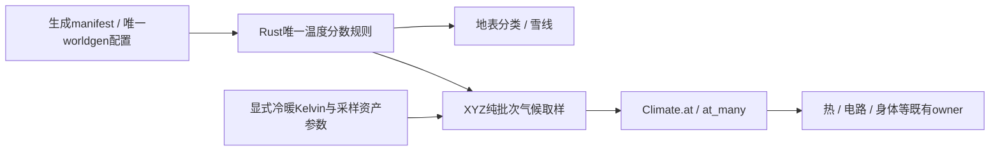

# 世界持续演化：分页与分区边界纠偏决策稿

状态：**产品原则已由用户确定；本稿工程组合待单轮独立核对，由统筹在已授权目标内采纳**（2026-10-27）。不把此稿当作已经证明的新算法，也不把旧 P6 冻结测试改名后继续执行。纯工程细化不新增逐项用户审批；真正新增产品语义或原创算法才另向用户说明。统筹已确认 CW2 可单独派发实施现有 owner 的 due/剩余进度保留。

**2026-10-28 气候范围澄清（覆盖下文候选的定稿解释）**：用户选择天然世界“按气候生成平衡初态”，随后明确气候目前仍是草案，并已有与 Sekai 联动的跨会话讨论。
该选择只确定初态方向，不批准本稿既有 worldgen score／Kelvin sampler 候选为正式气候来源。联动设计与实施状态以
[Voxim Weather.md](../../../../../Voxim/Docs/Weather.md) 为入口：Sekai 离线输出带来源身份的区域月气候，Voxim 天气生成／求值消费它；
当前 P0/P1 已有实现与分项验收，P2 服务端权威迁移、P3 `VoxelRegion.Climate` 物理接入仍为待细化提纲。
本稿 §5.4 的 e940 候选、试验参数和旧背景迁移讨论保留为证据，须先与该联动草案对齐，不单独合入正式主路径，不修改 Sekai／Voxim 的气候事实源。
“平衡初态”仍须按最终物理模型证明；已有相邻异温反例说明逐格 `T=air` 不足以证明无通量。天然活动初始化／首 cut／Ready／旧能量迁移继续未完成，
不借这一选择跳过它们，也不让尚未定稿的气候方案阻止独立的电路／页生命周期工作。

**同日 S0 范围后续裁定**：在明确说明天然初态与活动初始化是原 S0 门禁、气候接口尚未定稿后，用户选择“天然初态移到后续 Weather 阶段”。
因此该初态、初始化活动／首 cut、气候身份与旧背景能量迁移工作转交上述 Weather 联动，不再阻塞 S0 完成；它们仍未实现，世界持续演化产品原则不被撤销。
S0 只就当前已有显式活动证明无人推进、真实读取依赖、恢复与唤醒；原性能／双端门禁不变。保留 GeneratedStore 未登记天然活动的显式阻退事实，
不得移除阻退保护、伪造initialized凭证或把该范围裁定写成天然世界已完成持续演化。

用户原话：

> “我觉得模拟是世界的一部分，不能暂停。前端渲染可以停止，但后台的演化不能停，不然不就变成时间暂停了？”

本决定覆盖 [父稿](../2026-10-24-world-region-paging.md) 的旧 P6/Q1 及 [v7](../2026-10-26-voxel-authority-sharding.md) 中依赖它的模拟边界、ticket 冻结和零通量论证；原批准稿保留为历史。其余页存储、唯一写者、数据恢复、协议 41/42、D12 当前分区拟态上限等已有合同不因本次推翻。

## 1. 已定产品语义与未扩大范围

正在流动、燃烧、传热、相变、供能、飞行、演化的过程，不因玩家离开、渲染不可见、窗口取消、缓存预算或 ticket 用尽而停止时间。玩家退出后旧分区拟态继续自然演化，D12 只决定能否新建拟态，不决定旧实体是否继续存在或推进。

**自然无变化可以不耗 CPU；有动力而没预算不能伪装成自然无变化。** 静水达到数量内核稳定态、热状态满足既有模型的静止条件、零功率电路且无待到期变化，可以休眠；owner 必须维护会使它改变的全部唤醒事件。温度显示不变但有限燃料、库存能量、化学反应进度或持续通量仍在变化，不是静止。

计算需要真实耗时。有限 CPU 下短暂排队/装页/迁移是实现延迟；应推进的模拟时间仍欠着，不能删除、改锚点或在窗口重开时从“现在”重新开始，以此把延迟变成永久停滞。超过已声明实时包络时必须显式报告不达标，不能给性能验收假绿。

本次**不新增服务器停机期间实时演化、离线追算或故障下零停顿承诺**。服务器进程故障、PG 不可用等仍按既有显式失败与持久恢复处理；但正常运行中的持续存储慢/装页等待不能悄悄清掉未完成进度。崩溃恢复保留已持久进度，停机区间是否追加演化时间另有产品决定才实现。

## 2. 现有代码可复用的事实

- `World` 仍是唯一提交 owner；热、液体、投射物结果由既有事务写日志后发布。不要为后台演化再造旁路 World。
- `thermal_work.ex` 已有 `hot_rows/touched/burning/electric/pending/due` 与 `plan/4`；它只存派生候选域/几何，不保存温度、燃料真值。`plan/4` 从热行、热源、电路功率与燃烧形成种子，再扩六邻接与辐射伙伴，可作为真实活动域的现有入口。
- `world/liquids.ex` 已有 `liquid_active`、`wake_liquid/2`、`commit_active/1`；趋静与唤醒的活动集会在正常日志/页提交中维护。它不是玩家可见范围。
- `world/pages.ex` 的 `:activity` 单元由液体活动、热源、热行、待结算/电路候选派生；`World.restore_pages/1` 已读取持久活动页及日志后缀，再经 `PageLoad` 装入。可扩完整性测试，不必从全世界扫描重新发明索引。
- `PageLoad.request/2` 与 `Pages.adopt/4` 已有缺页装入/令牌/接纳闭包；`thermal_run.remaining`、`:thermal_step` 可跨消息续算。不需要每页一个 GenServer 或通用任务事务。
- **现有时间合同仍有缺口**：`Thermal.schedule/1` 取 `max(上次due+500, now)`，每次 `begin/1` 固定推进 0.5 模拟秒，注释明确“不积压补跑”；液体按本次调度后延一个 `step_seconds`。移除窗口门禁后，若执行/准备变慢，这些路径仍可能丢失应推进时间。
- **现有持久化背压也有冲突**：`world.ex` 在 PageCut `:mid/:hard` 时停热/液体/投射物并在部分路径 `Thermal.rest`。写库失败不能继续确认未持久状态，但不能将预算调度阻塞伪装成自然静止。修复其进度保留与过载事实是本稿单独任务，不隐藏在“恢复无窗模拟”声明里。

以上为 2026-10-27 阅读时事实；其他执行者正在移除旧窗口过滤，实施者以当前 diff 为准，不重做已完成纠偏。

## 3. 核实的一手实践与本项目取舍

本轮直接打开下述官方原文；它们说明可复用的机制，**不替本项目证明物理正确性、容量或零停顿**。

1. [OpenVDB overview，Active and Inactive Voxels](https://www.openvdb.org/documentation/doxygen/overview.html) 将活动状态解释留给应用，并提供稀疏迭代。适用：用现有活动索引只访问值得计算的单元。不能推导“离玩家远即不活动”或“inactive 必为热平衡”；不引入 OpenVDB 库、不换 canonical 存储。
2. [Box2D Simulation，Sleep parameters](https://box2d.org/documentation/md_simulation.html) 描述物体静止后休眠，碰撞及接触/关节改变时唤醒。适用：静止证明与变化触发必须由同一系统维护。这里只借用休眠/唤醒原则；刚体速度阈值不能拿来判热平衡，不照搬其忽略对睡眠物体施力的可选行为。
3. [LAMMPS Partitioning](https://docs.lammps.org/Developer_par_part.html) 与 [Communication](https://docs.lammps.org/Developer_par_comm.html) 以完整邻域数据计算跨域相互作用，ghost 距离由物理相互作用需求决定。适用：分区边界不能取代物理边界。当前推荐先让相互作用闭包同 owner，不立即引入 halo 双边数值交换；halo 是后续若巨型连通岛压垮单 owner 才另立的方案。
4. [GROMACS domain decomposition](https://manual.gromacs.org/documentation/2024.5/reference-manual/algorithms/parallelization-domain-decomp.html) 的 update groups 把有内部更新约束的原子一同迁移；不分组则须跨域约束通信。适用：保留整树/aid 的绑定组，把必须同笔结算的交互视为同 owner 的约束。不能把所有长期物理联系永久绑成一个全世界组；当前步的读写闭包与身份绑定的生命周期分别维护。
5. [Folia Region logic](https://docs.papermc.io/folia/reference/region-logic/) 要求单一所有权、邻近区域合并，并禁止 tick 内扩张自身所有权；在 tick 边界完成合并/拆分。适用：开始一自然计算单元前拥有完整可变依赖，新增接缝在合法提交边界处理。这里用完整 XYZ，**不采用 Folia 的 XZ 分组和玩家加载语义**。
6. [SimPy Time and Scheduling](https://simpy.readthedocs.io/en/latest/topical_guides/time_and_scheduling.html) 区分模型事件时间与 CPU 顺序处理，同时间事件保持确定顺序。适用：队列只安排运行，不能改写事件/模拟时间。现项目已有各内核调度 owner，本稿不引入 SimPy、通用优先队列或通用事件框架。

这些来源支持“稀疏活动 + 稳态休眠 + 完整依赖 + 边界迁移”。下面对本项目的时间进度、页闭包、日志恢复接线是**待审工程组合方案**，必须用本项目反例验证；没有借外部游戏实践把旧冻结语义重新包装回来。

## 4. 可选方案与推荐

**A：保留一个 World，恢复全部真实活动过程。** 最少改动，直接复用现有热/液体状态、PageLoad、活动恢复；优先实施已经授权的去窗口门禁。缺点：只解决语义回退，不解决持续活动增长后的单 owner 容量，也尚未修好调度欠账。

**B：A + 按实际交互闭包形成活动岛，合并后计算（推荐后续方向）。** 保留现有数值内核与 v7 PG 所有权/迁移机制，所有权按真实过程扩大；独立活动岛可并行，相接前先合并。避免第一步引入跨分片原子物理结算。代价：接缝预取/时间前沿必须准确，巨型连通岛仍由一个 owner 承担，不能用停止部分过程“解决”容量。

**C：有界空间分解 + halo + 跨域数值交换。** LAMMPS 类实践说明可行，但本项目热、电路、液体、整件材料提交须分别定义同步、守恒与失败合同；与 v7 现合同改动大，不是此次最小纠偏。暂不实施，也不能将它作为静默备用路径。

当前 A 的去门禁与 CW2 现有 owner 时间进度保留可按统筹安排实施；B 的 §5–8 是具体可审阅稿，单轮工程核对后由统筹采纳，再推进新的大规模分区实现。C 保留为容量触发后的独立决策，不把它计入本次交付。

## 5. 推荐工程合同

### 5.1 三类集合，从“资格”改为实际需要

- **观察集 V**：近/远景发送、碰撞窗口、客户端缓存需求。观察不创造或取消动力学。
- **真实活动 A**：已有内核判定仍有状态变化/非零通量/待到期演化的单元。来源是 `liquid_active`、ThermalWork 种子、源/燃烧/电路、飞行实体、身体/拟态现有状态；不由窗口、resident 或内存容量决定。
- **计算依赖 R/W**：某个自然步真实读取/改写的 canonical 页、身份/绑定组和流级记录。装页/pin/所有权从 R/W 派生；读取一个页不意味着该页的所有系统都长期运行。

驻留需求 = V 所需闭包 ∪ A 下一自然步的 R/W 闭包 ∪ 正在执行/装页/写回/迁移所需 pin。干净且不再被这些事实引用的页才可淘汰。A 可以没有任何玩家，单独一个 `window_pages=0` 不允许删 A。

### 5.2 稳态与唤醒

沿现有 `Liquid.step_transfers` 的活动更新、`ThermalWork.rehot/touched`、`Thermal.begin/rest/wake` 和电路 quiet 判定落实，**不增加一个跨所有物理的可写“活性真值表”**。

每个 owner 必须列明使静止失效的事件：几何/支撑/邻量变化、热源开始/结束、燃烧/相变阈值、附件/开关/电路连通变化、气候/参数变化、身体接触/拟态移动、定时源变化。事件从正常提交或现有 timer 到该 owner；窗口出现不是正确性唤醒来源。

休眠证明至少为：当前没有必须积分的量/通量，且没有未登记的会改变它的时间事件；已登记未来事件由原 owner 自维护。有限热源在放热、燃料在减少、稳定温度但持续电功转热，均不休眠。现有热容差只按原模型合同使用，不为省预算调大；若容差休眠对冻结 oracle/守恒有偏差，须明确误差范围并修正规则，不能称为精确平衡。

休眠不是丢时间：没有变化的区间可不计算每个空步；动力出现时按该事件的有效时刻进入已有自然推进顺序。首版只省略已证明无变化的空步，不新增解析跳时/粗化模拟算法。

### 5.3 时间进度与有限调度

每个已有动力学调度 owner 维护**一份**下一到期进度及已经完成的模型进度；优先复用 `thermal_due`、`thermal_run.remaining` 和液体 tick 状态，补缺的标量而非把每个逾期 tick 堆入 mailbox。`due` 的前进来自实际完成一自然步，不能 `max(due, now)` 擦掉欠账。

预算只限制一次回调计算量、并发装页/写回数或执行批次；下一次 continuation 继续同一自然步。未完成/等页时保持原剩余量与到期事实；有更高优先级输入可让出 CPU，但不能删除候选或设 `budget_frozen`。过期事件不自动扩成一个巨大 dt，仍使用原数值步/稳定性合同。

运行中若输入到达而模型已落后，仍按当前 owner 明确的提交顺序接纳，不把新输入倒填到过去，也不把推进中的过程标已追平；输出带进度/延迟事实。任何要求按真实时刻回溯输入的模型变更不属于本稿，不偷偷新增 rollback 系统。

可观察量：`simulated_through`、`target_through`、`lag`、当前自然步剩余量、等待原因（page_io/ownership/writeback/cpu）、最老待办年龄、活动页/依赖页数、完成自然步数。只有原 owner 更新前两者，lag 为派生值；不为每层复制水位。

写回积压必须保持 WAL 先于确认/广播。允许限制尚未接纳的新请求沿既有显式 `persist_backlog` 契约；已开始过程的时间欠账保留。PG 无法提供进展时报告存储故障/实时失败，不能通过内存继续确认，也不能把 `rest` 当稳态。容量包络若长期不足，不声称“全世界永远实时”；调度公平性要防某一活动过程永久饥饿。

### 5.4 缺页与实际边界

`PageLoad` 准备完整输入后再推进自然单元；读取失败显式错误/等待，未驻留不能改变材料或边界条件。

- 液体：真实活动格的两层侧邻/下落输入与实际保护边界；不以窗口裁剪 open/quantity。需要的邻页装入、重新接纳后同一数量内核推进。
- 热：真实热源/燃烧/电功/热差与原接触图；邻页未驻留不是绝热面。扩域后仍由同一 ThermalDomain/HeatCommit 结算。
- 辐射：按现有模型视距读取真实沿途 canonical 占用及伙伴；未知页不是遮挡，也不是天空。保留物理遮挡和已批准保护/气候边界，不创造新的距离 cutoff。
- 电路：按当前实际拓扑/状态求完整可求解分量；分量跨页要装全所需依赖，不因内存 cap 截断电路。
- 飞行/拟态/身体：沿已有轨迹/足迹/接触范围读写；越出所有玩家窗口仍演化。身体离线的既有实体生命周期另按角色合同，不从“不渲染”推导身体消失。

已知 baseline 静态区域可按规则省略；若程序生成器可产生无人触及也应演化的源，必须有源的初始化/活动发现入口。当前 `adopt_liquid_sources` 按载荷首次读取接纳，**不能据此宣称所有未访问生成区的非稳态水都已被持续模拟**。实施前盘点生成规则：只有证明初始天然状态稳态才可不登记；发现真实非稳态源时在世界生成/发布 owner 建活动登记，不靠玩家访问才激活。

### 5.5 天然雪与权威气候（2026-10-27：产品方向已选，接口方案待统筹审阅）

用户已明确选择 **寒冷气候维持雪地，加热后融化**。这替代“暖气候下把天然雪静态排出热域”的当前例外；不是让 snow 材料自带低温，也不是以首次读取/渲染为初态起点。最后正式分发 manifest 记录的1008版本确为全局293.15 K、目录雪4在273.15 K融为水21，而生成器按温度噪声减海拔生成雪。完整发布摘要、精确路径/行号及未知边界在 `.superpowers/sdd/voxel-authority-sharding/task-activity-initialization-report.md`；未连接公网，不把本地1023 rehearsal当正式生产。

**最小 owner 合同（工程提案，尚未接线）：**

1. Rust worldgen 提取唯一 `temperature_score(x, reference_y, z, config)`，公式保持现有 `climate(x,z,1536,seed+300) - (reference_y-sea_level)*0.0008` 的浮点顺序。`ground` 调用同一函数（reference_y=生成列height），不在 Elixir 复制 noise、海拔或 snow/moss 阈值算法。既有 `.10/.22` 阈值归该版本规则的同一 Rust 定义，供地表分类与气候映射共同消费。
2. 新的纯只读取样入口拟为 `Native.climate_samples(cells, worldgen_config, kelvin_config)`，按输入顺序返回每个完整 XYZ 的 `{air_k, wind_mps}`；无材料输入、无页访问、无 ETS/世界初始化、无随机状态。它只算每点的2个noise2 octave，**不调用 column_height/profile、也不生成region**。新增 `Climate.at_many/2` 做一批取样；`at/2` 保留单点使用。合法 source 在生成/环境接纳边界构造一次，内部不重复解析 manifest。
3. 取样坐标必须冻结：目前雪只出现在 `y=height-1` 的表层，旧分数参考height。提案在新的气候源资产显式声明 `sample_height_offset_m=1`，表示取格上表面高度（reference_y=y+1），使生成雪格与空气采样严格用同一分数；负Y同样适用。不是每次从当前地表/材料反推高度，挖掉雪也不改变气候。采用其它采样点应改生成分类一起冻结新版本，不能两边各补一个不同雪线。
4. 新源名拟 `worldgen-temperature-v1`；绑定当前已接纳 worldgen 的完整kernel identity、原八项config与world CV，不重复在环境JSON填写seed/sea_level。Kelvin资产提案参数为 `cold_kelvin=263.15`、`warm_kelvin=293.15`、`sample_height_offset_m=1`、`wind_mps=0`。Rust在score≤snow阈值 `.10` 时取cold、score≥moss阈值 `.22` 时取warm，中间线性插值；精确阈值比较与端点由同一规则定义。两个Kelvin值是可审阅资产参数，不能藏在NIF默认值；263.15 K是本次工程提案值，用户仅选了寒冷语义，未指定这个数值。
5. source identity = schema/rule + 已接纳worldgen identity/config + 显式Kelvin/采样参数的规范字节摘要；随thermal环境发布记录/检查点保存。源不符、缺参数、cold≥273.15 K或cold≥warm均由接纳边界显式失败，不退回293.15。非生成FileStore测试源若要使用此提供者，也必须显式带同一生成身份/参数；不能由材料或当前可读缓存猜源。

时间owner已核对取样合同：只消费World已经接纳的不可变source/config/摘要与本次明确cell序列，同序返回不可变sample；worker不重新读取Application.env/目录，continuation不刷新版本。纯空间source的样本只在同配置有效期复用；配置发布在统一ready接纳边界串行完成，已开始的旧due自然步先按旧配置完成，再生效新版本。生成初态登记必须包含初始化cut/实际范围/热参考账，不从有限patch外推全世界稳态。

**温度场与热边界身份必须分开：** 新生成源的 `Climate.region/2` 返回同一连续物理域身份（提案沿用nil），不能按取样温度、冷暖端点、噪声tile或source hash切开接触/辐射。现有手工 `climate_zones` 曾同时表示空气值和绝热分区，本提案不扩展它来画雪区；已批准真实保护/绝热边界仍由对应owner保留，今后手工区也应将温度覆盖与显式绝热身份分开。`air_k(a) != air_k(b)` 不意味着 a/b 不能传热。

**不能跳过的初态边界：** 同源且雪温低于融点只证明冷区内部的天然雪相态合理，**不证明整个空间温度梯度下的材料均已平衡**。插值带、相邻不同环境、冷热接触仍可能从开服起就有通量，必须由生成/发布owner在世界时间起点登记可派生活动前沿，走既有活动页和时间进度；不能靠首次PageLoad发现，也不能让区边界变绝热墙去“证明稳态”。有限同温冷区内无源且邻域相同的样本才可以零活动；热扰动由公开事务唤醒。完整世界的前沿构造/登记成本尚无测量，本次不通过扫描整个世界或启动服务伪造完成。此条件未闭合前，取样器单测通过也不表示§5.4已收口。

**采样与调度成本：** 静态源码可确认每点2个noise2、8个lattice hash，加常数次插值/海拔/Kelvin映射；无列高（原列高需5个lowland+1个mask+3个mountain noise2）、无完整66³载荷。N点一批为O(N)算术/编解码和一次NIF往返。提案批次用DirtyCpu；单点亦可先复用同入口，必须实测之后才讨论普通scheduler快路径，不预建双实现。热owner在既有自然批次输入准备时冻结本批位置取样一次并交内核，不在热边/每次迭代里重复做NIF；Scene身体保留单点查询。没有现在填造微秒数；取得运行锁后只测1/64/4096点固定样本的Rust纯算和真实NIF往返，记录p50/p95、编码/调度及批次内存，不扩成整世界基准。分批只运输同一位置序列，批界不得改变结果。依据：[ERTS NIF长调用/Dirty NIF官方契约](https://www.erlang.org/doc/apps/erts/erl_nif.html)，适用于不让CPU批次阻塞普通scheduler；DirtyCpu不证明本项目延迟达标。[OpenVDB活动状态文档](https://www.openvdb.org/documentation/doxygen/overview.html)明确活动含义由应用定义，只支持稀疏活动索引的工程机制，不能用“inactive”替代热平衡证明。本项目采用已有温度噪声的游戏气候映射，不声称线性Kelvin映射是气象学定律。

**目录与旧存档升级边界：** 不修改任何已发布环境JSON、materials目录、旧manifest或冻结字节。材料4/20/21的相变目录可原样复用，气候是独立source。`voxim_worldgen/build.rs`包含lib/world源码，新取样入口/提取会改变kernel identity，`GeneratedStore.open/1`对旧pinned expected identity明确拒绝；不得绕过。新生成manifest/环境资产使用新版本，只有证明L0地形字节保持一致后，发布迁移才可显式换expected identity并保留pinned世界目录；不由运行时自动改旧清单。没有稀疏热记录的天然态由新source定义；已有phase_energy_j、实例温度、燃料与有限源remaining不得重置，变更参考温度产生的账差由既有参数发布owner显式结算并同笔持久化source身份。新旧source冲突要显式诊断，不能按哪个文件可用就混用。冷恢复必须恢复同一source版本及已记焓，不能在重启时把加热过的雪再初始化为冷雪。

**两个最小公开入口反例（先写判定，串行接线后执行）：**

- **无人天然雪稳定：** 在专属新世界以正常生成manifest+显式新气候资产启动，用公开source取样冻结一个同温冷区内、具有真实生成雪的有限邻域及其全XYZ边界；零窗口/零会话推进既有公开模拟入口，在观察前后比较公开canonical、相态/数量与热账，雪仍为4且无伪造能量。读取只发生在检查点，不能成为初始化；另删掉全部观察调用仍按同一世界时间推进。坏例是恢复293.15旧环境、按material4返回低温、删窗口后不推进或首读才创建初焓。该例只证明相称的同温内区；边界梯度另由前沿登记用例覆盖，不能扩大成全世界稳态。
- **加热后融化／冷恢复账闭合：** 同一合法生成雪以公开有限供能工具/作者实验入口支付并注入足以覆盖显热+334MJ/宏格潜热的有限能量（随实际数量缩放，不能直接注入私有damage/temperature），即使没有窗口也由World正常提交融成21；显热、相族焓、环境交换、源消耗与数量账闭合。用实际File日志冷恢复后公开读回相同source identity/焓/数量与未用预算，继续推进和无重启对照一致。坏例包括保留天然雪thermal_node?静态排除导致热源仍不能加热、重启丢焓/返还已用能量、或新冷暖身份切断真实热接触。容差来自现有内核合同，不把验收阈值编入生产路径。

实施顺序：先统筹确认上述source/采样接口及显式资产提案参数；生成/Climate owner只改其纯函数与定向测试；World/Pages/Thermal/PageLoad接纳、批次冻结与活动前沿由各owner串行协作；取得资源锁后跑最小真实入口反例和单次采样成本测量。当前只是可review方案，未声称生产接线、初态登记、迁移或验收已完成。

**有限反证已运行（2026-10-27）：** 经统筹授权，只新增Rust integration test `native/voxim_worldgen/tests/climate_initialization.rs`，原热kernel的 `valid/advance` 与public生成入口使用正式发布参数/目录/环境，共2个L0 region，无BEAM/PG/UE。`cargo test --manifest-path apps/voxel_region/native/voxim_worldgen/Cargo.toml --test climate_initialization published_patch_cold_snow_gradient_and_finite_heat -- --ignored --nocapture` 首跑1 passed。真实雪 `[62,493,0]` 在提案263.15 K平台、h10/ε.9下0.5s无源焓不变；真实相邻stone11 `[62,278,0]` / `[62,279,0]` 各以当地air_k=278.215518/278.015518 K初始化，原内核0.5s交换±2.498683699 J，证明初始温度场不等于材料全体稳态。有限353.305MJ供能后雪终焓334.004951MJ达334MJ潜热，环境−48.780553J，残差6.15e−8J。它是算法/合法初态反证，不冒称World换材/付费/冷恢复验收。参数/命令/原输出在报告§7与 `.demo/observe/climate-initialization-20261027/attempt-01.txt`，未运行真实NIF成本基准。

初始候选至少包括真实非零温差导热接触两端、异温互见辐射伙伴、初焓偏离气候或已有有限源/燃烧/电功者；发布owner按实际几何与同一初态构造，不按材料身份、插值带或首次读决定。正式部署明确 `VOXIM_LIQUID_BOUNDS=[-8192,8192)^3`，按64m页整个有限cube上界256³=16,777,216页、约4.398e12宏格；manifest extent本身仅管XZ烘焙，不能据此虚构全XYZ门禁。此上界不证明真实活动页数或初始化成本可接受，未扫描世界。

生产hash迁移最小提案见报告§8：现测试不在build.rs输入列表，当前生产hash未改；未来score提取会改hash，先产新expected identity+旧pinned CV+改前后payload证据的独立候选manifest，运行时仍精确校验，无白名单/静默兼容。旧二进制/清单保持可用直至候选和数据迁移一起切换。若L0确实变化则新CV，不能pin旧缓存。旧未记录自然格从293.15 K背景改为新冷背景也改变初能量，必须由发布owner明确cut/范围并结清背景重基准账；若保留旧初能，则所有偏离新气候的天然格都要主动演化，不能只登记新世界的插值带。已有焓/温度/预算不重置。此界面未闭合前不部署新NIF、不改旧存档或冻结发布字节。

**新世界sampler候选已正常构建，正式接纳仍未集成：** 共享admission批次期间按统筹授权，将同一Rust候选置于observe下完整crate快照，保留Cargo.toml/lock/build.rs/全部src/tests及相对thermal源码依赖，私有CARGO_TARGET_DIR、不复制target缓存。正常Cargo/Rustler编译成功，sampler 2绿、有限天然patch+改前两份完整L0载荷逐字节比较1绿；候选kernel identity为 `worldgen_density_v3@1+sha256:59eee987d145d8fc1a377b509c51e669dd069cc0aebc35c7490cf1c3df09a793`。DLL只在私有target生成，没有安装到共享priv/_build。Source/Climate/生成store接纳草案与最小Elixir测试已备，待lead释放编译锁串行落盘与真实NIF/BEAM验证。原输出/快照输入摘要见报告§10。正式World接纳、初始稀疏活动发布登记、旧背景能量迁移和公开入口冷恢复仍是独立未完成项，不因sampler可编译就关闭§5.4门禁。

**后续隔离真实NIF验证已绿（同日，最新状态）：** 统筹创建正常worktree `C:/Users/DYZ/.codex/worktrees/e940/ex_mmo_cluster`（5957192b…），基底SHA确认后仅在该处落盘候选；独立Mix build/Cargo target、主仓deps只读，不写主仓NIF或生产src。按授权补一份只读空间header输入快照后，正常 `mix test --no-start test/climate_source_test.exs test/climate_test.exs` **6 passed / 真实exit0**，含独占新manifest/source入口和真实NIF XYZ采样；新CV由唯一业务函数实际算出 `c4c6b3b6dae8c2f9`，旧CV未覆盖。首轮header缺失编译错误与mix.ps1外层伪0完整保留，未计通过。实际NIF 1/64/4096点100样本p50/p95为1.7/1.9、4.2/9.6、177.7/615.5µs（OTP29、S2/DirtyCPU2，os.perf_counter高分辨率；wrapper为1.5/2.7、4.9/8.2、249.4/782.8µs）。详见报告§11原命令/环境/测量边界与13文件SHA合回清单。当前是隔离新世界sampler实现/验证完成，正式World接纳、初始候选登记、旧世界迁移与恢复仍未完成；合回唯一主路径由统筹串行执行。

### 5.5 实际交互闭包与分区

旧“模拟区之外都是墙，因此岛间零通量”证明**失效**。新的并行安全条件是：同一计算单元所读的可变状态及写入状态在合法边界由同 owner 接纳；不同并行单元没有未协调的写写/写读依赖。纯不可变 baseline 或固定目录可共享读取；不能把可变远页装作只读常量。

由 A 的下一自然步推导 R/W，加入整树/aid 不可拆绑定与与之相交的活动依赖，迭代至本步闭合；不用无限展开整颗星球的未来所有传播路径。当前步会跨 owner 时，唯一规划者先把静态非活动页迁入，或把相互作用的活动岛合并，再在新 owner 推进。一个长期导通电路可能要求大分量同 owner，这是真实成本，不以截断/冻结伪装独立。

预取/合并要看**过程传播需求**，不能只用玩家 `v_max`：液体一步前沿、热接触/辐射视距、飞行轨迹、电路瞬时拓扑扩展以及玩家新建连接分别给出下一步依赖。更新在合法提交/步边界接纳；tick 内不得随意扩权后边算边抢页。

迁移接缝携带已完成模型进度、当前步与到期欠账；正常跟随/停写/翻转等待不平移物理时间锚点。新 owner 从原进度接续，源不再推进相同成员。H/I/U 的事务顺序与物理时间是不同维度，不能用 seq 推断已追平。

**跨流时间前沿必须在 S2 前具体闭合**：如果两岛在即将执行的步出现读写依赖，要先停在各自合法边界并收齐该步输入，不可一边已推进到未来、另一边拿过去状态直接结算。推荐在受影响组件的交接载荷中携带各内核完成前沿/欠账，合并接纳时验证该自然单元的输入时刻一致；独立岛无需全局锁步。若现有热/液体/投射物时间合同不能构造这一条件，继续单 World，S2 不开闸，不能靠“先合并”三个字假设时间自动对齐。这一接口与最小跨边界因果反例属于本稿批准后的 CW4 实施细化，非已实现保证。

为保留 D13 ②，客户端窗口仍由所属分区供应是**独立的观察/路由约束**：可用已有 T1 获得所需页，遇另一活动岛则先合并。但不能再由“窗口⊆模拟集”推导它，也不能用窗口扩大来制造无动力热活动。需要为两种需求分别标来源，统一进入同一规划者，不创建两个所有权真值。

### 5.6 D11 与 D10 的冲突处理

D11 ① 对**玩家新接线**的潜在连通分量接纳限制可保留：它在过程开始前明确拒绝新操作，不暂停已经确认的演化。但旧 D11 ② “天然矿脉合成超限分量整体冻结”与最新要求冲突，**不得实施/继续作为合法降级**。

建议改法（待审）：既有/自然合成的大分量继续按真实拓扑演化、保留已有进度；上报分量规模/成本和实时包络失配，所有权先并到能完整结算它的 owner。有限预算可分片完成求解器已有可安全续算的单元；若当前电路求解不可拆，不能在调用侧切断图，先测量并按真实能力报告不满足容量，再决定是否另立求解器改造。不得超时后恢复旧解并伪装成功。

D10 “合并后保留全部已有过程”继续有效；原“ticket 上限只限新 ticket”不再作为活动许可机制。资源超限不从活动表删除过程，新的玩家请求只可沿已批准接纳合同明确失败，不把内部 ticket cap 变成未批准的玩法封锁。

## 6. 原路线修订与实施边界

**可立即继续的授权工作**：现有代理移除窗口/渲染造成的物理冻结，恢复无窗单 World；M2b 正确性、snapshot 外移、reset/watchdog、Q5 证据工作不受影响。此修正不等于完整“持续世界”验收。

**CW1 活动与休眠接缝（S0）**：沿 ThermalWork/liquid_active/Pages 补齐无人推进、自然稳态与编辑/源/气候/接触唤醒；活动恢复与生成初始活动盘点。只使用现有算法；缺新产品语义先报具体问题。

**CW2 时间与背压（S0）**：沿现调度 owner 保留欠账/剩余步和可观测进度，去掉正常预算等待中的锚点复位/丢时；测试受控 CPU/PG/装页延迟后仍完成全部应推进自然步。统筹已明确可单独派发实施，不等新的用户审批。

**CW3 P5 驻留与容量**：把淘汰前提改为无真实活动/依赖 pin，预算只管缓存/在途资源；观察与真实活动分别量尺度。活动规模增长导致更多资源需求必须在包络体现；不能保留“随玩家窗口数量有界”的旧结论。

**CW4 活动闭包与迁移时间（S1a/S2 前置）**：A4 不再计算窗口模拟岛，先定义每类自然步 R/W 与时刻；重证绑定/依赖闭包、扩权/先合并、正常迁移不丢时间。旧 v7 §3.2–3.3/§4.3 的 Q1 不补算依据、§4.8 中因超出包络而冷墙停步的定义均不能直接用于新机制。

**S2 首次多区**：PG fencing、基线链、跟随、请求序列可复用；先过无人过程跨边界因果/守恒与迁移时间测试，再接 E1。D13 由独立窗口路由合同保证。

**S3 合并与零停顿**：E2/E3 保留，同时增加“没有玩家靠近也因真实过程相接合并”。包络增加活动规模/传播率/电路分量/模拟 lag，旧参数不能原样认定达标。过程落后超包络为失败，不把慢模拟从指标中剔除。

**S4/P5 长期**：只拆分确实无跨步读写依赖的组件；自然活动仍在的 owner 不得停机退役。覆盖元数据可增长，常驻与当前真实活动/完整依赖+缓存/在途预算相关，不承诺世界无限活动而恒定内存。

**S5/青岚**：协议42近远景工作范围保留；真实“远处无人仍演化、回来读到自然结果”加入正式双端验收。所有窗口冻结场景作为历史证据保留，不能拿其绿灯验收新合同。

## 7. 最小反例与根级可观察面

测试都从正常公共入口建立状态，不回填 temperature/fuel/HP，不依赖另一个场景剩余样本。长时物理在 World 集成按生产自然步推进；短真实双端不空等燃尽。

- **CW1-无人**：两处同构有限水/有限热源/燃料装置，一处有客户端一处无窗口；相同有效自然步数下结果/账相等。删全部窗口后仍有新权威提交和燃料消耗，冷恢复活动页在无人登录时继续。
- **CW1-休眠**：静水自然无变化后无空循环；改变支撑/相邻数量后由编辑唤醒。零功率电路休眠后正常开关/热差事件唤醒；有非零功率/有限源的装置不误休眠。辐射穿未驻留空气仍看到真实伙伴，真实固体仍遮挡。
- **CW2-延迟**：停住一次 PageLoad/写回完成或限一次计算批次；释放后比较应推进时间与实际推进/守恒，原 remaining 保留。坏例为重置 due、anchor += 等待时长、直接跳过逾期步、永久不再排程，均必须红。
- **CW2-过载**：固定输入持续超过容量，判定 `lag` 增长且实时门禁失败；不要求耗尽内存/压到护栏。另一个有限活动过程仍有进展，避免“平均吞吐高但某实体饿死”。
- **CW3-淘汰**：移开全部客户端后无活动干净页可退；有源/前沿/未来时间事件所需页不可无声遗失。活动自然结束且写回后回落；再由真实邻接事件正确唤醒。
- **CW4-交互**：热/液体/飞行跨原窗口及分区面，Y 下落、视线、跨页整件；与 K1 同输入/同模型时间比较数量/能量/命中；交互前需迁移/合并，未归己不提交部分通量。漏一邻页、提前推进一方、迁移丢欠账均为判定器坏例。
- **CW4-D11**：新接线触上限拒绝且旧装置继续；自然拓扑合成超上限时存在容量告警但过程不被标冻结/删除；若当前求解器无法实时处理，验收明确失败，不能声称工程问题已由提示解决。

根级证据继续放 `Voxim/Saved/Playtest/paging-20261024/runs/<新目录>`：源/构建/协议身份、完整输入、自然步与模型时间、真实进度/欠账、页装入/所有权等待原因、热/数量/燃料账、活动/依赖/驻留/缓存/在途字节、原始错误与判定。窗口数独立列出，用于证明观察与演化解耦，不进入物理许可。

## 8. 需审阅的具体工程选择

1. 先完成单 World 的活动/时间纠偏，再以“实际交互闭包同 owner”推进分区；暂不做 halo 数值交换。
2. 复用现有各物理 owner 的候选、定时器与进度，保留未完成时间，以有限 continuation 调度；不建立通用事件/时间框架。
3. D11 天然超限冻结撤销，既有大分量继续演化并诚实报告容量；不可拆求解器瓶颈另以测量决定改造，不在消费侧截断。
4. S2 开工前必须完成各内核 R/W 与时间前沿的实际接口/反例；若尚不能保证，不开放多区物理，而不是偷偷回到冷墙。

这些是建议的工程组合，不是把用户一句产品原则扩写成已证明技术细节。统筹完成单轮独立核对后在既有授权内采纳；先继续单 World 去冻结、CW2 进度保留及无冲突 M2b 工作。跨流时间前沿仍是 S2 的技术门禁，未证实不开放多区物理；不为每项普通工程细化重复要求用户批准。
