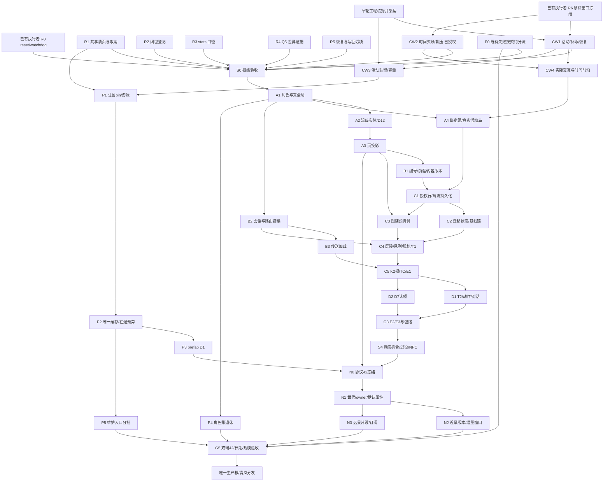

# 世界分页与空间权威拆分 Implementation Plan

## 2026-10-30 青岚内存专项（小改动获准独立发布，天然阻退保留）

本次用户授权在 `fix/page-retirement` 修复退休与日志，并允许天然初态无法安全独立完成时停下说明。
逐 owner 核对后，不能把 `GeneratedStore` 的空活动集合视为天然稳态凭证：生成器只发布几何，
热侧仍排除未记焓的暖环境雪／冰，液体侧仍按首次读取接纳有限数量；初始活动登记、气候身份和旧背景能量迁移尚缺。
因此本轮保留 `natural_activity_unregistered`，不宣称问题1已修复；依据及后续选择记录在
`.demo/observe/qinglan-deploy-20261029/fix-20261030/notes.md`。不改源世界、持久前缀、协议或生成身份。

独立实现计划与最小验证合同：

1. `Residency.maintain/1` 复用既有 `last`，同一连续阻退原因只警告一次；原因变化或恢复后再次阻退仍记录。
   纯回调测试检验重复、变化和恢复，不向真实World注入状态；保留现有阻退、活动依赖与文件退休回归。
2. Scene 的 `region_tick` 全部改 debug；真实 Scene + 假时钟推进到60 tick，验证仍运行且 info 无常规 tick。
3. Player supervisor 和 Session 空闲1000ms后由OTP休眠，释放交接后的不可达二进制；繁忙期间不强制GC。
   真实进程接收有限大二进制，经公开交接后等待可观察休眠／引用释放；Scene／路由替身只隔离非验证领域。
   Player 接纳后释放一次性 import/tail，不影响已导入的碰撞历史与输入；真实移交测试核对行为和状态。
4. World 不再把缓存预算写入 `min_bin_vheap_size`，保持VM既定GC策略与缓存自身容量分别管理。
   真实小World验证预算不再抬高GC下限，文件分页回归检查数据与发布；完整生产性能尚未验收。

依据：[OTP gen_server](https://www.erlang.org/doc/apps/stdlib/gen_server.html) 的 `hibernate_after` 仅在空闲触发，
避免忙时每请求休眠的双GC成本；[OTP erlang](https://www.erlang.org/doc/apps/erts/erlang.html#process_flag/2)
明确 `min_bin_vheap_size` 是字数单位的GC调优项，需以实测证明，而非业务缓存硬上限。
本机 Elixir 1.20.2 `dynamic_supervisor.ex:784` 的 `mfa_for_restart/2` 对temporary子项将参数改为undefined，
故不另造交接表或child spec协议；只补空闲回收。1000ms为本次工程选择，适用于低频登记／监督进程，
不用于60Hz Player/Scene/World。移除缓存耦合有减少回收延迟的依据，但不保证RSS或尾延迟必降。

所有本地命令置于4600MiB Windows Job内，`ERL_FLAGS=+S 2:2`，单命令600秒截止、退出清理子树。
只跑 `--no-start` 的相关算法／真实模块集成，不启动客户端、QUIC、整世界快照或生产连接。
本轮为定位交接与驻留故障，不用无关全套、客户端或大路线掩盖天然初始化尚未实现；结果另记证据目录。

本次实跑结果：根级`MIX_ENV=test mix compile`成功（既有warning保留）；voxel驻留相关30项、
World Session/真实移交5项通过；Scene/Player/碰撞/stream相关42/44通过，两条未改的profile_id／
GeneratedStore CV冻结预期不匹配保留，未重捕获金样、未宣称整体全绿。3轮2MiB交接probe中，
原Session及temporary监督者在每轮1300ms仍各引用2MiB，空闲休眠后3轮各0B；不是生产RSS或页退休实测。
证据、命令、审查与限制均见上述notes。问题1未修复，不作为该问题的生产上线候选；其余改动未部署。

### 2026-10-30 发布复核补记

用户明确授权先装内存兜底，再复核、提交、快进master、推送与发布 `qinglan-20261030-mem`。
独立 `1de80137` worktree 原样运行同五个Scene测试文件：40/42通过，两条失败与候选完全相同；
已实证为基线既有失败，不重捕获profile/CV金样。候选重新验证30+5+42通过、同两条失败；
根编译、选择性格式与diff检查通过。完整命令/退出码/上限在 `.demo/observe/qinglan-deploy-20261029/fix-20261030/ship/`。
Linux同限额与生产验收继续按该目录原任务执行，最终结果见 `ship/summary.json`，不以本地测试冒充生产验证。

兜底源码 `deploy/qinglan-memory-guard.py`，已安装dyz分钟cron；原始cgroup内存>3400MiB告警，
>3900MiB持续180秒请求重启，每日北京时间05:00请求重启，共用一小时冷却与flock。
计时由运维owner维护，异常断开高值连续性但保留冷却；状态解析失败不覆盖原记录。
按Linux cgroup v2官方接口、Docker stats与flock约定实现（来源及口径见deploy README/发布RUNBOOK §8）。
实际dry-run与隔离替身验证阈值/冷却、UTC调度每日去重、非零bake与代际变化拒绝、损坏状态及采样错误通过；无测试重启或邮件。
独立审查无Critical/Important；较小缺口保留：容器停止/Restarting采样只报container_not_running，
错误行不带inspect的OOMKilled/RestartCount，不改变正常采样记录或自动启动停止容器。

## S0 本轮收口（2026-10-28，覆盖下方历史停点）

按本页已批准范围，S0 已收口；未启动 S1a 后续实施，也不将 Weather、天然初始化、协议42或最终分发写成已完成。最后正式服务端为 `/home/dyz/s0-formal-g0-20261028/build-v3/_build/rel/voxim_server`，冻结源清单SHA `4b9fda9a16c3ef74e15b18696233033fe53e47411f63011d7245572a5a343523`；客户端仍为已配对的 `e3a3896afb8c2dc44ecd381ebc901be5d9c12e5817014b9e9386ce1e43559333`。未提交或推送。

- **部署与真实玩家闭环**：完整生产材料来自当前发布目录的全部88个正ID，公开余额API启动前核对；正常采集入账、付费放置、G0双端离窗持续燃烧及返回同身份通过。G0新04的36笔业务意图完整，离窗2.5模型秒消耗1MJ，返回确认txn264。判定器修正分别绑定加热／最终点燃、只读人物查询／业务意图，未降低实际事务与角色身份检查。原失败及新复判分开保留。
- **D11**：新03真实完成26微格Prefab前置、第27单元普通右键接纳、第28单元普通右键拒绝；双方确切建造事务、后续同incarnation属性查询、余额和占用均正确。实际查看中文拒绝及无幽灵格；`d11-s0-live-20261028-v2-03/clients/report.verify-20261028T104235901742Z.json`通过。只读查询水位不冒充建造事务；未通过回填资源或静默容忍业务失败救场。
- **最后性能阻断**：指纹修补单独实测仍有365.261ms，定向MFA／GC证据将约90%的接纳成本定位到ring逐格投影。两个生产文件改为由纯Payload owner按连续X行计算规范差额、Payloads只选完整XYZ片段；无新索引、memo、阈值或真值。最小红绿6项与一轮窄审通过。原N1同seq14615／27区／120秒预热／180秒编辑复测：179笔完整提交与匹配回执、0错误，最长World回合228.147ms，完整提交最大231.731ms／p99 128.717ms；首次adopt从363.929降至68.198ms，DOWN降至69.632ms，达到原300ms门槛。共同窗口RSS峰1,685,176,320→1,723,617,280B（+2.281%）、总准备21.7→21.8秒如实保留，不称全部指标下降，不追零GC。
- **复用范围**：原1/2/4/8矩阵、R4 1x/4x与R5恢复证据未重跑。220ms装页门槛仍是原完整矩阵任务中位95.489ms，不新增首窗两任务中位门槛。原N2超线与N1首载属于同一27区ring接纳路径；本轮仅针对该唯一owner和最重N1首载／普通编辑失败模型复验，不声称新实测N2/4/8。原失败数值全部保留。F0 house31点与历史trace等价证据复用，两项thermal_edit旧oracle仍按既定范围保留至G5前处理，不宣称F0全绿。
- **最新正式根与真实呈现**：v3正常prod release六阶段均0、837源前后一致；当前正式material／magic／Global system环境publication一致、材料配置88。v3最终run-02正常出生，SessionStart／Ready同N15152、R1；L0–L5载荷就绪、Surface与网络队列清空、错误／missing／rejected为0，随后同会话呈现队列也自然清空。实际查看当前v3玩家近景与Far overview，建筑、材质、植被、水面与远处地形正常，run-01早期白空只作为仍在流送的历史图保留。overview仅改变相机，不冒称角色移动／LOD交接；正常移动／窗口退休／返回由G0另证。

证据主入口（路径以仓库根为基准）：`.demo/observe/ring-span-projection-20261028/{result,n1-comparison}.json`、`.demo/observe/s0-formal-g0-20261028-v3/verification.json`、`.demo/observe/s0-visual-20261028-v3/run-02/{result,visual-review}.json`；客户端原始场景在 `../Voxim/Saved/Playtest/paging-20261024/runs/`，图片在 `../Voxim/Captures/S0-20261028/`。具体根级命令为 `python -B -m harness.continuous_batch <G0 scenario> --out <新输出>`、`python -B Saved/Tests/d11-live-candidate-20261028/run.py <D11 scenario> --out <新输出>`、`python -B apps/voxel_region/bench/paging_m0/run_m0.py <隔离deploy> <新输出> --steps 1 --idle-seconds 120 --step-seconds 180 --interval-ms 1000 --spacing 256`；已消耗场景不得直接重放，须按其准备器建立新可变环境。

收尾：本轮UE与BEAM均停止，隔离PG `voxim-pg-paging1024`已停止未删除；所有WIP、旧失败世界和原报告保留，如园保护库／备份未修改，20GiB护栏始终保持且未触发。

> **当前执行焦点（2026-10-28，用户最新指令）**：“天气和气候全部后移，先专注于内存占用平滑与世界分块(scene)。”本轮不推进 Weather／Sekai 接线、气候采样、天然初态或旧背景迁移。优先当前内存尖峰／World 回合停顿及分页在途生命周期、迁移读取正确性，随后按既有 S1a→S1b→S2 的数据／Scene 所有权边界推进分块。与这些目标直接相关的现有热／液体读集和时间正确性继续验证；历史热学参照仅收尾已开始的有界改动，不再展开成内存工作的串行前置。该优先级不把任何未通过项改写为通过。

> **当前优先级（2026-10-27，用户再次明确原始内存目标）**：先闭合大世界加载／换窗的内存尖峰与停顿证据，按同版本、同数据、同负载定位峰值阶段，最小修复后复测。现有 r130 的 RSS／准备时间／p99 回退保留，不能以分页或功能测试通过代替性能完成。气候、历史热学与正式双端仍在总目标中，但不再全部串行阻塞服务端内存 probe；已开始的有界修补收口后，下一实际测量窗口优先内存复现。本安排改变执行优先级，未删除任何最终门禁或恢复窗口冻结语义。

> **2026-10-27 语义纠偏**：用户已要求世界持续演化，窗口/无人/预算冻结不是当前终态。以 [continuous-world-decision.md](continuous-world-decision.md) 为纠偏方案入口：产品原则已定，新工程组合经单轮独立核对后由统筹采纳，CW2 已可单独派发；R6 单 World 去冻结与无冲突 M2b 工作可继续。历史冻结实现/测试保留在 P6 日志，不作为本计划验收依据。

> **2026-10-28 气候范围**：用户偏好“按气候生成平衡初态”，但明确气候仍为草案，须对齐 [Voxim Weather.md](../../../../../Voxim/Docs/Weather.md) 的 Sekai 区域月气候→天气→后续服务端物理路线。旧 e940 sampler 并非已批准正式来源，本轮不直接合入；天然初始化／首 cut／旧背景迁移仍待联动合同细化。详见持续世界决策稿页首澄清。独立电路与驻留收口继续。

> **2026-10-28 S0 完成范围（本轮用户明确裁定）**：用户要求完成 S0，并选择“**天然初态移到后续 Weather 阶段**”。因此 CW1 的天然初态／初始活动登记、气候源首次持久绑定／Ready 与旧背景能量迁移不再是 S0 完成门禁，转交 Weather 联动阶段；不是标为已实现。S0 保留现有显式装置与活动的持续演化／恢复／唤醒、D11 玩家新接线、分页正确性、原性能及正式双端验收。GeneratedStore 的 `natural_activity_unregistered` 阻退限制继续可见，不删保护、不以 FileStore 测试冒称正式根全面退页，也不宣称天然世界已全域演化。

## S0 边界与当前收口顺序（2026-10-28）

**本轮执行纠正（用户再次明确要求 S0 达标）**：此前在o单窗读取仍392.192ms、完整门禁未闭合时结束工作是执行中断，不是S0不可达的论证。继续完成原批准范围，不以局部优化／报告／单测绿灯作为停点。只做证明当前合同或已复现失败所需的验证；通过的R0／R1／R2／R3、无窗演化与输入时间直接证据复用，旧checkbox不得诱发重复全套。剩余并行推进：必要驻留堆和完整性能门槛、R4历史逐身份Q5与迁移一致性、R5真实PG恢复／写回、D11新接线、G0正式双端及八窗口性能；F0按实际影响与既有证据归属闭合，不将Weather或S1a以后的拆分加回S0前置。结束条件是全部适用门禁真实通过，或明确具体外部阻断及已做完的独立工作；不能把未知份额或尚未实施说成不可实现。

依上位 approved v7 §8，S0 不提前依赖 S1a 的角色／真全局行拆分或 P5 的完整长期有界；M2a §5.2 原已将 globals 单列为残余上界，
M2b §7 已接受 home max_hp 汇总随 N 系列／协议42处理。因此 R5 在 G0 前须完成的是当前分页数据完整性、运输预算直接合同与声明负载的恢复／写回验证，
不能将全面 format3／globals 拆行加成 G0 前置，造成 G0→A1→R5→G0 循环。若现合法单元在声明负载中实际超出300ms等门禁，仍必须在产生端修复，
不得以延期长期有界逃避当前实测失败。可选字节预算默认无限的事实保留，有限配置的验证不冒充已启用有限生产默认。

当前顺序：已证GC／大单元的内存表示与必要生命周期修补、R4/R5迁移／恢复验证 → G0正式双端和同输入性能矩阵 → 既有S1a/S1b/S2的Scene分块。R1 异步等待取消已实现并独审：Scene 13项、World直接接缝13项通过，证据见内部 `task-s0-r1-async-finish.md`／`task-s0-r1-async-review.md`，不重复按旧清单实施。
F0仅就当前改动确实影响的行为闭环，未关闭的历史参照仍独立列示；天气／气候全部按用户要求后移。
互不修改同一owner的离线判定／冻结版本诊断可以并行，主仓构建与可变运行环境保持单写者。
已完成但旧checkbox未同步的 R0／R2／R3 与显式活动切片按现版本证据复用，不为归档重做；S0 只在全部适用门禁实际闭合后标完成。

### 紧凑表示实测与当前接续点（2026-10-28）

`RefinedSlots` 已接入 canonical、持久接纳、碰撞／材料消费者和纯 contracts 编码投影，保留普通槽枚举次序、旧持久格式与冻结 wire；独审无确认阻断。同输入 j→k 单窗结果：采样 RSS 峰 2,440,007,680→1,955,102,720 B，完整 public read 1878.528→638.6688 ms；但原单笔动作 422.912→482.0992 ms、事务 369.664→424.960 ms、snapshot 20.1756672→22.5905664 s，内存有收益、平滑仍失败。两轮自有进程与隔离 PG 均已停止；原始身份／GC／采样窗口与限制见 `.superpowers/sdd/voxel-authority-sharding/task-memory-jk-driver.md`，对照为 `.demo/observe/gc-compact-jk-analysis-20261028/jk-comparison.json`。单窗不证明 p99、220ms装页中位、默认27 tiles或8窗验收。

碰撞判空修补已完成：Elixir 1.20.2 官方实现证明旧路径每个非空紧凑宏格多解码首槽，现复用已有 `Enumerable.count`。最小反例由4次读取对3槽的失败转绿，连同碰撞／真实 File 冷恢复接缝5项通过，独立核对无确认阻断；完整 XYZ 占用字节不变，不新增状态、兜底或生产性能门禁。证据见 `.demo/observe/collision-compact-20261028/`。

同一 k 输入的新 l 单窗已完成且清理：动作490.0864ms、事务432.845ms、action GC314.2656ms；完整读取821.8624ms、后读GC490.1888ms；RSS同窗口采样峰2,038,108,160B。单样本未证实主要停顿改善，300ms仍失败。l的后读GC有160.768ms直接落在encode时窗，不能把相应墙钟回退当压缩算法变差；其余比较与身份见 `.demo/observe/collision-compact-kl-analysis-20261028/kl-comparison.json`／内部 `task-memory-kl-driver.md`。不重复l或扩八窗来追求好数字。

R4/Q5 的 Test-only 安全切片已实现：删除旧 collector 两处整 World 状态回传，`capture_regions/3` 复用正常serve/prepare pin与 OTP 精确请求完成事件，就地计算固定摘要；整次绑定同一World PID，逐页唯一归属、首尾及各页同seq，payload原序号按既有缓存合同允许较旧并保留原值。两页先后退休仍各自计数、跨页部件只在home报告、错From／异常／序号漂移明确失败；8项直接测试通过，纯预检1项、原比较16项、护栏12项通过，证据 `.demo/observe/s0-q5-safe-collector-20261028/`。它只产有限范围 `paging-region-audit-v1`，**不证明完整Q5**；旧全世界CLI在任何restore/start前明确拒绝，因为首次发布切点与独立全身份目录尚未接线。未新增生产审计API／冻结门，真实1x/4x仍未验收。天气／气候仍全部后移。

碰撞投影的下一切片已实现，范围限定为 `CollisionSource`／`Payloads`／`Observation`：现提交已给出完整 changed 宏格，复用该自然输入，只读取变化宏格的旧占用；完整 new chunk 仅在实际占用或16³／128³分辨率变化时构造，去掉完整 old chunk 及其全槽临时列表。材料阻挡与有限数量规则仍只在原投影 owner 定义，不新增缓存、常驻计数或额外验证层。局部实际占用由共享投影比较，保留“512槽覆盖底材”“显式空气覆盖”“首／末非空槽改变chunk分辨率”的原精确字节语义。依据已查阅的 [Dirty Flag 原著](https://gameprogrammingpatterns.com/dirty-flag.html) 的明确变化驱动派生计算和 [OTP binary 文档](https://www.erlang.org/doc/system/binaryhandling.html) 的构造成本边界；只采用当前changed集合，不引入新dirty状态。

该切片最小红绿证明未变2槽由旧路径读4次降到2次，无几何变化由4次降到0；14个不同直接用例已分别通过，含完整XYZ字节、分辨率/数量边界、真实File、GeneratedStore提交和付费水→冰/冷恢复。原边界批次10/11的fixture别名失败及location296漏选297均保留，分别定向补齐，不拼成一次全绿。独立审查未确认阻断；证据 `.demo/observe/collision-changed-projection-20261028/`，合同/命令在内部 `task-collision-compact-fix.md`。新m源码清单另含4项已审Q5工具变化，实际护栏类/函数/阈值逐字及AST同l，迁移等待函数的等价改写明确列出。

m已完成唯一实跑且清理：l→m内部transaction **432.845→238.285ms**、collision **226.406→34.099ms**；完整action **490.0864→453.7344ms**、action GC **314.2656→317.7472ms**。内部transaction不是完整World回合，不能用238ms宣称300ms门禁通过。public完整后读 **821.8624→867.1232ms**，其内部materialize **779.264→451.174ms**；m后读GC共488.1408ms，仅174.592ms与record/details交叠，其余313.5488ms位于public读取其他接缝，不把内部下降冒称整个读回改善。1秒OS采样峰 **2,038,108,160→1,906,995,200B**，不是连续峰或p99；原snapshot **23.9423488→23.172608s**。动作/对应delta均14616，后读合法L14616<R14618=U14618，原固定payload身份/长度/hash保持。manifest `f1c23c2be6254f6f5d360d764d0ebdf393bfc877c17e87f3e8169c901be25134`，204源未漂移、profile一致、护栏未触发、两trace完整销毁、自有节点与隔离PG停止。对照 `.demo/observe/collision-projection-lm-analysis-20261028/lm-comparison.json`，原始 `Voxim/Saved/Playtest/paging-20261024/gc-unit-20261028m/`；单窗性能仍失败，S0仍未完成。下一性能判断应覆盖完整action/public读取中的GC和必要驻留工作集，不再只盯内部collision；R4历史逐身份A、R5真实恢复、G0八窗/双端和Scene拆分保持未完成。

动作计时口径复核：`GCAction` 的elapsed只包 `World.apply_edits`，delta等待在finish后，不能把453ms解释成等待复制。原GC事件与毫秒事务日志的有限对齐推断显示，m的major约在action相对19.968–178.9952ms，早于内部txn约198.21–436.50ms；minor约237.3632–396.0832ms在txn内。该对齐仍受Logger毫秒精度／调度影响，不是新函数级追踪，前段具体分配函数未知；保留这个未知，不添加强制GC或延长等待掩盖。

> **For agentic workers:** REQUIRED SUB-SKILL: Use superpowers:subagent-driven-development (recommended) or superpowers:executing-plans to implement this plan task-by-task. Steps use checkbox (`- [ ]`) syntax for tracking.

**Goal:** 完成父稿 P1–P7、N1–N6 与 approved v7 的 S0–S5、P5、青岚交付，保留全部未通过证据，不把局部实现当作整体完成。

**Architecture:** 延续唯一 `VoxelRegion.World` 权威实现，以真实活动前沿/依赖闭包持续推进，与观察窗口分离；先修单 World 活动/时间，再审定分区同 owner 的交互与时间合同。DataService 持久化授权与迁移决定，WorldServer 只做路由和规划；客户端通过唯一正式组合根消费权威结果。协议 41 保持到 S4，S5 一次冻结协议 42 的近景与远景合同。

**Tech Stack:** Elixir/OTP、现有 Rust NIF、PostgreSQL/Ecto、Voxim UE5.8/C++、现有 Python benchmark 与 R7 harness。

**Spec:** [父稿 approved v4](../2026-10-24-world-region-paging.md)、[拆分稿 approved v7](../2026-10-26-voxel-authority-sharding.md)、[M2a 实现偏差](m2a-page-store.md#0-评审吸收记录)、[M2b 现状](m2b-on-demand-pages.md#7-进度与偏差2026-10-26)、[P6 当前施工正文](p6-simulation-scope.md)。本文件是剩余工作的执行与验收索引，不替代这些语义正文。

## 2026-10-28 接续：驻留阻退结果先于闭包投影

本轮只处理已证无效分配，不扩测试。m 日志在 `prepare_done` 与 `apply_edits` 接纳之间有约177ms，覆盖原major GC约159ms；源码确认 `Residency.required/1` 已取得 Thermal 的 `natural_activity_unregistered`，却先展开观察／准备的整树闭包，然后才返回该错误。日志只能定位接缝，不能把全部GC时间归到单个函数。

选择在同一 owner 内先取得各系统的需求结果，Thermal优先，首个错误直接返回；成功才计算观察范围及原有页／身份闭包。依据已实际查阅的 [Elixir 1.20.2 with 官方文档](https://hexdocs.pm/elixir/1.20.2/Kernel.SpecialForms.html#with/1)：首个不匹配中止链，全部匹配才执行正文。适用本仓只读需求函数，无新增状态、缓存、后台维护或重试。GeneratedStore阻退规则继续由Thermal唯一维护；诊断现在优先报告显式owner错误，原来可能先被 `:all` 或闭包错误遮盖，两种情况都不退页。全部owner合法时仍按原顺序投影，完整XYZ、整树、原因页数和退休规则不变。

最小验证：新增一个纯状态反例，精确独立测试进程／单MFA arity计数证明错误返回时 `Pages.residency_closure/3` 调用为零，同时核对原错误及 `:all` 不遮盖错误；不启动World／数据库。成功路径只复用 `page_eviction_test.exs:192` 与 `:224`，证明seq0释放和跨页整树保留／退休／重读。通过后复用m输入做唯一n单窗动作与必要完整后读，原profile／GC观察／20GiB护栏／300ms门槛保持；不跑全套或8窗。证据写 `.demo/observe/residency-short-circuit-20261028/`，同输入单窗仍不是S0整体验收。

实现和直接验证已完成：`01-red` 在保留原错误的同时实际调用2次闭包而非0，原生退出2；`02-green` **3 passed／9 excluded**，新反例及两个指定退休／重读用例都实际选中，原生退出0。两个窗口护栏未触发，自有进程树停止；独立只读审查无阻断，不重跑其他suite。命令、源码SHA和选例在该目录 `direct-validation.json`，生产改动仅 `world/residency.ex`。n同输入测量结果如下。

n唯一实跑已完成并清理：m→n完整action **453.7344→261.4272ms**，内部txn **238.285→240.845ms**，action GC **317.7472→157.696ms**，major **1→0**；原prepare完成到阻退日志177ms变为同一毫秒，随后2ms接纳编辑。单笔低于300ms，只证明本负载前段无谓闭包修复，不是整体门禁。完整后读 **867.1232→780.800ms** 仍失败，record393.318ms中315.392ms与GC重叠；RSS采样峰 **1,906,995,200→2,054,492,160B**、snapshot **23.172608→23.8726144s** 回退保留。固定payload身份／长度／hash及poststats相同；L14616<R14617<U14618。204源仅Residency变化，manifest `71aa23c4a8e9147710fb0433d9e04dc4770a48ec078e806610152a58d0686660`；源未漂、护栏未触发、自有节点／PG停，两trace销毁。完整离线对照在该证据目录 `mn-comparison.json`。

### 接续：紧凑槽记录直接用于编码

n完整读取仍有477.3888ms GC，其中315.392ms落在record循环。源码确认该循环把每个已接纳binary槽解码成tuple、再调用纯协议 `Refined.slot_record/1` 编回同样16B记录，8042宏格共1,221,590槽；这是真实无谓构造，但本次GC全部归因尚不能仅由日志判定。选最小表示修补：每宏格独立binary改为slot升序记录＋原map枚举位置到记录位置的索引；普通枚举／HP／代表点仍按原顺序，查询与排序投影直接读升序段。构造字段验证保留一次，记录字节使用mmo_contracts唯一 `slot_record/1`，Payloads直接取前缀，不再逐槽重编；原memo失效和日志保持。

依据已实际查阅的 [OTP binary handling](https://www.erlang.org/doc/system/binaryhandling.html) 的sub-binary共享正文机制。每macro父binary至多9216B，不会保留整页巨parent；小binary不承诺零拷贝。持久与Parcel仍导出旧map，wire不变；内部布局不支持持有旧值的VM热替换，采用正常冷启，不增版本兼容分支。

最小验证范围：新增合法33槽纯 `Payloads.with_refined/2` 反例，构造在trace前完成，精确单MFA证明输出时调用 `Refined.slot_record/1` 为0且冷／暖投影字节相等；原路径应33次而红。现 `refined_compact_test.exs` 五个小例覆盖字段／1、32、33、512槽／孔洞／原枚举及HP代表点反变异／拒伪，首例补记录字节与空值；只复用 `refined_compact_world_test.exs:42` 一个真实File冷恢复、HTTP／Replica／Feed接缝。无新PG／UE或整物理suite。通过后唯一o同输入测量动作及完整读取，准备与snapshot成本也保留。证据 `.demo/observe/refined-record-reuse-20261028/`。

实现已完成。该目录 `01-red` 保留旧33次重编码、原字节断言通过而性能结构断言失败，native2；`02-green` **7 passed／1 excluded**，native0，包含指定真实File冷恢复接缝，护栏未触发、自有进程树停。独立只读审查无阻断；未追加碰撞／物理／PG／UE套件。生产仅 `refined_slots.ex` 与 `world/payloads.ex` 变化，o测量前冻结。可复现命令、源码SHA及选择范围在该目录 `direct-validation.json`。

o唯一实跑完成并清理，manifest `3a8eff4c8b20df63e38db73cffd4334ddf7f937a7338a4816a07d783a63e7349`。n→o **record393.318→4.915ms、details408.167→20.480ms、完整public读取780.800→392.192ms**；后读GC477.3888→159.5392ms，剩余一次minor全部位于terrain时窗（terrain165.580ms），record/details/owners/encode无GC交叠。encode176.230→180.019ms略回退，不能把全部读取开销归到refined或声称整体已过300ms。8042macro／1,221,590slots／19,545,440record bytes不变，固定payload身份／长度／hash及poststats相同，L14616<R14617<U14618。

完整action261.4272→259.7888ms，内部txn240.845→239.924ms；o动作GC158.208ms为一次0ms minor尝试加一次major，0self，不能沿n结论声称不再有major。RSS采样峰2,054,492,160→1,901,551,616B，snapshot23.8726144→23.4330112s；与本轮起点m相比action453.7344→259.7888ms、完整read867.1232→392.192ms、RSS采样峰仅1,906,995,200→1,901,551,616B，snapshot反而23.172608→23.4330112s。只证明单窗已证热路径收益，不证明内存峰总体显著下降或p99／8窗／27tiles门禁。两项修复共10个不同必要直接用例通过，两个旧实现反例及n/o两次单窗原始值完整保留；未跑全套或扩大测量。

最终证据为该目录 `mno-comparison.json` 及 `Voxim/Saved/Playtest/paging-20261024/gc-unit-20261028o/run/cleanup-verification.json`：204源恰好两项预声明变化、源未漂、prepare/run护栏未触发、自有节点与隔离PG停、两trace销毁。下一判断聚焦必要驻留堆及自然单元分配，不继续追已降到4.9ms的记录循环，不调GC参数或强制GC。离线已能从原窗口和装页日志重建701页键；历史epochs全世界4,692,422行／87页及最大八页28,943,812B ETF仅是大堆线索，缺本次逐页分布，不能把历史276.1MiB称作o实际GC份额。S0、R4/Q5／R5真实恢复、G0双端／8窗、Scene拆分均未完成。

### 接续：必要驻留 epoch 按自然 chunk 紧凑保存

o 仍有约159.5ms自然GC。已从原o隔离库只读导出已发布14615切点的epoch段并关闭PG，不启动World；逐chunk离线ETF统计表明实际两窗口驻留L0内有 **1853 chunks／71页／4,671,022条epoch**，占全库4,692,422条的99.54%。仅这些全局XYZ键的三元组在64位表示已需约149MB，尚不计HAMT节点；这不是将旧字段flat_size当成本次GC份额。完整行身份、只读SQL、原始压缩行和解析摘要在 `.demo/observe/epochs-resident-audit-20261028/`。实际值域1～14614；实现仍保留完整u64与显式0，不以样本值域收窄契约。

统筹采纳单一 `EpochChunk` 表示：沿既有16³自然chunk，每值保留chunk坐标、记录数和独立binary，记录按local槽号排序，采用u16槽号＋u64 epoch，最多40,960B。缺失槽与显式0分别保留；查询二分，正常Enumerable仍投影原 `{globalXYZ, epoch}`。依据已实际查阅的 [OTP map内存说明](https://www.erlang.org/doc/system/maps.html)、[binary共享机制](https://www.erlang.org/doc/system/binaryhandling.html)与[SQLite页内有序索引](https://www.sqlite.org/fileformat.html#b_tree_pages)：将必要数据放入有上界的独立不可变二进制，使GC与运输不再遍历百万XYZ／HAMT节点。驻留记录正文预计46,710,220B，只是布局估计，实际RSS／GC收益仍需同输入验证。不引入RLE／palette、第二可写表示、缓存、进程或GC参数。

校验只在旧持久map接纳和新epoch写入构造边界执行：拒绝非整数／越界epoch、跨chunk坐标与伪造struct；内部合法值直接消费。批次先按chunk归组、每chunk与既有有序记录线性合并并构造一次，禁止逐格复制整chunk。`Tools.damage_geometry` 同笔目标判定与最终提交共用一次构造的epoch后继。写回任务才导出旧map，公开快照／旧日志继续原globalXYZ map；分页格式、wire、缺省值与身份语义不变。原 `placed_by` map独立保留。窗口运输和Q5摘要消费合法chunk的原坐标枚举，不扫描内部struct字段。

最小验证：先用真实 `Pages.unit_value` 接纳旧epoch行，证明旧实现仍为大map而红；再核1／32／33／4096条、负XYZ和跨chunk、显式0与缺失、批量覆写及旧值不变、旧格式持久往返、非法外部值拒绝。bulk合并用精确单chunk构造计数证明多格同chunk只构造一次；真实File冷重启只选直接epoch身份／观察入口。运输预算仅迁移既有小fixture为合法chunk，保留原规模和全部阈值断言。未获环境租约前只写代码，不启动VM；成功后才做一次同输入性能验证，不扩大成无关suite。

本切片已实现并完成唯一最小直接验证窗口。`01-red` 仅临时恢复旧Pages接纳行，真实结果为map而在typed值断言失败（0/1、4排除、native2），不是缺API异常；finally逐字恢复并记录SHA。`02-green` **9 passed／3 excluded**（native0）：5个epoch直接例及4个原运输预算例实际选中，含一次同chunk多格构造、完整u64与显式0、旧map持久往返、真实File发布／后缀回放／两次冷重启后身份正确。20格紧凑单元ETF现317B，保留原298B拒绝上限并直接核对计量与错误；原512／1024批次／在途阈值和原数据条数保持，未使用旧map的299B大小假设。两轮20GiB护栏均未触发、自有进程树停止、没有PG／UE。原生退出、命令、清理和源身份见上述证据目录；生产源码冻结后交还R5与根级同输入验证，尚不声明GC／RSS或S0性能达标。

p唯一同输入测量已实际完成并清理。manifest `26f01dfc0b92ba2f5eab5b242a4fe20c3088b851a11398a4e4ffdb3097ad5e8f` 固定205源，较o为8个epoch生产源及6个已审Q5源；Q5侧别未设置、日志仍默认Db、首发布闸未启用，boot条件分支变化明确披露，原code-ready/profile、动作、顺序双GC观察、完整后读和20GiB护栏保持。o→p **RSS采样峰1,901,551,616→1,440,989,184B（下降24.2%）**；major后used heap约53.42M降为17.43～18.07M words，但回收次数增加：action GC158.208→214.9376ms（p为4minor含两次0ms尝试＋2major），read GC159.5392→163.9424ms（p为3minor含一次0ms尝试＋1major）。不能把每次GC变短宣称完整操作平滑已达标。

完整action **259.7888→309.1456ms**、public read **392.192→391.0656ms**，300ms仍失败；内部txn239.924→234.292ms，snapshot23.4330→23.4381s，migration ready86.4→94.7s，cold ready均16.6s。p后读record61.337ms中57.2416ms为GC交叠，encode232.345ms中54.8864ms为GC；record非GC残差仍约4ms，不回退已证消除的重编码。固定payload身份／长度／hash和poststats相同；L14616<R14617<U14618。`op-comparison.json` SHA `1fcc404fb7465111ff8d47c8b6839fdaa07edf125da297151dc5b1145a6bb534` 与原p/run保存完整证据；native0、source/profile一致、护栏未触发、cleanup空、自有节点及PG停止。S0仍未通过，继续修复剩余自然单元分配；不重复单窗追好数值，也不在核心失败未处理时直接扩大8窗。

### 接续：地形ring只投影实际值差额

p仍未过300ms，继续沿自然输入消除无效分配。现 `Payloads.terrain` 对26邻区已有base无条件构造25,352个ring覆盖值，含均匀格六面tuple；即使center的原ring与邻core完全相同，液体准备仍序列化／散列整张覆盖表，完整编码也再次拼接这些无变化格。p的prepare与terrain／编码段多次触发约52～57ms自然GC，尚不能把全部GC归于该单一构造。

选择在同一terrain owner只产生相对center真实不同的ring值，既有overlay最后覆盖不变。合法Payload值的相等比较归纯contracts：material相等且两侧无skin记录时直接相等，其余严格消费原skins规范值，不重复接纳校验或另写表皮解析算法。依据再次实际查阅的 [Dirty Flag原著](https://gameprogrammingpatterns.com/dirty-flag.html) 对无变化派生工作应省略的原则，并沿现 `Payload.splice_cells` 的稀疏覆盖合同；这里只采用值差额，不新增dirty状态、memo、失效协议或GC参数。缺页仍走原显式错误，完整XYZ面／棱／角及最终完整编码字节不变。

最小反例：26个合法相等base的terrain结果应无ring覆盖，旧实现实际25,352项而红。必要等价用例只覆盖完整XYZ面／棱／角差额、同材质非平凡skin的相等与变化，以及既有overlay优先级，均通过真实Payload编码核完整字节。不重跑碰撞／材料／热学等无关suite。证据 `.demo/observe/terrain-ring-delta-20261028/`；完成直接红绿与只读核对后再一次原同输入测量，不将局部算法通过当作S0完成。

直接修补已完成：`01-red` 真实返回25,352项而期望0（native2）；`02-green` **4 passed／1 excluded**（native0），最终完整字节与手算旧六面完整ring覆盖输入相同，复杂纹理保持原精确值比较，overlay优先级不变。直接消费者 `liquid_adoption_signature_test` 的旧夹具改接 `Cache.new(0)`，同值ring期望改0；原32B独立指纹、内容变化必须换指纹与数量不重复断言保留，`03-liquid-signature` 单例通过。两项生产源经统筹只读核对无确认问题；全部最小窗口护栏未触发、自有树停止，没有PG／UE或额外套件。最终4文件SHA与分组证据在该目录 `implementation-manifest.json`，SHA `8a0a71148864f667cdf056fd04800ebf18efc69a3c9cae3956d3254343f293e5`。原p失败继续保留，下一q须同输入测量并披露并行R4已审bench变化。

q唯一同输入测量完成并清理，manifest `5220d9223d4e832c65811479608f85195bacc926780a43c48552ef58f641bc12` 固定205源／5项差异（2个ring生产源＋3个已审R4静态切点bench源）；boot/profile/护栏同p，Q5侧别缺席。p→q action **309.1456→239.2064ms**、完整public read **391.0656→310.0672ms**，后者仍未过300ms；snapshot23.4381→20.7558s。read GC163.9424→107.2128ms，record4.403ms／encode169.165ms没有GC交叠，details73.113ms含54.4768ms GC；action GC214.9376→161.5872ms。RSS采样峰1,440,989,184→1,563,099,136B回退保留。固定payload身份／长度／hash及poststats相同，L14616<R14617<U14618；native0、源／profile一致、护栏未触发、cleanup空、自有节点及PG停止。完整原始值在 `pq-comparison.json`（SHA `fbec6e6f34992d52cc10ac617a63aa24cae85c318f943029b87b63d592b5688c`）与q/run，不能取内部249ms物化代替完整310ms通过。

### 接续：删除已无编码收益的refined记录memo

`RefinedSlots` 的有序记录已成为权威合法值内的O(1) binary前缀，`refined_encoded` 仍逐macro额外查找／写入 `{slots, binary}` 并持有派生map。唯一消费者是 `Payloads.with_existing_details`；其余引用仅World初始化、Canonical失效／重建、Pages退休和旧Log检查点选择，不进入持久格式或公开wire。q的8042项记录循环约4.4ms，随后details内发生54.5ms GC；这证明当前仍有无编码收益的持有／分配，不证明删除一定消除哪次GC。

统筹采纳直接删除该memo与所有初始化／失效／退休分支，保留必要的每次payload records投影、slot／byte标量和完整payload缓存。依据前述[OTP binary文档](https://www.erlang.org/doc/system/binaryhandling.html)对局部引用成本的说明：已有独立macro前缀无需另存一套可写memo。不引入替代缓存、状态版本或GC配置。日志保留原构造事件身份和时间区间，删除已不成立的memo_hits／memo_misses，不伪造命中计数；当前测量器只依赖事件身份和边界，不将历史计数语义延续到无memo版本。

最小反例沿已有33槽纯投影证明返回state不再增添记录memo，原完整字节／零次逐槽重编码断言保持。必要绿入口限该例、原record观察／完整载荷失效例、跨页整树退休例和File冷恢复HTTP／Replica／Feed首读例；专测被删memo失效的私有用例随功能删除，其他夹具仅删除旧字段，不扩suite。证据 `.demo/observe/refined-record-memo-removal-20261028/`；本轮与D11协调World.init写入，运行源按实际冻结，不把并行未完成D11候选当验收。

原会话中断后的落盘证据核对：本切片实际已完成，`02-green` 为 **4 passed／14 excluded、native0**，护栏未触发且自有进程树已停；完整源码及前后差异在该目录 `implementation-manifest.json`、`before/`、`after/`。接续代理已只读核对五个生产源的删除范围，未见遗留调用或确认阻断，不重复已通过测试。当前r同输入测量单独冻结206源，除memo五源外还含D11三个默认actual路径等价抽取及一个尚无生产调用的候选模块，不能将该测量称为唯一memo变量或D11验收。原q读取310.0672ms失败保留。

r唯一实跑已完成并清理：manifest `4acb3c5f45c4c8951dc8c6c90540411fd2014faa4fc2d7c799dc80710c6bffd2`，native0、源及profile一致、护栏未触发、两个trace销毁、自有节点及隔离PG停止。q→r完整action239.2064→312.7296ms、完整read310.0672→308.4288ms，均未满足300ms；记录循环4.403→2.970ms，但action GC161.5872→224.6656ms、read GC107.2128→107.520ms。RSS采样峰1,563,099,136→1,493,323,776B、snapshot20.7558→22.8953s，收益和回退均保留；固定载荷身份／长度／hash及poststats同q。原始对照为该目录 `qr-comparison.json`，SHA `72bdfc2a5d6e2bcebdff5be97edf47a08523825abcf7ce3b99c53c40d4f33be0`；命令与范围见内部 `task-memory-qr-driver.md`。不重复r追求更好数字，后续依据真实分配路径修复后再测。

### 接续：完整载荷只在Codec边界物化一次

r唯一同输入结果仍失败：完整action312.7296ms、public read308.4288ms；记录投影2.970ms，prepare4.915ms和owner扫描3.789ms均不是主要墙钟。后读details71.987ms中54.4768ms GC发生在记录循环前，encode222.925ms含53.0432ms GC；不能把全部GC归于8k槽表／邻区集合或新memo删除。完整结果、D11并行候选差异和清理见 `.demo/observe/refined-record-memo-removal-20261028/qr-comparison.json`；不重跑r。

源码直接证据为当前Refined先将19,545,440B记录拼成大binary，Payload再拼完整base raw，VXRD又从该raw切出base_tail重新拼外壳。选择只改纯contracts三源：Refined增加同字段／同排序的iodata出口，原encode仍返回binary；Payload保留尾段片段直接组成最终外壳；Codec在原容量边界先计长度、只flatten一次，随后原zlib及hash仍消费同一binary。依据实际查阅的[OTP iolist_size](https://www.erlang.org/doc/apps/erts/erlang.html#iolist_size/1)、[zlib.compress的iodata合同](https://www.erlang.org/doc/apps/erts/zlib.html#compress/1)与[OTP29 hash源码](https://github.com/erlang/otp/blob/OTP-29.0/lib/crypto/c_src/hash.c)：crypto虽然接受iodata，内部仍可能展平，故不声称零拷贝、不新增分段hash／压缩协议或参数。改动删除已证临时表示，不保证减少特定GC；当前r单笔apply_edits无region后像，不承诺同一修复直接改善这笔action。

最小验证先用手算VXR5完整包及单MFA计数证明旧路径实际调用Refined二进制编码而红；绿窗核VXRD空／非空base尾长度与手算字节、Codec嵌套iodata和原格式容量拒绝，再复用既有纯槽排序、有限量冻结字节、完整编码提前判定和G0冻结序列化单例。只启动contracts测试，无World／PG／UE或无关物理suite。新生产源码冻结后唯一s按原输入测量，并披露D11正式接入变化；证据 `.demo/observe/payload-single-body-20261028/`，尚未声明通过。

直接红绿已完成：`01-red`手算完整VXR5字节先通过，真实Refined.encode/3调用1次而非0，native2；三源修补后`02-green` **11 passed／20 excluded、native0**，包括新增3项、既有槽顺序、VXRD冻结小例、有限量冻结头、原容量、encode_below和G0冻结序列化单例。两窗20GiB护栏未触发，自有树已停止；独立只读核对未确认阻断，无World／PG／UE测试。唯一s已按原driver启动，冻结206源／10差异，除编码3源外还包含D11正式6源和account_store一行doc变化；D11默认玩家限额生效，但该测量的作者apply_edits不调用玩家接纳入口，不将s当D11验收或纯编码独立因果。

s唯一实跑完成并清理，manifest `77439bc491ffc2b59d1ad3ac84df25d4d1ca656c32bd226568ef6f1b48ede721`。r→s完整public read **308.4288→246.1696ms**，本样本低于300ms；encode **222.925→162.918ms**，其中GC交叠53.0432→0；read总GC **107.520→52.6336ms**，剩余一次minor全部在details前段，记录2.868ms／owner段无GC。完整action **312.7296→305.4592ms**仍失败，内部transaction299.315ms不能替代完整action；action GC219.4432ms（4minor＋2major）仍在。RSS样本峰 **1,493,323,776→1,576,013,824B**回退保留，snapshot22.8953→22.2609s；固定payload身份／长度／hash及poststats同r，L14616<R14617<U14618。native0、源／启动profile未漂、护栏未触发，两trace销毁，自有节点及隔离PG停止。离线原值在该目录`rs-comparison.json`（SHA `297a39aa7ee74be6b0c10079528332eb7c6ff9db8aa1b849bf586e3a1c1aab18`）；不重复s追数值，不将本次读取单项通过冒称action／p99／八窗或S0完成。

### 接续：附件候选先筛选，再建立有序结果

s action305.4592ms中GC219.4432ms仍占主要部分，不能为追5ms改门槛。已离线读取同输入发布切点14615的R4历史owner逐身份产物：13,516个附件槽中，原动作宏格(3988,306,163)的唯一候选L0(62,4,2)含7,138槽，实际足迹命中0；s日志独立确认目标core+ring仍有7,264槽。按当前单格／无region后像的源码路径，affected_attachments被reduce输入、prune、Canopy前后、refresh_structure共调用5次，即35,690候选先排序再丢弃；这是静态调用推导，不是新trace。来源与限制在 `.demo/observe/attachment-filter-20261028/candidate-counts.json`，没有诊断VM或新PG查询。

选择由原Attachments几何owner提供存在性短路谓词，复用原anchor、neighbors和完整XYZ floor_div，不为每候选构造完整去重足迹；Canonical仅三参数过滤入口先筛再排序，原二参数Map.keys快路保留。依据[Elixir1.20.2 Enum官方源码](https://github.com/elixir-lang/elixir/blob/v1.20.2/lib/elixir/lib/enum.ex)的any短路、filter次序和uniq所需临时集合，纯相交谓词与确定排序可交换；不新增驻留索引／缓存，不改附件支撑、边棱或所有权规则，不把全部GC归于该路径。

最小直接验证仅三槽真实affected入口的手算有序结果＋macros/1精确计数旧3→新0、三轴面／棱及负宏格边界手算表，以及原world_attachment_index_test:44有限跨区域等价接缝。独立只读审查未确认阻断；源码冻结后唯一t保持原输入／profile／护栏／300ms门槛，原失败全部保留，尚未声明新结果。

附件修补最小红绿已完成：`01-red`手算有序命中结果正确，旧路径逐槽macros/1实际3次而期望0，native2；`02-green` **3 passed／2 excluded、native0**，两个新增直接例和原索引:44跨区域接缝实际选中。两窗20GiB护栏未触发，自有树停止，三生产源与直接证据身份在该目录`implementation-manifest.json`。未跑额外材料／物理／PG／UE用例；t测量仍待完整运行源冻结，不复用s的doc-only说明掩盖其他工作线新增的账号运行逻辑。

**用户最新验收口径（2026-10-28）**：目标是运行平滑；GC是定位指标，不是独立门禁，不追求零GC。原完整操作300ms、装页220ms中位与尾延迟门槛继续有效；完整操作／读取满足预算后停止针对GC的局部优化，转入必要整体负载／换窗验收。单样本微超须结合实际负载和分段证据判断，不机械无限迭代单窗或改写阈值。

t唯一实跑完成并清理。s→t完整action **305.4592→302.2848ms**，仍超300ms **2.2848ms**，原判定保留；public read **246.1696→252.5184ms**仍在本样本预算内。内部transaction **299.315→241.255ms**不能替代完整action，GC总量 **219.4432→223.3344ms**且位置变化；l0_cache126.362→64.614ms、structure67.891→12.493ms、collision90.829→151.859ms不能孤立选好数值。readGC53.0432ms均在details前段，encode168.653ms无GC交叠。RSS样本峰1,576,013,824→1,565,736,960B，snapshot22.2609→21.6251s，固定payload身份／长度／hash和poststats保持；L14616<R14617<U14618。

t manifest `e84aef7f0609bbc96d783572c46eba3232a0f5e7465cd8ee563edce130bc6bb0`固定206源／4差异：本次附件3源及另一线account_store邀请码容量逻辑。额外新增账号migration `20261028000001_add_invite_capacity.exs` 被原SQL身份门禁拒绝后显式审定接纳，固定SHA `e33082e7b21c0fb74f9c748f44bb8a4aa59fbb0b1beba5ca75e6b74063ad5d36`，原有全部SQL逐项不变；原boot确于14:57:00.102–.140执行该auth迁移，不谎称SQL完全相同或只有附件变量。原dump／世界输入／profile／护栏保持。native0、源未漂、两trace销毁、护栏未触发、自有节点与隔离PG停止。原值在该目录`st-comparison.json`（SHA `3b21d2a17a513348028dc418a9123c82728df02161757add61735f674e374ce6`）。不自动再做单窗微调；整体矩阵只做离线准备，依资源安排执行，S0尚未完成。

### 原1／2／4／8窗口持续负载矩阵（2026-10-28，唯一实跑）

用户要求按完整平滑结果推进，保留t302.2848ms原失败后，已完成原`run_m0.py`矩阵：idle120s，各档180s、interval1000ms、spacing256、activity/circuit关闭，未安装单PID GC诊断trace。新目录`Voxim/Saved/Playtest/paging-20261024/smooth-matrix-20261028a/`，新库`paging_smooth_matrix_20261028a`从原dump以createdb/restore恢复16640|14615，不走DROP；迁移发布14615／dirty0／suffix0后正常停节点再冷启。冻结206源同t，manifest-v2 `2a6859e3a4df75e22efe62a23ff59c26f64b5817d0e2e632043033cb70d7f12e`；v1仅在启动前补护栏输出目录后作废保留，没有第二次准备或实跑。薄编排只在原阶段report出现error_count时留证并首停，原负载、测量口径、护栏与阈值不变。

四档分别179／358／714／1428次提交，合计2679次，**全部行为错误0**。提交p99依次 **301.363／254.055／259.892／268.907ms**；max **309.657／296.653／271.565／473.609ms**。8窗p50为14.643ms、p99从r118的677.082和r130的791.770降至268.907ms；但max473.609仍须保留。World回调类型最大值超300ms的记录为N1快照`DOWN`366.899ms、N1稳态`page_request`302.489ms、N2快照`page_request`348.979ms；这不是所有超线样本的精确计数。N4/N8记录到的World最大回合256.615／262.456ms。不能用内部txn或部分档通过冒称全部门禁完成。

以各轮原step-08报告后的M0Probe UTC切点排除历史末诊断整state复制，RSS采样峰 **r1184,033,224,704／r1304,054,626,304→当前2,014,613,504B**（当前925个同范围OS样本，非连续峰）；当前idle/end World堆162.0／331.9MiB，对照旧520.6／1951.4–2062.9MiB。整轮快照准备21.7／11.4／11.9／12.8s，较r11819.6／8.8／9.9／9.3s仍有回退，较r13027.4／11.3／12.5／11.9s混合。18个page-load任务完成时长总体median95.489ms／max4979.098ms；必须同时披露首密集窗2个任务4979.098与1143.296ms（中位3061.197），后续2/4/8窗任务中位76.851／99.226／66.356ms。任务生命周期不是World回合，也不是逐独立冷区请求；不得用轻窗总体中位稀释首密集窗问题或直接冒称全部首次装页通过。

原session78183正常native0，完整源／运行profile／kernel／NIF身份一致，prepare与run20GiB护栏未触发，主节点PID31244（create_time1793171333.3578892）running=false／beams=[]，隔离PG exited、cleanup_errors=[]；归还环境前独立进程枚举无erl／beam／python。对照产物 `.demo/observe/smooth-matrix-20261028/analysis/matrix-comparison.json` SHA `5e0d2ac00d4aea2895f0cc67818e02fd6b81eed65b0134f98145db232f42bc65`，阶段与历史末诊断切点细化 `phase-details.json` SHA `99283dc527f060d20416c15ee28585b28fb67310d9742d27fb9305e9c15c435f`。本次证明声明M0负载的内存与多数尾延迟明显改善；剩余实际超预算／首密集窗准备继续列明，不追零GC，不冒称正式双端、默认27tiles、角色移动跨窗或S0整体验收。

可复现入口（各一次，已执行）：`python -B .demo/observe/smooth-matrix-20261028/comparison_inputs.py --run-id smooth-matrix-20261028a --source-manifest .demo/observe/smooth-matrix-20261028/source-manifest-v2.json`；`python -B .demo/observe/smooth-matrix-20261028/run_matrix.py --run-id smooth-matrix-20261028a --source-manifest .demo/observe/smooth-matrix-20261028/source-manifest-v2.json`。后者调用原安全准备与原矩阵函数，完整argv保存在`orchestration/result.json`。

### 接续：液体指纹不复制整个材料平面到ETF

剩余N1/N2快照长回合已由原日志定位到同回合27区液体接纳检查（365.568／347.750ms）；N1的`DOWN`是装页完成后inline重放prepare，不是退出清理。原220ms门禁按完整矩阵任务中位判定，当前95.489ms已满足；首窗5s／1.14s是后台读取、解码、闭包及多次短提交，不新增首窗中位门禁。归因原值与限制见 `.demo/observe/smooth-matrix-20261028/analysis/remaining-turns.json`。

本次只删源码已证的临时构造：`term_to_binary({materials, overrides})`为了32B私有指纹再复制574,992B材料平面。采用[OTP crypto分段摘要合同](https://www.erlang.org/doc/apps/crypto/crypto.html#hash_update/2)：同一SHA256状态先消费原材料binary，再消费确定序ETF覆盖表，最终仅保存32B结果。framing由既有Payload边界保证：`decode_cells`及`terrain_sections`固定66³个u16，因此第一段长度固定且与后续ETF表无歧义；内部可信路径不重复校验。覆盖表仍用`[:deterministic]`，原失效／退休入口保持。私有指纹值会改变，不持久化、不上wire；按正常冷启动接入，不为旧VM热更新添加兼容分支。

授权短窗仅跑旧大tuple序列化反例及既有signature32B／同值／变化单例，无World／PG／UE或性能测量。该改动不承诺消除全部GC或证明27区prepare已低于300ms；通过后立即归还VM，由后续既定验收证实。837正式release不含本修补，最终正式配对前必须更新冻结生产版本，不能提前声明进入正式根。证据目录 `.demo/observe/liquid-signature-stream-candidate-20261028/`。

液体指纹单源修补直接验证已完成：`01-red`旧实现实际对整材料tuple序列化1次、期望0而失败（native2），其32B指纹断言先通过；`02-green`仅授权两项均通过（native0），覆盖大tuple拷贝消除、独立32B指纹、同值复用、材料／覆盖变化失效。两窗20GiB护栏未触发，自有树停止，运行后立即归还VM；未启动World／PG／UE，也未追加单窗或全矩阵。生产仅`world/liquids.ex`变更，SHA `3dca0ec4b54b855e6f6909875434edfd3ffbb14c2b973bac1cc237cf83ea74c4`，命令／源身份／清理见该目录`implementation-manifest.json`。实际27区prepare平滑度及新版正式release配对仍待后续证实，837不包含此成果。

正式构建v2已完成（仅构建，尚未启动／配对）：`.demo/observe/s0-formal-g0-20261028-v2/`冻结837文件，manifest SHA `d4d82b2cba9ec1d4542c20040df45ffcce583e6c516fbd0b46de2f0d95ab0bb1`；相对v1为liquids单源修补及3个R4 bench源更新。使用v1构建的私有物理缓存副本，在`/home/dyz/s0-formal-g0-20261028/build-v2`正常执行Mix prod依赖编译／编译／`mix release voxim_server`，6阶段退出均0、837源前后无漂移，BatchGuard未触发，host最低available50,447,228,928B，高于20GiB。新release位于`build-v2/_build/rel/voxim_server`，包含liquids源SHA `3dca0ec4…`及对应release BEAM `dc8db10d6c7a131ae43984b274ca6fbd6dbf14fc6a474419c4ec31997f711dda`。精确Linux最终claim已退出；未启动服务、未改runtime指针、未用PG、未复制大世界基底。证据为该目录`verification.json`；后续由正式G0/D11配对验收，不把产物构建成功写成正式客户端流程已验收。

### 接续：ring差额沿连续材料行推进（2026-10-28，直接验证完成，根级待测）

最新无编辑冷窗 `s0-firstload-20261028a` 的27区／seq14615／274,275,233B保持原输入；World `DOWN` 最大365.261ms、液体接纳363.929ms，未证明指纹修补解决长回合。随后唯一白名单MFA诊断 `s0-adopt-profile-20261028a` 中，同subscriber的27区接纳377.856ms，`Payloads.ring_overrides/2` 27次累计341.094ms（约90.27%）；`binary.matches` 24次22.425ms、`hash_update` 54次5.836ms，`decoded_source/decode_cells/decode`均0次。该段GC跨度249.2416ms与函数计时重叠，不相减冒充CPU成本；source／seq未漂、trace已销毁、护栏未触发。诊断只定位，不替代原300ms验收。

所选最小修补保留 `Payloads.ring_overrides` 的单一完整XYZ投影owner；连续行的字节切片／u16匹配归纯 `Payload.put_row_differences/6` 格式owner，只有这个当前调用方。沿已有x最快材料布局按自然连续x行比较，邻区local直接为当前local减`64×{dx,dy,dz}`，不往返全局坐标。相同行且两侧无records可整行跳过；有records时仍沿同一行逐格查两侧键，只有材料差异或任一侧skin候选才调用既有规范比较／取值。不同材料行以成对u16匹配推进。绝不每行遍历整records、建立新索引／memo、改完整编码或overlay最终优先级；中心有skin而邻core无记录也必须正确生成uniform覆盖。

依据：[OTP二进制匹配与match context](https://www.erlang.org/doc/system/binaryhandling.html)说明连续bit syntax可避免临时子二进制；[binary part合同](https://www.erlang.org/doc/apps/stdlib/binary.html#part/3)提供明确字节span。适用本仓 `Payload.cell_index=x+66*(y+66*z)`、66³ u16/64³ core；这是内部已接纳不可变载荷的直接投影，不重复边界校验。跨度为64格或1格，均乘2字节；不假定实际records为空，也不以材质相同代替skin相同。

最小验证：先在现 `terrain_projection_test.exs` 加一项带core内非空skin记录的相等ring反例，精确当前测试PID的`Payload.same_value?/4`调用数原25,352→0；保留相等输出。绿只选原4项`ring_delta`（手算负XYZ面／棱／角、skin-only差额与overlay优先）＋新1项，并在原skin例补中心record被邻区uniform删除；再复用既有`liquid_adoption_signature_test.exs`单例，合计6项，不扩suite。修改前生产单文件快照、最小红绿与局部diff在`.demo/observe/ring-span-projection-20261028/`。正式冷窗＋普通编辑完整回合、v3构建与正式根接纳由统筹随后执行；原365.261／302.489ms失败及v2实景证据均不改写。

本切片已落地：`01-red` 实际25,352次而期望0，native2；`02-ring-green` 五项通过／一项无关缺源例排除，`03-liquid-green`原指纹单例通过。既有面棱角例原来差异均在dx=-1单格行，补六向面及64格行首／行末手算点后仅该例于`04-wide-rows`通过；仍只有上述6个不同必要用例。窄审要求格式SSOT归位后，`05-owner-ring-green`／`06-owner-liquid-green`最终同6项通过，native/wrapper均0，全部20GiB护栏未触发、自有进程树停止。生产仅`world/payloads.ex`与纯`mmo_contracts/voxel/payload.ex`行差额helper，没有改wire/状态布局；现保留`change.patch`相对本轮两份生产文件前快照供独审，不把继承WIP的HEAD diff当本次范围。未重新运行PG、UE或性能矩阵，尚不声称300ms门槛已通过。

## 2026-10-28 内存主线：M0 启动代码就绪修补

本次由统筹作工程选择，属于既有内存诊断／测试启动修补，不表示用户另行选择了具体技术方案。c 单窗证实五个同步 GC BIF 入口各邻接一次 major；d 在原 snapshot 后由小 controller 一次补载三应用代码，资格完整、实际 interactive、动作窗无新增模块时，同一笔动作变为零同步请求／零 major，但仍有一次约288 ms minor，事务约565 ms。该干预只支持代码就绪关联，不是自然 cold 性能或正式根验收。原 c／d 数值与失败不改写，完整近场、S1a–S5、协议42与分发范围保留。

依据：[OTP 29.0.4 code API](https://github.com/erlang/otp/blob/OTP-29.0.4/lib/kernel/src/code.erl) 的批量模块加载及 interactive 首加载同步 GC 路径、[Mix release 默认 embedded](https://github.com/elixir-lang/elixir/blob/v1.18.5/lib/mix/lib/mix/tasks/release.ex)，以及 `.superpowers/sdd/voxel-authority-sharding/task-code-readiness-{audit,review,driver}.md` 的实际结果。正式主节点默认与 peer 的实际 mode 尚不能互相外推。本步修复 owner 是 `bench/paging_m0` 的 Test-only 启动与身份；不改 World 计算、GC 参数或生产 Topology。

选择在创建大 World 前由启动进程按 `voxel_region / mmo_contracts / data_service` 的运行时 application manifest 一次 `code:ensure_modules_loaded`，与原先在首业务回调按需加载的口径明确区分。应用规范先正常加载，NIF 的正常 on_load 归这个启动边界，不复用 d 的“两个 NIF 必须事先 loaded”干预限制；任何模块／NIF 加载失败都中止启动，不发 ready、不重试／跳过／扩大集合。代码加载本身可部分完成，失败后结束该隔离 VM，不卸载回滚。此为所列三应用的代码就绪，不宣称完全复制 release、覆盖所有 OTP 依赖或修好 peer。

- [x] 开工前按 SHA 保存当前 boot／control／identity／README 与直接测试的只读历史；a/b/c/d、现有 helper 与私有世界保持不动。证据：`.demo/observe/m0-startup-code-ready-20261028/history-before/manifest.json`。
- [x] 先写最小反例：manifest 缺失或模块加载失败时不得启动 World／发布 ready；成功必须先完成标准代码加载再启动应用；控制端拒绝缺 profile／code-ready 的新 ready，保留显式错误。实际 Elixir 0/6→6/6、Python 拒绝不合格子例后3/3，原生退出与准备失败分别保留。
- [x] 在 `boot.exs` 正式迁移后、`voxel_region` 应用启动前实现唯一代码就绪步骤；最近必要 helper 仅承担该职责，不引入通用启动框架或后台 watcher。`m0-ready.json`／启动返回／`runtime_identity.exs` 记录真实 mode、明确 `m0_manifest_ready_v1` profile、三应用版本／manifest／结果与顺序事实；不保存全部 init 参数或 cookie。
- [x] 同步 M0 README、最小相关测试红→绿及一轮独立审查；真实运行沿正常 Mix 构建图、唯一隔离 PG／新库、20GiB host available 精确自有树护栏，不与其他 VM／UE／Cargo 并行。e 已完成迁移和冷两次真实启动，实际178/178代码就绪早于World应用、身份同源；guard未触发、源未漂、自有资源已停。
- [ ] 新 profile 下先同备份／单窗口／原坐标单动作验证启动与第一笔成本；该 profile 的代码条件已变，必须明确标记，不能伪作原 interactive 首加载口径的同条件性能胜利。通过后再决定原完整8窗；300ms／220ms 原门禁和残余 minor／工作集问题继续，不靠改 heap／强制 World GC 通过。

### 下一最小热路径修补：宏格提交只失效可重建载荷

e 新profile实际首笔608.0512ms／事务586.956ms，仍未通过300ms；0同步请求／0major，唯一minor289.3824ms严格位于collision段。无该次GC的l0_cache段197.018ms含多个子调用，不直接当作某一函数CPU。只读证据与下游逐项核查见 `.superpowers/sdd/voxel-authority-sharding/task-edit-cost-audit.md`；保留大状态份额未知与首次后读成本的限制。

统筹采纳的单一候选是删除 `Edits.apply_batch` 的 eager `refresh_macro_payloads`，保留原 `put_overlay` 完整XYZ core/ring失效和 `Payloads.payload_bytes` 唯一按需物化。源码核实结构／树冠／canonical collision直接读truth，不依赖此缓存；必要后像原本已skip这次刷新，Replica／完整读取miss有正常重建路径。依据 [Microsoft Cache-Aside官方模式](https://learn.microsoft.com/en-us/azure/architecture/patterns/cache-aside) 的“改权威源→失效→首次读取重建”，适用范围限本仓单World不可变提交与已有seq回灌守卫；不新增缓存、TTL、dirty镜像或最终一致。不是改wire／压缩算法／材料truth，也不捆绑整缓存导出清理。

- [x] 先经公开入口暖小L0并做真实非noop sparse宏格提交，精确WorldPID／单MFA arity计数证明旧路径调用 `Payload.replace_uniform_cells/4`，期望不为缓存主动重写而红；匹配0／未暖／零提交不得冒充红绿。实际 red-02 为调用1次而失败，最初小catalog准备失败单列保留。
- [x] 最小删除eager调用及无调用方函数，同步最近README／日志段语义；core/ring失效、原afterimage／structure／collision／txn选择与回灌守卫全部保留。必要标量时间在原owner已有构造点记录，不扫描state／另编码来统计。实现仅删Edits热刷新与无caller helper；未加生产观测配置或改codec。
- [x] 最小直接回归验证首次后读的L0／XYZ ring／refined suffix／structure与正常冷重放逐字相同，Replica同seq正确；优先复用实际受影响的既有fixture，不跑热电或PG／UE全套。旧测试如只遍历现cache keys，必须显式读取待比L0后再核原值，不能因lazy miss而少验。实际4passed／91excluded、native0、guard未触发。
- [x] 一轮独立审查；`.superpowers/sdd/voxel-authority-sharding/task-lazy-payload-cache-review.md` 无确认Critical/Important，既有失效与完整字节消费者值均保留，测试未因cache miss少验。
- [ ] 新profile下原单窗／单笔量真实成本与首次必要完整物化成本。不得只把成本移到下一serve／Replica便报性能完成；单个完整L0仍超预算时回上游划分，门禁不放宽，P1工作集与R5大单元债务继续。

f 首轮实际结果为整轮失败并保留：原动作456.3968ms／事务433.766ms成功，minor319.3856ms；完整读取服务端callback1268.326ms，随后固定头身份拒绝，actual header未落盘，不能猜是哪个字段。日志另证动作14616后液体推进，prepare已在14617、随后thermal14618。根据用户世界持续演化语义、`World.serve` 原有“按region原子物化seq/hash”契约及既有region各自seq测试，**后读R恰等动作L不是合法前提**。后读核对采用已确认目标core变更序号L与serve返回后的同World公开序号fence U，要求 `L ≤ R ≤ U`、`L ≤ U`，CV/level/完整XYZ仍严格；命中缓存时R可小于U。依据与精确源码在 `.superpowers/sdd/voxel-authority-sharding/task-post-read-sequence-contract.md`。

下一版本仅修这个测试接纳合同并补拒绝前固定头实际／期望小诊断，不暂停演化、不改World、也不将1.268s性能失败改为通过。新g helper/driver保留f源码和原始失败，先以真实Codec小例验证合法后续／旧值／超fence／反序fence；Root独立审查后才授一次新g恢复／单动作／后读。f的未知header仍未知，不能由新版本结果反填旧证据；原300ms门禁及完整读取成本问题继续。

g 有界合同已实际通过，`L14616 < R14617 < U14618`、CV／XYZ匹配、同PID，0同步GC／0major／1minor，原action404.7872ms；完整public read1298.944ms，raw20,516,779B／compressed1,232,338B。读取后701驻留页、30,822细化宏格、2,056实例、shared cache约4MB，只是该时点计数，不能当GC时字段live份额。持续演化合同得到验证，性能仍失败。

### 完整物化的下一观测边界

唯一下一候选是 `Payloads` 构造边界固定标量计量，而不是先选择改算法或新增Task流水。依据 `.superpowers/sdd/voxel-authority-sharding/task-full-payload-cost-audit.md`，正常路径是terrain→既有details→Canopy→完整encode→Cache，确有全驻留refined owner枚举，但现证据不能将1.3秒归给它或压缩。只在该唯一owner现有构造点读取同VM monotonic整数，记录seq／level／完整XYZ、各阶段起止／耗时、已经生成的字段map_size／binary byte_size与已解析header raw/body；不为统计新增遍历、编码、解压、MD5、World全state输出、逐单元长期表或配置。细化槽数量若现阶段未直接拥有就不捏造／额外扫描。

- [ ] 先定义结构化日志的固定字段和正常source／hit／实际materialize范围，标准代码／小fixture证明计时顺序、身份与最终payload不变；无需扩大物理／PG／UE suite或引入profiler。
- [ ] 实现限 `world/payloads.ex` 及最近README／直接最小验证；纯contracts codec保持无logger，现 `with_refined` 返回形状／正常编码／失效／预算／序号语义不变。失败照常显式返回，不吞错借观测伪成功。
- [ ] 一轮独立审查后，同profile新单窗／单笔＋完整后读读原始stage日志，明确构造内部瓶颈与大单元规模，再决定最小修复。300ms门禁、完整读取与内存工作集、P1/P2/R5/S5债务继续；不将观测或搬移成本称性能完成。

h 已按冻结身份单轮完成，唯一目标物化1249.178ms／details1063.526ms／Canopy3.379ms／encode176.435ms，输出8042个细化格records、652实例、7264附件；后读GC未测，不能叫CPU或直接认定slot编码／owner扫描占比。原Feed在同region曾构造相同数量，但不是内容／memo命中相等证据。`task-payload-details-audit.md` 明确World首读必须自足，不能依赖别系统先暖。

下一仍是最小证伪：原record reduce已有循环内仅累计O(1) memo hit/miss、`map_size(slots)`和`byte_size(bin)`，对原循环与现owner筛选加聚合monotonic边界，不再扫描／编码；这不是新缓存或正确性真值。同时如需判断墙钟中的GC，仅在**原action observer已完成且销毁后**，复用同一旧观察器为postread开一次顺序独立session／子目录，完整关闭／delivered／销毁后再fence／stats。绝不并存两个GC session，不增MFA／caller／参数／stack，原action窗不变；源与诊断条件明确记新版本，仍非性能验收。若证明不了原因，保留unknown，不为得到好数字重跑／扩大观测。

## Global Constraints

- 完整 XYZ；默认近场 `3×3×3 tiles = 27 tiles = 9261 chunks`，跨一 tile 为 entered/exited `9 tiles = 3087 chunks`、retained `18 tiles = 6174 chunks`。
- 父稿 I1–I5 继续，v7 持久授权/日志/唯一迁移决定可复用；依赖 Q1 冻结、窗口模拟域或“不补算”解释的时间/所有权合同必须按 CW4 重审。不引入每页进程、第二 authority、通用事件框架或备用真值。
- D11 玩家新接线限制与 D12 当前分区内本人拟态上限保留；D11 天然超限整体冻结撤销，替代容量处理待新稿审定。旧分区拟态持续自然演化，与玩家窗口无关；D13 ② 协议 41 留至 S4、窗口本分区供给改由独立路由约束保证；D14 ① 所有正式传送均进加载。
- D11/D12 原决定保留在 v7 §9；新用户语义覆盖见两稿页首与持续世界决策稿。D12 不再询问；D11 冲突部分不能因历史“已定”继续冻结既有过程。
- 单节点开发 Windows 原生；本轮不建 Docker 镜像。生产根与分发所需平台按当时两仓工程规则执行，测试替身不算真双端。
- 如园保护范围严格按 [HANDOFF](../../../../../Voxim/Saved/Playtest/paging-20261024/HANDOFF.md) 只读；隔离 PG 仅 `voxim-pg-paging1024:26810`，同一可变库/基准节点一个写者。20 GB 内存护栏不变；RPC 只调用一次。被护栏杀掉不得自行重跑。
- 先定义可观察事实与失败码，再实现；中文注释、模块文档与最近 README 同步。所有测试遵守 [Testing.md](../../../../../Voxim/Docs/Testing.md)，依实际影响选择最小充分范围。
- 本计划不授权提交/推送；HANDOFF 要求逐次获得用户同意。实现步骤完成后保留可审查 diff，不能机械执行 skill 中的 commit 示例。
- 阈值只用于测试；D3 包络、`d_merge`、不可写窗口阈值、`T_claim`、E 容差首测后由用户定，未定时出完整测量报告而不冒充验收。已有 300 ms 回合、220 ms 首次装页中位目标及 r130 回退不放宽。

## Review Focus

- 装页共享后一个 caller 消失，另一个 waiter 与模拟仍须完成；超时不等于已接纳事务撤销（R1）。
- 写回确认与新提交交错，不能误淘汰脏页或让旧令牌恢复旧值；跨页整件和冷粗层完整性保持（P1、P2）。
- 页投影遇同笔删除、整件跨页与空投影，恢复及订阅前驱必须连续（A3、C3、C4）。
- 已授权请求、前摇、对话或投射物跨 H，不能换 Player 后归零、重复扣款或丢结果（B2、D1）。
- 源收尾前崩溃、目标跟随丢失、迁移中止及认领后迟到导入，不能双写、丢已确认真值或永久阻挡（C2、C4、D2）。

## 当前基点与执行方式

2026-10-27 基点为 `paging-window-snapshot` 的 `5957192b` 加工作树增量。M1/M2a/M2b 已有实现和隔离库实跑；当前仍在 S0。用户纠正后，旧窗口物理冻结方向停止，当前代理负责恢复无窗单 World 持续演化；完整活动恢复/稳态唤醒、时间欠账、D11 冲突修订、真双端与性能门禁仍需闭合。恢复代理与 DataService reset/benchmark watchdog 各有执行者，其他代理不得并写。

本轮已验证增量：移除窗口物理门禁，保留自然步欠账，ready 输入固定接纳切点，模拟读取失败显式恢复；最终相关合并批次48项通过、3项数据库测试排除。身体旧夹具修复保持原断言，10/10；生成源身份精确单例1/1。F0 仍余热学历史差异，天然活动初始化与旧背景能量迁移仍未闭合。气候 sampler 仅在隔离工作树验证，尚未接正式 World。首次真双端因恢复原有主机剩余内存护栏行政中断；补齐护栏后第二轮两端均完成协议41 SessionStart/Ready，但首个采料准星被测试室墙体挡住而失败，尚未采料或点火，不能判连续演化通过。[第二轮原始报告](../../../../../Voxim/Saved/Playtest/paging-20261024/runs/g0-continuous-batch-20261027-02/clients/report.json)保留，所有本轮进程已停止，后续先修 Test-only 站位与视线再留新证据。

窗口外组装证据 `r130-window-release-final`：首次装页中位 45.4 ms；准备时间 27.4/11.3/12.5/11.9 s、8 窗 p99 791.8 ms、RSS 6.04 GB，均保留原对照与自动失败；首窗冻结 396.9 ms 含 GC。该检查点获准提交不等于全面验收。

每个下述任务均有独立审查价值。执行者依次：建立所列反例→在改前运行并保存红灯→最小实现→同一命令绿灯→记录根级证据/未运行边界→一轮独立审查及必要修补核对。已有用例在改前通过时，用明确的最小变异证明其能拒绝目标缺陷，不改冻结摘要。首次真实闭环优先，完整性能仍是完成门禁。

路径约定：`VR = apps/voxel_region`、`DS = apps/data_service`、`SC = apps/scene_server`、`WS = apps/world_server`、`GT = apps/gate_server`、`MC = apps/mmo_contracts`、`VX = ../Voxim`；缩写后都是仓库相对的真实路径。任务明确标“新增”的文件/接口是实施落点，不声称已存在。所有新接口只加入对应唯一 owner，不另建兼容实现。

证据根 `E = VX/Saved/Playtest/paging-20261024/runs/<新运行名>`；编号运行前读取现目录，禁止覆盖旧失败。每个 `E` 保存执行版本、命令、输入、red/green、原始日志、判定结果；真实两端另保存本轮角色/会话/意图/事务对应关系。状态统一为“已实现 / 已实跑 / 已验收 / 未覆盖”。



最近可并行分派 R1、R2、R4；R3 可单独小切片。P1/P2 不与当前恢复代理并写 World，且其新活动驻留合同等 CW3；S2 明确等待 CW4，不能凭旧零通量证明开闸。CW1/CW3/CW4 经单轮工程核对由统筹采纳，CW2 已可单独派发；不新增普通工程细化的用户审批。

## S0：把已有分页交付收口

### R0 已分派：reset 与 watchdog

Owner：`DS/lib/data_service/voxel/overlay_log_store.ex` 的 `reset_world`，`VR/bench/paging_m0/{m0.py,run_m0.py,equiv.py,migrate.py}`；复用现有入口。依赖：无。

- [ ] 合入已有执行者的结果；reset 清理本 cv 定位表，不影响其他 cv；watchdog 只识别本运行进程树，不能杀独立 erl。
- [ ] 核对最小隔离数据库反例与 Python 进程归属反例的红绿证据，确认与 R4 的 `equiv.py` 修改串行合并。
- [ ] 根级证据归 `E/r0-*`：reset 前后隔离 cv 行数、被监控 PID/父子关系及 cleanup。没有该证据不运行后续基准。

### R1 同页在途读取共享、挂起调用生命周期

Owner：`VR/lib/voxel_region/world/page_load.ex`、`world.ex` 的 `page_need/stage/commit/DOWN` 分发；测试 `VR/test/page_on_demand_test.exs`。依赖：无；与 P6 仅协调少量 World 分发编辑。

稳定接口：保持 `PageLoad.gate(state, entry, attempt) -> {:ready | :deferred, state}`、`need/5`、`finish/3`、`defer/3`、`request/2`。每页请求在发出读取令牌时登记唯一 owner，不等 stage 才认领；waiter 是请求生命周期，不能成为第二页真值。

- [ ] 用真实 World 和受控读取后端挂住同一冷页，让两个公共调用重叠；断言读取一次、都得到完整值；取消一个后另一个仍完成，任务/held/pin 最终归零。
- [ ] 运行 `mix test --no-start test/page_on_demand_test.exs`（工作目录 VR，`MIX_ENV=test`）；保存改前读两次、孤儿请求等红灯。
- [ ] 只取消未接纳 caller 的挂起意图；共享读取仍有 waiter 或模拟需求时继续。caller 退出须 monitor 清理；普通 `GenServer.call` 超时不会通知被调用方，不能声称监控自动覆盖超时。沿实际公共 wrapper 显式传递截止/取消事实；已接纳提交不回滚、超时仍按原“结果未知”语义。
- [ ] 同命令绿灯，保留“让出后半树重放”“装树时平凡页可用”既有反例。根级 `E/r1-*` 经公开查询/意图展示两个并发请求及取消后的剩余一次提交，记录读取数与释放原因；这不是双客户端验收。

### R2 Closure 入口登记差集

Owner：`VR/lib/voxel_region/world/closure.ex`；新增 `VR/test/closure_entries_test.exs`。读取 `world.ex` 入口但不重排生产分发。依赖：无。

稳定接口：`Closure.needs(state, message) -> :none | :all | {ring_keys, exact_keys, identities}` 保持；新增 `Closure.registered_entries/0` 为已处理消息 tag/arity 与无页入口的显式登记，只供开发期审查与测试，生产不每次扫描。

- [ ] 测试对正常 World 入口做登记差集，并加入一个未登记消息的最小反例；显式无页消息允许 `:none`，未知入口不能被兜底吞掉。GM 子操作与异步投射物结果模式分别覆盖。
- [ ] `mix test --no-start test/closure_entries_test.exs` 改前红，补登记/明确失败后绿；现有合法意图仍走一次上游闭包校验。
- [ ] 根级 `E/r2-*` 保存实际入口差集为空、未知入口反例非空/显式失败、测试实际执行数。无需 PG/UE，也不增设运行时二次验证。

### R3 stats 口径

Owner：`VR/lib/voxel_region/world.ex` 的 stats 回调、`VR/README.md`、`VR/bench/paging_m0/probe.ex`；新增 `VR/test/resident_stats_test.exs`。依赖：R1 完成后复用其观察字段。

接口：保留 `World.stats/1` 兼容字段，明确 resident-only 的范围元数据；装页任务/等待者/驻留页数以 owner 当前计数导出，不为 stats 装全世界或遍历 PG。

- [ ] 从正常写入、compact、重启建立远处未驻留页；断言 stats 明示驻留范围，统计不改变 resident 集，装入后只该统计变化。
- [ ] `mix test --no-start test/resident_stats_test.exs` 红→绿；更新 probe 字段解释，不能把 resident 数称为世界总量。
- [ ] 根级 `E/r3-*` 保存同一世界冷/热 stats 和未触发装页的日志；P5 后继续复用相同口径。

### R4 Q5 确定序迁移差异逐项列举

**2026-10-28 实测后的语义核对与工程裁决**：用户明确实际材质不能变，并委托工程侧研究，以近远景视觉正确为目标。新1x H/A/B的A→B全部严格相等；H→B的167个完整区域载荷摘要（L0～L5，仅规范seq）逐项相同，28个真实持久字段摘要相同，1625个g2观察代表位置变化带出308个代表材料字段和161个代表防御字段差异，另有region_bases内部struct表示差异。原失败保留，不称原判定通过。源码已核：g2身份为owner，玩家材质展示及服务端实际伤害均取真实命中位置的canonical材质；代表位置不是部件全部体素的材料。旧map枚举顺序亦非OTP承诺，依据[官方maps文档](https://www.erlang.org/docs/27/apps/stdlib/maps.html)。不为保留偶然枚举顺序给世界新增持久状态。

据此修正的是**测试的表示边界**，不是允许真实材质改变：只有双侧在同owner/seq/catalog下由Canonical.target_at独立证明代表位置真实占用、owner/材料正确且防御精确对应同目录，H→B才可记录不同合法代表的micro/material/defense字段；差异逐项保留。全部canonical载荷、真实材质/几何、HP、其余属性仍严格，A→B仍全字段严格，max_hp只保留原末位规则。region_bases须以正式Payload编码的规范载荷比较，不散列内部struct字段也不忽略真实base。旧产物缺见证，不能回填通过。候选及必要坏例在 `.demo/observe/q5-representative-semantics-20261028/`，待矩阵释放后实施/验证。调试面板显示命中材质却沿用代表防御的一行呈现缺陷单独纠正，不改g2存储、真实物理或wire。下文旧“仅max_hp”的范围被本段有条件的语义判据替代，历史记录不改写。

该语义判据已实施：13项纯判定及2项真实File见证/base接缝通过，独审无阻断。新1x `semantics-20261028/run-1x` 的H/A/B同14615、29字段及167载荷严格等价、15430身份完整，1625个合法代表差异全量保留，max_hp差异0，源稳定/护栏未触发/资源已停。随后4x首失败发生在测试编排：采集者仍正常逐页读取时，另起的linked `Task.async(World.compact)`先触发公共wrapper的300秒超时；不是材质/见证比较失败，也不改超时或挑另一切点。

修补仅在Test-only采集器：按[OTP异步请求合同](https://www.erlang.org/doc/apps/stdlib/gen_server.html#send_request/2)，同一采集进程发出原`:compact`请求，`capture_full`释放发布闸后才按原60秒完成期限接收精确响应；采集异常弃用本请求的回复alias并保留原异常，不取消或回滚已接纳的World compact。真实小File静态C0→X用例记录发送请求的实际caller，旧额外Task与采集者PID不同而红，修后请求归同一采集者且全采集/发布/冷恢复继续绿（1 passed／12 excluded）；命令、native2→0及清理在 `.demo/observe/s0-d11-resume-20261028/q5-owner-{red,green}`。只读独审无阻断，无新增生产API/计时器/总等待预算。旧4x原始失败留在 `semantics-20261028/run-4x`，修后只对尚未完成的4x用 `compact-owner-20261028` 新目录运行，已通过1x不重采。

2026-10-28 收口合同：R4 只验自然初始化已经完成的静态迁移样本，持续活动／非空后缀恢复由 R5 单独验证。
保存 H/A/B 三份真实产物：H 在确定序前的冻结 `18f6cb4c52107d2123c19da9948add2a401c370e` 源码运行原 Observation，
A 在当前源码的实际审计切点发布前，B 为当前版本同 X 的正常冷恢复。历史摘要没有逐身份值，不能代替 H。
H→B 只允许已批准的 g2 max_hp 末位候选；当前 A→B 全部29字段、载荷、所有属性严格相等，不能借用历史例外。

旧4x真实证据仍保留：`m2a-06-equiv-4x` 曾 `cut=14699,seq=14700`，不能把初始 C0 当自然初始化后的 X。
测试侧保留 C0 的真实发布闸，等待 owner 的活动、timer/next due、原生工作 pending 等实际完成事实，不用 quiet 秒数挑样。
若首次资格观察 X=C0，直接采既有 cut；若 X>C0，一次正常释放并确认 C0，重置同一测试闸至 X，调用正常 compact，
只在其真实 cut X 发布前采 H/A。不会造 noop 加序号，不暂停物理，不在失败后反复选择另一切点；任一后续漂移即失败。
B 必须在同 X 已发布前缀、无后缀且初始化完成，H/A/B 内容版本与切点严格相同。首C0前提已由这个显式合同替代，不能宣称任意持续演化世界的首C0快照验收。

采集复用精确请求完成的 owner 内 hook，逐页按自然归属输出摘要与属性，不回传 World；独立页目录及 canonical 身份目录约束完整性。
首发布3个直接 File 接缝与 Python 三产物/预检8项已经通过；静态 X 新接缝已1项通过，原失败保留。真实1x H曾在历史NIF构建阶段管道关闭，尚无H/A/B三产物，1x/4x仍未验收；接续用新输出目录保留原失败，不重跑已通过的判定器与静态切点直接例。
方案、源与证据见 `task-s0-q5-safe-collector.md` 和 `.demo/observe/s0-q5-full-20261028/`。

Owner：`VR/bench/paging_m0/equiv.ex`、`equiv.py`；新增 `VR/bench/paging_m0/test_equiv.py`，必要时只读 `world/canonical.ex` 与 `world/observation.ex`。依赖：离线开发无；真实库运行依赖 R0，`equiv.py` 与 R0 单写者协调。

接口：扩现有 `compare(a,b)` 报告，不另写求和算法。A 为迁移前合法世界采集，B 为确定序迁移后的正式观察；按完整实例/aid 身份列 `{identity, before_max_hp, after_max_hp, delta}`，原始数值/来源版本保留；只允许批准的 max_hp 次序末位差异，HP 当前值、余额、材料、删除、载荷其他字段仍逐项比较。

- [ ] 最小离线夹具含一笔允许差异、一笔非法当前 HP 差异、丢失身份与新增身份；后 3 项必须失败，不用通用浮点 epsilon 放过所有字段。
- [ ] 在 VR 执行 `python -m unittest discover -s bench/paging_m0 -p test_equiv.py` 红→绿；采集器同时覆盖 g=2/g=3，摘要相等不能代替差异明细。
- [ ] 按既有 `python bench/paging_m0/equiv.py <隔离deploy> <新E> --dump <隔离容器dump>` 跑 1 份与 4 份合法迁移；报告每项差异，零差异也明确计数。父稿 Q5 在有明细及其他字段全等前保持未验收。

### R5 M2a/M2b 恢复、行汇总与写回预算残项

Owner：`VR/lib/voxel_region/world/{pages.ex,page_cut.ex,page_writer.ex}`、`DS/lib/data_service/voxel/page_store.ex`、`VR/test/page_store_matrix_test.exs`、`VR/test/persist_backlog_test.exs`、`VR/bench/paging_m0/{load.ex,equiv.ex,README.md}`。依赖：R0；与 P6、P1 修改按顺序合并。

接口：复用 `Pages.extract/2,row/2,adopt/4`、`PageCut.backlog/1` 与现有 published prefix。按本页 S0 边界及 M2b §7 已接受偏差，home 持久化整件 max_hp 汇总归 N／协议42，当前继续整树闭包并明确保留该未完成项；S0 仍须验证正常观察的 g=2/g=3 值、完整身份和冷恢复，不能引入第二套求和算法或用延期跳过数据完整性。

- [ ] 按页正式入口构造跨页整件、长日志后缀与非空活动页；发布/删除可退日志后重启。断言 g=2/g=3 汇总、所有真值与活动恢复正确；Q5 仅由 R4 允许。
- [ ] `mix test --no-start test/page_store_matrix_test.exs test/persist_backlog_test.exs` 红→绿；新增字节批预算反例使用少量不同大小单元，不能靠“64 条”宣称字节有界。单个单元过大在上游分段修正，不在消费者补备用路径。
- [ ] 补写回/装页/保留旧版本字节观察与有限预算；`min_segment_interval` 沿 M2a §0 已记录的“切点间隔即最短写回间隔”偏差核对写放大，不为名字补无用计时器。慢 PG 接纳与自动恢复沿既有 backlog owner 验证。
- [ ] 根级 `E/r5-*` 用隔离 PG 实跑长后缀、非空活动恢复、慢写回，记录真实恢复字节/页数、启动耗时、Replica 60 s 保留内存与本流写放大。定位表只增不删的持久元数据增长单列，不擅自引入删除兼容协议。

当前可复用证据：可选写回字节预算及直接 File 接缝最终13项通过、3项database明确排除，一轮独审无确认阻断，见内部 `task-r5-recovery-budget.md`／`task-r5-budget-review.md`。后续真实PG证据在 `.demo/observe/r5-pg-closure-20261028/README.md` 与 `r5-summary.json`：三项事故矩阵分批通过，`recovery-01`四笔混合后缀／非空活动／发布后零后缀二次冷恢复通过，`retention-03`真实SQL慢发布、接纳拒绝／自动恢复及默认60秒Replica退休通过；原失败完整保留。该有限样本不是长后缀容量或完整世界性能验收，1MiB批／4MiB在途是样本配置，生产默认仍无限。后续ring、memo、D11源码变化按直接影响证据复用，不声称全组合同版本重验。现负载合法大单元与G0性能仍待闭合，不按旧checkbox重复已绿局部合同。

### R6 已分派：恢复无窗单 World，自然演化不受观察门禁

Owner：当前 P6 runtime 执行者；实施记录继续在 [p6-simulation-scope.md](p6-simulation-scope.md)，语义以 [持续世界决策稿 §1](continuous-world-decision.md#1-已定产品语义与未扩大范围) 为准。依赖：已有窗口、液体、热边界增量；这是撤销冻结语义，不复制第二套物理。

- [ ] 移除窗口导致的液体墙、热绝热、辐射冷页遮挡和身体/拟态/源/燃烧等活动过滤；保留真实几何、保护/气候边界与 M2b 装完整依赖再算。窗口只服务观察/驻留，不能决定物理许可。
- [ ] 最小反例：无窗口有限水持续 Y 下落、有限源/燃料持续消耗、未驻留空气不伪装遮挡、旧区拟态持续演化；原冻结用例保留历史记录并按新用户语义明确替换，而非重录物理 oracle。
- [ ] 模块红绿与 CLI 通过后接真实短场景，`E/p6-continuous-*` 记录无人时进度；此增量不冒称 CW2 时间完整性、全世界生成区活动发现或多分区已完成。

### CW1 真实活动、自然稳态与自维护唤醒（工程核对后采纳）

Owner：`VR/lib/voxel_region/thermal_work.ex`、`world/{thermal.ex,liquids.ex,pages.ex}`、`world.ex` 恢复入口、`generated_store.ex` 的生成源接纳；新增 `VR/test/continuous_activity_test.exs`。依赖：R6 及统筹单轮工程核对。

接口：复用 `ThermalWork.plan/4,touched/3,rehot/4`、`Liquids.wake_liquid/2,commit_active/1`、`Pages.with_activity/1` 与现 `load_head` 活动记录；不建通用活动真值表。正常事件向各自 owner 唤醒，静止区可无 CPU，但有燃料/供能/通量的过程不休眠。

- [ ] 两处同构装置、一处有窗一处无窗，推进相同模型自然步后值/账相等；静水达稳态后无空循环，正常改支撑后醒；零功率电路正常开关后醒，有功率装置始终演化。
- [ ] `mix test --no-start test/continuous_activity_test.exs` 红→绿；无玩家冷恢复活动页自动继续。记录源/燃烧/热差/电路/拟态/身体/未来事件各自唤醒责任。
- [ ] **已由用户转交后续 Weather，不计 S0 完成门禁，尚未实现**：核查未访问 baseline 的天然源是否本来稳态；若存在应自行演化的生成源，沿生成/发布 owner 登记活动，不靠首次客户端读取才初始化。未知行为明确报告，不能声称已覆盖。
- [ ] 根级 `E/cw1-*` 保存无窗进度、活动恢复与稳态唤醒。仅活动条件变化不能修改 HP/温度/燃料真值，导出 CLI 不需要窗口。

### CW2 保留应推进时间、有限续算与真实过载（已授权，可单独派发）

Owner：`VR/lib/voxel_region/world/{thermal.ex,liquids.ex,projectiles.ex,page_cut.ex,page_load.ex}` 和 `world.ex` 调度；新增 `VR/test/simulation_progress_test.exs`。依赖：与 R6 恢复改动协调共享文件；统筹已授权单独实施，与 CW1 串行合入。

接口：在现有各内核调度状态复用/补齐唯一 `target_through/simulated_through` 进度、remaining/next_due；对外 snapshot 导出 lag/等待原因。完成一自然步才推进已完成时间，不把 `due=max(due,now)` 或 `rest` 用于清除动力学欠账；无需每逾期 tick 发一条消息。

- [ ] 受控卡住 PageLoad、PageWriter 或一个计算批次，释放后按原生产步继续；断言时间欠账守恒、未完成 remaining 保留、无重复量/账，另一有限过程不饥饿。坏例为丢到期步、平移锚点或等待后永久无续算。
- [ ] `mix test --no-start test/simulation_progress_test.exs test/persist_backlog_test.exs` 红→绿；写库失败仍不得确认未持久状态。既有新请求背压可显式拒绝，已开始过程不标稳态/预算冻结。
- [ ] 根级 `E/cw2-*` 包络内 lag 回落，过载时报告真实 lag 增长与实时门禁失败。输入按明确当前提交顺序，不新增倒填历史/rollback；服务器停机区间不额外承诺离线追算。

### CW3 活动驻留与容量合同（工程核对后采纳）

Owner：P1/P2 的同一 Residency/Cache 与 `Pages/PageLoad`，无新增第二调度器。依赖：CW1、统筹单轮工程核对。

接口：required 从观察闭包∪真实活动下一步依赖∪在途 pin 派生；活动页可无玩家。缓存预算约束可丢弃字节，执行预算限制批次/并发，不能删除既有活动。

- [ ] 以“移走所有窗口、有限源仍未耗尽”反证旧淘汰条件；自然结束并持久确认后页可退，普通邻接事件能再次唤醒。
- [ ] 将该反例加入 P1 的 `page_eviction_test.exs` 红→绿；P2 记录活动与缓存分别占用，不把 cap 当模拟开关。
- [ ] 根级 `E/cw3-*` 在固定玩家数增加无人活动规模，真实资源需求必须被测到；超过包络失败，不能报告随玩家窗口恒定内存。

**2026-10-29 进度：热活动自身依赖未维护导致每步退休／重装（已修）。** 根因：`Thermal.residency_dependencies` 只在进行中 run 或原生未写回时计入当前计算域，
而多内核步提交的续行检查（`{:thermal_step}`／强制步 `drain_thermal`）按同一计算域（带粗层祖页 26 邻）请求装页；提交间驻留投影丢掉这些页，
石炉探针每步退休同一批 135 个 L1–L5 邻页再重装，约半数强制提交只在等装页（6152 s 模拟需 24312 次迭代，基线 12287）。
修复在唯一 owner：`Thermal` 新增 `continues?/1`（`begin/1` 的唯一开步判定），活动将继续时驻留需求保有已建计算域，热域自然结束后释放；
步前 `seed_keys` 不变，不提前读取从未装入的外环（保留“历史邻格不触发无用冷页读取”反例）。另把显式 `:thermal_commit` 与 `:liquid_commit`
同样作为 PageLoad／Admission 挂闸输入（`Closure` 种子即 `Thermal.seed_keys`），装页期间到达的强制步不再被并入或吞掉；接纳后若续完原提交时又暂停于模拟装页，
原输入经既有 `defer_input` 挂到同一装页重放。证据：`simulation_progress_test.exs` 新增两例改前红（`page_load.sim` 每步 `:loading`；两次强制步只推进 0.5 s）改后绿；
探针同输入 12237 次迭代、等待 1 次、`retired_last` 0；`石炉炼铜` 76.6 s→45.7 s（基线 12.6 s）。热电／发电机长循环仍慢，采样显示约 80% World 时间在每提交重建
`CircuitGraph.solid`／`Attachments.incident_slots`，非本项驻留问题，另行处理。payload 缓存“装页即作废 27 邻＋祖页环”与 P1/P2“缓存跨退休保留、冷页不重编码”不符，
但现缓存版本与页行均无按页内容版本，替换为版本校验属新语义，待统筹选型，未改。

### CW4 实际交互闭包与迁移时间前沿（S2 强前置，尚待证）

Owner：A4 Islands、现 ThermalWork/Liquids/Projectiles 的准备输入、WS 规划者与 VR Migration 载荷；新增 `VR/test/interaction_closure_test.exs`。依赖：CW1/CW2/A1、统筹单轮工程核对。

接口：每种自然步提供实际可变 `read_keys/write_keys`、完整身份绑定、已完成模型区间及下一步范围；由当前唯一 owner 构造，内部消费者不重扫。动态相互作用必须先收齐输入和扩权/合并再算；不能用窗口外墙证明独立。跨流时刻一致性具体合同须在相应自然步接口落实，不能从 seq/H 推断物理进度。

- [ ] 最小两岛热/液体/飞行步跨页及跨 owner，当前步 R/W 与 K1 相同；故意漏读邻页、提前推进一方、迁移丢 remaining/欠账均红。不能完成时刻一致性证明则留单 World，S2 不开闸。
- [ ] `mix test --no-start test/interaction_closure_test.exs` 红→绿；只共享不可变 baseline/目录读，任何未协调写读/写写依赖须在本步闭合。
- [ ] 根级 `E/cw4-*` 先无玩家过程跨原边界，再加玩家窗口路由；过程预取含液体前沿、热/辐射实际距离、飞行、电路拓扑，不能仅按玩家 v_max 估容量。

### G0 S0 根级验收

Owner：`VR/bench/paging_m0/{run_m0.py,load.ex,compare.py}`、`VX/Docs/R7/harness/{scenario.py,checks.py}`，场景加入 `VX/Docs/R7/scenarios/` 的正常入口。依赖：R0–R6、CW1/CW2，以及 F0 中影响 S0 契约的失败已闭合。

- [ ] 离线判定器先拒绝活动场景实际零活动、丢模拟时间、漏选窗口、缺一端事务；窗口来源退休不要求世界活动同时退休。使用 harness 单测验证，不在生产植入检查。
- [ ] 复用 `python bench/paging_m0/run_m0.py <deploy> <E> --steps 1,2,4,8 --step-seconds 180 --idle-seconds 120 --interval-ms 1000 --spacing 256`，活动/电路另按本次契约必要选择；同输入对齐 r118/r130，报告准备、提交 p99、RSS、GC、首次装页与活动进度。r130 回退未消除/未明确批准前不能整体通过。
- [ ] 真双端短场景经真实鉴权、正常移动/准星操作，离开装置观察范围后它继续演化、返回读到自然结果，同一意图完整双端复制；每场景约 10 分钟内。长期物理由模块按自然提交推进证明。
- [ ] 根级报告逐项覆盖父稿测试矩阵：ring 正负 XYZ 面棱角、冷粗层、跨页身份、权限冷页、旧游标、维护入口；仅复用有同版本直接证据的项，缺项明确分派到 R5/P5/N 系列，不宣称父稿全部完成。

G0 v2 首次实跑的工具门禁已做最小离线修复：`g0-s0-live-20261028-v2/clients/before.json` seq3 的 `property_states` 为空，但公开 `epochs` 已有煤样 `[8,8000,4]→1`。原驱动把稀疏属性行当作身份前提，因此在双方正确收到 txn4/hp78 后仍首停；原世界和失败不改写、不复用。现保持 before／away_end／原已有 snapshot 的取值时点，用该权威 epoch 加夹具固定的 micro、g0、owner0、material 绑定身份，缺 epoch 显式失败；原 `tool_receipts` 未改，无新 RPC、无新等待或放宽期限。真实日志 result 截断且无确认行的纯例等待，完整相同 txn/身份后按原 0.5s 冷却放行；错代/owner/material/旧 txn/无关行/缺 epoch 均不放行，原 10s 超时保留。`.demo/observe/g0-tool-receipt-20261028/` 保留旧文件、真实日志摘录来源和红→绿；7 项共享纯测试及 D11 继承 Observer 的 2 项直接例通过。只证明判定器修复，后续必须用全新样本世界实跑。

### D11 玩家新接线的潜在分量接纳（2026-10-28 接续）

用户已选择计数单位：**人工宏格、人工微格、人工附件槽各计1**，由本轮实测确定保守有限默认值。只拒绝玩家本次新增潜在连接，不冻结、删除、截断已有／天然大分量；潜在连通忽略开关与温度，保留真实空间接触、保护边界及蓄能石仅±Y接触规则。同空间潜在拓扑替换忽略incarnation／owner变化；蓄能石改成普通导体会开放新轴接触，属于必须检查的新增连接。

人工来源只消费既有权威事实：宏格`placed_by`、微格所属实例`placed_by`及人工附件槽。没有actor的自然热相变／冶炼输出不推断玩家因果、不补写旧存档历史来源，也不引入热传播归因表。直接玩家相态工具/库存链已核：当前发布目录相族4/13/20/21/22及peer均不导电；库存材料后续经正式build／Prefab放置已有来源登记。未来若明确actor的原地加工新增导体，须在该提交构造点沿同一`placed_by`登记，不依材料id猜来源。**旧“无天然导体生成”不再成立**：当前worldgen `classify`矿脉44–52深度分支返回24，当前发布物性24有电导率；天然桥必须遍历但不计人工数量。

最小实现分工：`Circuit`只增加实际／潜在导电策略；`CircuitGraph`复用原实体面、附件端点、完整XYZ页依赖与保护域构图；`CircuitAdmission`按此次新增潜在单元播种，每个连通分量只访问一次并统计人工量。依据已读取的 [NetworkX 3.5 connected_components官方源码](https://github.com/networkx/networkx/blob/networkx-3.5/networkx/algorithms/components/connected.py) 的逐分量遍历/已见集合；只复用此标准遍历组织，本仓空间邻接继续来自唯一Circuit规则，不引入NetworkX依赖或第二套图。新接纳发生在生产建造、玩家Prefab放置/替换及附件放置的候选状态提交前，拒绝保留旧seq/余额/几何；自然HeatCommit和toggle不经过限额门。

冷页返回既有`{:pages_missing, keys}`，由World原`missing_pages`/`defer_input`运输同一请求并持有发现的完整页依赖；装齐重放时用当前seq重建候选，未接纳不缓存成功build_session、不对外扣账。派生图不持久，不建立第二真值、后台扫描或永久组件缓存。可观测面为原玩家拒绝reason与`voxel_circuit_admission`的结果、人工量、上限及读取页数，World stats报告其构造时接纳的有限配置。

最小验证先用正常玩家建造、limit1的两格连接证伪旧路径：第二格必须拒绝且余额/seq/目标不变。纯图例覆盖宏/微/槽各1、闭合/断开及过热相同潜在图、天然桥不计、同拓扑替换不误拒、battery侧面新连接、多个不相连分量分别计数；冷页整合例验证defer后正常重放/取消，不写私有真值。实际求解路径复用既有小电路用例，证明限额未作用于旧分量。只跑这些直接边界，不扩热学或PG套件。

默认N未从prefab上限或模型记忆复制：先在同生产构图与现求解器上，用等人工单元数的线/闭环网、宏/微/附件混合合法输入做有限递增标定，到首个接近既有300ms完整回合包络的候选即停；记录建图、求解、完整新连接和内存。按最慢已测形状选择有余量的有限N，再只核其边界N/N+1并接唯一正式根。测试阈值不编进运行时；生产只有已批准的人工单元计数接纳规则。标定与真实玩家/冷页证据完成前，D11仍不标已验收。

**2026-10-28 14:28 接续结果：已实现并通过直接模块验证，正式客户端门禁仍归 G0。** 默认上限现为 **27 人工单元/潜在分量**，唯一配置 owner 为 `World.CircuitAdmission.configure/1`；World 构造时接纳正整数并在 stats 暴露。生产 build、玩家 Prefab 放置/替换和附件放置均在候选提交前裁决。`pages_missing` 不记入 build session，复用原 PageLoad 重放；同笔多个分量中后者缺页时保留此前分量依赖，最小反例已证伪旧遗漏。作者入口、自然 HeatCommit、实际电路求解与 toggle 不经过该限额。

有限标定环境为 Windows、i9-14900KF、`MIX_ENV=test ERL_FLAGS=+S 4:4`，输入目录为既有 `b1aca503…` 物性夹具；使用生产 CircuitGraph/Circuit，非另一套求解器。27 宏格立方的接纳/实际建图加求解为 **110.694/99.532ms**；64 宏格为 **244.736/247.808ms**，已达到预设停止区间，未继续增大。等 27 单元的宏格线/闭环、微格立方、附件网、宏微附件混合全部完成：接纳最慢 **111.923ms**，实际建图加求解最慢 **102.604ms**。完整公开 World 第 27 格建造首次 **111.718ms**，最终直接验证 **105.574ms**；第 28 格明确拒绝且 seq、余额、几何不变。每形状为有限单次标定、未单独预热，内存记录是前后进程内存而非峰值，不把这些数字冒称 G0 的 p99/RSS/八窗口验收；天然桥不计数，亦不以此上限保证任意天然大分量的实时成本。

证据根 `.demo/observe/s0-d11-resume-20261028/`：`01-dependencies-red` 为真实依赖遗漏红，`02-graph-green` 5/5；既有建造红复用 `.demo/observe/p1-residency-20261028/d11-limit-red-01`，本轮 `04-world-green` 1/1。`05-player-seams` 保留附件夹具缺支撑的失败，补正常作者支撑后 `06-attachment-green` 1/1。`08-cold-and-existing` 2/2：冷页等待不扣账/提交、取消后同请求重试，以及冷恢复把新限额降至 1 后原 8 槽回路仍继续供能。最终 `09-final-direct` **11 passed、25 excluded**（5 纯图、5 World、1 既有实际电路例），native/wrapper 0；全部自有树停止、20GiB 护栏未触发，无 PG/UE 或全套回归。

复跑命令在各目录 `meta.json`：统一入口 `python .demo/observe/s0-d11-resume-20261028/run.py <新目录名> test --no-start test/circuit_admission_test.exs test/circuit_admission_world_test.exs test/circuit_test.exs:104 --trace --seed 0`；旧分量持续供能只选 `test/circuit_paged_world_test.exs:84`。标定入口为同目录 `calibrate.exs` 与 `calibrate_shapes.exs` 的 `mix run --no-start`，原始逐点值在 `03-calibration/calibration.jsonl` 与 `07-shapes/calibration.jsonl`。公开拒绝沿既有 `ResultFrame.error` 下发 `:circuit_component_limit`，Voxim HUD 原始原因回退仅完成静态核查；真实准星操作、双端复制和正式根版本验收尚未由本切片执行。

**D11 三入口收口候选（同日，尚未实跑）**：统筹采纳独立短场景，复用最终 release 的新独占世界，不混入 G0 持续燃烧时间线。`Voxim/Saved/Tests/d11-live-candidate-20261028/` 已有可生成场景、作者准备、回放、判定器和必要反例；3 块铜经 15 次正常采掘取得，现有 Prefab API 只承担前置定义的已鉴权发布及 26 微格一次真实 place/扣料，第 27/28 单元使用普通准星/右键。其余余额足额，不能把客户端缺料预检误当 D11 拒绝。双端确切事务、公开余额/几何、拒绝后两端严格空位准星、CLI `BuildResultText` 与一张实际检查的中文 HUD 图共同判定；不等待长时物理。仅候选的共享 harness `prefab_api_port` 可选项与既有 `author_chinese.LABELS` 单键增量尚未应用；无 wire/C++ 或资产修改。源码清单与最终配对构建身份必须在新生成时冻结，当前 draft 明确拒绝实跑。离线 4 项（含 8 个失败变体）通过，不代表三入口已验收。

同次发现 G0 生成 `@aim_build` 的点位于下方支撑格，而真实回放 C++ 使用 `Expected=floor(Point)`；新最小测试确实以 `(4,7998,4)!=(4,7999,4)` 失败。已只修 `continuous_rays.py` 的 3 个建造点为目标格内 `+0.01`，`continuous_prepare.py` 直接消费已干跑的同一组点；4 个 ray 纯测试通过，证据 `.demo/observe/s0-d11-live-20261028/g0-floor-{red,green}.log`。历史生成模板及实跑证据保留，后续 G0 必须以最终 source manifest 生成新输出，不将此纯 Python 修复写成 UE 实跑通过。

D11 候选经统筹审查又修正一处时间假设：有界快照的全局 seq 不再要求等于建造事务，也不要求拒绝前后全局 seq 静止；本笔 txn 仅来自唯一 `intent.result`，Observer 与双端精确事件均绑定它。快照只要求时间不早于该 txn，拒绝继续要求 ref=0、没有本意图完成事务、目标/余额不变。旧候选保存在 `review-global-seq-before/`，无关 seq 21→24、命名建造 txn=20 的合法例已红→绿；5 项纯 Python 测试（含 10 个坏例）通过。837 源清单 `1f65f7b7…` 已离线生成 `Voxim/Saved/Playtest/paging-20261024/runs/{g0-s0-20261028,d11-s0-20261028}/`，两者 fixture 均未安装；G0 scene-config 与已备 runtime 完整相同。D11 的最终配对 build 缺失会在启动前显式拒绝，不能用旧构建代替。本记录不表示已启动/验收场景。

冻结来源检查亦按实际 `freeze_build.py` 修正：构建真值只认清单旁 `source/` 不可变副本，不再把可继续做 Test-only 工作的当前工作区误当运行版本。前次因工作区 `equiv.ex` 改变而假拒绝的原始输出保留；副本当时与清单相同，未重冻/重建。最小反例验证工作区不同但冻结输入相同可用、冻结副本被改必须拒绝，以及配对记录与实际客户端二进制错配必须拒绝。最终候选纯 Python **7 项通过**，见 `review-final-identity-green.log`；本轮没有预填旧客户端到正式 `version.json`，实际 UI 资产/UE 构建及版本配对仍由统筹完成。

**2026-10-29 计数口径变更：附件按整件计 1（用户决定，已实现并通过直接模块测试；本段首条“附件槽各计1”自此作废）。** 问题：一整块导电附件面占 64 槽，旧口径下玩家连一块完整铜面都放不下。用户原话选项：“**附件整面计 1**”——一块附件面无论占多少槽只计 1 个单元，上限 27 不变，人工宏格、微格仍各计 1。

- 身份依据：附件槽值为 `{出生ID, 材料}`；出生ID由 `AttachmentOps.attachment_change`（`max(attachment_serial, seq)+1`）、`Prefabs` 每个附件组、`Parcel` 重映射各自一次分配，同一件全部槽共享；整件拆除按它收槽（`for {s, {^id, _}}`），`Attachments.identity/2` 的整件 HP owner 亦为 `{id, kind*3+axis}`。故“一块面”= 一个出生ID，不另建实例表。线附件（size 8 = 8 槽）同属整件，按同一规则也计 1。单件最大 64 槽：线协议 `attachment_intent?` 与 Prefab 附件组解码都只接受 size ∈ {1, 8}。
- 唯一改动点：`World.CircuitAdmission.artificial_units/2` 由 `map_size(graph.slots)` 改为图内槽值按出生ID去重计数；`CircuitGraph`、配置、日志与拒绝 reason 不变。同一件被裁剪成不相连的两段时各自分量各计 1。代码旁 `apps/voxel_region/README.md` 同步。
- 测试（证据 `.demo/observe/d11-face-unit-20261029/`，`meta.json` 有命令）：`circuit_admission_test` 新增“3 人工宏格 + 1 块 64 槽面（单一出生ID），limit 27 接纳且计 4”，改前红（`01-red.log`：67≠4）、改后绿；反例“28 个各自出生的 size1 面经共享端点连通 → 拒绝”。直接相关 6 文件 `02-circuit-green.log` **52 passed**。D2 为绕旧口径在 `switch_material_test`（130）与 `protection_world_test` 许可矩阵（64）中的放宽已删除、恢复缺省 27：临时还原旧计数时这 4 个用例在缺省上限下以 `artificial_units=64/65` 被拒（`00-old-rule-default-limit-red.log`，3/7），新口径 7/7 通过（`03-relaxations-removed.log`）。其余 circuit 测试没有逐槽计数期望；`circuit_admission_world_test` 只把“附件逐槽接纳”标题改为“逐件”（两件 size1 线仍超 limit 1），`circuit_paged_world_test` 的 8 槽线现计 1，不影响“恢复后降限、旧回路继续供能”的断言。
- 客户端/协议：拒绝仍是既有 `:circuit_component_limit`，Voxim `author_chinese.py` 文案“连接后电路规模超过上限”不涉单位含义，无需改；`Voxim/Saved/Tests/d11-live-candidate-20261028/` 只用微格/宏格（attachments=0），不受影响。

**性能风险（如实）：原 27 上限的标定（接纳最慢 111.9ms、实际建图+求解最慢 102.6ms、World 直接例约 106ms）均在旧逐槽口径下得出，附件当时最多 27 槽；新口径一个单元最多 64 槽，27 单元上界 1728 槽。** 用同生产 `CircuitGraph`/`CircuitAdmission`/`Circuit` 及同物性夹具、同 `MIX_ENV=test ERL_FLAGS=+S 4:4` 做有限估算（`estimate_faces.exs`，2 轮、未单独预热，非 G0 p99）：

| 形状（27 单元） | 槽 | 接纳 ms | 实际建图+求解 ms | 其中求解 ms |
|---|---|---|---|---|
| 26 人工宏格立方 + 1 面 | 64 | 127–134 | 129 | 3.7–3.9 |
| 27 块整面沿石墙一排 | 1728 | 38–57 | 138–141 | 93–99 |
| 3×3 人工铜板上下贴 18 面 | 1152 | 68–71 | 189–191 | 117–120 |
| 3×9 天然铜板上表面贴 27 面（宿主不计数） | 1728 | 144–147 | **370–376** | **226–231** |

结论：接纳本身仍在约 150ms 内；但成本主项已从“建图”转为实际求解（节点/边从 ≤88/280 增至 1.9k/9.2k），纯人工最坏实测约 190ms（旧口径约 103ms 的 1.8 倍），贴天然导体时约 370ms，**超过既有 300ms 完整回合包络**。后者属已登记的“天然桥不计数、上限不保证天然大分量实时成本”，但新口径让玩家只用 27 件附件即可稳定达到。按用户决定未改上限或加第二门禁；是否需要另以“槽/节点”约束、或在求解器侧优化，须用户/统筹另行决定，并在 G0 正式性能窗口复核。未启动 release/UE/PG，未跑全量。

**2026-10-29 求解器优化：只取得热点证据，未实施（统筹按用户新目标“如园平顺即停、冻结部署”叫停）。** 用户曾选“不加玩法限制、优化求解器”；本轮在动手前被叫停，`lib/` 无任何改动。证据 `.demo/observe/d11-solver-perf-20261029/`（`bench.exs` 沿用 F 的四形状夹具，分段计时；`meta.json` 有命令）：同 `MIX_ENV=test ERL_FLAGS=+S 4:4`、预热 2 轮后 7 轮、CPU 负载 0–6%，中位／最大 ms——人工面一排：接纳 40.5/41.5，建图+求解 137.9/153.3；26 宏格+1 面：119.5/124.8，122.7/139.8；3×3 铜板 18 面：69.9/72.2，191.0/199.7；**天然铜 3×9 上 27 面：143.9/150.7，378.9/404.2（建图 144.7、prepare 1.1、plan 229.1）**，与 F 估算一致。`before.term` 是四形状完整图与求解结果，可作后续优化的逐项等价对照。`:tprof` 热点（天然铜形状，`profile-before-natural-{solve,graph}.txt`）：求解期主要在 `DCNetwork.eliminate/3` 稀疏消元的行更新与填充（`Map.update/4` 约 20%、`maps:fold_1` 约 14%、消元闭包与 `gb_sets` 主元队列合计约 25%），即面网格 1.9k 节点／9.2k 边上的最小度消元填充；建图期主要在每个实体导体逐顶点 `Attachments.incident_slots` 枚举（宏格 9³ 顶点）、`Enum.uniq` 去重及 `require_pages` 对每个采样点重复 `Prefab.macro_slot`／`Canonical.region_of` 映射页键，接纳检查走同一构图所以同量级。候选方向（未查证、未实施）：同面等电位／串并联节点合并或更好的填充减少排序（如 AMD）、按实体一次求页集合而非逐采样点映射。**残余风险：天然铜上 27 面约 370–404ms，超过 300ms 完整回合包络；接纳最坏约 150ms。** 若后续需要，从本目录基准与 `before.term` 继续，不重测基线。

**2026-10-29 电路构图每实体成本回归（已修）。** 现象：thermoelectric_world_test 785 s 且 :230 超时、furnace_generator_world_test 3000 s 未完成，单笔热提交约 75 ms（基线约 2 ms）。根因：重建频率与基线相同（两边都是每个电路段重建，WIP 由 `CircuitGraph` 沿接触读页增量构图）；回归在 `CircuitGraph.solid/4` 每个导电实体逐个闭端点盒顶点（宏格 9³）展开 `Attachments.incident_slots` 再 `Enum.uniq`、逐采样点映射页键，3×3×3 无附件铜立方约 46–58 万归约/实体。修复（唯一 owner `world/circuit_graph.ex` + `Attachments.incident_ranges/2`）：按种类／轴一次给出端点盒内候选锚点范围，页集合由范围直接求；已存在槽 = 锚点范围 ∩ 附件表，遍历较小一侧（区域侧读 Canonical 同步维护的 `attachment_regions` 派生索引），按原“顶点字典序 × 关联槽序”首次出现次序排序；端点的关联槽页已被八个采样点页覆盖，不再重复。未改重建条件、接纳语义或物理。单测夹具改经 `Canonical.index_attachments/1` 建索引（缺索引显式 KeyError，不静默空集）。
- 证据 `.demo/observe/circuit-graph-cost-20261029/`：`circuit_graph_test` 归约界先红后绿两步（`01-red.log` 467k≥100k → `02-green.log`；`07-red-step2.log` 23.9k≥16k → `08-green-step2.log` 13 passed），`06-reductions.log` 576k→23.9k→11.0k/实体。等价：同 VM 同输入下修复前后 solids/points/slots/hosts/未排序 contacts/keys 与 `Circuit.plan` 全部逐位相同、接纳计数 27（`09-equivalence-same-vm.log`）。跨 VM 比较 `before.term` 时 powers 末位差（最大相对 1.3e-10，总和与其余字段相同）经 `03-equivalence.log` 证实与本修复无关：同一份修复后代码只因 VM 内多编译一个模块即复现该差、加载相同环境后与修复前逐位相同——是 `Circuit.plan`/`DCNetwork` 浮点累加次序随 VM 运行环境变化的既有性质，另登记为残余风险。
- 耗时（CPU 负载约 0%，顺序执行）：TE_HEARTH 单笔 基线 1.93 ms → 修复后 4.24 ms（原回归约 75 ms），文件 31.8 s → 51.4 s 5 passed；furnace 文件 基线 138.9 s → 244.7 s 6 passed，单笔 基线 1.2–4.5 ms → 3.1–7.5 ms。D11 四形状建图中位 41.3/118.8/70.5/144.7 → 17.9/3.0/20.2/33.6 ms，求解 plan 不变（`10-bench-summary.txt`，天然铜 27 面建图+求解 378.9 → 266.5 ms）。furnace「充电支路」「温敏陶瓷 45」修复后通过，判定为同一慢回归所致。剩余差距采样（`11-probe-after-step2.txt`）：World 约 42% 在 `Residency.maintain_now`，约 31% 在构图（其中 `Circuit.solid_faces` 与基线同路径），不属本修复。
- magic_windup「取消不扣能」非本回归：修复后 5 s 内稳定失败、基线通过；World 多出一个对已死短命进程的 monitor，200 ms 后自然消失，是测试在 DOWN 处理前观测 monitors 的时序竞态，未修，待对应 owner 判定。
- energy_material「发电—蓄能—灯」挖除后首次提交偶见灯仍 1600 W（WIP 11 次失败 7 次、基线 6/6 过）非电路图回归：World 当回合已正确熄灯（seq 106、图不含蓄能石），是测试 `commit/1` 把投递 `:thermal_commit` 当作同步完成。主动退页后该强制步读取集有 45 个冷粗层页，按 M2b 设计暂停装页；observe 盒页也被退休、另起装页，两任务先后决定 observe 读到提交前快照与否。基线无退页故恒同步。修复只改测试：投递后等 `TestSupport.simulation_settled?/1` 再观察；重启后订阅观察盒使其页常驻，原 helper 下 5/5 确定失败、修后整文件连跑 15/15 通过；电路相关 70 项、furnace 6 项通过，TE_HEARTH 约 4.08 ms/笔。证据 `.demo/observe/energy-material-lag-20261029/`。

### F0 既有失败逐项分流与正式门禁

2026-10-28接续核对：house原31个历史点已经闭合，两个thermal_edit旧全trace摘要尚不能据此关闭。当前测试还直接枚举旧平铺epochs，需按已接纳EpochChunk的公开平铺投影检查逐格几何失效，不能把chunk键当macro坐标。历史参考原始trace此前未找到，不重复全盘搜索或盲跑当前旧摘要。R4已正常构建的隔离历史18f6cb4c树内，这两个测试的原字节与首次引入d079534e完全相同且已有THERMAL_CAPTURE入口；只准备一次原ordinary／bulk最小历史复现实验，原期望与0.5秒断言不改。命中原摘要才可作为数值对照参考，未命中则只记历史源码实验失败，不能重录oracle。准备器在 `.demo/observe/f0-edit-historical-20261028/`，须等既定性能矩阵释放VM后执行，不新增物理功能或扩大热学suite。

Owner：`VR/test/{body_contact_world_test.exs,thermal_edit_world_test.exs,thermal_domain_equivalence_test.exs,generated_store_test.exs}` 及各自真实生产 owner（`world/thermal.ex`、`body_contact.ex`、`thermal_domain.ex`、`generated_store.ex`）；若复现保护许可偶发，另归 `world/claims.ex`/`protection_world_test.exs` 的接纳时间边界。依赖：先从 `t19/t28/r133` 读取原始失败；与 R6 分配文件所有权，不能抢改。

接口：现有公开 World 接触、热提交、GeneratedStore 源读取；不新增诊断专用真值入口。历史基线是 body_contact 10、thermal_edit 2、thermal_domain_equivalence eps0.9 1、generated_store 1，共 14 项；这是历史数量，不假设当前仍恰好 14。

- [ ] 从原日志逐项记录测试完整名称、失败断言/摘要、版本、影响契约和本轮最近改动。未重跑的标未验证；相同失败不得当通过。只在涉及该任务门禁时运行最小文件/行，不为“找齐14项”先跑全量。
- [ ] 在 VR 按归属运行 `mix test --no-start test/body_contact_world_test.exs`、`mix test --no-start test/thermal_edit_world_test.exs`、`mix test --no-start test/thermal_domain_equivalence_test.exs:175` 或 `mix test --no-start test/generated_store_test.exs:<原日志失败行>`；行号先按当前文件校对，输出零项即失败。原红灯成为修复前证据。
- [ ] 分清产品缺陷、夹具生命周期/计时依赖、版本不符 oracle 与已批准语义变化。产品修复落唯一 owner；夹具修复只能经正常入口建立所需条件，不回填温度/HP/库存，不靠睡眠或重录冻结摘要抹去差异。若 oracle 失效，提供独立解析/守恒/冻结协议依据与原差异，不能把新输出直接当期望。
- [ ] 同一最小命令改后绿，保留对修复的反证。身体/真实活动/稳态唤醒触及 R6/CW1/S0 的失败必须在 G0 前修复或给出用户明确批准且范围有限的例外；源/载荷或正式物理链路其余失败最晚 G5 前闭合。旧冻结行为用例按用户新语义明确替换，历史失败不覆盖；物理数值 oracle 仍不得重录掩盖缺陷。
- [ ] 根级 `E/f0-*` 保存逐项归类、根因、红绿、正式行为证据或用户批准例外原文/范围；例外仍保留自动失败，不默认为其他阶段继承。G5/DIST 不能凭“baseline失败”跳过任何影响正式链路的项。

2026-10-27 采样进一步暴露旧测试的时间前提失效：`pause_clock` 只取消 timer，但 World 在查询返回后仍按保留的 due 补步，ordinary 的一次观察实际推进1.0秒，bulk第8切点已到4.5秒。单补旧日志空 metadata 仍不匹配冻结摘要，故三项 oracle 继续未闭合。统筹采纳最小依赖修复方向：沿本仓 `SceneServer.Movement.Clock` 的 `{module, ref}` 构造模式，为 World 的热／液体调度统一单调时间读取、timer 创建／取消、ready cutoff 与相关身体年龄时间域；默认仍用原系统时间与定时器，测试使用独占可控实现并等待既有公开进度完成。due 的保存／消费、0.5秒步长、物理值与冻结断言保持原契约。实现须先证明时间不变时查询不额外推进、推进500毫秒恰好一拍、取消运输后真实到期仍能补步，之后才恢复可比 trace。

该选择对应 [OTP timer 取消契约](https://www.erlang.org/doc/apps/erts/erlang.html#cancel_timer/2)、[TimeProvider 对时间与 timer 的统一依赖](https://learn.microsoft.com/en-us/dotnet/standard/datetime/timeprovider-overview)以及 [Go 官方对可控时间和等待异步完成的测试实践](https://go.dev/blog/testing-time)。仅采用适用于现有 World owner 的依赖边界，沿现有公开进度观察完成；本段是待实施切片，不表示原热学失败已修复或增加游戏暂停能力。

2026-10-28 本轮F0只先闭合已开始house小改的准备失败：原 `f0-house-oracle-20261028-01/house/` 已证 `NullLog.locate/2` 缺失，尚未进入数值断言。本测试不验证持久化、不重启World；空后端补齐现 `OverlayLog` 的空页／空身份目录三个只读回调，返回`prefix:nil,rows:[]`／`%{}`／`[]`，不修改生产、热物性、历史表或判定。按正常Source和原受控Clock重跑唯一eps0.9用例，实际历史31点必须完整匹配；这仅是已有准备失败的必要后续，不扩大到热学全套。结果待资源窗口后记录。

## S1a：数据归属与可投影日志

### A1 角色行、真正全局行与信标页

Owner：`VR/lib/voxel_region/world/{pages.ex,log.ex,production.ex,casting.ex,beacons.ex}`、`DS/lib/data_service/voxel/page_store.ex`；新增 `VR/test/character_rows_test.exs`。依赖：G0。

接口：`Pages.globals/1,install_globals/2` 只持真全局项；新增 `Pages.character_row(state,cid)` 与 `Pages.install_character_row(state,cid,row)` 作为本 owner 的提取/恢复契约。余额、能量、配方/进食账与游标、相变库存、信标调谐归 cid；信标位置记录归页且 id 由 PG 唯一键保障。控制面目录摘要与维护回执按 v7 §3.5，不复制到每角色。

- [ ] 正常采集/消费后保存两个角色、不同页信标；只重载其中一个角色，断言其完整账与页信标逐字段相等、不依赖另一角色常驻。
- [ ] `mix test --no-start test/character_rows_test.exs test/beacon_world_test.exs` 红→绿，旧世界一次迁移后重启等价；存量数据不得用空库绕过。
- [ ] 根级 `E/a1-*` 通过 R4 的迁移判定与 CLI 查询，并记录角色/全局各字段归属清单。还不宣称离线角色退休，P4 负责。

### A2 流级实体热账与 D12

Owner：`VR/lib/voxel_region/world/{pages.ex,log.ex,casting.ex,projectiles.ex,thermal.ex}`、`VR/lib/voxel_region/magic/semblance.ex`；新增 `VR/test/stream_entities_test.exs`。依赖：A1、CW1/CW2。

接口：新增 `Pages.stream_row(state)` / `install_stream_row(state,row)` 提取/恢复在飞投射物、拟态（含 impact_delivery）、本流热总账；复用现有拟态构造/演化函数。`Casting.owned_semblance_count(state,cid) -> non_neg_integer` 只从当前流实体计算本人数量供施法接纳使用，不建全局计数或跨区归还消息。

- [ ] 纯计数反例用两个不可变流投影：同一 cid 在旧流有上限数实体、新流为零，分别计算只取本流；真实单流 World 经正式施法入口验证到上限拒新、其他角色不占本人名额。S2 TC 实现前不伪造角色迁移；C5 再用真实传送验证旧实体不删除/改锚点、新流可按自身名额创建、旧流不因无人/无窗停止演化及全局数可超单区上限。
- [ ] `mix test --no-start test/stream_entities_test.exs` 红→绿；复用守恒账验证恢复与已锁定 impact_delivery 不重复结算。
- [ ] 根级 `E/a2-*` 输出 `cid/stream/entity_id/count/limit` 及两流账，S2 以真实传送补 D12 最短场景。决定来源：v7 §9，已授权，无待询项。

### A3 日志按页投影与删除

Owner：`VR/lib/voxel_region/world/log.ex`、`VR/lib/voxel_region/log_projection.ex`、`VR/lib/voxel_region/world/pages.ex`；新增 `VR/test/page_log_projection_test.exs`。依赖：A1、A2。

接口：保留 `Log.projection/1,replay_txns/2`；新增 `Log.project_members(txn, members)`，输入成员页/cid/流级实体键，输出同一提交的绝对后像/显式删除，保留 seq/前驱；不重新裁决、不重复扣款。

- [ ] 同笔同时改页与整件、跨页身份、最后槽删除、余额与空成员投影；断言成员投影回放=整笔回放后取成员，空投影保留顺序信封。
- [ ] `mix test --no-start test/page_log_projection_test.exs test/log_projection_test.exs` 红→绿；期望用手算小状态，不用再复制产品投影算法。
- [ ] 根级 `E/a3-*` 保存正常提交的投影/重启等价与删除明细；供 C3 跟随及 C2 基线链直接消费同一接口。

### A4 绑定组、真实交互岛、O/P 的纯派生计算

Owner：新增 `VR/lib/voxel_region/world/islands.ex`、`VR/test/islands_test.exs`；消费 `pages.ex` 身份/覆盖与 CW4 已定义的真实自然步依赖。依赖：CW4、A1 的页身份格式；只算不分区，不提前沿旧 v7 窗口模拟集实现。

接口（工程核对采纳后）：`Islands.derive(active_steps, bindings, observation_needs, prefetch) -> %{islands: ..., ownership: ..., prefetch: ...}`；活动岛从本步可变 R/W 相互作用合并，bindings 由根 home/覆盖页与 aid home/槽派生。观察需求为 D13 路由另列来源，不反向授物理活性；无第二持久组真值。

- [ ] 三页传递绑定、两活动域因同棵树/真实读写依赖相接、负 XYZ、无人液体/热/飞行前沿及窗口路由的手算样本；断言本步闭包到不动点。不可变共享读不误当可变独立，预测距离同时覆盖过程传播和已批准窗口准备。
- [ ] `mix test --no-start test/islands_test.exs` 红→绿；不启动 World/PG。
- [ ] 根级 `E/a4-*` 正常施法/无人装置与窗口分别产生输入，CLI 输出活动依赖、观察需求、派生岛与页归属，供 C4 规划者使用；此时仍单 World。

## S1b：提交编号、会话与加载合同

### B1 next_seq、独立 aid、前驱、行内容版本

Owner：`VR/lib/voxel_region/world.ex`、`world/{log.ex,page_cut.ex,attachment_ops.ex,edits.ex}`，`DS/lib/data_service/voxel/page_store.ex`，`SC/lib/scene_server/movement/{player.ex,collision_updates.ex}`；新增 `DS/lib/data_service/voxel/number_store.ex`、`VR/test/stream_order_test.exs` 与 `DS/test/data_service/voxel/number_store_test.exs`。依赖：A3。

接口：提交构造读 `state.next_seq`；日志带本流 `prev_seq`，积压用已提交未发布事务数；`PageStore` 批次每行带内容版本、发布参数仍为 C。新增 `DataService.Voxel.NumberStore.reserve(cv, kind, count) -> {:ok, first..last} | {:error, reason}`，使用事务 `UPDATE ... RETURNING`，不用 sequence。

- [ ] 分类所有 `seq + 1` 调用：本次编号、游标下界、前驱判断分开；测试跨块跳号仍连续、aid 唯一且引用/收据相等、同批不同内容版本、导入 max(seq,H,成员最后seq) 后继续单调。
- [ ] VR `mix test --no-start test/stream_order_test.exs` 与 DS `mix test test/data_service/voxel/number_store_test.exs` 红→绿；数据库用隔离 cv。K=1 seq 逐项相等，aid 不要求旧数字相等。
- [ ] 根级 `E/b1-*` 保存 K=1 等价与跨块反例；不改协议 41 字段布局。编号起点必须高于既有全部已发号，并有一次启用证据。

### B2 Gate 出队上下文、在途 actor 与会话连续

Owner：`GT/lib/gate_server/session/quic_connection.ex`、`SC/lib/scene_server/movement/{tool_action.ex,player.ex}`、`WS/lib/world_server/movement.ex`、`WS/lib/world_server/movement/projectile.ex`、`VR/lib/voxel_region/world/{tools.ex,casting.ex,production.ex,attachment_ops.ex}`；测试 `GT/test/gate_server/quic_connection_test.exs`、新增 `SC/test/scene_server/movement/action_transfer_test.exs`。依赖：A1/A2，B1 顺序信封。

接口：单会话 worker 出队时取当前 ctx；移交待定暂停出队但 Gate 主进程继续 Ready/输入；`Say` 同队列。actor 以 cid + Gate 会话 + life_generation 经 `WorldServer.Movement` 当前 owner 刷新；保留 received_us/clock_node/action_key，finish_tool 按 cid 交当前 Player。会话存储以 Gate 键，退出/迁出明确退休；投射物以 cid/life_generation 认施法者。

- [ ] K=1 M4a 用受控真实 Player 移交覆盖“待定时出队”“已授权后才换 Player”“冷却内再次攻击”“新 Player 前旧投射物命中”；断言一次结果、冷却未清零、Say 不回 transfer_in_progress。
- [ ] 在 GT/SC 分别运行上述测试文件红→绿；扩到既有 `transfer_tail_test.exs` 仅因共享移交边界。
- [ ] 根级 `E/b2-*` 真双端正常工具/说话跨移交，各意图与权威事务一一对应；保存两端身份、冷却、命中与会话结束原因。

### B3 D14 所有传送进入加载

Owner：`SC/lib/scene_server/movement/player.ex`、`SC/test/scene_server/movement/beacon_travel_test.exs`、`VX/Source/Voxim/Movement/VoxelM1Client.cpp`、`VX/Source/Voxim/VoxelRender/VoxelBeaconInteraction.cpp`、`VX/Source/VoximTestOnly/Tests/VoxelM1ClientEntryTests.cpp`。依赖：B2。

接口：正式传送统一 relocate→stream_window；加载退出来自新窗口 canonical/碰撞/fence 的真实消费与落点所有权完成，不能用 Relocations 增量。GM 直接位置改动保留 Test-only 分类。

- [ ] 改同窗瞬达旧期望，新增同窗/异窗均先加载、fence 未消费不退出、损坏窗口显式失败的服务端/客户端反例。
- [ ] SC `mix test --no-start test/scene_server/movement/beacon_travel_test.exs` 红→绿；UE 用 `Docs/R5/tools/run_tests.py` 正常 scope 选择对应 ClientEntry 测试（先核对实际非零选中，不手拼编译图）。
- [ ] 根级 `E/b3-*` 真客户端从信标 UI 同窗/异窗各一次，记录加载分解及确认态；不计入零停顿 E1–E3。

## S2：两静态分区，先接通 E1

### C1 PG 所有权授权与每流持久化

Owner：新增 `DS/lib/data_service/voxel/ownership_store.ex`、正常迁移 `DS/priv/repo/migrations/`；修改 `page_store.ex`、`overlay_log_store.ex`、VR Log/PageCut；新增 `DS/test/data_service/voxel/ownership_store_test.exs`。依赖：A4、B1。

接口：`OwnershipStore.authorize(repo, writer, rows)` 在现有写事务内做一次权威校验；writer 含 partition/incarnation，row 含 key/content_seq。分区/base_slot/owner/owner_base/migration/member 字段与状态原样取 v7 §4.1。日志/页/角色/流级行及 prefix 带流 id；清残留仅本流。未来调用者使用 DataService 公共入口，不穿 Repo 内部 worker。

- [ ] 两连接交错：FOR SHARE 写授权阻塞翻转，换化身后旧写拒绝；覆盖行首次物化与槽改派互斥；迁移中止后历史批仍按当前权威写合法；其他流残留不能被清。
- [ ] DS `mix test test/data_service/voxel/ownership_store_test.exs` 红→绿；只对 40P01/40001 整笔重试，stale_owner 显式停止，其他错误不吞。
- [ ] 根级 `E/c1-*` 隔离 PG 保存锁/授权审计与本流恢复；普通本地编辑不能通过中央 World 裁决。

### C2 迁移状态机、基线链与收尾

Owner：新增 `DS/lib/data_service/voxel/migration_store.ex`、`VR/lib/voxel_region/world/migration.ex`；修改 `pages.ex/page_cut.ex/page_store.ex`；新增 `VR/test/migration_recovery_test.exs`。依赖：C1、A3。

接口：`MigrationStore.prepare/commit/abort/release/unfreeze` 的持久状态/守卫/同事务动作复用 v7 §4.2；返回已持久同一 seq 或显式错误。CW4 对载荷加入唯一物理完成前沿/remaining/欠账合同；正常等待/中止不以平移锚点删时间。故障仍不保证零停顿，停机区间不新增追算。恢复读 owner/链/来源段/前缀/后缀在一个 REPEATABLE READ，跟随丢失重装不得当空页。

- [ ] 最小轨迹覆盖 C<H 写回晚到 prepared、源收尾前崩溃、目标重启丢跟随、重复翻转/释放/解冻、再迁链传递、never_edited。断言真值逐页相等、热账/余额/锚点恰好一次、链有引用时 GC 不删。
- [ ] VR `mix test --no-start test/migration_recovery_test.exs`（隔离真实 PG）红→绿；fin_empty 快路仍是同一状态机，非空沿常规切点限速收尾。
- [ ] 根级 `E/c2-*` 两 BEAM 节点重启检查本区恢复、另一分区继续提交，记录恢复链长度/字节/耗时及未知结果事故，不能称故障下零停顿。

### C3 跟随预拷贝与信用生命周期

Owner：新增 `VR/lib/voxel_region/world/follower.ex`，复用 `canonical_feed.ex` 的单 FIFO 模式与 A3 投影；新增 `VR/test/follower_test.exs`。依赖：A3、C1。

接口：`Follower.subscribe(source,migration,members)` 建立批次快照边界并登记；随后每笔 `(seq,prev_seq,projection)` 包括空投影；`Follower.consume/2` 只构造不可写派生副本。结束标记明确载荷完整，消费 H 才可翻转。

- [ ] 建立期间提交、分批快照不同边界、删除、空投影丢失、订阅者退出、信用耗尽；断言不漏不重、只应用批次边界之后投影、所有旧引用释放。
- [ ] `mix test --no-start test/follower_test.exs` 红→绿；每源全体跟随者总带宽/并发受预算，信用超限仅断开跟随并停 planned，不能静默跳过。
- [ ] 根级 `E/c3-*` 对非驻留冷页从 PG 已发布来源预拷贝，记录字节、峰值、队列与释放；不复用 Replica，不声称跟随可恢复真值。

### C4 唯一规划、T1 前置、封口与请求队列

Owner：新增 `WS/lib/world_server/voxel_planner.ex`、`VR/lib/voxel_region/world/ownership.ex`，修改 `VR/lib/voxel_region/{world.ex,collision_stream.ex}` 与 SC `collision_updates.ex`；新增 `VR/test/handover_stream_test.exs`、`WS/test/world_server/voxel_planner_test.exs`。依赖：C2/C3/B2/A4/CW4；S2 不沿旧零通量证明开闸。

接口：`VoxelPlanner.demand(partition, ownership, prefetch)` 消费实际交互与独立观察需求的派生 O/P；每 key 唯一未终结迁移，重启由 PG 重建。非活动页可 T1；遇他区活动读写依赖先合并/取得同一自然步的完整输入后计算，不能造冷墙。相同 src/dst 同拍页可同迁移；D9 请求排队沿用。订阅 `subscribe_handover(m,H)` 的 I_m/U_m 顺序保持。

- [ ] 测迟到窗口仍收 H+封口、中止不等不存在 I_m、通知丢失仍自观察决定、先挖后放跨 H、触多迁移仅排最早者、原 from 只转发一次。游标退休前钉住 H/I_m，超时后显式 cursor_expired。
- [ ] VR/WS 各运行新增测试文件红→绿；本地缺所有权请求只排队+需求，禁止新增通用转发指针。
- [ ] 根级 `E/c4-*` 保存需求→planned→H→I/U→done、排队/转发结果、前驱与队列释放；完整可变 R/W/物理时间前沿未接纳不得提交部分计算。等待保持欠账并报告 lag，不把等待算作稳态。

### C5 K=2 生产组合、TC 与 E1 最短双端

Owner：`WS/lib/world_server/{application.ex,movement.ex}`、`SC/lib/scene_server/movement/{authority.ex,player.ex,scene.ex}`、现有 `deploy/` 拓扑入口、`VX/Docs/R7/harness/`；新增 `SC/test/scene_server/movement/partition_transfer_test.exs`。依赖：C4/B3/CW4 的无窗跨边界因果/守恒先通过。

接口：分区=同址 Scene+现有 World 实例；按页 owner 判 Scene 分工，不按静态盒越界。普通编辑直达所属分片，中央 World 消息数=0；TC 保持 seal/body_detach→BodyStore.save→TC→commit_transfer→BodyStore.claim，失败边界按 v7 §4.6。

- [ ] 集成反例：独行者跨基础槽不换 Scene、两端读同事务；TC 前失败回源、committed 后失败关闭会话且重连从当前 owner；旧区拟态 D12 不随角色搬走/删除。
- [ ] `mix test --no-start test/scene_server/movement/partition_transfer_test.exs` 红→绿；K2 根只支持 PG/流送，同时间域，不运行 Replica/非流送 Scene/NPC。
- [ ] 尽早运行 E1：A 持续编辑，B 正常走过冷基础槽往返/斜向/跳跃/Y 下落，并用准星编辑；真双端对应完整意图。再跑跨区信标加载与 D12，证据 `E/c5-*`。报告为 K2 有限路线 Test-only，未宣称长期有界。

## S3：提前合并与角色连续

### D1 T2、前摇、在飞实体与对话

Owner：WS `voxel_planner.ex`、VR `world/{migration.ex,casting.ex,projectiles.ex}`、SC `movement/{player.ex,scene.ex}` 与 `dialogue.ex`、VX `Movement/VoxelM1Client.cpp`；新增 `VR/test/t2_continuity_test.exs`，复用 SC `movement/dialogue_scene_test.exs`。依赖：C5。

接口：按较小活动岛页数合并（并列 partition id），期限由 CW4 的真实过程传播与观察需求重算，旧仅玩家 v_max 公式不足。H 携带在线会话、待施放/结果、认领角及物理进度/欠账；源只去掉 cancel_cast、保留 body_detach fence。目标 Player 按绝对到期时刻重建前摇；源晚到采样丢弃，目标首拍重采，不平移正常迁移锚点。对话迁话题/轮次/听众/在途请求，客户端成功移交不自行 End。

- [ ] 测前摇跨 H 只释放一次、旧 Player DOWN 不取消新施法、冷却/去重保留、投射物命中不空、对话跨交接有原结果、未随迁话题显式原因码；合并保留全部已有过程/进度，不以 ticket cap 冻结或删时间。
- [ ] VR `mix test --no-start test/t2_continuity_test.exs` 与 SC 对话测试红→绿，UE 相关移交回放测试正常 scope。
- [ ] 根级 `E/d1-*` 增加无人过程真实相接先合并，再真实 E2 两端相向合并/并排挖放、三群有限连锁接近；记录物理 lag、不可写窗口与 M4a 分别时长，不能相互替代。

### D2 D7 A″ 认领两阶段决定

Owner：新增 `DS/lib/data_service/voxel/protection_store.ex`；VR `world/claims.ex`、`world/migration.ex`、WS 控制面；新增 `VR/test/partition_claim_test.exs`。依赖：C5；可与 D1 分离模块实现，合入 migration 接缝串行。

接口：pending/committed/aborted/released + version；投 yes 后分区级阻挡记录持久化，覆盖以后首次物化/导入的 rect 内页，不随页迁移。prepared 页按 H 内容投票；导入补验锁同一认领行；拓扑起停/槽改派排队，普通迁移继续。

- [ ] 最小反例：投票后首次物化页、决定后迟到导入、prepared 页投票、挂起页迁走、恢复已决定未应用；committed 拒他人写，aborted 按序重新接纳，不能永久阻挡。
- [ ] `mix test --no-start test/partition_claim_test.exs` 红→绿；T_claim 首测后定且小于编辑超时，未定不硬编码玩家承诺。
- [ ] 根级 `E/d2-*` 真双端一端认领另一端正常编辑，记录等待到唯一决定及结果；CLI 与用户提示均接通。

### G3 E2/E3、判定器与包络门禁

Owner：`VX/Docs/R7/harness/{checks.py,measurement.py,scenario.py}`、新增其 `test_sharding.py`，VR benchmark/probe；依赖：D1/D2。

- [ ] 离线最小坏例逐条实现 v7 §8：同次数长停步、权威 tick 停两回合、一次 stale_owner、重复/倒序事务、B 缺一事务、结果未知、cursor_expired、cast_cancelled、认领角丢失、say 中断、投射物命中为空、物理停两回合、任一 late/lost；另拒零迁移/零样本/缺角色/缺交接前中后。
- [ ] 在 `VX/Docs/R7` 运行 `python -m unittest harness.test_sharding` 红→绿。E3 没有请求落在 `[H,决定]` 必须报未覆盖；通过条件逐项输出，不能只输出布尔总绿。
- [ ] 同构建 K1 与 K2、同输入序号/路线进度/共同采样窗口实跑 E2/E3；增加无玩家活动规模/传播率/电路分量/物理 lag 维度。报告吞吐、停步/确认延迟、不可写 p99、转发、跟随/保留/锁/恢复与各区内存；不能因慢模拟少算而得到性能改善。首测数值供用户决定 D3/d_merge/T_claim/E 容差，再标验收。

## P5：长期驻留、缓存及角色账预算

### P1 驻留 pin、干净页淘汰与代数

Owner：`VR/lib/voxel_region/world/{pages.ex,page_load.ex,page_cut.ex}`、新增 `world/residency.ex` 与 `VR/test/page_eviction_test.exs`。依赖：R1/CW1/CW3；A1/B1 若已落地同时消费其行版本，不自行分叉。

接口：`Residency.required(state)` 从订阅闭包∪准备 pin∪真实活动/未来事件所需依赖派生；当前实际调用方统一走批量 `request/maintain`，仅在离开 required 且已持久内容版本匹配时退休，更新 page_generation。原拟单页 `evict` 没有当前调用方，不保留一个名为单页却隐含全体维护的公共入口。窗口退出只释放观察引用，不清活动/欠账；跟随页生命周期仍归 C3。

2026-10-28 统筹启动本项实质实现。i已证明record冷循环1056.359ms中847.6672ms为GC（3minor+2major），循环现场8042个macro／1,221,590槽，纯墙钟残差不是CPU；不能继续把排序当全部根因或用更大memo／预热掩盖工作集。按 `task-canonical-refined-design.md §6` 先做当前显式需求与clean-page最后引用退休，必要集合仍大时才进入typed compact，原G0字节和HP／representative既有枚举语义不改。

完整需求面必须由现owner给出：观察订阅／未来窗口、PageLoad任务与caller／ready／held／准备完成到使用的在途、热／液体／投射物／前摇／拟态及未来到期事件；复用现Closure ring／祖页／整树／附件，不另套空间或定时lease。owner未知不视为空；天然初态／背景热账尚未完成的边界要显式报“不可证明可退”并保留，不得在未知处按窗口删页或冻结活动。它是尚待完成的同一P1/CW1依赖，不宣称整个天然世界已验证。

持久资格同时检查当前dirty与未发布cut.units/frozen投影；dirty清空不是已发布。退休在同World合法回合构造后继state，不调用canonical业务删除／退款／判脏，不改持久truth／定位行；清掉页及最后派生引用、增generation，旧load／旧publish不能复活旧值。已自足的冻结旧输入归P2在途持有，不永久pin当前canonical。不得先启用仅按窗口的半条生产路径；先在单次闭环证明所有当前会用到的owner与失败语义，再接正式回调自动退休。

2026-10-28 当前显式需求闭环实现：`world/residency.ex` 与 World 的窗口、输入、取消／DOWN、持久发布接缝已接线；CLI 为
`World.residency_status/1`／`maintain_residency/1`，仅报告原因页数、持久阻塞、退休数和代数，不逐槽导出状态。
沿现写入口的脏覆盖，页内容只可能来自可恢复的不可变 source／已发布前缀，或位于当前 dirty／未发布 frozen 单元；
资格投影同时排除后两者，不复制内容版本真值。seq0 source-only 可直接退休，未发布 canonical 迁移内容仍阻止。
PageLoad 的精确 staged 页集合覆盖“已安装但树未闭合”的内存表示，最后读取 owner 取消／失败后同批退休；准备 token 关联原 request，
初次回复超时且 caller 继续存活也会精确释放。自足 window 冻结同回合移交准备 token，旧 window 回填沿原 page_generation，未引入第二代数。
共享 L0／Lk fragment 最后 owner、overlay core／ring、refined／macro／aid／component 的退休均沿原索引；fragment 选择目前仍是 O(驻留fragment索引)，
不声称严格 O(退出页)。合法已编码 Cache 字节保留在原有界预算内，不随 canonical 退休强删。

真实回归又证伪两项旧隐式前提：显式 `:liquid_commit` 冷缺页时原本只留下通用 `:wake`，未来3600s的自然 due 不能续这个已到达的强制步；
现将其作为原 PageLoad／Admission 输入挂闸和重放，不提前自然 due。多轮洪泛此前依赖“上一段页装过永远在”；
现把实际 defer 已发现且重放仍读取的完整XYZ页放入同一输入不可变 `page_dependencies`，唯一 `PageLoad.input_dependencies` 同供 gate、task、ready／held 与 Residency，
完成／取消／失败自然释放，不另表／TTL／第二队列。旧失败 `shared-01`（20/29）、`shared-02`（25/29）和 `failed-03`（4/5）均保留。
动态读集在合法在途／ready阶段持页；IO失败的死亡掉落原意图退回未ready重试，完整context沿既有 `Admission.preparing`／timer运输保留。
该失败等待可释放当前页，重入同一gate精确重装／重判后才读当前canonical；不新增retry表，不声称所有未来意图全程持页或IO失败零延迟。

测试依 `Voxim/Docs/Testing.md`，真实模块集成仅启动必要 World／文件日志，source与文件publish/read闸只替换依赖时机，不回填authority真值。
`page_eviction_test.exs` 新11例已在 `green-03` 实跑通过：双有限XYZ、真实发布prefix／未发布cut、seq0、prepare→use／timeout／caller取消、
跨页树、同材料／完整payload／collision重读、旧load／冻结window回灌、无人有限热源／活动液体due、L0／L1 fragment最后owner。
独审两项Important（取消后stage孤儿、初次prepare回复超时永久pin）均有新增反例；`page_on_demand_test.exs` 保留单独attempt1已知半树定位callback反例。
受影响共享回归限定 `page_on_demand_test.exs` 与 `closure_entries_test.exs --exclude database`，不启动PG／UE、不扩大物理suite。
所有命令、native退出码、20GiB自有树护栏和清理证据在 `.demo/observe/p1-residency-20261028/`，最终联合结果随后补入；完整P1／CW1、
天然活动初始化cut、电路连通闭包、根级换窗性能和300ms／220ms仍待同阶段后续工作，不勾整体验收。

本轮最终证据：`final-01` 运行上述11生命周期＋`page_on_demand_test.exs`＋`closure_entries_test.exs`＋新增合法context直接触达的
`page_load_context_test.exs`，**42/43通过、3数据库用例排除**，native2；唯一失败为旧共享液体fixture仍等待通用 `:wake`。
保持生产源码不变，仅将该表示断言迁移为同一原显式输入并在共享验证后释放读取闸，`final-fix-02` 行375定向 **1/1通过**、native0，
独立caller退出／共享reader存活／真实事务推进与后续活动判定均实际执行。两批均guard false／error null、forced cleanup0、自有树全停。
此前 `green-03` 新生命周期11/11、`failed-04` 多轮动态defer原失败行1/1；不把跨批证据改写为联合单次43绿。
最终生产与直接测试源码清单／SHA在 `.demo/observe/p1-residency-20261028/source-manifest.json`，原当前WIP备份在 `history-before/`；
不提交、不推送、不改协议／存储／客户端，core完成本有界闭环后把World及页owner串行交回后续CW1／电路实现。

电路后续切片已接续现有 `CircuitGraph`／`ThermalWork.circuit`：从真实电动势种子沿原导体接触、附件槽及端点规则发现完整 XYZ 读取图，
缺页交原 PageLoad，等待期间保留自然步 due／remaining，当前 seq 改变后重建未求解派生图，完成后仍交原 Circuit 求解器。
本切片验证范围是纯端点／图回调、公开 World 冷导体接冷附件的首段、读取失败原路恢复，以及等待期间排队、原自然步完成后接纳的正常断路编辑；
使用正常作者样本、真实文件持久化和共享读取闸，不启动 PG／UE，不回填私有状态，不据此宣称双端或性能验收。
历史 `circuit-world-01` 失败及本次 `circuit-world-02` 诊断失败保留：后者已有热电功与光能账，但远端首段属性缺少 `electric_w`。
已定位原 `thermal_steps` 的结果仍在原生热域、`electric_rows` 却先要求已落入属性行的温度，最终写回发生在结算之后；
接续修补由热 owner 复用既有变化节点写回入口，在派生电观察读取前交付本段结果，不放宽功率／数值门槛。
首段红例在 `circuit-world-03` 已绿。后续原充放电用例揭露热历史域请求与驻留需求不一致：调度反复装入已无当前需求的环页，
三秒内退休计数 40009→81499→122944，模型时间固定 25.5s。`Thermal.seed_keys` 与驻留投影现共用 `current_cells`，
仅进行中 run 或原生未写回值保留数值域；对应 owner 反例实际红→绿。模拟 IO 回归又揭露液体原始 active 包含域外唤醒格，
原 World 请求多扩一层、与实际 `step_cells(bounds)`／驻留需求不一致，恢复后 9 页反复装退；现由 `Liquids.seed_keys` 唯一投影实际读取，
World 与驻留共同消费，不修改活动真值、流动算法、PageLoad 或求解器。

最终同批 `circuit-final-02` **57 passed**（10.9s，native/wrapper0）；包括电路纯值与真实冷回路、热／液体依赖投影、
故障恢复及接纳顺序。原 `energy_material_test.exs:166` 真实时钟用例在 `circuit-energy-01` 60s 超时后，
定位并修复上述热装退循环，`circuit-energy-02` **1 passed／4 excluded**（4.1s，native/wrapper0），覆盖充电、灯、复制、重启与挖掘；
该源文件字节、全部原断言、生产参数与60s上限保持不变，不以换测试时钟隐藏等待。
32／33槽及无源断开岛对照满足原电池／合金各自容差，但浮点并非逐位相同；不泛化成全世界逐字节等价。
`circuit-final-01` 原 **53/55** 失败保留。热旧失败用例依赖无用历史环，现改为原100W/tol1下两自然步前进、不读取该环，
失败闸另以明确回调小例覆盖；液体使用实际两层读集后在第一步前缺页，公开检查点为原y193／恢复后≤192，
总量、原 due 前进和 held 释放继续严格验证。没有把这些范围调整伪装成原用例不变。

复现入口（从仓库根，输出label需用新名字）：

```powershell
python .demo/observe/p1-residency-20261028/run_tests.py <新label> test/circuit_paged_world_test.exs test/circuit_dependencies_test.exs test/circuit_graph_test.exs test/activity_residency_dependencies_test.exs test/circuit_test.exs test/simulation_io_failure_test.exs --seed 0
python .demo/observe/p1-residency-20261028/run_tests.py <另一新label> test/energy_material_test.exs:166 --seed 0
```

原始日志、退出码与清理在 `.demo/observe/p1-residency-20261028/`；本次WIP基底／最终SHA／定向差异在
`.demo/observe/p1-circuit-finish-20261028/`。所有最终批次20GiB护栏未触发、forced cleanup0、自有树停止。
新增 flush 每完整电路段取一次变化节点，原生 `take_dirty` 仍遍历dirty位图；不是零扫描／性能优化声明。
独立定向审查已核对本轮差异、14项源码身份及原始执行证据，未发现确认的 Critical／Important／Minor，无需追加生产修补。
天然初始化、默认27tiles、300ms／220ms及正式双端仍未验收，不勾完整P1。

测试前提裁决：`Admission.next_step/2` 在 `thermal_run != nil` 时先推进同一热步，公开编辑在构图缺页期间不会先提交。
因此公开集成测试证明上述排队顺序及之后断路生效；旧 seq 派生图作废继续由 `CircuitGraphTest` 的明确 owner 回调小例证明。
不通过私有状态注入制造公开链路不可达的交错，也不为满足旧测试计划而改接纳时序。该范围不声称公开编辑能中断已开始的自然步。

- [ ] 公共入口创建修改页，卡住写回后换窗：脏页/prepare pin/活动依赖页不可淘汰；写回后无活动/引用的页才可退；无窗燃烧/热源不丢；旧 load token 拒绝，跨页 home 与整件仍完整。
- [ ] `mix test --no-start test/page_eviction_test.exs test/page_on_demand_test.exs` 红→绿；逐项证实 decoded、region_bases、snapshots、served_headers、liquid_adopted、页内索引、component_cache、热域节点/seen 引用随最后 owner 退休。
- [ ] 根级 `E/p1-*` 正常 XYZ 换窗往返，驻留随观察+真实活动需求变化，活动结束/无引用后回落；无人活动保留符合实际成本。冷页重读与确认态相同，报告 live/dirty/pin/evicting 字节。

### P2 冷页与 L0–L5 统一缓存、在途字节预算

Owner：新增 `VR/lib/voxel_region/world/cache.ex`，修改 `world/{payloads.ex,pages.ex,page_cut.ex,page_load.ex,window_snapshot.ex}`、`canonical_feed.ex`；新增 `VR/test/page_cache_budget_test.exs`。依赖：P1/R5。

接口：`Cache.get(cache,key)` / `put(cache,key,binary,version)` / `delete(cache,key)` 为唯一可丢弃 LRU；冷页保存已持久编码字节、不重新编码，L0–L3 及 L4+ 载荷共享一个总预算。冻结输入/写回旧版本/装页暂存/Feed 运输独立列入声明的在途预算，不被 LRU 偷删仍在消费的不可变输入。

2026-10-28 纯模块切片：`World.Cache` 的 payload/prefab 命名空间共用同一预算与 LRU；`peek/2` 只读，`update_metadata/3` 仅更新同条目有限元信息，`pin/3` 以请求 reference token 原子登记、`release/2` 幂等释放。pin 只阻止容量淘汰，显式 delete/replacement 必须退休旧条目与旧 pin；旧请求已捕获字节仍由在途 owner 持有。put 失败保留完整旧缓存，metadata/pin 增重不足预算也显式失败。

权重在构造/释放点维护：[Erlang 官方 binary 计量](https://www.erlang.org/doc/apps/stdlib/binary.html#referenced_byte_size/1) 用于原字节及固定 32 字节身份的完整 referenced parent，不为统计复制输入；有限 typed key/version/metadata 和 pin 关系用官方 `external_size * wordsize` 声明保守 heap 权重，允许共享对象重复计费，不声称为整个 VM/RSS 上界。采用 [Caffeine 官方加权缓存](https://github.com/ben-manes/caffeine/wiki/Eviction) 的构造/替换时冻结权重原则，淘汰顺序延续本仓 gb_tree LRU。metadata 只允许 PayloadMetadata 的 Codec 九字段纯标量 header 与 liquid_checked，prefab 只缓存原始 VXPD binary、metadata 为 `:none`；compiled geometry 不得藏入缓存，另归准备请求的在途成本。当前配置仍为原 payload 96 MiB，未新增默认预算。纯模块验证不代表 World/Payloads/P3 集成或内存峰值门禁完成；执行证据见 `.superpowers/sdd/voxel-authority-sharding/task-bounded-cache.md`。

- [ ] 小预算下冷热页与各 LOD 争用、写回后再编辑、缓存回填过期、冻结载荷被普通 LRU 淘汰的反例；断言总缓存不越声明值、合法确认态不变、失败/退出释放全部本请求引用。
- [ ] `mix test --no-start test/page_cache_budget_test.exs test/collision_source_test.exs` 红→绿；因共享 Payloads 才扩后者。不复制 canonical 数据以“统计预算”，字节计数在构造/释放点维护。
- [ ] 根级 `E/p2-*` 与 r130 同窗口输入及稠密窗口换出测峰值/回落，另保持相同真实活动规模与模型推进量，解释活动/依赖+观察+缓存+在途+运行时余量。同主机 peer 合计计预算；缓存可退不代表正在演化真值可退，超容量明确失败，不调大护栏或冻结过程通过。

### P3 父稿 D1：prefab 定义按 id 加载与有界缓存

Owner：`VR/lib/voxel_region/{prefab.ex,world/prefabs.ex,world/catalogs.ex,world/window_snapshot.ex}`，复用 P2 Cache；测试 `VR/test/prefab_definition_test.exs` 与 `prefab_runtime_publish_test.exs`。依赖：P2。

接口：保留 Prefab 编解码与现有 id 查找；常驻目录仅身份/摘要/必要呈现元信息，definition.cells/macro_cells 按 id 解码、进有界缓存；World 不在回合同步读磁盘，沿既有准备入口装定义。

- [ ] 冷定义发布引用子定义、放置/替换/导出、逐出后重读；以 `World.prefab_definition/2` 与 Parcel 导出的**原始 bytes**断言原 `.vxpd` 版本、SHA/id逐字保持，覆盖v1–v4。不得用`Prefab.encode(decoded)`重编码v1/v2来猜原身份；合法目录更新保持按内容身份的缓存契约。
- [ ] VR `mix test --no-start test/prefab_definition_test.exs test/prefab_runtime_publish_test.exs test/prefab_test.exs` 红→绿；必要 canopy/parcel 回归按具体调用变化选择。
- [ ] 根级 `E/p3-*` 以原约 239 MB prefab 堆基线量冷目录、活跃定义、首次操作耗时，确认几何默认值及窗口呈现不变。与本计划 D1（S3 T2）同名但含义不同，报告明确称“父稿 D1”。

### P4 在线角色账与消费回执退休

Owner：A1 的角色行、VR `world/{production.ex,casting.ex,log.ex,pages.ex}` 与 DataService PageStore；新增 `VR/test/character_retirement_test.exs`。依赖：A1、P1；TC 已落地则必须覆盖其 pin。

接口：只常驻在线角色/在途动作或 TC 所需角色行；离线在持久确认与引用归零后退休。food_receipts 持久消费游标及去重结果退休边界由角色 owner 在现有操作合同内维护，不能仅因 LRU 淘汰而允许重复消费。

- [ ] 正常消费→离线退休→重启→登录→重放原请求；断言余额/能量/库存不丢且不再次消费；TC/未完成动作仍 pin；删除回执不删除消费水位。
- [ ] `mix test --no-start test/character_retirement_test.exs` 红→绿。
- [ ] 根级 `E/p4-*` 多批角色登录/退出后，常驻账随在线数回落，持久历史与重放语义保持；若现协议无合法退休确认点，明确记录具体缺口并在 N0 同次冻结，禁止任意 TTL。

### P5 维护入口与剩余全表工作按范围有界

Owner：`VR/lib/voxel_region/world/{coarse_rebuild.ex,catalogs.ex,prefabs.ex,claims.ex}` 及现 parcel 入口、`VR/lib/voxel_region/world/closure.ex`；新增 `VR/test/paged_maintenance_test.exs`。依赖：P2/P3，D2 已落地时覆盖认领版本。

接口：复用作者/维护公共入口与唯一日志提交；O(范围) 总工作允许，输入与输出逐自然页推进，最终目录/粗层发布边界显式原子。不把 `resident=:all` 留在正常运行；粗层重算需完整子输入，物化只读对应持久片段。

- [ ] 正常 parcel 导出/安装、属性/参数发布、冷页认领与粗层重建，在中途失败时不发布半成品；冷子页不被当无细节、跨冷保护不当野外。
- [ ] `mix test --no-start test/paged_maintenance_test.exs` 红→绿，保留与 P1 的 pin/释放接缝。
- [ ] 根级 `E/p5-*` 实跑限定范围维护，记录范围、单元数/字节/峰值与发布 id；对 `recon-operations.md` 原 64 处逐项标“已消除/限定维护/仍未完成”，不能因 M1 大部分完成而漏剩余扫描。

## S4：动态拆合与长期负载

### S4 动态重分、退役和 NPC 所有权半径

Owner：WS `voxel_planner.ex`、VR `world/migration.ex`、DS ownership/migration stores、SC movement authority 与现有 NPC 入口；新增 `WS/test/world_server/partition_lifecycle_test.exs`。依赖：G3；长期验收另依赖 P1–P5。

接口：在 T1/T2/TC 上重分，`d_split > d_merge` 滞回仅是防抖条件，能拆还须 CW4 证明无当前跨步可变读写依赖。退役须迁走活动进度及全部覆盖行（含离线 cid）再改派基础槽；历史链保留。NPC/无窗口实体按真实行为/时钟依赖接活动 owner，不能用窗口为其资格开关。

- [ ] K≥3 的分散→聚集→再分散、边缘抖动、分区仍有无人过程时不允许直接停止、离线 cid 退役重登、被引用历史可读；NPC 无玩家时正常行为最小夹具验证。
- [ ] WS `mix test --no-start test/world_server/partition_lifecycle_test.exs` 红→绿，扩真实 PG 只为化身/覆盖/链不可分合同。
- [ ] 根级 `E/s4-*` 记录覆盖行增长、真实活动/依赖规模、自然结束后的常驻/跟随/缓存回落与唤醒曲线。包络内合并不迟到且物理 lag 达标；巨型连通岛不冒称水平扩展，长期有界按活动规模声明且须等 P5。

## S5 / 原 M4：协议 42 一次冻结

### N0 近景与远景同版合同及 golden

Owner：`MC/lib/mmo_contracts/{session/codec.ex,voxel/codec.ex,voxel/payload.ex}` 及邻近协议文档/测试；VX `Net/MmoSessionCodec.*`、`Voxel/Net/{VoxelGateCodec.*,VoxelRegionCodec.*}`；新增对应协议 42 golden 测试与共享冻结样本。依赖：S4/A3/P3；设计可提早核对，正式冻结一次。

接口：在同一版本身份明确事务身份、页内容版本、会话观察序号、来源流前缀映射；远景片段键 `(level,L0页)`、版本、完整/增量/删除、订阅屏障/聚合 owner。列清属性完整快照/缺行语义、窗口/碰撞/fence/Ready/Transfer、TransactionCores 取删、意图账无新事务/已应用退休；近/远景不共享可写全局水位。

- [ ] 先写两端共用冻结样本：全 XYZ 正负边界、不同流 seq 不可横比、片段删除、默认属性、ABA、窗口进入/保留/退出；任意字段遗漏/错误版本明确拒绝。
- [ ] MC 正常 `mix test --no-start` 仅选 Session/Voxel codec/golden 文件；UE 正常 runner 选同字节 decoder 测试，改前红→绿。G0 的 31 组冻结样本保留，不能重捕获覆盖。
- [ ] 根级 `E/n0-*` 保存协议/构建身份与双方读取同一 fixture 的报告；不先发两个近景/远景临时协议版本。

### N1 世代、宏格 owner、默认属性与 home 汇总

Owner：VR `world/{edits.ex,observation.ex,payloads.ex,pages.ex}`、`replica.ex`（仅保留的 K1 路径）；MC payload；VX `Voxel/Net/VoxelDamageState.cpp`。依赖：N0/R5。

接口：父稿 N1–N3 原样：稀疏世代+D3 裁剪盒戳进载荷，先计算世代再构造后像；宏格 owner 进载荷；只发非默认属性，缺行=满血+环境温度，g2/g3 max_hp 进载荷、可变 HP 仍 home 行。

- [ ] 同盒反复安装合并被覆盖旧戳、挖放 ABA 拒旧、跨区整件默认量、从损伤/热态恢复默认显式删除；手算一格与跨页样本。
- [ ] 新增 `VR/test/payload42_properties_test.exs` 与 UE Damage 测试红→绿；Replica 与客户端共用同一语义取值，不复制盒戳算法判定自己。
- [ ] 根级 `E/n1-*` 真双端正常损伤/修复/重装，记录字节减少与同意图权威状态；原 D3 并入本项，无额外旧协议路径。

### N2 会话观察顺序、增量换窗与意图退休

Owner：VR CollisionStream/CanonicalFeed/Observation、SC Player/collision_updates、VX `Movement/{VoxelM1Client.cpp,MmoPrediction.cpp}`、`Voxel/Lod/VoxelLodWorld.cpp`、`Voxel/Net/VoxelIntentLedger.cpp`。依赖：N0/N1。

接口：N5 换窗仅 entered；retained 继续原确认态，exited 清除，g2/g3 跨 retained/entered 去重；property/geometry/fence 按冻结合同安装。碰撞/Ready/Transfer 使用来源前缀映射与会话观察序号，不能继续用一个全局 seq 比较所有内容版本。

- [ ] 全 XYZ 一 tile 换窗断言 entered/exited=9 tiles、retained=18；多来源交错、恢复默认、退出后迟到事务、无新事务成功意图、已应用事务退休；对单格删到 baseline 验证不残留 TransactionCores。
- [ ] 新增 `VR/test/window42_test.exs` 与 UE `VoxelLodHandoffTests`/`VoxelM1CollisionTimelineTests`/IntentLedger 对应测试红→绿；正常 runner 确认非零选中。
- [ ] 根级 `E/n2-*` 真实两端持续正常移动与准星挖放，核对每笔事务/余额、近景确认态/碰撞/fence；重连独立场景验证重建，不靠每阶段重启清状态。

### N3 远景片段聚合与有限陈旧订阅

Owner：VR `world/{canopy.ex,payloads.ex,observation.ex}`、DataService PageStore、现远景订阅 owner、VX `Voxel/Lod/{VoxelLodWorld.cpp,VoxelLodLevel.cpp}`。依赖：N0/N1。

接口：以 `(level,L0页)` 片段归属/版本聚合，初取与订阅有精确屏障、删除和缓存失效；父稿 N6 entries/coarse 按订阅盒与 LOD 带投影。S2–S4 只从 PG 重取的“不保证有限陈旧”限制到此解除，不能把该阶段限制延续到青岚。

- [ ] 跨分区同粗区域不同片段同时改变、片段移主、删除最后树冠、初取期间提交、远端未驻留页；断言完整聚合不丢他片、不把冷子页当空，订阅不断更。
- [ ] 新增 `VR/test/far_fragment42_test.exs` 与 UE LOD source/runtime 对应反例红→绿；聚合只派生不写 canonical。
- [ ] 根级 `E/n3-*` 双端近处正常改动/远处观察并核对版本与删除；保存近远景同时更新和缓存退休证据。N4 批内 request_id/seq/digest 去重按原批准“实测收益排期”：先量收益，在本次 42 冻结内做或明确延期理由，不凭空删除必要身份。

## 总验收与分发

### G5 原目标与已知回退全部有结论

Owner：VR benchmark、VX R7 harness、现部署 CLI；依赖：S4、P1–P5、N1–N3、F0 与所有前置根级证据。

- [ ] 修订父稿资源目标：无活动静态内容增长不推高热路径；资源随真实活动/完整依赖及观察需求，而非只随玩家窗口；事件额外占用由在途预算解释，自然完成后回落；恢复 O(脏页+后缀)+明确 G/A。固定窗口增加无人活动必须观察到其真实成本。补 M0 缺失轴，不盲目扩大 suite。
- [ ] 覆盖 v7 目标 5–8 的新前提：真正无可变交互依赖的活动岛并行扩展、普通编辑中央 World 消息数=0、故障只影响自身、E1–E3 在重定包络下达标；增加无窗连续演化、等待不丢时间、自然稳态自唤醒。每项有最小坏例，旧零通量证明不算证据。
- [ ] 同版本/硬件/输入/预热/共同窗口实跑；r130 准备/RSS/p99 回退、300 ms 回合和 220 ms 中位目标分别给结果。不能用纯编码移走、功能 smoke 或一次未发生 GC 的窗口替代目标。
- [ ] D4/refined 二进制与分支 A/B 仅在实测触发时另按原条件决定，不预做。若现有不可分自然单元超标，修产生该单元的上游划分；不得追加消费侧备用路径。
- [ ] 根级 `E/g5-*` 汇总每个任务“实现/实跑/验收”，保留原失败与具体批准例外。自动门禁未过或缺样本均不写整体完成。

### DIST 唯一生产根与青岚

Owner：`VX/Scripts/{run.py,server.py,package.ps1}`、正式 Qinglan 组合根与 `deploy/`、`VX/Docs/Playtest/README.md`；依赖：G5。

- [ ] 按两仓当时 AGENTS 分发规则，把全部 Global system 接入唯一正式根；Test-only probes/场景不进包，K2 有限路线不冒充正式拓扑。
- [ ] 冻结客户端/服务端/协议42/发布资产版本，在正式 readiness/CLI 中可核对。正常构建图编译/Cook 后完成同版本服务端与新打包客户端真实冒烟，再制作分发包；分发所需镜像/推送另按已获授权执行，不沿用本开发轮“已运行 Windows”冒充分发验证。
- [ ] 根级 `E/distribution-*` 保存真实信标加载、正常移动/编辑、双端复制、重连、远景、资源预算与包内测试依赖排除；实际查看所需视觉证据并记录结果。

## 验收索引与范围核对

- 父稿 P1 页/home/粗层 → R5、A1、P1、N1/N3；P2/P3 日志/切点 → A3、B1、C1/C2、R5；P4 装页 → R1/R2/R5；P5 → CW3/P1–P5；旧 P6/Q1 冻结目标作废 → R6/CW1/CW2/G0；D11 冲突按新稿 §5.6，不能整网冻结；P7 → P5；原 Q5 → R4，仍待验收。
- M2b §7 六项 → R0 reset/watchdog；其余四项为 R1 共享读取、R1 caller 生命周期、R2 Closure、R3 stats。长后缀/活动页恢复与 home max_hp → R5；这些不被六项清单吞并。
- 14 项历史失败及保护许可偶发 → F0，按实际契约归 R6/R5/其他 owner；未修复/未获具体例外的正式链路失败阻断 G5/DIST，原摘要和自动失败均保留。
- S1a → A1–A4（A4 等 CW4），D12 → A2/C5；S1b → B1–B3；S2 → CW4/C1–C5；S3 → D1/D2/G3，加无人过程相接；S4 → 真实活动独立性后拆分；S5/原 M4 → N0–N3；青岚 → DIST。
- 原 N1/D3 → N1；N2 owner → N1；N3 默认行/max_hp → N1；N4 行瘦身 → N3 的实测排期；N5 entered-only/属性生命周期 → N2；N6 按订阅投影与远景更新 → N3。所有字段分离与 TransactionCores/IntentLedger 退休同时归 N0/N2。
- 原 D1 prefab → P3；角色账/food_receipts 退休 → P4；定位行与覆盖行允许持久增长但常驻不得同增长 → R3/P1/S4/G5。D2 已被页切点替代，禁止复活旧全量检查点方案；D4 是有条件项，不把未触发项写成已实现。
- v7 §10 未闭合项：结束标记/信用/跟随重建 → C3；同拍冷页合迁、规划吞吐与突发 → C4/G3；再迁与收尾/链 → C2；动态边界/K≥3/NPC → S4；Replica/非流送仅保留 K1 现路径，正式多区明确不支持；远景全套 → N0/N3。

## 一手依据与适配范围

本计划保留无冲突的已批准设计；CW1–CW4 及受其影响的分区任务是新产品语义下的待审工程组合，不作为已批准新算法。最新一手检索与适用取舍在 [持续世界稿 §3](continuous-world-decision.md#3-核实的一手实践与本项目取舍)。下面原依据仅用于其仍有效的具体机制：

- [PostgreSQL 行锁](https://www.postgresql.org/docs/current/explicit-locking.html)、[事务隔离](https://www.postgresql.org/docs/current/transaction-iso.html)：C1/C2 的共享锁授权、更新锁翻转、REPEATABLE READ 一致恢复与 B1 号块；不是把任意 PG 失败自动重试。
- [Erlang 信号顺序](https://www.erlang.org/doc/system/ref_man_processes.html#signals)、[消息复制](https://www.erlang.org/doc/system/eff_guide_processes.html#sending-messages)、[gen_server](https://www.erlang.org/doc/apps/stdlib/gen_server.html)：R1 caller 超时边界、C3 单 FIFO、P2 冻结输入复制预算；别把同节点 refc binary 的优势推广到所有 term 或跨节点。
- [PostgreSQL exported snapshots](https://www.postgresql.org/docs/current/logicaldecoding-explanation.html)：C3 类比精确快照/变化流边界，不引入逻辑复制。
- [Luanti 引擎设置源码](https://github.com/luanti-org/luanti/blob/master/builtin/settingtypes.txt)：只保留驻留/发送是不同概念的参考，不再据其 active range/forceload 上限支持窗口冻结或有限 ticket 许可。
- [Folia region logic](https://docs.papermc.io/folia/reference/region-logic/) 与 [Lamport 1978](https://lamport.azurewebsites.net/pubs/time-clocks.pdf)：A4/C4/S4 的相邻域合并和不可 tick 中扩域、B1 的接收后时钟前推；不借其外部数值承诺本项目零停顿。

自查结果：页/角色/流 owner 不变，真实活动与观察分开；时间欠账由原调度 owner 维护；队列只运输调度。新分区零停顿/时间前沿没有声称已证明，CW4 先闭合；旧冻结证据保留历史但不再验收新目标。工程组合由统筹单轮核对后采纳，因果前沿未证实前不推进多区物理。
