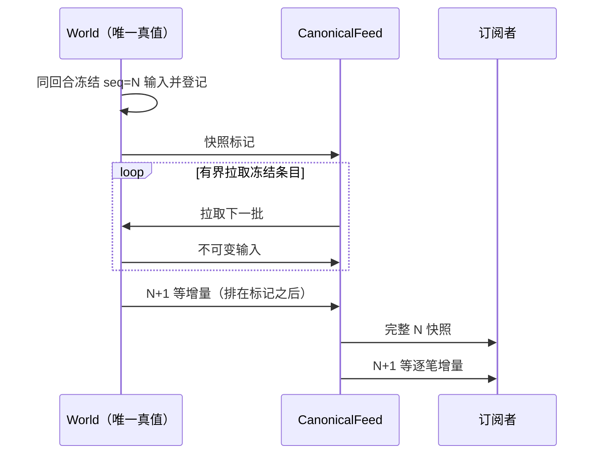

# M2b：按需装页、身份定位、读取闭包、粗层片段、按活动索引启动

父稿已写的定义（页、home、读取闭包、装页令牌、pin + 接纳复核、启动按需）只引用不复述。本稿只写本步的取舍与验证。

## 1. 改变的可观察行为与不变量

| 项 | M2a | M2b |
|---|---|---|
| 启动 | 读全部页段装入全部页，全量 `refresh_structure`、全世界 `prepare_component_cache` | 只读全局行 + 日志后缀 + 活动索引；后缀涉及的页与活动页经装页入口装入；不做全量 structure / component_cache |
| 常驻 | 全世界 | 驻留集 = 启动装入 ∪ 此后任何入口的读取闭包（本步不淘汰，只增） |
| 首次触及冷页的请求 | — | World 不在回合内读库：把请求挂起、交装页任务读 PG，装齐后在 World 重新裁决（对调用方只是多等一次装页） |
| 身份 | 实例 / aid 只在内存 | 持久定位表 `instance / aid → (根实例, 根 home 页)`，与页同批写入 |
| 粗层 | structure 启动全量重算；树冠每次从 L0 现算 | structure 与树冠按 `(level, L0 页)` 片段持久、随提交增量维护；物化粗层页只读粗层页 + 片段，不拉 L0 页 |
| 日志 kind3 | 改了实例 / 附件归属的提交写整表 | 写按键增量（`instances_delta` / `attachment_owners_delta`）；整表旧格式只在全量回放（迁移）路径接受 |

不变量（父稿 I1–I5 的落实）：
- **R1 驻留闭合**：驻留集对“读取闭包”闭合——任一驻留 L0 页上引用的实例 / 有主 aid，其整棵实例树（全部成员的 home 页、细化格 / 归属格 / 附件槽所在页）都驻留。由装页入口在接纳时迭代补齐，因此提交路径上的整件汇总（`component_geometry`、`subtree_ids`、`leaf_component?`、附件整件 HP）只读内存仍完整。
- **R2 非驻留页无内存改动**：提交只写驻留页（I5）；非驻留页的 PG 可见版本自启动前缀起不变，所以装页按“当前已发布前缀”读即是真值，不需按页重放日志。
- **R3 接纳复核**：每个可能读页的 World 入口在裁决前按当前状态重算其读取闭包；有未驻留页就挂起并装页，装完重新进入同一入口（父稿 P4“回到准备”）。本步不淘汰，pin 等价于“已驻留”。
- **R4 缺失不冒充**：PG 无行 = 从未编辑（baseline）；装页失败显式回复调用方 `{:error, {:page_load_failed, _}}`，不当空气。
- **R5 :all 模式**：前缀为 nil（迁移 / 全新）或 0 时内存即全部真值（库里没有可见页段），驻留集 = 全部，不装页。现有全新世界的用例行为不变；按需装页只在有前缀的重启后出现。

## 2. 设计要点（只写本步新增）

### 2.1 装页令牌与挂起（`World.PageLoad`）
- 驻留集 `resident :: :all | MapSet({level, region})`；粗层片段 `(L, p)` 驻留 ⇔ L0 页 p 驻留或粗层页 `(L, ⌊p / 2^L⌋)` 驻留。
- 入口 `needs(state, message)` → 闭包缺页（区域键各扩 26 邻页，同级）与待定位 id；空则直接裁决。否则挂起 `{from, message}`、起一个装页任务（World 监控），任务循环：取令牌（`{:page_tokens, pages}`，令牌 = 每页键的代数，本步恒 0，淘汰在 M3 递增）→ 读页 / 查定位 → `{:page_adopt, ...}` 接纳（只收令牌匹配且仍未驻留的页）→ World 按新驻留页补出树闭包缺页 → 直到无缺。完成后重放挂起消息；任务异常则对挂起的 call 显式回错。
- 接纳只装值不判脏：段经 M2a 唯一装页入口写入、恢复 `snapshots`、增量补页索引与 `remembered`（不再全量 `rebuild`），失效本页与 26 邻页的载荷缓存。
- 同一入口覆盖 handle_call（编辑、意图、prefab、GM、地块、信标、快照、serve 等）与 handle_info（施法 / 信标 / 身体接触 / 死亡掉落）。定时模拟（热、液体、投射物）在步前按种子页检查，缺页则本步不推进、请求装页、装完唤醒（父稿 P4“该步暂停”；P6 资格判断不在本步）。
- 维护入口（目录发布、参数发布、热实验、离线粗层重建）读整表：先装全部有行的页并切到 `:all`（父稿 P7 允许 O(范围)）。

### 2.2 闭包键（`World.Closure`）
- 区域型：沿用各入口现有键（`edit_keys`、`tool_regions`、`intent_keys`、prefab 足迹、窗口盒、射线盒），扩 26 邻页。
- 身份型（`remove_prefab`、prefab 拆 / 换、`replace_prefab`、`instance_cells`、`replacement_cells`、GM 搬移）：id 不在内存即查定位表 → 根 home 页 → 根记录的覆盖页集合。

### 2.3 定位表与 home 汇总
- 表 `voxel_identity_locator(cv, kind, a, b, root_a, root_b, home_x/y/z)`，主键 `(cv, kind, a, b)`；只插入（`ON CONFLICT DO NOTHING`）：根与根 home 自创建起不变（父 id 与 anchor 不变；搬移 / 替换产生新身份）。随切点批次与页段同一 PG 事务写入；删除的身份不删行（查到后装根页发现不存在 = `instance_not_found`）。
- **home 汇总的偏差**：父稿要 home 记录带“覆盖页集合 + 整件 max_hp 汇总”以免装全部覆盖页。本步只持久“根实例的整树覆盖页集合”（新段 `covers`，在根 home 页），闭包据此装全整棵树；不持久 max_hp 汇总——整件汇总照旧在内存算，结果与 M2a 逐项相同。代价是触及一棵树要装它覆盖的全部页（树的空间尺度有限）。按覆盖页汇总改造观察层属 N 系列 / 协议 42。

### 2.4 粗层片段（拆分稿 §5 e：行键 `(level, L0 页)`）
- `structure` 段：`state.structure` 里 `{L, cell}`（L=1..5）按 cell 所在 L0 页分片；写入集中到 `Canonical.put_structure/3`（判脏 + 片段索引）。
- `canopy` 段：`Canopy.project/3` 对 L≥1 改为合并片段——片段 = 该 L0 页内全部绑定锚点、其祖先实例记录副本、逐级去叶残余与残余 structure；L0 照旧现算。提交时对 `affected_keys` 涉及的页重算片段（同笔），变了才判脏。片段可由驻留 L0 数据重算，是派生物。
- 粗层页 `(L, R)` 的读取 = 本页 base / 稀疏格 + `level = L`、L0 页落在 R 内的片段行；跳过已驻留 L0 页的片段（内存为准）。

### 2.5 活动索引与启动
- 每个 L0 页一个 `activity` 单元（布尔），切点冻结时对本批涉及 liquid_active / sources / damage / identity 的页重算：有活动液体格、有限热源、热行（`ThermalWork` 的 hot / 耗尽 / 电路候选）即为活动页。
- 启动（有前缀）：读前缀 / 全局行 / 后缀 → 后缀涉及的页与 id（按事务内容静态求出，后缀里新建身份的 home 由 anchor 直接得出）∪ 活动页 → 闭包装入 → 重放后缀 → 按驻留数据 `rebuild_work`。迁移（无前缀）沿 M2a 全量回放，另全量计算片段与定位单元写进首个切点。
- 格式：全局行带 `page_format: 2`；读到旧格式（M2a 写的库）显式失败，不静默缺段（M2a 未部署到任何正式库）。

### 2.6 顺带
- `Liquids.raw_liquid_edit` 冷区逐格重读解码：把解码缓存带回 state。
- 部件整件求和次序：`in_refined_order` 依赖整表遍历次序，驻留集不同次序就不同（结果随装页历史漂移）。改为按格坐标排序的确定序（Q5 已批准；差异在迁移等价里列出）。

## 3. 可能破坏的直接边界

装页与提交交错（迟到结果、并发两个任务装同页）；挂起后重放与原调用超时；树闭包遗漏（附件槽在覆盖页外）；粗层片段与 L0 现算不一致；日志增量格式回放；切点里新段的判脏遗漏；活动页漏装导致重启后模拟不恢复；Replica / Scene 快照入口。

## 4. 证伪（最小反例，期望来自契约或手算）

1. **冷页编辑**（首个闭环）：真实 PG / File 后端，写 → 发布 → 停 → 重启：重启后驻留集不含该页；编辑该页 → 挂起、装页、提交成功，且结果与不重启的同序操作逐字段相等；改前（M2a 全装）该用例的“重启后驻留页数”断言失败。
2. **冷页不冒充 baseline**：冷页有 base / 稀疏格 / refined；`serve` 与窗口快照字节等于重启前（去头部 seq）。
3. **跨页树**：实例树跨 ≥2 页、home 在窗口外；只请求一页 → 整树驻留；按 id 拆除（定位表路径）后重启，树全部消失、余额退料一次。
4. **定位表**：负坐标 anchor；只在后缀里创建的身份（未发布）重启后按 id 拆除成功。
5. **迟到装页结果**：页已被另一任务装入并改写后，迟到的同页结果不覆盖（手工构造第二份接纳消息）。
6. **粗层**：冷 L0 页里的树，只装粗层页时 L1–L5 载荷 = 全装时（逐字节，去 seq）；改树后片段更新，重启后一致。
7. **活动恢复**：液体流动中 / 热源未放完时发布并重启，重启后不触碰该区也继续推进。
8. **日志增量**：同笔建删实例 + 改归属，重放两次只生效一次；旧整表格式出现在分页重放里显式失败。
9. 判脏：沿用 M2a `PageInvariant`，新段（covers / structure / canopy / activity）各一处反证（去掉判脏即红）。
10. 全量 `MIX_ENV=test mix test --no-start` 对比 M2a 基线 677/691（14 项既有失败）。

## 5. 不覆盖

P5 淘汰与预算、P6 模拟集与资格（冷页上的过程照旧冻结在库里，直到被装入）、分区 / 拆分、日志按页投影（S1a）、协议 42、max_hp 汇总（§2.3）、跨冷页的电路发现（电路只在驻留页上求解，本步不保证跨冷页连通）。

## 6. 实测

隔离 PG `voxim-pg-paging1024`，同 M2a 负载：重启就绪 1 / 4 份（对照 36.6 / 105.6 s）、就绪后驻留页数与 BEAM 内存、8 窗口提交 p50 / p99（对照 r98 / r99）。证据 `Voxim/Saved/Playtest/paging-20261024/runs/` 接续编号。

## 7. 进度与偏差（2026-10-26）

**实现与本稿的偏差**

| 本稿 | 实现 | 理由 |
|---|---|---|
| 闭包键 `{keys, ids}` 一律扩 26 邻页 | 分“扩邻页”与“只装本页”两类：只读快照（`material_snapshot` / `simulation_snapshot` / `sight_snapshot`）不物化载荷，只装盒内页 | 大盒快照（保护区测试 3.2 km 盒）扩邻页会装上万空页 |
| §2.1 挂起 | 第二次重放起不再为查无此身份的 id 等待（否则不存在的 id 无限挂起）；装页只给真装入内容的页失效缓存（PG 无行 = baseline，旧缓存仍对） | — |
| §2.5 前缀为 0 | 前缀 0（全新世界，库里没有可见页段）与无前缀同为 `:all`；重放后全量重算树冠片段（片段不进日志） | 测试里的全新世界行为不变 |
| §2.5 后缀 | 后缀写到的 L0 页连同各级粗层祖页扩邻页装入，重放后重算这些页的树冠片段 | 片段不进日志，重放后要按结果重算 |
| — | 旧整世界检查点函数（`Log.checkpoint_input` / `build_checkpoint` 等）保留，只供测试夹具 `LegacySave` 制造旧存档 | 迁移路径的测试依赖 |
| §2.3 home 汇总 | **已知偏差（统筹 2026-10-26 接受）**：只持久化根实例的整树覆盖页集合，触及即装全整棵树；整件 max_hp 汇总不持久，随 N 系列 / 协议 42 做 | 观察层按汇总改造属协议 42；代价见实测“如园中央首次装页 4.7 s” |
| §2.1 挂起 | 同一动作（施法 / 信标的准备、授权、取消，动作键）或同一身体（接触、摘离、死亡，cid）的消息按到达顺序处理：前一条挂起装页时后到的排在它后面，装完按序重放（`PageLoad.order_key/1`） | 先处理迟到的取消会落空，挂起的准备随后建起永远等不到授权的待施放（调用方无回复、施法者被卡成 cast_too_soon）；摘离同理会被迟到的旧接触覆盖 |
| §2.1 模拟 | 热提交每个内核步前（定时步、同步收尾 `drain_thermal`、`:thermal_commit`）都按当前热域查驻留，缺页即停在该步之前（提交不结束、不写部分通量），装齐后续步；液体每步只读活动格 ±1 格，步前检查已覆盖 | 父稿 P4；原实现只在开提交前检查，一次提交内多步扩域可能伸出已装邻页而按 baseline 读（当空气） |
| — | 会挂起装页的调用统一等 300 s（`simulation_snapshot`、`sight_snapshot`、`instance_cells`、`publish_properties` 原用 5 s 默认） | 见下“5 s 超时排查” |
| — | `run_m0.py` 补 20 GB 内存看门狗（与 `equiv.py` 同一实现）；新增 `migrate.py`（还原 → 迁移发布 → 停机） | 接力说明的基准纪律 |

**测试**（`MIX_ENV=test mix test --no-start`，voxel_region）：新增 `page_on_demand_test.exs` 9 项（§4 第 1–8 项 + `raw_liquid_edit` 只读一次）；
反证逐项为红：关定位表查询 → 按 id 拆除失败；去掉“仍未驻留”判定 → 迟到结果覆盖已拆的细化格；去掉活动页 → 重启后液体不推进；
去掉覆盖页跟进 → 跨两页的 prefab 拆除后远页残留；跳过片段行 → 粗层载荷少 structure；接回逐格重读 → 冷区读 5 次。
契约变更而改写的既有断言（各附独立依据）：日志实例 / 归属改为按键增量（`prefab_test`、`prefab_macro_world_test` 3 处）；
有前缀的重启后只驻留启动装入的页，判定前经 `material_snapshot` 触及内容所在格（`page_store_matrix_test` 4 处、`damage_world_test` 3 处、
`prefab_macro_world_test` 2 处）；部件格次序改为格坐标确定序（`world_refined_index_test` 1 项，Q5）；树冠投影合并随提交维护的片段
（`canopy_projection_test` 投影前重算片段，断言不变）；两处手工 state 夹具补派生字段。全量（`runs/t19-m2b-full.log`）685/699，失败恰为 14 项既有
（body_contact 10、thermal_edit 2、thermal_domain_equivalence 1、generated_store 1）。加 `raw_liquid_edit` 修复后的终轮（`t20-m2b-final-full.log`）685/700，
多出 1 项失败：`thermal_domain_equivalence`“earlier catalog, eps 0”。根因已定位为用例依赖墙钟：参考记录里点火前已走过一次 0.5 s 提交，靠的是旧实现建场
（冷区逐格重读解码 > 500 ms）慢于启动节拍；探针显示点火时 elapsed 旧 0.5 / 新 0.0，只撤回解码缓存即恢复通过。修法同 M2a 的 `pause_clock`：取消启动节拍、
建场后显式投递同一次提交并断言 elapsed = 0.5，记录与断言不变；该文件与本组用例重跑（`t21-m2b-equivalence-rerun.log`）只剩既有的 eps 0.9 一项。
data_service 51 项全过。`protection_world_test`“许可…”单独连跑 3 次失败 1 次（M2a 已记的与热节拍竞争的偶发，全量两轮均通过）。

**实测**（同 M1 / M2a 负载；隔离库先 `migrate.py` 迁移发布再 `run_m0.py` 不还原启动，即有前缀的重启；runs `r100`–`r103`）：

| 份数 | 版本 | 重启就绪 / 启动峰值 | 空闲 World 堆 | 结束 World 堆 / 驻留页 | 8 窗口 p50 / p99 / 最长 | World 长回收 n / 最长 | OS rss 最高 |
|---|---|---|---|---|---|---|---|
| 1 | M2a（r98，重启 36.6 s 取自 m2a-04） | 36.6 s / — | 1712 MB | 2056 MB / 全部 | 192 / 904 / 937 ms | 89 / 502 ms | 5.96 GB |
| 1 | M2b（r101） | 15.9 s / 1.15 GB | 426 MB | 1264 MB / — | 229 / 802 / 872 ms | 226 / 625 ms | 5.23 GB |
| 4 | M2a（r99，重启 105.6 s 取自 m2a-06） | 105.6 s / — | 6133 MB | 6140 MB / 全部 | 160 / 1899 / 2457 ms | 205 / 1714 ms | 18.6 GB |
| 4 | M2b（r103） | 15.9 s / 0.85 GB | 426 MB | 1894 MB / 2033 页 | 192 / 781 / 1116 ms | 149 / 586 ms | 4.81 GB |

重启就绪与空闲常驻不再随份数增长（1 / 4 份相同）；其中装页阶段 1.76 s 为读头部（前缀 / 全局 / 后缀 / 活动索引），两轮后缀为空、活动页为 0。
4 份 8 窗口结束时驻留 2033 页、实例 2056（= 一份如园：中央窗口拉起一整份，其余窗口在普通地形），说明常驻随活跃区域而不随世界份数。
窗口首次装页 25 次，p50 74 ms（1 份）/ 184 ms（4 份），最长 4.7 s / 4.0 s：如园中央窗口一次装 125 页（3³ 窗口区域各扩 26 邻页），
再按触及即装全树把覆盖这些页的整棵实例树装进来（home 汇总偏差的代价，见偏差表），是本步最大的单次装页事件。8 窗口 p99 在 4 份由 1.9 s 降到 0.78 s
（存活堆小、主回收短）；1 份长回收次数增多（堆小、回收频）但最长不变档位。延迟对比带当天机器状态折扣（见 M2a 进度日志）。

**统筹跟进修正后**（顺序、模拟步前检查、超时；反例：`magic_windup_world_test` 冷页取消排序、`page_on_demand_test` 热提交开提交前暂停，各自反证为红）：
全量 `t22-m2b-followup-full.log` 中途以 EXIT 132 异常终止（mix 进程退出码 132，未出结果行；已知现象，原因未查，原始日志保留）；重跑 `t23-m2b-followup-full.log`
688/702，失败恰为 14 项既有。

**尾延迟复测**（同一代码、同一配置：1 份，`migrate.py` 迁移发布后 `run_m0.py` 重启 + 1/2/4/8 窗口各 180 s；两轮间隔 ≥ 2 分钟、同一时刻一个基准节点、看门狗照旧；
8 窗口段统计，长回收 = World 进程 ≥ 20 ms 的 long_gc，回合占用 = 段内 World 消息处理时长之和 / 183 s）：

| run | 提交数 | p50 / p99 / 最长 | World 长回收 n / 中位 / 最长 / 合计 | 长回收分布（<100 / 100–300 / 300–500 / 500–800 / ≥800 ms） | 回合占用 | 结束堆（采样，含未回收垃圾） |
|---|---|---|---|---|---|---|
| r101（跟进前） | 1429 | 229 / 802 / 872 ms | 103 / 381 / 409 ms / 38.9 s | 1 / 0 / 102 / 0 / 0 | 0.73 | 1264 MB |
| r105 | 1386 | 376 / 1979 / 2889 ms | 92 / 387 / 860 ms / 36.9 s | 3 / 0 / 81 / 6 / 2 | 0.77 | 1930 MB |
| r106 | 1431 | 64 / 643 / 765 ms | 11 / 378 / 400 ms / 3.5 s | 2 / 0 / 9 / 0 / 0 | 0.55 | 1952 MB |
| r107 | 1430 | 333 / 794 / 1095 ms | 111 / 380 / 398 ms / 41.5 s | 2 / 0 / 109 / 0 / 0 | 0.74 | 1952 MB |

判定：r106、r107 的 p99 都回到 ≤ 1.0 s，按统筹规则记为**回收时机起伏**，不是跟进改动的回归；r105 的尾部与它独有的 8 次 ≥ 500 ms 主回收对应
（其余三轮最长都 ≤ 409 ms）。r106 段内长回收只有 11 次、占用 0.55，说明同一负载下回收次数本身随堆档位大幅起伏（父稿 M1 已记）。原始数据全部保留
（runs `r104`–`r107`）。

**代码评审修正**（`review-astra-m2b-code.md`、`review-fable-m2b-code.md`，统筹合并 6 条；反例均在 `page_on_demand_test` / `magic_windup_world_test`，各附反证）：

| # | 问题 | 改法 | 反例（反证） |
|---|---|---|---|
| 1 | 闭包不覆盖真实读写集：模拟 / 死亡 / 投射物 / 液体接纳 / 启动活动页只装 L0 页却逐级归约写粗层页，未驻留粗层页从 baseline 读、整页覆盖 PG `coarse_overlay`；洪泛无空间上界；刷新姿态与施法授权未过闸 | 会几何提交的入口与模拟步前检查都带 L1–L5 粗层祖页（`Pages.with_ancestors/1`，与 `edit_keys` 同一归属）；`{:prepare}` / `{:adopt_liquid}` / `body_death` / 投射物 / 启动活动页同；洪泛伸进冷页即停、注入格的提交闭包未齐即挂起，装齐后从头重新裁决；工具 / 生产 / 附件意图按刷新后的姿态复核闭包、缺页挂起原消息；`authorize_cast` 过闸 | “重启后一步液体提交→切点→再重启 L1–L5 逐字节等于不重启”（去掉祖页即红）；“注液洪泛伸进冷页，冷墙挡住液体”（同时去掉洪泛检查与提交闭包检查即红） |
| 2 | 树闭包非原子：页先驻留、整树后补，期间别处提交按全表把“身份已装、格未装”的实例当死实例删除；已装孤儿不再定位 | 装页任务按 PG 行求树闭包（`Pages.closure_step/3`），闭合后一次 `page_adopt`；实例裁剪只在本笔碰过的身份及其祖先里做（`Payloads.dead_instances/1`）；`need` / 闸按“整树闭合”而非“在内存”过滤身份，孤儿仍定位补根 | “读另一页途中别处提交不删跨页实例”（按轮接纳即红）；“别处提交不把格未装的实例当死实例删除”（全表裁剪即红） |
| 3 | 装入无关页把 `remembered.sources` 等整表重置，抹掉他页未提交差异，漏判脏、重启复活热源 | 装页只把本次装入的键并入 `remembered` | “装页不重置他页未提交的热源差异”（整表重置即红）；“两页热源只触及一页后重启另一页仍在” |
| 4 | 后缀回放以区域后像的实例投影覆盖完整记录（丢 placed_by）；旧整表归属未拒绝 | 后像实例只补内存里没有的；`txn_needs` 同时拒绝整表实例与整表归属 | “后缀回放不覆盖未改动实例的 placed_by”（恢复旧合并顺序即红）；整表归属 `assert_raise` |
| 5 | 装页失败时异步业务消息只记日志 | `prepare_cast` 回错并发 `cast_failed`、`quote_cast` 回错、`authorize_cast` 按取消收尾、信标回 prepared / committed 错误、投射物放掉本次采样并清任务位、`body_death` 1 s 后原样再投（已确认后果无别的渠道）、身体接触等下次续报 | “冷页上前摇准备装页失败：调用方收到错误、Player 收到 cast_failed、同序队列释放”（只记日志即红） |
| 6 | 热步前装页失败时 `:wake` 立即重投步，PG 不可用即紧循环 | 只有确实暂停在步前的提交才续步；失败时等 500 ms 再试 | “热步前装页失败：不紧循环重试”（立即重投即红：1 s 内数十次） |

评审修正后全量 `t24-m2b-review-full.log` 697/711，失败恰为 14 项既有。修正触及装页路径，按规则复跑 1 份重启 + 8 窗口（`r108-1x-m2b3-migrate`、`r109-1x-m2b3`）：
重启就绪 14.3 s、启动峰值 0.87 GB；8 窗口 p50 / p99 / 最长 176 / 703 / 717 ms，长回收 96 次、最长 372 ms，回合占用 0.63，提交尾延迟无退化。
**但窗口首次装页变慢**：17 次装页中位 1.2 s、最长 9.4 s（r101：中位 74 ms、最长 4.7 s）。原因：窗口预备的闭包现在带 L1–L5 粗层祖页（每窗口约 170 个粗层页键），
`PageStore.read_pages` 对粗层页逐键一条范围查询（L5 页的片段范围覆盖 32³ 个 L0 页）；整树闭合后一次接纳也让单次接纳回合变大。最小修正建议（未做，待统筹定）：
粗层页按级合并成一条查询；或只在预备之后确实要提交液体接纳时才带粗层祖页。

**统筹第三轮**：
- 粗层页按级合并读取（`PageStore.read_pages` 每级一条查询，片段行按算术右移归页），闭包内容不变；单测断言 24 个粗层页键（5 级）只发 5 条读段查询（逐页查询时 24 条，反证为红）。
- 死亡掉落装页失败：原实现本就每次失败都 1 s 后原样再投（不是只投一次），补结构化日志 `voxel_death_drop_retry cid feet error retry_ms`；
  反例“连续两次装页失败后第三次成功，掉落只落一次”（去掉再投即红）。
- 全量 `t25-m2b-round3-full.log` 698/713：14 项既有 + `protection_world_test`“许可…”（M2a 已记的与热节拍竞争的偶发；该文件单独连跑 3 次全过）。data_service 51 项全过。
- 复跑（`r110-1x-m2b4-migrate`、`r111-1x-m2b4`）：重启就绪 15.4 s；8 窗口 p50 / p99 / 最长 109 / 764 / 938 ms，长回收最长 459 ms；**首次装页中位 1227 ms、最长 9156 ms，
  合并读取后几乎不变**（r109：1195 / 9379 ms；r101：74 / 4690 ms）。按统筹规则（中位 > 3 倍）定位剩余耗时，加了每轮耗时日志（`voxel_page_load_round`、`voxel_page_adopt`）
  做一轮短探针（`r112-1x-m2b4-loadprobe`，同库 8 窗口 30 s）：如园中央窗口一次装页 11.6 s，其中 PG 读段合计 0.36 s、任务内解码 2.5 s（21 MB 压缩段）、
  任务内求树闭包 2.8 s（`closure_step` 每轮对已读全部行重算，3 轮 × ≈0.9 s）、**World 一次接纳回合 5.9 s**（再解码一遍并装入 1831 行）。其余窗口单独装页 7–70 ms，
  与它并发的装页排在这个接纳回合后面，耗时 1.3–3.4 s——中位数被这些排队拉高。玩家可见的窗口准备总时长（`snapshot_phase_s`）首个如园窗口 20.8 → 23.3 s，
  其后各级 10.1–11.8 → 8.8–9.4 s。结论：剩余耗时不在 PG 读，在“双份解码 + 闭包重算 + 单次大接纳回合”。最小修正建议（未做，待统筹定）：
  `closure_step` 只对本轮新读的行增量求；任务把已解码的单元交给 World（只解码一次）；大闭包分批装入但到闭合才一起标驻留（单次 World 回合有上界）。
  **5.9 s 的单次 World 回合本身是停顿风险**（r101 按轮接纳时最长 3.5 s），应优先处理。

**统筹第四轮（分批接纳）**：
- 改法：① `closure_add/2` 只并入本轮新读的单元（增量）；② 装页任务按行并行解码、把解码结果交 World（World 不再解码）；
  ③ 大闭包按固定规模分批交 World 暂存（`:page_stage`，每批 ≤ 16 行 / 64 KB 压缩字节，常量），暂存页记在 `page_load.pending`、**不驻留**，
  整树闭合后 `:page_commit` 复核根覆盖页并一次标驻留；其他请求要的页正被别的任务暂存时，其装页任务把挂起条目交给那个任务后退出（`:page_yield`，一页只由一个任务暂存，无互等）。
- 反例：“分批暂存途中触及该树的请求挂起到闭合”——读第二页时用读取闸卡住，`instance_cells` 必须挂起、放行后返回整树 8 格（暂存即标驻留的反证为红：返回半棵树）。
  同用例里远处编辑（x = 8000，与暂存页及各级粗层祖页都不重叠）正常提交、不删暂存中的实例。说明：与暂存页共用粗层祖页的请求会等到整次装页闭合。
- 全量 `t26-m2b-round4-full.log` 698/713：14 项既有 + `protection_world_test`“许可…”（单独连跑 6 次失败 1 次；M2a 改动撤回时为 12 次 1 次，同一偶发）。批规模由 32 行 / 128 KB 调到 16 行 / 64 KB 后
  终轮 `t27-m2b-round4-final-full.log` 699/713，失败恰为 14 项既有。data_service 51 项全过。
- 复跑（r113 / r114：批 32 行 / 128 KB；r115 / r116：批 16 行 / 64 KB）：

| run | 单次接纳回合最长 | 首次装页 中位 / 最长 | snapshot_phase_s（1 / 2 / 4 / 8 窗口） | 8 窗口提交 p50 / p99 / 最长 | 重启就绪 |
|---|---|---|---|---|---|
| r101（按轮接纳） | 3462 ms | 74 / 4690 ms | 20.8 / 10.1 / 10.4 / 11.8 s | 229 / 802 / 872 ms | 15.9 s |
| r111（整树一次接纳） | 4255 ms | 1227 / 9156 ms | 23.3 / 8.8 / 9.1 / 9.4 s | 109 / 764 / 938 ms | 15.4 s |
| r114（分批 32 行） | 331 ms | 1192 / 6809 ms | 23.3 / 9.8 / 11.4 / 10.4 s | 62 / 765 / 786 ms | 15.5 s |
| r116（分批 16 行） | 311 ms | 1156 / 6821 ms | 21.7 / 10.1 / 11.3 / 10.8 s | 258 / 790 / 1138 ms | 14.9 s |

- **目标对照（未全部达成，不放宽）**：单次接纳回合 311 ms，略超 300 ms——最大的那批只有 1 个单元（一个 16³ 子块的稠密 refined 行），
  装入本身约 0.3 s，分批无法再切；要再降需改写入口的批量装入（逐格 `put_refined` 维护索引）。首次装页中位 1.16 s，远高于 220 ms；提交尾延迟未退化。
- **剩余耗时分布**（r116 全部装页任务合计）：PG 读 0.55 s、任务内解码 2.1 s（已并行）、求闭包 1.0 s、暂存 13.6 s——其中 World 实际暂存回合合计 4.1 s（468 批），
  其余约 9.5 s 是**任务在 World 邮箱里排队**：同期 World 的非装页大回合——窗口快照组装 `canonical_snapshot` 最长 2.4 s、首笔编辑 2.2 s、装页结束后在 DOWN 回合里
  重放挂起的快照 1.7 s、液体接纳 1.3 s——都远超 300 ms，装页的每一批都要排在它们后面。中位数（1.0–1.6 s 的那批）就是这几个与如园同时开窗的窗口在排队。
  这些大回合是 M2a 已有的窗口快照 / 首笔编辑成本（r101 里同样有 2.6 s / 2.2 s），不属于装页路径；要让首次装页回到 r101 量级，需把窗口快照组装移出 World 回合
  （分支 B 方向）或拆小，超出本步。

**统筹第五轮（Fable 修补核对 §2.3 必改 + §2.4）**：
- §2.3：`PageLoad.gate` 重放（attempt > 0）不再整体清空身份，只跳过定位后内存里仍无记录的 id；内存里有记录而树未闭合的（让出 / 撤销暂存留下的半棵树）继续定位补根，
  `defer` 的 attempt 1 同受益。反例“让出后以 attempt > 0 重放…不按半棵树作答”：读覆盖页时杀掉装页任务（撤销暂存，实例记录留在内存），再把 `instance_cells`
  交给一个不含该树、正常结束的任务经 DOWN 以 attempt 1 重放——期望整树 8 格（手算）；旧代码反证为红（返回 home 页上的 4 格）。
  核对说明：Fable 推断的“D 只含覆盖页”时序在现实现里 D 读到覆盖页的归属引用也会闭合该树，真实可达的是“让出给已结束任务 / 级联让出”的重放，故用 DOWN 路径夹具。
- §2.4：粗层页与本轮单元里不带 identity / covers / refined / macro_owners / attachments 的 L0 页随其最后一批暂存直接标驻留（`Pages.ready_batches/2`，
  `:page_stage` 多带 `ready`）；带树身份或覆盖关系的页仍等 `:page_commit` 整树闭合，半棵树不可见不变。反例“整树暂存期间粗层祖页与平凡 L0 页已驻留…”：
  树卡在读覆盖页时，L5 / L1 祖页与无树邻页已驻留、home 页未驻留；同一 L5 页内无关编辑在树仍卡住时完成（文件后端 14–16 ms，3 次）；改前反证为红（60 s 超时）。
  原“分批暂存途中触及该树的请求挂起到闭合”用例仍过。
- 全量 `t28-m2b-round5-full.log` 700/715：14 项既有 + `protection_world_test`“许可…”（同一偶发，单独连跑 6 次全过）。新增 2 项。
- 复跑 r117（迁移）/ r118（1 份重启 + 1/2/4/8 窗口）：

| run | 单次接纳回合最长 | 首次装页 中位 / 最长 | snapshot_phase_s（1 / 2 / 4 / 8） | 8 窗口提交 p50 / p99 / 最长 | 让出任务 | 随批标驻留页 |
|---|---|---|---|---|---|---|
| r116 | 311 ms | 1156 / 6821 ms | 21.7 / 10.1 / 11.3 / 10.8 s | 258 / 790 / 1138 ms | 0 | — |
| r118 | 292 ms（日志 255） | 1104 / 6118 ms | 19.6 / 8.8 / 9.9 / 9.3 s | 54 / 677 / 731 ms | 0 | 2746（468 批） |

  r118 重启就绪 30.1 s（r116 14.9 s）：页恢复 `load_us` 1.68 s 与 r116 的 1.78 s 相同；多出的约 11 s 在 `mix run` 编译检查阶段、约 4.5 s 在 World 之前的其他应用启动，
  与装页路径无关，记为环境起伏，未复测。如园这一轮没有任何装页任务让出（r116 也是 0），首次装页中位仍由 World 邮箱里的非装页大回合决定（见第四轮），
  所以 §2.4 的收益在本基准上不可见，由上面的单测量级证明；首次装页中位 ≤ 220 ms 的目标仍未达成，未放宽。

另：开热提交前暂停的既有用例改名并写明证明范围（只覆盖开提交前，夹具只删驻留标记）。

**待办（统筹定为本轮不做）**：测试 reset 未清定位表（`OverlayLogStore.reset_world` 只清旧四表）；同页在途读取合并（父稿 P4“每页至多一请求”，现为每挂起入口一任务）；
看门狗按脚本进程树限定（现为“启动后新出现的全部 erl”）；挂起 caller 超时 / 退出后的取消语义；`Closure` 兜底 `:none` 改为入口登记差集测试；`stats` 整表统计只数驻留的口径说明。

**5 s 超时排查**：会过闸的入口里，窗口快照（`canonical_snapshot_and_subscribe`，含 CollisionStream）、Replica 快照、区域取数 `serve`（预备 300 s、
逐区 60 s）、工具 / 生产 / 附件 / prefab 意图（300 s）、施法与信标（Player 异步消息，Gate→Player 300 s）、`material_snapshot`（300 s）原本就不是 5 s。
用默认 5 s 的是 `simulation_snapshot` / `sight_snapshot`（NPC 感知与视线）、`instance_cells`（玩家拆 prefab 的前置查询，冷实例走定位表）、
`publish_properties`（作者目录发布，装全部页），已统一改为 300 s；其余默认超时的调用（版本、seq、目录、统计等）不过闸。

**剩余风险 / 未覆盖**：电路只在驻留页上求解；维护入口（目录 / 参数发布、热实验、离线粗层重建）装全部页；定位行只增不删；页不淘汰（M3）；
活动恢复只在单测验证，如园库两轮活动页为 0；max_hp 汇总未持久（§2.3），整件按格确定序重算的末位差异未逐项列出（Q5）。

## 8. 交接第 1 项：窗口组装移出 World（2026-10-27，施工中）

契约：沿用父稿分支 B 的只读投影与 v7 §3.6 的精确观察切点。World 在同一回调冻结已驻留窗口的不可变输入并登记订阅，
`CanonicalFeed` 在 World 外沿既有 `Payloads` / `Observation` 路径组装区域、完整整件属性及碰撞，先发快照再逐笔发送增量（含空投影）。
所有字段仍取同一 seq；跨窗口的叶子与附件必须保留完整整件输入；来源损坏显式失败，不发送部分快照。

工程选择：冻结窗口相关引用留在 World 堆内，发送进程逐批拉取 map 条目，信用为 1；不把整份 World 捕获进闭包／任务。
传输批次只搬运已经冻结的值，不产生第二真值或按批次改变单元语义。组装后的载荷仅作派生缓存回填，切点后发生提交则丢弃该回填，
确认态仍由 World 唯一写入。冻结输入在传输结束、订阅者或发送进程退出时释放；不保留持久快照副本。
依据：[Erlang 消息复制规则](https://www.erlang.org/doc/system/eff_guide_processes.html#sending-messages)
明确普通消息数据会复制（同节点 refc binary／literal 例外）；仓内 `PageCut` 已采用同进程冻结引用与有界传输。
[Erlang 同源信号顺序](https://www.erlang.org/doc/system/ref_man_processes.html#signals)适用于 World→Feed→订阅者的单一 FIFO。
代价：组装期间保留旧引用、增加本地往返。几何缓存只回填汇总；World 在切点与目录仍匹配时用自身引用构造原有缓存标签，
不复制工作进程标签里的原始微格。实测必须同时看复制／GC 与总准备时间，不能只看编码移走。

最小验证：真实 World + 既有 GeneratedStore（测试仅在读取接缝加闸），暂停组装时 `World.seq` 与远处编辑仍完成；
放行后快照保持旧 seq／内容、后续事务连续；复用现有损坏来源、跨区整件属性、重复订阅与缓存失效测试。
仅启动本模块必要依赖、每例临时目录；不启动 PG／UE。再用既有 `run_m0.py` 与隔离 PG 对齐 r118 的 1/2/4/8 窗口、180 s，
记录单回合、首次装页、准备时长、提交 p99、GC 与内存（20 GB 护栏不变）。这不是玩家入口或双客户端验收。

施工顺序与记录（本节兼作执行记录，不另建平行计划）：
- [x] `collision_source_test` 最小受控并发反例：改前失败、改后通过。
- [x] `World` / `CanonicalFeed` / 相邻只读输入模块接入冻结、分批传输、失败与释放；同步 README。
- [x] 最小相关集成回归与隔离库实测，原始证据接续 `runs/t29`、`runs/r119`；最终 `t50` / `r130`。
- [x] 一轮独立代码评审与针对修补核对；后续实测驱动的性能修正由反例与相关回归验证，未反复重开评审。
- [x] 用户 2026-10-27 授权提交当前实现检查点，并要求保留性能回退和未验收记录；该授权不表示全面验收通过。
- [ ] 推送单独等待用户同意。

范围：本步不改协议、不实施 P6／迁移、不处理首笔编辑或液体接纳的大回合；Replica 旧入口暂保持原行为。
2026-10-27：完整读取交接、approved v7、§7 与两仓测试规则；当前分支 `paging-window-snapshot`，保留用户既有 D11 改动。

**独立评审与修补核对（同日，一轮评审 + 一次针对核对）**：
- 冻结全表扫描：叶子改从窗口 `refined_regions` 找 owner，再经 `refined_owners` 扩完整叶子；附件经 `aid_regions` 找完整槽；
  epochs 按窗口 chunk 键取。反例固定一窗、加入 2,000 个远处叶子：改前冻结 reductions 138,081 对小样本阈值 7,802，失败（`t34`）；修补后通过。
- **裁定**：不采用只从 `pages.unit_damage` 读属性的建议。`Thermal.flush` 可在提交前新增 damage，该持久索引尚未更新；只读它会漏观察。
  保留原始 damage 的冻结引用，在每次运输中最多检查 16 条，再按窗口／owner／aid 选择。单回合不整表过滤，但总读取工作仍随驻留属性记录数增长。
- 嵌套表：保护查询 index 不供观察使用，不运输；`protection.regions`、`thermal.semblances`、真实来源形状 `source_state.index.bounds`
  按自然记录运输。保护表反例 `t34`、来源 bounds 反例 `t36` 均先红；bounds 原先的单批 9,837 words 大于半张表的 4,859 words。
  没有添加通用递归序列化器；区域基底／prefab 单记录的成本仍须由实测检查，不据 16 条的计数直接宣称字节有界。
- World 退出：旧 Feed 忙于读取／组装而不能消费 DOWN，反例 `t33` 等不到 Feed DOWN。增加独立生命周期监视者，
  只链接 Feed、不链接 World；World／订阅者退出会中断阻塞组装，Feed 正常退出也回收监视者。反例修补后通过。
- `t29`：主并发反例改前红；`t30`：改后绿；`t31`：原三组接缝 122 项通过；`t32`：3 项退出／阻塞用例通过；
  `t35`：窗口纯算法、来源、属性、按需装页共 125 项通过。命令均在本 app 下 `MIX_ENV=test`、`ERL_FLAGS=+S 4:4`、`mix test --no-start`。
  日志中 `test-only page read failure`、损坏来源和前缀冲突来自既有故障用例；不将这些预期日志当作测试失败。
- `r119-window-migrate`：仅隔离库还原与迁移发布，seq 14615，67.1 s 就绪，峰值 3.13 GB，护栏未触发，正常停机。
  `r120-window-snapshot`：针对核对发现真实来源的 bounds 嵌套未拆完后主动停止；未形成完整性能结论。
  保留启动、空闲、部分运行日志及 `interrupted.json`；手动正常停机与运行器收尾交错触发 `psutil.NoSuchProcess`，非产品失败，未重试 RPC。

**性能反证与直接修正**：
- `t37` 最终相关回归 126 项通过。`r121` 重新还原隔离库并发布同一 seq 14615；`r122` 按 r118 参数开始实测，
  首窗 `world_send.elapsed_us = 1,923,276`，仍不满足 300 ms 目标；`feed_sent` 19.1 s。停止本轮负载、正常停止节点，保留失败证据；
  未触发内存护栏。不能以单测通过或编码已外移声称本步完成。
- 定位到冻结为找 owner 扫描稠密微格。`t38` 的 64 个相同宏格（每格 1 / 512 槽、同一 owner）反例：稠密输入 709,378 reductions，
  稀疏输入派生阈值 14,940，失败。修正为 `Canonical.put_refined/index_refined` 维护
  `refined_region_owners = 区域 → %{owner → 占用宏格数}`；同格同 owner 多槽只计一次，最后一个宏格离开即移除。
  `WindowSnapshot.freeze` 只读该索引再经原 `refined_owners` 找完整整件，不再展开槽。派生索引不持久、无第二 owner，恢复由既有写入／重建路径维护。
  计数更新复用同模块附件计数的相同规则；对应手算反例覆盖重写、同区多格、最后一格移除、负区域与重建。
  [PostgreSQL 索引文档](https://www.postgresql.org/docs/current/indexes-intro.html)说明索引随数据修改维护以免查询全扫，代价是写入成本；
  此处只借用该维护原则，实现延续仓内已有的 Canonical 派生索引，不引入数据库索引或外部缓存。
- `t39`：窗口抽取、派生索引、来源、属性、按需装页 135 项通过。新增索引触及共享写入口，所以扩大到 `world_refined_index_test.exs`，
  具体抓取“某 owner 仍占同区另一格却被过早删掉”及“重写同归属多计一次”两类破坏。

**总准备时间回归与缓存接续**：
- `r123` 短探针：首窗冻结 33.5 ms；输入回合最长 439 ms 与同时间 World 439 ms GC 对应，不能声称所有回合都低于 300 ms。
  30 笔提交无错误，OS RSS 峰值 4.65 GB。`r124` 重新迁移；`r125` 完整 1/2/4/8 × 180 s 已正常完成并停机（未中断）：
  178/357/714/1428 笔提交、零错误；准备 26.2/17.1/19.8/18.4 s，明显慢于 r118 的 19.6/8.8/9.9/9.3 s，故没有作为验收通过。
  冻结回合最长 375/40/39/43 ms（首窗含同时间 338 ms GC）；8 窗口 p50/p99 187/788 ms，OS 峰值 4.83 GB，重启就绪 13.9 s。
- 相邻读取表明快照仅消费 prefab 的 `definition.presentation_bindings`，而目录堆统计约 239 MB；删除运输中的模板几何。
  组装函数返回后先在 Feed 回收已用完的输入，再投影碰撞（World 不做这次 GC）；增加 `feed_input_released` 日志。
  `t40` 模板输入反例先红，`t41` 141 项通过；`r126` 短探针准备仍为 25.9/16.1 s，说明裁剪本身不足以修复回退。
- 进一步恢复原有 `Observation.component_cache` 语义：冻结时只取标签仍匹配的几何汇总，载荷与汇总均命中的区域不运输原始微格；
  未命中整件仍取完整输入，在 Feed 用唯一算法、原确定序计算，按每批最多 16 个 owner 回填。World 仅在 `seq` 与目录仍相同才接纳，
  标签由当前 World 自身引用构造。缓存是可丢弃派生物，不产生事务、不替换真值；多批失败时已回填的合法缓存仍可用，批次不承担正确性语义。
- 原始微格省略后，已冻结载荷必须作为本轮不可变输入保留，不能再受工作进程临时 LRU 淘汰支配。`t44` 四区域、小缓存反例确实丢失末区字节；
  `Payloads.canonical_regions` 显式接收冻结字节，其余区域仍用同一物化算法。`t42` 缓存命中反例、`t44` 淘汰反例、`t46` 去掉切点／目录守卫的变异反例均为红；
  `t43` 142 项、`t45` 143 项通过。新增验证覆盖几何修改与目录修改后缓存失效、跨页完整整件及过期结果拒绝。
- `t47` 144 项通过；`r127` 短探针准备 27.0/11.4 s，缓存接续降低重复开窗成本。r125 的 8 窗运输回合最长 20.8 ms，4 窗除 GC 外的直方图上界为 32.8 ms，
  因此把输入批次从 16 条改为 64 条以减少同步往返（几何回填仍每批 16 个 owner）；每条均为同一冻结输入，未改 20 GB 护栏或验收目标。
  `t48` 针对运输／来源的 21 项通过；`r128` 短探针准备 23.7/11.0 s，零错误，输入回合最长 8.1/6.7 ms。
  总读取 work 的限制不变：damage 按每批最多 64 条筛选，source bounds／全局回执按自然记录传输，仍未实现 P5 的长期驻留预算。
- 缓存接续后由 `Canonical.put_refined` 在部件最后一格消失时立即释放其缓存，不能依赖下一次开窗清理已消失的 owner。
  `t49` 退休反例先红；`t50` 最终六文件 145 项通过。当前代码以此冻结，后续最终验收只使用 `r129` 干净还原后的 `r130`。

**最终实跑与判定（`r130-window-release-final`）**：
- 版本：基于 `0fe6c0fc` 的当前未提交改动，分支 `paging-window-snapshot`；运行前保存 `source.json`，运行后核对 10 个改动源码／测试文件 SHA-256 全部相同。
  Windows 原生、16:16 调度器、隔离 PG `voxim-pg-paging1024` / `paging_ruyuan_1x`；r129 从同一 `/tmp/backup.dump` 还原并发布 seq 14615，
  r130 重启，空闲 120 s，1/2/4/8 窗口各 180 s、间隔 1000 ms、spacing 256；与 r118 同负载。跨日期机器状态不同，细小差异不作因果归因。
- 新增可操作行为：窗口组装期间 World 可继续响应和提交，订阅保持精确切点与同源 FIFO；来源损坏、Feed／订阅者／World 退出均显式结束，
  不发部分快照。六文件命令见 app README，`t50-window-final.log` **145 项通过、退出码 0**。
- 性能主目标的证据：首次装页 17 次，中位 **1104.4 → 45.4 ms**，达到原中位 ≤220 ms 目标；最大 **6117.8 → 6687.2 ms**，如园大闭包尾部仍在。
  快照冻结回合在 1/2/4/8 档最长为 **396.9 / 38.4 / 37.2 / 42.9 ms**；首窗同回合包含 361 ms World GC。
  冻结原先对应 **2187.4 / 1177.4 / 2051.6 / 1243.9 ms**。输入传输回合全轮最长 **17.7 ms**，几何回填最长 **0.82 ms**。
- 实跑完整性：四档分别 **178 / 357 / 714 / 1428** 笔提交，错误全部为 0；8 窗提交 p50/p99 **221.9 / 791.8 ms**（r118：53.9 / 677.1 ms）。
  总准备时间 **27.4 / 11.3 / 12.5 / 11.9 s**（r118：19.6 / 8.8 / 9.9 / 9.3 s），OS RSS 峰值 **6.04 GB**（r118：5.04 GB）。
  重启就绪 14.9 s；r118 的 30.1 s 含当时编译／其他应用启动差异，不据此宣称快照优化加快启动。
- **结论与范围**：窗口编码／属性汇总已移出 World，其他页请求的排队中位明显下降；**不宣称整体性能验收通过**。
  总准备时间、RSS 与本轮提交尾延迟均高于对照，完整冷输入的跨进程复制／重建仍有成本；World 全轮长 GC 最长 414 ms，不能宣称所有回合 <300 ms。
  首笔编辑、液体接纳及其他已有大回合未在本步修改。未做真实双客户端验收，未推进 P6／迁移；第 3 项 caller 取消等欠账仍按交接清单保留。
- 证据：`runs/r130-window-release-final/{source.json,comparison.json,step-*.json,probe/,os.jsonl,startup.json,stop.json,cleanup.json}` 与 startup 所指原始服务端日志。
  `comparison.json` 从两轮同名结构化字段生成，包含原始失败／代价，没有改阈值；`field-heap-end.json` 开头可能含 hosts 解析日志，读取时只取其最后一行 JSON，原文件未改。
  运行器退出码 0，20 GB 护栏未触发。已正常停节点、停隔离 PG（只停不删），最终无残留 erl；如园保护范围未写入，D11 原有文档改动保留，未提交／推送。
