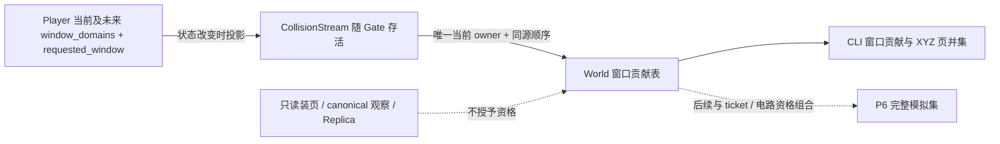
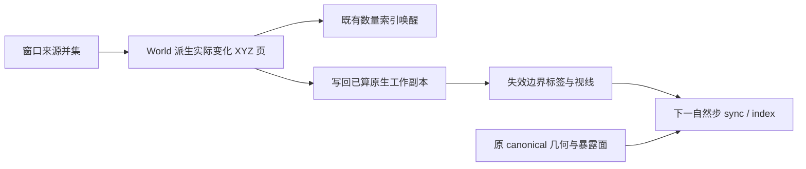

# P6／Q1：模拟资格与边界实施记录

> **最新语义（2026-10-27）**：用户明确要求“模拟是世界的一部分，不能暂停；前端渲染可以停止，但后台的演化不能停”。
> 此要求取代下文旧 Q1 的无人/预算冻结方向。当前施工先恢复单 World 按世界实际活动持续演化，窗口仅负责观察生命周期；
> 有限热源、燃烧、液体、接触与辐射不受窗口增减影响，自然稳态可休眠，由真实相互作用维护唤醒。
> 旧日志保留为历史证据，不充当新语义验收；新反例/命令/进展见 `.superpowers/sdd/voxel-authority-sharding/task-continuous-runtime-report.md`。
> 完整活动驱动分片方案另由协调者组织，本次不据旧冻结方案新增架构。

状态：既有批准方向的实施中记录，不是完成或验收声明。前置检查点为 `5957192b`；其性能回退、未验收项仍以 `m2b-on-demand-pages.md` §8 为准。
上位契约：[父稿 P6／Q1](../2026-10-24-world-region-paging.md)、[approved v7 §3.2–3.3、§8–9](../2026-10-26-voxel-authority-sharding.md)。
执行遵循两仓 AGENTS 与 Voxim `Docs/Testing.md`，工程细化自主推进；后续提交、推送仍逐次征得同意。

## 1. 顺序与范围

1. **窗口来源与可观测面（本增量）**：接通真实 Player → CollisionStream → World 的窗口贡献；已安装、待装、已请求盒并集外扩一圈完整 XYZ 页。
   单独读页、canonical 观察订阅和 Replica 不授予窗口资格。窗口来源断开自动退休，跨 Scene 移交沿同一个流保留。
2. 物理接纳与边界：液体墙、导热绝热、辐射冷页遮挡、身体／拟态范围、资格变化唤醒；与 M2b 的有资格但未驻留门禁组合。
3. ticket、冻结时间锚点与活动恢复：有限过程、预算冻结持久化、不补算、重启不复活；D10 保留既有过程。
4. 电路有界发现与 D11：当前导通分量整页资格；接线按潜在图（只计玩家放置／加工导体）拒绝超限；天然矿脉合成超限按已定规则冻结提示。
5. 根级集成、最小真实客户端场景、同输入 8 窗口基准。逐项闭合后才能声称 P6 完成。

第 5 点须先让 `paging_m0/load.ex` 的测试窗口显式登记贡献（其普通 canonical 订阅不能自动取得资格），否则内核接入后可能测到“没有资格所以不模拟”的假低负载。

窗口来源增量只落实第 1 点；后续液体／散体定时步及世界导热／辐射边界已接入窗口资格，见 §6–7；完整热冻结与其他物理仍待接入。
查询字段继续叫 `window_pages`，不伪称包含 ticket／电路的完整模拟集。
不提前建立 ticket／预算开关、第二物理实现或迁移协议。后续接入按同一资格 owner 的明确契约推进。

## 2. 窗口契约与归属

- **Player 是窗口生命周期的事实来源**：复用 `window_domains`（按 `simulation_tick` 保留当前和未来域）及 `requested_window`。
  `window_domain` 同时保留来源快照的 L0 盒；bounds／travel 仍由它派生，不从浮点米坐标猜回页号。
- **CollisionStream 是资格来源的生命周期 owner**：它随 Gate 存活、跨 Scene 只切换 Player 接收者。初次请求先登记请求盒；
  后续请求携带 Player 当前完整窗口集合，在 World 接纳该集合后才启动快照准备。接收 ACK 只释放消息缓冲，不能退休资格。
- **退休点**：Player 的 `simulation_tick` 消费到新域，现有 `stream_window` 裁剪旧域后发布新的集合。不是快照刚到达，不是消息 ACK，也不是 private tick 提前装入未来域。
  这是现行协议 41 能表达的服务端权威窗口生命周期；不新增客户端确认消息。
- **移交**：`attach` 同时接收新 Player 从 cut 派生的完整窗口集合，流 PID 不变；来自旧 Player 的迟到发布／请求拒旧并记录，不能覆盖新 owner。
  导出 cut 前，旧 Player 向流做一次有回执的接纳屏障，保证此前 cast 已被接纳；否则 attach 来自另一发送者，可能先到而丢掉 cut 内已记的在途请求。
  该屏障不等 World／快照／安装。流向 World 异步登记，收到登记回执后才启动快照读取；流等待登记时仍处理屏障和 attach，
  避免 Player→流→World→Player（意图刷新会回调 Player）的同步等待环。只扩展原在途请求的准备阶段，不另造安装状态机。
- **World 独占窗口贡献表**：键是 CollisionStream PID，值是已校验的盒集合；首次登记 monitor，DOWN 即删除。没有 TTL、续租、第二持久真值。
  窗口页集合从贡献表按完整 XYZ 派生；不因 PG 行、驻留页、canonical 订阅或只读视线而增加。
- 同一来源替换窗口集合不会影响其他玩家；相交窗口的重叠页仅算一次。默认近窗三轴各 3 个 L0 页时，其窗口贡献外扩为三轴各 5 页。



可观测接口：`World.simulation_windows/1` 返回来源数、每个来源的窗口、`window_pages` 与页数（页坐标、盒坐标均完整 XYZ）。
结构化日志 `voxel_simulation_windows` 记录来源 PID、更新／退出、来源数与窗口数；PID 与现有 `liquid_stream_identity` 的角色绑定对应。
正常玩家入口仍是登录、移动跨窗、Scene 移交、断开；不增加玩家 UI 或协议字段。

## 3. 依据与取舍

[Luanti 官方地图术语](https://api.luanti.org/map-terminology-and-coordinates/)明确区分 loaded 与 active；
[官方 API](https://api.luanti.org/core-namespace-reference/)分别提供 loaded／active 查询和 forceload。
这里只采用“驻留不等于模拟资格”的边界；不照搬它的地图块尺度或产品冻结行为，Q1 才是本项目产品契约。
[Erlang 进程文档](https://www.erlang.org/doc/system/ref_man_processes.html#signals)的同源信号顺序与 monitor 用于同一流连续发布和退出退休。
先查证仓内实际调用：Player 在收到事件时立即 ACK，但稍后才在私有 timeline 安装、再由 simulation tick 消费；据此不能拿 ACK 当安装完成。

选择复用 Player 已有窗口序列，由流转交，而不是另造一套 ACK／安装状态机。代价是 Player／流的内部 API 增加窗口集合参数；
优点是只有一个安装／退休事实源，跨 Scene 保持同一流的生命期。物理接口接入留在下一可运行增量，不用开关掩盖未完成范围。

## 4. 本增量最小验证

- 纯几何：XYZ 外圈、负页坐标、多个窗口重叠与来源替换；期望手算，不复刻实现。
- 真实 World + CollisionStream：正常请求登记；普通读取／观察不登记；消息 ACK 不退休旧盒；当前 owner 发布才替换；attach 后旧 owner 迟到发布无效；
  Gate／流退出退休，其他来源保留。来源用既有合法空气夹具与文件日志，不启动 PG。
- 真实 Scene + Player：用既有可控时钟／来源替身覆盖窗口实际消费与退休接缝，替身只替世界数据，不替 Player 或流。
  核对当前窗口和待装窗口并存、接收 ACK 后仍并存、消费到新域才退休；移交保留集合。现有出生、复活、信标流送夹具同步提供新内部契约。
- 可从正常 Elixir CLI 调用只读接口复现。纯元数据增量不跑如园全量 benchmark；第 5 步内核接入后再跑规定基准，不以这一步代替 P6 性能或双客户端验收。

## 5. 执行日志

- 2026-10-27：用户批准并已提交窗口组装检查点 `5957192b`，未推送；继续 P6。原始性能回退未改写。
- [x] 本增量设计单轮独立核对：补齐 cut 前接纳屏障，其他方向可实施；没有新增产品决定。
- [x] 最小反例先红；接入窗口贡献与现有生命周期。
- [x] 相关真实模块回归、CLI 观察与退出清理。
- [x] 独立代码评审：没有确定的 Critical／Important 代码缺陷；补齐指出的真实 seal/import 与提前安装验证缺口。
- [ ] 本增量提交仍需另行同意，未推送。

实现验证进度：`t51-p6-windows-red.log` 三项改前失败；`t52-p6-windows-green.log` 三项通过（真实 World＋流，含 World 暂停时屏障仍完成）。
`t53-p6-player-red.log` 真实跨窗暴露旧接口；接线后 `t54-p6-player-green.log` 通过：真实输入在 tick 343 请求新窗，快照进入 FIFO 后两窗仍并存，
tick 344 实际消费新窗后才退休旧窗。新盒 Y 也重新居中，期望按 y≈501、64 m 页手算为 `[6,9)`，未把 Y 固定为原值。

收口证据（窗口增量，不是整个 P6）：
- `t55-p6-stream-regression.log`：World／流 5 项通过（其余 19 项未选，不计通过）。
- 代码评审指出两个覆盖缺口后，补真实移动跨 Scene → `Player.seal` → `Scene.prepare_transfer` → prepared 提前安装 → activate 消费的场景。
  流暂停时 seal 必须等接纳；World 替身暂停时，恢复流后 seal 与 attach 都必须能完成。保留同一个流 PID，旧、新窗口在 prepared 时并存，消费后才退休。
  `t58-p6-seal-mutation-red.log` 删除 Player 屏障会提前返回 cut，确实失败；`t59-p6-early-retire-red.log` 在 private tick 提前退休会只剩新窗，确实失败。
  两项临时变异均撤回；`t60-p6-player-final.log` 五文件 **23 项通过、退出码 0**，包含流送／非流送、复活、信标与移交回归。
- `r131-p6-window-scope/probe.exs` 使用正常 `mix run --no-start -r test/support/world_fixtures.exs <probe.exs>` 执行，`MIX_ENV=test`、`ERL_FLAGS=+S 4:4`。
  真 World／真流、空气来源／文件日志：窗口贡献 **125 页**，只读远处材料后不变，来源退出后 **0 页**，世界事务号仍为 0；`scope.json` 保留完整 CLI 读回。
  这是模块级 CLI 实跑，不是正式 QUIC／UE 玩家验收。复跑须把 probe 复制到新的输出目录，原证据不覆盖。
- 本轮没有启动 PG 或基准节点、没有运行物理性能基准；当前物理仍沿原路径。前一检查点 r130 的准备时长、RSS、尾延迟回退及双客户端未验收原样保留。

## 6. 液体冷边界与唤醒增量（2026-10-27，施工中）

接续会话 `01a17ab1-233e-7760-8e0f-c27eb1869e50` 已授权的第 2 项，先闭合液体／散体共用数量内核。
本增量只消费窗口资格；ticket、热、电路、投射物、预算冻结恢复与根级验收仍未完成，不能称为 P6 完成。

- 契约：定时步只消费有窗口资格的活动格；计算输入同样裁去无资格格，故冷页既不收水也不被取水。显式工具／作者入口沿用原权限与事务契约。
- 冻结前沿保留在既有 `liquid_active`，无资格不排程，冻结候选自身不触发装页、不补算；重启不恢复玩家窗口。上一帧下落仍发一次空帧清除。
- 窗口并集变化按变化页及六邻页查询现有 `liquid_regions` 索引唤醒，避免全世界数量表扫描；窗口贡献仍是唯一资格来源，不增设兼容开关。
- 可观测面复用 `simulation_windows`、`liquid_activity`、`simulation_snapshot` 与正常 canonical 下落帧。`active_cells` 包含冻结候选，`scheduled=false` 表示当前无可推进步。
- 测试：独占临时目录、真实 World／文件日志，来源替身只提供空气或一格合法静水；手动投递正常液体拍，不启动 PG／UE。
  覆盖正负 XYZ 边界、不取冷水、只读装页不授予资格、静水边界重开、重启冻结与清帧；其他物理和真实玩家链路不在该组结论内。
- 依据复核：[Forsyth 六面格点模型](https://tomforsyth1000.github.io/papers/cellular_automata_for_physical_modelling.html)与
  [Clawpack 有限体积守恒](https://www.clawpack.org/riemann_book/html/Approximate_solvers.html#Finite-volume-methods)。
  沿用原数量内核及共享面两端相消；Q1 的冷面零通量通过输入可用性实现，不另造流动算法。代价是 ticket 尚未接入时，窗口外有限过程暂时冻结。

### 6.1 实现与本轮证据

状态：液体边界增量已实现、真实模块／CLI 已实跑；不是完整 P6、真实双客户端或性能验收。所有新改动仍未提交／推送。
依据已批准的边界语义自主实施，没有增加产品决定。单轮独立代码审查未发现确定的 Critical／Important 缺陷；指出的过期模块说明已同步更新。

- World 每拍先求当前有资格候选，装页就绪后才清掉被消费候选，冻结部分仍在原活动集中。`Liquids.advance_liquid` 的输入格也过滤资格，
  避免只过滤活动格却从冷侧取水；不改通用 `liquid_cells`，显式工具与作者动作仍走原入口。
- 资格变化按所有来源的页并集对称差及六邻页，从 `liquid_regions` 取数量格唤醒。显式释放与来源 DOWN 复用同一路径；
  `schedule_liquid` 为旧下落帧保留一次清帧机会，无可推进候选及旧帧后停止排程。
- 旧液体／散体夹具在正常公开入口登记自身 XYZ 窗口；恢复真值先读回、需继续推进时再重建资格。
  `bench/paging_m0/load.ex` 改为各长期订阅进程在快照前登记自己，快照报告带 `simulation_source`；
  原停止路径使来源退出，由 World monitor 退休。驱动已编译，未运行新的全档基准。

规范证据：`Voxim/Saved/Playtest/paging-20261024/runs/r132-p6-liquid-scope/`（相对两仓父目录）。
本轮代码身份为基点 `5957192b` 加该目录 `source-sha256.json`；与前次窗口贡献 WIP 合并验证，不冒充已提交版本。
命令均在 `apps/voxel_region`，`MIX_ENV=test`、`ERL_FLAGS=+S 4:4`：

```powershell
mix test --no-start test/liquid_scope_test.exs
mix test --no-start test/liquid_scope_test.exs test/simulation_windows_test.exs test/liquid_test.exs test/liquid_world_test.exs test/loose_world_test.exs test/phase_world_test.exs --exclude database
mix test --no-start test/page_on_demand_test.exs test/persist_backlog_test.exs test/protection_world_test.exs test/protection_identity_test.exs test/thermal_edit_world_test.exs test/sand_glass_world_test.exs test/furnace_generator_world_test.exs test/thermoelectric_world_test.exs test/thermistor_ceramic_world_test.exs --exclude database
mix test --no-start test/liquid_scope_test.exs test/simulation_windows_test.exs
mix run --no-start -r bench/paging_m0/load.ex -e 0
```

- `red.log`：7 个新行为反例全部改前失败；`green.log`：7 项通过。覆盖 X 正／Z 负／Y 正负边界、不流入及不取冷水、
  只读装页不授予资格、无活动前沿的静水重开、冷恢复不补算、退出后空下落帧。
- `regression-core.log`：**92 项通过、3 项排除**，退出 0。范围扩至散体与相态，因为它们共用数量内核和焓搬运。
- `regression-seams.log`：**64／66 项通过、3 项排除、2 项失败**，退出 2。扩大到按需装页、积压恢复、保护区与材料组合，
  分别覆盖模拟门禁、重新调度、侧流权限及相同数量入口。两项失败均为已有 `thermal_edit_world_test` 冻结摘要：
  当前 `21b21903…`／`7ca7a941…` 与 `runs/t09-checkpoint-proj-full.log` 和 `runs/t11-thermal-verify-full.log` 逐字相同；
  未更新期望、未改写为通过，不把该组报告成全绿。
- `final-scope.log`：格式与说明更新后 **10 项通过**，退出 0；`bench-compile.log`：驱动编译退出 0；
  新模块／新测试 `mix format --check-formatted` 与 `git diff --check` 通过。既有 Elixir 编译告警保留。
- CLI 通过正常 `mix run --no-start -r test/support/world_fixtures.exs <新运行目录>/probe.exs` 执行，原始 `cli.log`、`scope.json`：
  冷边界 2,097,152 单位不变，只读相邻页后不变，开放后只搬运 **131,072** 单位，释放来源后总量及分布不变、来源数 0、无下一拍。
  复跑先新建独占目录，只复制 `probe.exs`，不复用原 `probe-world` 可变日志。
- 本轮 PG 未启动，如园保护范围未写入；结束时无残留 erl，`voxim-pg-paging1024` 仍为 Exited。
  自动审批以 `blocked by policy` 拒绝了删除临时世界并迁移目录的组合命令；未重试删除，规范日志单次复制到上述目录，
  本轮 `.demo/observe/p6-liquid-20261027-resume/` 与其小型世界夹具保留，供人工按需清理。

剩余：热传导／辐射／身体与投射物边界、ticket 与预算冻结的持久化／恢复、电路与 D11、正式双客户端及同输入 8 窗口性能门禁。
接入 ticket 前窗口外液体暂时冻结；本次模块验证不将该过渡状态称为完整 Q1 交付。r130 的性能回退及未验收记录继续有效。

## 7. 世界热节点交换边界（2026-10-27，施工中）

接续已批准 P6／Q1，先闭合世界节点之间的导热与 canonical 法线辐射视线；不把此增量称为整个热冻结完成。
有限源、燃烧、环境交换、电路能量及身体／拟态外加边仍走现有推进路径，资格调度、ticket 与预算恢复留后续闭合。
这样不在边界施工时截断电路的能量结算或丢失冷页有限源余能，旧记录与日志仍是唯一真值。

- 契约：世界接触边仅在两端完整足迹都有资格、且原保护区／气候分区允许时存在；任一冷节点为绝热边界。
  辐射起点与沿途宏格都须有资格，否则为既有 `:blocked`，不退化成天空。资格恢复后复用原自然步序，不重开进行中的 run。
- 输入与所有权：保留 canonical 几何及真实暴露面，只剪导热接触，不把断开的接触面改成额外环境换热面积。
  World 接纳窗口变化时先写回已算的原生工作副本，再使热域边界标签、视线与精确域标志失效；下一步由同一 ThermalDomain 重建拓扑。
- 可观测面：复用 `simulation_windows`、`simulation_snapshot` 的温度／供能／环境账及 `voxel_thermal_kernel` 的边数、辐射半对与天空面数。
  具名缓存接缝测试可读取派生图计数；World 内容和温度只由作者编辑、有限热实验及正常提交产生。
- 最小验证：真实 World＋空气 Source／文件 Log，2 格石体手算热容与有限 10 kJ 源；暖→冷、冷→暖、冷→冷导热，
  空气冷页遮挡、冷起点辐射半对、重开与再关闭、进行中 run 的写回保留。模块测试不启动 PG／UE，不替代根级验收。
- 依据：[COMSOL 官方 Thermal Insulation](https://doc.comsol.com/6.3/doc/com.comsol.help.heat/heat_ug_ht_features.09.094.html)
  将绝热定义为零跨界热通量，[OpenFOAM 官方常见边界组合](https://doc.openfoam.com/2606/tools/processing/boundary-conditions/common-combinations/)
  将其对应到温度零法向梯度。本项目复用已存在的对称导热边删边表达零通量，不将冷页设置为环境温度；
  辐射 `:blocked` 沿用已批准 Q1 与现有 ThermalRadiation 合同，不新增辐射算法。



### 7.1 实现、验证与限制

状态：世界热节点交换边界已实现、真实 World／CLI 已实跑，未提交／推送；完整热冻结、P6、S0 以及真实客户端／性能仍未验收。
单轮独立审查未发现确定的运行时 Critical／Important 缺陷；指出的气候热场景缺资格已在实际热入口补齐，原摘要／行为断言保持。

规范证据目录：`Voxim/Saved/Playtest/paging-20261024/runs/r133-thermal-boundary/`，基点 `5957192b` 加 `source-sha256.json` 的工作树源码。
不重录任何既有冻结摘要，保留准备失败、原始红灯及变异失败；本增量无新产品决定。

命令在 `apps/voxel_region` 执行，`MIX_ENV=test`、`ERL_FLAGS=+S 4:4`：

```powershell
mix test --no-start test/thermal_scope_test.exs
mix test --no-start test/thermal_scope_test.exs --only thermal_scope_inflight
mix test --no-start test/thermal_scope_test.exs test/liquid_scope_test.exs test/simulation_windows_test.exs test/thermal_domain_test.exs test/thermal_radiation_test.exs test/thermal_work_test.exs test/thermal_radiation_world_test.exs test/thermal_domain_equivalence_test.exs test/thermal_activity_world_test.exs test/combustion_world_test.exs test/climate_zone_world_test.exs
mix test --no-start test/thermal_batch_test.exs test/thermal_static_phase_test.exs test/thermal_switch_test.exs test/protection_world_test.exs:428 test/protection_world_test.exs:452
mix test --no-start test/page_on_demand_test.exs:573 test/page_on_demand_test.exs:599
```

- `red-corrected-metric.log`：5 项边界反例全红，旧路径导热把另一侧加热约 **0.072 K**，冷起点辐射漏约 **0.035 K**。
  初次准备误用实验入口禁止的零环境系数，已改为合法近绝热参数 `1e-9 W/m²/K`，准备失败另保留；
  首次观察误把合并后的天空项个数当面积，已改为面积与实际环境能量共同判定，没有修改生产规则。
- `green.log`：5 个热边界与既有窗口／液体合并 **15 项通过**。之后补进行中 run 反例：两个有限源在 0.1／0.2 s 耗尽，
  只测试调度屏障让公开窗口更新排在自然步之间；不回填温度、能量或 run 私有真值。总供能 **30 kJ**、0.5 s 提交、储热＋环境账闭合。
  `inflight-no-flush-mutation.log` 去掉写回后确实失败，变异已撤回；不是只测空闲状态下的缓存更换。
- `regression.log`：11 文件 **63／64 项通过、1 项排除、1 项失败**（退出 2）。唯一失败为既有 `eps 0.9` 房屋冻结摘要：
  460.0000000000002 s 的 `1d7c030363d75d8aa0523fb7c1634a78db209967307654194530dd7bad92d4b0` 与 `runs/t11-thermal-verify-full.log` 逐字相同。
  零辐射冻结对照、气候边界、热休眠／唤醒、热域／视线纯契约和本轮边界通过；不将该组改报全绿。
- `boundary-seams.log`：**18 项通过、15 项未选**（退出 0），覆盖批次、相态、温控开关及原保护区导热／辐射边界；
  `page-thermal.log`：**2 项通过、20 项未选**（退出 0），覆盖真实热恢复及装页失败不紧循环。未选均不计通过。
  扩大范围的原因是复用原生热域、接触边界和换窗失效入口；没有重跑无关整套服务端／客户端。
- CLI 正常入口：`mix run --no-start -r test/support/world_fixtures.exs <新证据目录>/probe.exs`，`cli.log`、`scope.json`：
  另一侧 **293.15 K → 293.19977559895096 K → 293.19977559895096 K**，分别对应关闭／开放／再关闭，供能 **10 kJ** 且账闭合。
  该 probe 自行创建、停止并清理本次独占临时世界；复跑复制脚本到新证据目录，不覆盖原输出。
- 旧热场景夹具已显式登记有限 XYZ 窗口，纯值／有意无窗场景保留；恢复先断言真值、继续推进再登记。
  不是全部迁移夹具都做了完整场景实跑；只将上面实际选中的用例计入验证，其他文件只做断言不变与语法核对。
- `final.log`：变异恢复与格式整理后，热边界／液体／窗口合并 **16 项通过**，退出 0。
  `syntax.log` 解析本工作树 52 个改动 Elixir 文件成功（不求值、不算场景通过）；新文件格式检查及 `git diff --check` 通过。
  本轮结束无残留 erl，隔离 `voxim-pg-paging1024` 保持 Exited，未写如园保护范围，未提交／推送。

### 7.2 整体路线定位（答当前接力问题）

Claude 已交付 M1（按世界规模解耦）、M2a（页表与连续写回）、M2b（按需装页）的实现和隔离库实跑，提交已推送；
M0 有主要基准但并非全部矩阵完成，M2b 仍有 §7 待办和真实双客户端缺口。
Codex 接手后补窗口组装检查点 `5957192b`，再推进这里的窗口／液体／热交换增量。
按 approved v7 §8，目前仍是 **S0 前置实施与收口**，尚未进入 S1a。父稿 M3 的 P6 被提前到 S0；
P5 淘汰与缓存预算等仍在后续。之后才是 S1a 数据／日志、S1b 编号与会话、S2 两静态分区、S3 合并与动作连续、
S4 动态拆合，最后 S5／原 M4 协议 42。不能用这几个增量推算整体完成百分比，或把它们写成已完成分片。

## 8. 冷过程资格与有限过程接入（2026-10-27，施工中）

第一闭环先修正冷过程仍进入热内核的问题：资格在 World 编排入口统一判断，冷侧有限源、温度、燃料、相态不推进；
窗口重开只触发下一正常步，不补算。热域只接纳全部足迹有资格的节点，拟态按完整 span，身体接触按接触格过滤。
冷侧原始记录与待结算键保留在既有 owner，不能以裁掉缓存为由删除。CLI 继续使用 simulation_snapshot 的热账与有限源余量。

实施顺序：冷过程入口及反例 → 单一资格 owner 的有限 ticket / 页数字节预算 → 持久化冻结与重启 → 电路整页资格及 D11 → 投射物边界。
预算数值尚未在批准稿找到，已报协调者；不自行赋予产品默认值。D10 迁移保留只在迁移合同落地后验收，不能用纯集合合并声称真实移交完成。

依据复核：[Luanti 官方地图术语](https://api.luanti.org/map-terminology-and-coordinates/)将模拟 active 与 loaded 分离；
[Folia 官方 region logic](https://docs.papermc.io/folia/reference/region-logic/)要求推进期间不能扩大所属集合。
本项目借用接纳后再推进的边界纪律，实际 XYZ 页、冷面、不补算及有限过程语义仍以 Q1 为准；不照搬二维 section。

第一组测试使用真实 World、合法作者热实验、文件日志与空气来源替身；正常热提交消息推进，测试时钟只取消定时器。
反例包括无窗热源不消耗、混合冷暖源只消耗暖侧、重开恰推进 0.5 秒、真实重启保留冷源，随后扩至燃烧与环境。
该组不证明真实玩家链路、预算 ticket、分片或性能；运行前独占共享 BEAM 测试锁，证据另建目录不覆盖旧运行。
