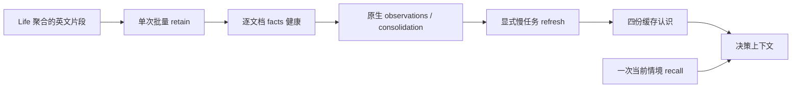

# NPC life 的独立 Hindsight 服务（只测试）

`service.py` 只管理 `voxim-npc-life-loop-20261011`，宿主端口 `18908`，数据卷与模型缓存卷分别为同名前缀的 `-pg` / `-hf`；不操作其它实验服务。容器加入既有 `caplib-20261008-net`，Demo 服务端使用 `http://voxim-npc-life-loop-20261011:8888`；宿主使用 `http://127.0.0.1:18908`。这不是正式生产部署。

```powershell
python -B scripts/npc_life/service.py start
python -B scripts/npc_life/service.py restart
python -B scripts/npc_life/service.py stop
cd apps/gate_server
mix test --no-start test/gate_server/npc_hindsight_test.exs
```

凭证读取同级主树 `../ex_mmo_cluster/.env` 的 `NPC_LLM_URL` / `NPC_LLM_KEY`，只经子进程环境与 `docker -e NAME` 传入；manifest 不含上游地址与密钥。复用固定镜像 `voxim-npc-evolve-hindsight:0.10.3-flashrank`，BGE-small ONNX 的 CLS 与查询前缀以及 FlashRank 配置来自已实跑的 [NpcEvolve/service.py](../../../Voxim/Docs/Gameplay/NpcEvolve/service.py)。新 mutable 数据完全隔离。

HTTP 适配器为 `GateServer.Npc.Life.Hindsight`，config 是 `%{url: root_url, bank: bank_id}`。`ensure/2` 建立独立 bank 与缺失的 self/relationships/world/commitments；已有模型不覆盖。`retain/2` 接受 `%{"id" => stable_id, "text" => english_episode, "at_ms" => unix_ms}` 列表，边界一次映射到第三方文档字段，同步批请求后检查每个文档的 `memory_unit_count > 0`。它报告最近 100 个后台操作；抽取完成与巩固完成是两项事实。`models/1` 只读缓存内容；`refresh/1` 是显式后台运维调用，逐模型等待自己的 operation。`recall/3` 恰好一次 mid-budget、带 query_timestamp 的情境召回。`status/1` 返回 stats、最近操作及按操作聚合的 token，丢弃原始 LLM trace。

单 HTTP 请求缺省 300 秒；每个后台 operation 的总预算缺省 600 秒，轮询请求也受剩余预算约束。错误只返回可诊断分类，不返回外部错误体或私有 URL。所有模型/召回输出标记为主观记忆，不是 World 当前数值真值。



依据与验证：本次对固定镜像的 `/app/api/pyproject.toml`、`hindsight_api/api/http.py` 和运行服务 `/openapi.json` 直接核对（版本 0.10.3）。文档读取采用 `detail=content`；刷新返回 async operation，按 `/operations/{id}` 的 completed/failed/cancelled/not_found 判定。没有假设后续网页版本的 API。源配置实际启用了 observations 与 auto consolidation；启动日志证明 BGE-small 的 ONNX CLS/query prefix 已初始化，FlashRank `ms-marco-MiniLM-L-12-v2` 已初始化。

测试隔离：10 项 HTTP 边界测试只启动 `:inets` 与端口 0 的本地 HTTP 替身，覆盖批次映射、每文档 facts、失败脱敏、缓存只读、单次召回、单请求/operation 超时及模型创建/完成。真实验证仅用独立 `contract-probe-20261011` bank，不写最终 NPC bank；两短文档一次 HTTP batch 仍触发 **两次** LLM 抽取，共输入 20,287 / 输出 659 token、5 facts，召回中同时存在 Brann 破坏与 Mara 修复。生产 Life 应先将短事件聚合成约 3000 字符片段，不能把“一个 HTTP batch”误称“一个抽取调用”。数值/模型表现属于本小样本，不能代替真实 World/Body/双客户端验收。

本次可复现 probe 与原始证据位于 `.demo/observe/npc-life-20261011/hindsight/`：`contract_probe.exs`、`refresh_probe.exs`、`service.json`、`providers.log`、`version.json`、`openapi.json`、retain/recall/status JSON 与刷新产物。复跑真实抽取请使用新 bank 和新输出目录，不覆盖既有证据。

## 单 NPC 双端人生 Demo（只测试）

`demo.py` 绑定本轮唯一正式组合：`voxim-npc-life-demo-20261011`、`server/` 挂载、同一 `LifeBuilder` cid 与独立 bank。只读 import 同级 Voxim 的 R7 `harness`，通过真实认证的两端 `ReplayInputs` 发普通鼠标/键盘意图；`@place` 只摆放测试玩家。输出目录必须为新目录，入口先转绝对路径，避免 Voxim 子进程工作目录改变产物位置。脚本不会伪造情绪、关系、计数或施工方块；初始有限材料走 `World.material_supply`，施工必须由 NPC 自己完成。

```powershell
python -B -m unittest discover -s scripts/npc_life -p test_demo.py
python -B scripts/npc_life/demo.py dry --out .demo/observe/npc-life-20261011/dry-new
python -B scripts/npc_life/demo.py social --out .demo/observe/npc-life-20261011/social-new
python -B scripts/npc_life/demo.py memory --out .demo/observe/npc-life-20261011/memory-new
python -B scripts/npc_life/demo.py restart --out .demo/observe/npc-life-20261011/restart-new
```

这些命令是已经准备好的本轮世界的测试入口，不是通用生产部署。`prepare` 只允许尚未登记 NPC 的世界；`initial-correction` 是本轮首次材料夹具不足的显式纠正入口，不能用它重置已开始的人生。宏木块需要 2,097,152 材料单位。修复的 `@aim_build` 应落在目标空格内部（Y416.01），普通瞄准地表与建造空格不是同一契约。

`judge --sources ... --out ...` 把真实 World seq、actor、格子、两端意图结果与 canonical_applied 相对照。行为还要求同来源实际 XYZ 距离变化与新终态 Outcome，且发生在声明的玩家靠近窗口；加载期的 AOI 触发作为混杂保留，不计控制样本。`authority_accepted`、`behavior_accepted`、`client_authority_accepted` 与 `all_replays_completed` 分开报告。伤害后移动与玩家带旧伤害来源再次靠近后的移动分别标注；done/settled 但 within_tolerance=false 只证明实际接近，不能宣称精确到点。

终态只搜索同一次连续 social 机会及紧邻的 `social=nil` 释放行（兼容 thank 完成），取消/释放后不能借下一次相同来源的 done。输出 `opportunity_id`、`terminal_at_ms`、原 Outcome 身份与实际靠近窗口；开始和完成都须在同一窗口，单终态只能计分一次。首次8项判定器只保存GREEN、原RED证据缺失；复审I1的取消后复用/越窗两个反例先RED（8/10、2失败），修复后11项GREEN，离线新产物为`primary-judge-06/`、`fresh-judge-03/`，原8个受控终态仍独立有效。人格离线复判使用原来公开State产出的距离文件并记录来源/hash，不请求服务或复写生产规则。

`matched-fresh` 先等 NPC 自然停稳，按完整 XYZ 生成玩家距离，再用既有客户端入口靠近一次；末尾东侧相机窗口是独立展示阶段。`fresh-judge` 审计本轮固定前后阶段，从公开 `State.behavior` 派生旧/新距离，要求对照均在旧安全距离外、新谨慎距离内，且后测比前测更远；不能拿 2.684m 的近距离混杂样本冒充人格改变。名义 3.3–3.5m 是选点近似，不是新增生产阈值。

`upgrade --image ...` 仅接受本轮通过构建的 manifest/image ID，检查已有容器挂载与端口，保留 DB/world/bind。测试 wrapper 保持原有 `--user 0:0` 写 readiness/log；生产 `/app/bin/server` 入口不改。`repair-memory` 调用公开纯 State 从同一 World 历史重建文字，确认重建 canonical 相等，替换原来两个相同 document ID，等事实巩固后刷新 Life 缓存；不会把重建心智写回 Life，也不重放状态增量。

依据：UTC 文本使用 [Elixir DateTime.from_unix/3](https://elixir.hexdocs.pm/DateTime.html#from_unix/3) 与 [to_iso8601/3](https://elixir.hexdocs.pm/DateTime.html#to_iso8601/3)，原始 World `at_ms` 保持毫秒精度。固定 Hindsight 0.10.3 镜像源码 `engine/retain/fact_storage.py:205–318` 在替换前删除旧事实衍生 observations；`engine/memories/pg/writes.py:242–330` 清理旧来源关联并将其它 surviving 来源重新排队巩固；`engine/memories/pg/retain.py:217–246` 删除该文档所有 memory units（含 chunk_id=NULL）后同 ID 写回，保留 created_at。相同 hash 是去重，UTC ISO 文本改变 hash 后才真正重新抽取。本轮最终仍只有两个文档，没有新建另一 bank 或重置心智。

`llm` 是同 cid 的单次正式接线检查，目标为自然维护施工，保留全部真实能力组，预算 1/h。复用 `scripts/npc_soak_trace.exs` 的既有脱敏 trace，只增加模型哈希、召回摘要与工具/用量，不保存 endpoint/key。请求完成后停止探针，`restore` 恢复建设者；不以请求成功宣称记忆产生了行为因果。

本轮实跑：六次损害评价、六次修复帮助；三个受控回避和五个实际接近样本，两次无伤害控制、两次重启后陌生人谨慎移动。首次相对路径、材料不足、修复瞄准失败、模型时间污染、第二次陌生人距离失配与部署 wrapper 用户失败全部保留。更正后的四模型已人工复核，Hindsight 的帮助事实范围仍存在 +10ms 派生偏差；权威原事件/ISO经历不偏移。唯一 LLM 请求选择 look 并完成，输入8303/输出45 token；上下文接线通过，LLM 记忆行为因果未证明。

最终证据索引为 `.demo/observe/npc-life-20261011/final-04/manifest.json`：主行为 `primary-judge-07/`、人格 `fresh-judge-03/`、冷重启 `restart-01/`、模型 `memory-corrected-01/`、决策 `llm-01/`、恢复 `restore-01/`，最终修复镜像接入 `upgrade-final-01/`。主判定的 `provenance.json` 记录完整三份 authority 输入、命令及最终脚本哈希；旧判定保留。详细阶段报告、最终审查和验证日志在 `validation/`。真实截图 `fresh-matched-01/shots/npc-life.001.png` 显示完整 LifeBuilder。五轮双端进程场景共约16.11分钟（两进程时长之和约32.06分钟），超出约10分钟目标，原因是失败重试与一次最小补验；成功原主循环与首轮陌生人场景共约8.86分钟，没有客户端长跑或小时级 soak。

时间限制保持未达。已有默认 social/fresh 定长复跑入口，但默认 fresh 的第二次短间隔曾失配，尚无完整通过全部重复门槛且约10分钟的已实跑短路径；8.86分钟的局部成功不包含第二有效人格样本。本轮复审只离线判定，不用追加运行抵消历史超时。

独立 `contract-probe-20261011` 的真实后台验证：巩固新增 5 observations，输入 12,789 / 输出 374 token；四模型显式刷新共 16 次 reflect 工具调用，输入 136,106 / 输出 1,577 token。人工核对 relationships 的 Brann 破坏/Mara 修复因果正确，world 未捏造坐标，commitments 如实说明无承诺。初始化空库四模型的 completed 操作未产生 LLM 请求（0 token）；这只证明当前固定镜像空事实的短路行为，不能推广到有历史事实的 ensure。探针与真实NPC费用分别列于 `final-01/cost-summary.json`，未提供模型计费单价，不虚构美元费用。
