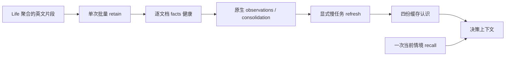

# NPC life 的独立 Hindsight 服务（只测试）

## 2026-10-12 收口状态（当前）

所有本轮驱动已停止，三人已恢复原登记。最后的`npc-happy-path-20261012/run-02`完成30次决策，
三人均实走、观察、交流并记事；最终状态为`failed_cleanup`，原因是记忆检查点等待超时。
松岚仍有6条经历持久保存在Life pending、尚未送入Hindsight；flush busy与刷新完成条件的缺口已记录，未在本轮修复。
因此以下短实验/年度驱动是Test-only实验工具，不能作为“记忆已全部归档”或全年生活完成的证明。
最新证据、角色卡与共享模板设计、后续修复入口统一见
[交接记录](../../docs/10-active/cross-cutting/2026-10-11-npc-next-session.md)和
[设计稿](../../docs/10-active/cross-cutting/2026-10-11-npc-long-horizon.md)。
本轮不再启动模型调用或补跑长期实验；本地`.demo/observe/`保留原始产物，不纳入Git。

合并审查的两项修正只处理已有错误契约：依据正式`Runtime.finish_skill`的`outcome.data.memory_error`，
技能完成但经历写入失败时停止驱动；沿用年度驱动已有的收尾方式，将`trace_stop`失败记入最终`progress.json`，不重试。
最小反例分别以真实技能结果形状调用`step_complete`，以及在临时目录运行零行动场景、令最终checkpoint和trace停止失败，
检查最终`failed_cleanup`及两项原始错误均落盘。外部RPC、模型、记忆服务使用替身；只证明驱动判定和报告，不证明真实归档成功。
复现：`python -B -X utf8 -m unittest discover -s scripts/npc_life -p 'test_*.py'`。

## 2026-10-12 三角色新轮（历史运行记录）

历史上曾恢复为 `run-05`（PID209764，桥接PID209360），该轮已于14:17结束。此前run-04实际完成32步：
7次say尝试中5次接纳、2次conversation_expired拒绝；7次move_to中6次done、1次no_path拒绝，
另有4次survey、6次look、4次remember、3次set_plan、1次inspect，未采集或建造。
其中一次CLI发生TLS断线后重连并返回turn.completed，但桥接把中途error误判为最终失败，run-04于10:46停止。
桥接已修正为以终态判断；恢复重连反例RED→GREEN，失败或缺完成/usage仍拒绝。
该次真实生成36080 token已对账，未交付NPC，未重放；run-04失败记录保持原样。
当时已知历史62960075 token继续纳入基线，旧1次未知usage保留；该轮结果保留在run-05的progress。

当前入口仍是 `hourly_year.py`，角色配置为 `ROLES`，共同提示词唯一正文为 `LIFE_GOAL`。
LifeBuilder / 建设者（607440080896）、松岚 / 探索者（51107598336）、知衡 / 学者（10938748928）
均经正式 Registry → Body → Runtime → Llm → World；每人独立 `npc-life-{cid}` bank。
原两人的存档、库存、关系与旧计划保留，由模型自主修订计划；不写入虚构完成经历。

`codex_bridge.py` 在本机用官方 `codex exec --ignore-user-config --ephemeral --json --output-schema`，
指定 `gpt-6.1-sol / medium`，复用 CLI 自己读取的现有登录，不提取登录令牌。
它适配既有 Responses 消费格式，模型字段是本机 CLI 的指定执行配置，不是 CLI 返回的独立服务器身份字段。
决策与记忆分别走 `/decision/v1/responses`、`/memory/v1/responses`；只使用随机本地桥接凭据，
没有旧付费端点 fallback。CLI 每次无共享聊天上下文，游戏上下文仍由正式 NPC/记忆 owner 提供。
桥接与 Hindsight 不主动重发失败请求；官方 CLI 内部传输行为沿用自身默认，不能声称其内部重试已关闭。
所有 CLI 完成事件及实际 usage（包括 reasoning output）保存于桥接 `calls.jsonl`。

时间按**真实小时统计，小时内连续决策**：非wait动作取得同调用号终态后继续三人轮转，
只有模型自己选择wait才推迟该人的下一次许可；新直接发言由正式 `Dialogue.direct?/2` 判定并提前唤醒。
同小时每次调用均有独立sequence/tag。小时不是动作限额，完整经过3600秒才计入一个完成小时。
World、Scene 身体与 Life 情绪继续各自已有的权威实时时钟，不注入第二套模拟状态。
因此 8760 小时需要约 365 天持续在线；身体营养当前只在伤口修复时消耗，仍不是完整饥饿生存模型。
`completed_decision_rounds` 与 `completed_hours` 分开，等待期间每分钟更新心跳并检查 Life 错误。
停机后没有自动续跑保证；用户休眠、关机、服务退出或模型限额都可能使全年目标无法完成。

该轮产物：`.demo/observe/npc-three-life-20261012/run-05/`；接线证据：
`.demo/observe/npc-codex-20261012/wiring-01/`。`run-01` trace 名冲突、`run-02` 新 bank
在 Life 初始化前查询失败均保留，二者未执行 NPC 决策。当前 trace 包含实验目录与运行目录，避免旧轮命名冲突。
零事实的首份记忆样本及错误 CLI 配置失败也保留；后续明确事件样本产生 2 条 facts 后才启动 NPC。
`run-03`三人首轮各自保存计划后，被错误的每小时一次调度挡住后续行动；用户指出后正式停止，
保留3步、三人的新计划和费用。`run-04`加载同一持久计划与独立记忆，放开连续思考与行动，
建设者已自主调用survey并获done。已知先前成本61577588 token纳入新轮基线，旧未知usage失败保留。

```powershell
python -B -X utf8 scripts/npc_life/hourly_year.py status --out .demo/observe/npc-three-life-20261012/run-05
python -B -X utf8 scripts/npc_life/hourly_year.py stop --out .demo/observe/npc-three-life-20261012/run-05
python -B -X utf8 -m unittest discover -s scripts/npc_life -p test_hourly_year.py
python -B -X utf8 -m unittest discover -s scripts/npc_life -p test_codex_bridge.py
```

验证范围：CLI 指定模型真实预检、真实 Hindsight 抽取、三人正式登记/独立记忆初始化与同命令终态；
11 项驱动测试（模型/终态错误、三人轮转、缺人、跨实验命名、新bank readiness顺序，
保存计划后同小时仍继续三人轮转、只有wait暂停、同小时多调用身份独立），
4 项 CLI 响应边界测试（真实usage、失败/缺终态、记忆JSON文本、重连后成功终态）。
实际NPC对话已有5次接纳含同conversation_id往返；不能据此宣称建设、全年生活或客户端复制完成。
依据：[官方非交互 CLI](https://learn.chatgpt.com/docs/non-interactive-mode)、
[官方登录说明](https://learn.chatgpt.com/docs/auth)、固定 Hindsight 0.10.3
`openai_responses_llm.py`（实际容器源码），及 Scene `Movement.Player` 1 Hz 身体推进契约。

## 8,760 小时自主生活采样（2026-10-11 历史设计，调度已被上文取代）

用户本轮明确指定 `gpt-6.1-sol / medium`、至少一年、按小时推进，并解除总 token 上限。
新入口 `hourly_year.py` 使用正式登记 `life`，`cadence=manual`、`max_requests_per_hour=unlimited`；
每小时两个 NPC 各一次真实决策，先手交替，Body 同调用号终态确认后推进，日检查点封存真实经历。
旧 2,010,947 token 历史与旧计数预检失败保留。原 3,000,000 上限和计数预检不是本轮启动门槛。
对话、决策和 Hindsight 所有生成模型统一到指定配置，实际 usage 持续记账。

模拟日历是决策采样时间：World 物理、权威事件时间与情绪衰减仍走真实时钟，不据此宣称完成全年物理生存。
没有玩家开场、补料或脚本代答；模型自由等待或执行正常能力。HTTP/记忆基础设施失败停后续，普通玩法拒绝保留为经历。
默认自动模式不变；产物包括 `progress.json`、`model-results.jsonl`、`steps.jsonl`、每日检查点与正式请求 trace。
当前进度只能读取本轮 `progress.json`；目标 8,760 不能写作已经完成。

**目标提示词（2026-10-12 更新）**：三名 NPC 的共同长期目标在
[`hourly_year.py`](hourly_year.py) 的 `LIFE_GOAL`，身份描述在 `ROLES`，由`goals_for`组合。
按用户要求改为探索和了解世界、生活、建设、学习，以“为了美好而建设”为方向；
允许自主修订旧守望/休息计划，在完成或休息后选择下一步。修改会在下次 `run` 登记时加载，
不会自动改写已有 NPC 计划、记忆或历史请求。旧 `run-01` 已停止，本次只改目标配置，未重新启动实验。

```powershell
python -B scripts/npc_life/hourly_year.py run --out .demo/observe/npc-year-20261011/run-01 --hours 8760
python -B scripts/npc_life/hourly_year.py status --out .demo/observe/npc-year-20261011/run-01
python -B scripts/npc_life/hourly_year.py stop --out .demo/observe/npc-year-20261011/run-01
python -B -m unittest discover -s scripts/npc_life -p test_hourly_year.py
```

`run` 拒绝覆盖已有目录；`stop` 让当前请求/动作结算后恢复原登记，不发后续小时。
节点重启后 manual NPC 不自行请求模型；本轮不自动重放结果未知的小时，必须先对账已有 trace 与状态。
部署前必须核对同一隔离容器、固定镜像身份、模型实际配置和存档不变，见
[本轮契约与记录](../../docs/10-active/cross-cutting/2026-10-11-npc-long-horizon.md)。

`service.py` 只管理 `voxim-npc-life-loop-20261011`，宿主端口 `18908`，数据卷与模型缓存卷分别为同名前缀的 `-pg` / `-hf`；不操作其它实验服务。容器加入既有 `caplib-20261008-net`，Demo 服务端使用 `http://voxim-npc-life-loop-20261011:8888`；宿主使用 `http://127.0.0.1:18908`。这不是正式生产部署。

```powershell
python -B scripts/npc_life/service.py start
python -B scripts/npc_life/service.py restart
python -B scripts/npc_life/service.py stop
cd apps/npc_server
mix test --no-start test/npc_server/npc_hindsight_test.exs
```

凭证读取同级主树 `../ex_mmo_cluster/.env` 的 `NPC_LLM_URL` / `NPC_LLM_KEY`，只经子进程环境与 `docker -e NAME` 传入；manifest 不含上游地址与密钥。复用固定镜像 `voxim-npc-evolve-hindsight:0.10.3-flashrank`，BGE-small ONNX 的 CLS 与查询前缀以及 FlashRank 配置来自已实跑的 [NpcEvolve/service.py](../../../Voxim/Docs/Gameplay/NpcEvolve/service.py)。新 mutable 数据完全隔离。

HTTP 适配器为 `NpcServer.Life.Hindsight`，config 是 `%{url: root_url, bank: bank_id}`。`ensure/2` 建立独立 bank 与缺失的 self/relationships/world/commitments；已有模型不覆盖。`retain/2` 接受 `%{"id" => stable_id, "text" => english_episode, "at_ms" => unix_ms}` 列表，边界一次映射到第三方文档字段，同步批请求后检查每个文档的 `memory_unit_count > 0`。它报告最近 100 个后台操作；抽取完成与巩固完成是两项事实。`models/1` 只读缓存内容；`refresh/1` 是显式后台运维调用，逐模型等待自己的 operation。`recall/3` 恰好一次 mid-budget、带 query_timestamp 的情境召回。`status/1` 返回 stats、最近操作及按操作聚合的 token，丢弃原始 LLM trace。

单 HTTP 请求缺省 300 秒；每个后台 operation 的总预算缺省 600 秒，轮询请求也受剩余预算约束。错误只返回可诊断分类，不返回外部错误体或私有 URL。所有模型/召回输出标记为主观记忆，不是 World 当前数值真值。



依据与验证：本次对固定镜像的 `/app/api/pyproject.toml`、`hindsight_api/api/http.py` 和运行服务 `/openapi.json` 直接核对（版本 0.10.3）。文档读取采用 `detail=content`；刷新返回 async operation，按 `/operations/{id}` 的 completed/failed/cancelled/not_found 判定。没有假设后续网页版本的 API。源配置实际启用了 observations 与 auto consolidation；启动日志证明 BGE-small 的 ONNX CLS/query prefix 已初始化，FlashRank `ms-marco-MiniLM-L-12-v2` 已初始化。

测试隔离：10 项 HTTP 边界测试只启动 `:inets` 与端口 0 的本地 HTTP 替身，覆盖批次映射、每文档 facts、失败脱敏、缓存只读、单次召回、单请求/operation 超时及模型创建/完成。真实验证仅用独立 `contract-probe-20261011` bank，不写最终 NPC bank；两短文档一次 HTTP batch 仍触发 **两次** LLM 抽取，共输入 20,287 / 输出 659 token、5 facts，召回中同时存在 Brann 破坏与 Mara 修复。生产 Life 应先将短事件聚合成约 3000 字符片段，不能把“一个 HTTP batch”误称“一个抽取调用”。数值/模型表现属于本小样本，不能代替真实 World/Body/双客户端验收。

本次可复现 probe 与原始证据位于 `.demo/observe/npc-life-20261011/hindsight/`：`contract_probe.exs`、`refresh_probe.exs`、`service.json`、`providers.log`、`version.json`、`openapi.json`、retain/recall/status JSON 与刷新产物。复跑真实抽取请使用新 bank 和新输出目录，不覆盖既有证据。

## 单 NPC 双端人生 Demo（只测试）

`demo.py` 绑定本轮唯一正式组合：`voxim-npc-life-demo-20261011`、`server/` 挂载、同一 `LifeBuilder` cid 与独立 bank。只读 import 同级 Voxim 的 R7 `harness`，通过真实认证的两端 `ReplayInputs` 发普通鼠标/键盘意图；`@place` 只摆放测试玩家。输出目录必须为新目录，入口先转绝对路径，避免 Voxim 子进程工作目录改变产物位置。脚本不会伪造情绪、关系、计数或施工方块；初始有限材料走 `World.material_supply`，施工必须由 NPC 自己完成。

```powershell
python -B -m unittest discover -s scripts/npc_life -p test_demo.py
python -B scripts/npc_life/demo.py dry --out .demo/observe/npc-life-20261011/dry-new
python -B scripts/npc_life/demo.py social --out .demo/observe/npc-life-20261011/social-new
python -B scripts/npc_life/demo.py memory --out .demo/observe/npc-life-20261011/memory-new
python -B scripts/npc_life/demo.py restart --out .demo/observe/npc-life-20261011/restart-new
```

这些命令是已经准备好的本轮世界的测试入口，不是通用生产部署。`prepare` 只允许尚未登记 NPC 的世界；`initial-correction` 是本轮首次材料夹具不足的显式纠正入口，不能用它重置已开始的人生。宏木块需要 2,097,152 材料单位。修复的 `@aim_build` 应落在目标空格内部（Y416.01），普通瞄准地表与建造空格不是同一契约。

`judge --sources ... --out ...` 把真实 World seq、actor、格子、两端意图结果与 canonical_applied 相对照。行为还要求同来源实际 XYZ 距离变化与新终态 Outcome，且发生在声明的玩家靠近窗口；加载期的 AOI 触发作为混杂保留，不计控制样本。`authority_accepted`、`behavior_accepted`、`client_authority_accepted` 与 `all_replays_completed` 分开报告。伤害后移动与玩家带旧伤害来源再次靠近后的移动分别标注；done/settled 但 within_tolerance=false 只证明实际接近，不能宣称精确到点。

终态只搜索同一次连续 social 机会及紧邻的 `social=nil` 释放行（兼容 thank 完成），取消/释放后不能借下一次相同来源的 done。输出 `opportunity_id`、`terminal_at_ms`、原 Outcome 身份与实际靠近窗口；开始和完成都须在同一窗口，单终态只能计分一次。首次8项判定器只保存GREEN、原RED证据缺失；复审I1的取消后复用/越窗两个反例先RED（8/10、2失败），修复后11项GREEN，离线新产物为`primary-judge-06/`、`fresh-judge-03/`，原8个受控终态仍独立有效。人格离线复判使用原来公开State产出的距离文件并记录来源/hash，不请求服务或复写生产规则。

`matched-fresh` 先等 NPC 自然停稳，按完整 XYZ 生成玩家距离，再用既有客户端入口靠近一次；末尾东侧相机窗口是独立展示阶段。`fresh-judge` 审计本轮固定前后阶段，从公开 `State.behavior` 派生旧/新距离，要求对照均在旧安全距离外、新谨慎距离内，且后测比前测更远；不能拿 2.684m 的近距离混杂样本冒充人格改变。名义 3.3–3.5m 是选点近似，不是新增生产阈值。

`upgrade --image ...` 仅接受本轮通过构建的 manifest/image ID，检查已有容器挂载与端口，保留 DB/world/bind。测试 wrapper 保持原有 `--user 0:0` 写 readiness/log；生产 `/app/bin/server` 入口不改。`repair-memory` 调用公开纯 State 从同一 World 历史重建文字，确认重建 canonical 相等，替换原来两个相同 document ID，等事实巩固后刷新 Life 缓存；不会把重建心智写回 Life，也不重放状态增量。

依据：UTC 文本使用 [Elixir DateTime.from_unix/3](https://elixir.hexdocs.pm/DateTime.html#from_unix/3) 与 [to_iso8601/3](https://elixir.hexdocs.pm/DateTime.html#to_iso8601/3)，原始 World `at_ms` 保持毫秒精度。固定 Hindsight 0.10.3 镜像源码 `engine/retain/fact_storage.py:205–318` 在替换前删除旧事实衍生 observations；`engine/memories/pg/writes.py:242–330` 清理旧来源关联并将其它 surviving 来源重新排队巩固；`engine/memories/pg/retain.py:217–246` 删除该文档所有 memory units（含 chunk_id=NULL）后同 ID 写回，保留 created_at。相同 hash 是去重，UTC ISO 文本改变 hash 后才真正重新抽取。本轮最终仍只有两个文档，没有新建另一 bank 或重置心智。

`llm` 是同 cid 的单次正式接线检查，目标为自然维护施工，保留全部真实能力组，预算 1/h。复用 `scripts/npc_soak_trace.exs` 的既有脱敏 trace，只增加模型哈希、召回摘要与工具/用量，不保存 endpoint/key。请求完成后停止探针，`restore` 恢复建设者；不以请求成功宣称记忆产生了行为因果。

本轮实跑：六次损害评价、六次修复帮助；三个受控回避和五个实际接近样本，两次无伤害控制、两次重启后陌生人谨慎移动。首次相对路径、材料不足、修复瞄准失败、模型时间污染、第二次陌生人距离失配与部署 wrapper 用户失败全部保留。更正后的四模型已人工复核，Hindsight 的帮助事实范围仍存在 +10ms 派生偏差；权威原事件/ISO经历不偏移。唯一 LLM 请求选择 look 并完成，输入8303/输出45 token；上下文接线通过，LLM 记忆行为因果未证明。

最终证据索引为 `.demo/observe/npc-life-20261011/final-04/manifest.json`：主行为 `primary-judge-07/`、人格 `fresh-judge-03/`、冷重启 `restart-01/`、模型 `memory-corrected-01/`、决策 `llm-01/`、恢复 `restore-01/`，最终修复镜像接入 `upgrade-final-01/`。主判定的 `provenance.json` 记录完整三份 authority 输入、命令及最终脚本哈希；旧判定保留。详细阶段报告、最终审查和验证日志在 `validation/`。真实截图 `fresh-matched-01/shots/npc-life.001.png` 显示完整 LifeBuilder。五轮双端进程场景共约16.11分钟（两进程时长之和约32.06分钟），超出约10分钟目标，原因是失败重试与一次最小补验；成功原主循环与首轮陌生人场景共约8.86分钟，没有客户端长跑或小时级 soak。

时间限制保持未达。已有默认 social/fresh 定长复跑入口，但默认 fresh 的第二次短间隔曾失配，尚无完整通过全部重复门槛且约10分钟的已实跑短路径；8.86分钟的局部成功不包含第二有效人格样本。本轮复审只离线判定，不用追加运行抵消历史超时。

独立 `contract-probe-20261011` 的真实后台验证：巩固新增 5 observations，输入 12,789 / 输出 374 token；四模型显式刷新共 16 次 reflect 工具调用，输入 136,106 / 输出 1,577 token。人工核对 relationships 的 Brann 破坏/Mara 修复因果正确，world 未捏造坐标，commitments 如实说明无承诺。初始化空库四模型的 completed 操作未产生 LLM 请求（0 token）；这只证明当前固定镜像空事实的短路行为，不能推广到有历史事实的 ensure。探针与真实NPC费用分别列于 `final-01/cost-summary.json`，未提供模型计费单价，不虚构美元费用。
# 长期自洽续验

**当前预算/自主对话入口（2026-10-11）**：正式 `say` 已进入共同能力库，默认life档案可与生活工具一起选择。
`budget_proxy.py` 为 Test-only 决策/记忆统一出口，账本基线2010947、追加授权后的总上限3000000；不含凭证或请求正文。
`budget_service.py setup` 先用已保存的真实请求/usage核验兼容服务的精确计数契约，再按原镜像ID重建本任务容器接入出口。
当前预检失败（实际10294、count11694，另有502），所以未部署、未切换NPC，不得把本地预算单测通过当作已接通付费门禁。
`live_autonomy.py --out <新运行ID> --seconds 560` 为准备中的单次两NPC/双端交談→两轮有限材料修复驱动，仅使用Hello40隔离客户端；
首个阶段失败关闭出口并停止后续，结束恢复原settler登记且不启用life后台。旧驱动 `autonomy.py`/`long_horizon.py live` 的软预算路径不是当前付费验收入口。
只读核验与失败证据在 `.demo/observe/npc-autonomy-20261011/resume-01/`；后续先解决计数契约，禁止删库、改基线或重采样覆盖失败。

当前阶段成果使用独立登记名 `brain: "life"`；下面的 freeze/pairs/live 入口均使用该组合，原始实跑证据保持原提交身份。接入说明见生产 `apps/npc_server/lib/npc_server/README.md`。

`long_horizon.py freeze --out pairs-input-01` 固定真实 Life 缓存与一次召回；
`pairs --source pairs-input-01 --out pairs-results-01` 按预登记的六组自传身份互换运行12请求，不执行结果，不写回真实记忆。
`live --out live-01 --seconds 420` 在正式 Brain/Body 运行同一 NPC，最多24请求，结束恢复 settler 并保留自主意图；
`clients --out clients-01` 是同时运行的一次真实双端伤害/修复短场景（170秒输入）。
驱动复用命名 `@await_peer`：核对 A 本轮3笔成功意图与同角色/格/事务的 World damage/destroy 后才放行 B，B 的 build 确认后才结束 A；首次拒绝、证据错配或超时写 abort，原日志保留。`live` 的恢复不依赖最终 Life/World 观察成功；恢复失败写错误并停用本任务登记，trace/尾部取证仍独立执行，异常不伪装成功。
离线反例及驱动接线验证：`python -B -m unittest discover -s scripts/npc_life -p test_long_horizon.py`（进程、网络替身，无真实模型调用）。
只能在已由 `demo.py` 建立的本轮独立服务运行，输出在 `.demo/observe/npc-long-horizon-20261011/`，拒绝覆盖旧运行。
`decision_trace.exs` 只保存无凭证请求体、工具响应和 usage；key 始终留在进程环境。
验收边界及失败保留见 `docs/10-active/cross-cutting/2026-10-11-npc-long-horizon.md`。

续验最终证据：`.demo/observe/npc-long-horizon-20261011/final-01/manifest.json`。原驱动`0843fa0e`的真实22决策（13个Body done、2个no_path、7个本地wait）、双端4笔事务及计划修订可用`audit-01/verify.py`离线对账。6组配对只证明组合自传上下文影响合作意向，未执行合作动作；30天只用受控服务端时钟，非连续模型挂机。模型自写计划/笔记及心智在完整服务冷重启后严格保留。失败门禁修复`4b06b564`只做离线反例与驱动接线验证，实跑证据版本不改写。
# 邻里植物散步 happy path（2026-10-12）

`happy_path.py --out <新目录>` 复用三名现有角色，运行“发现并分享植物点 → 访问邻居介绍的点”两段短场景。
每段600秒内最多发起24次决策，已发动作等正常终态；记录真实动作、对话、笔记，结束恢复原登记。
前提是本任务三角色处于非Life登记、已有持久认识缓存、本机27365桥接已运行，独立Demo与Hindsight沿用原配置。
不注入故障、不补资源、不改写记忆；模型/基础设施错误停止，不自动重试或切模型。
`hourly_year.step`接受可选`context`，短场景传自己的目标，旧年度入口默认上下文保持原样。
实验期间写`<新目录>/STOP`可在当前动作结算后停止；进度、两阶段检查点与模型usage保存在输出目录。
