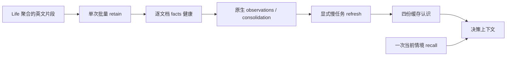

# NPC life 的独立 Hindsight 服务（只测试）

`service.py` 只管理 `voxim-npc-life-loop-20261011`，宿主端口 `18908`，数据卷与模型缓存卷分别为同名前缀的 `-pg` / `-hf`；不操作其它实验服务。容器加入既有 `caplib-20261008-net`，Demo 服务端使用 `http://voxim-npc-life-loop-20261011:8888`；宿主使用 `http://127.0.0.1:18908`。这不是正式生产部署。

```powershell
python -B scripts/npc_life/service.py start
python -B scripts/npc_life/service.py restart
python -B scripts/npc_life/service.py stop
cd apps/gate_server
mix test --no-start test/gate_server/npc_hindsight_test.exs
```

凭证读取同级主树 `../ex_mmo_cluster/.env` 的 `NPC_LLM_URL` / `NPC_LLM_KEY`，只经子进程环境与 `docker -e NAME` 传入；manifest 不含上游地址与密钥。复用固定镜像 `voxim-npc-evolve-hindsight:0.10.3-flashrank`，BGE-small ONNX 的 CLS 与查询前缀以及 FlashRank 配置来自已实跑的 [NpcEvolve/service.py](../../../Voxim/Docs/Gameplay/NpcEvolve/service.py)。新 mutable 数据完全隔离。

HTTP 适配器为 `GateServer.Npc.Life.Hindsight`，config 是 `%{url: root_url, bank: bank_id}`。`ensure/2` 建立独立 bank 与缺失的 self/relationships/world/commitments；已有模型不覆盖。`retain/2` 接受 `%{"id" => stable_id, "text" => english_episode, "at_ms" => unix_ms}` 列表，边界一次映射到第三方文档字段，同步批请求后检查每个文档的 `memory_unit_count > 0`。它报告最近 100 个后台操作；抽取完成与巩固完成是两项事实。`models/1` 只读缓存内容；`refresh/1` 是显式后台运维调用，逐模型等待自己的 operation。`recall/3` 恰好一次 mid-budget、带 query_timestamp 的情境召回。`status/1` 返回 stats、最近操作及按操作聚合的 token，丢弃原始 LLM trace。

单 HTTP 请求缺省 300 秒；每个后台 operation 的总预算缺省 600 秒，轮询请求也受剩余预算约束。错误只返回可诊断分类，不返回外部错误体或私有 URL。所有模型/召回输出标记为主观记忆，不是 World 当前数值真值。



依据与验证：本次对固定镜像的 `/app/api/pyproject.toml`、`hindsight_api/api/http.py` 和运行服务 `/openapi.json` 直接核对（版本 0.10.3）。文档读取采用 `detail=content`；刷新返回 async operation，按 `/operations/{id}` 的 completed/failed/cancelled/not_found 判定。没有假设后续网页版本的 API。源配置实际启用了 observations 与 auto consolidation；启动日志证明 BGE-small 的 ONNX CLS/query prefix 已初始化，FlashRank `ms-marco-MiniLM-L-12-v2` 已初始化。

测试隔离：10 项 HTTP 边界测试只启动 `:inets` 与端口 0 的本地 HTTP 替身，覆盖批次映射、每文档 facts、失败脱敏、缓存只读、单次召回、单请求/operation 超时及模型创建/完成。真实验证仅用独立 `contract-probe-20261011` bank，不写最终 NPC bank；两短文档一次 HTTP batch 仍触发 **两次** LLM 抽取，共输入 20,287 / 输出 659 token、5 facts，召回中同时存在 Brann 破坏与 Mara 修复。生产 Life 应先将短事件聚合成约 3000 字符片段，不能把“一个 HTTP batch”误称“一个抽取调用”。数值/模型表现属于本小样本，不能代替真实 World/Body/双客户端验收。

本次可复现 probe 与原始证据位于 `.demo/observe/npc-life-20261011/hindsight/`：`contract_probe.exs`、`refresh_probe.exs`、`service.json`、`providers.log`、`version.json`、`openapi.json`、retain/recall/status JSON 与刷新产物。复跑真实抽取请使用新 bank 和新输出目录，不覆盖既有证据。

真实后台验证已完成：巩固新增 5 observations，输入 12,789 / 输出 374 token；四模型显式刷新共 16 次 reflect 工具调用，输入 136,106 / 输出 1,577 token。人工核对 relationships 的 Brann 破坏/Mara 修复因果正确，world 未捏造坐标，commitments 如实说明无承诺。初始化空库四模型的 completed 操作未产生 LLM 请求（0 token）；这只证明当前固定镜像空事实的短路行为，不能推广到有历史事实的 ensure。分项在 `cost-summary.json`，未提供模型计费单价，不虚构美元费用。
